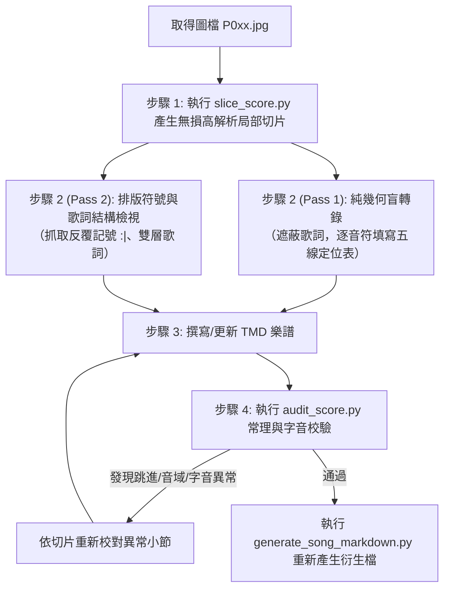

# 歷史唱歌樂譜防幻覺轉錄與校對專家（Shōka Score Grounding）

本 Skill 是專為本專案設計的樂譜光學結構化與防幻覺轉錄工作流。
當處理日治時期臺灣教育會《新定兒童唱歌》、總督府各時期《公學校唱歌集》等古籍掃描圖檔時，**嚴禁依賴整頁縮圖裸眼辨識，亦嚴禁調取模型內部傳唱記憶或預訓練旋律**。

---

## 核心防幻覺原則（Grounding Directives）

1. **唯一資料來源（Single Source of Truth）**：
   * 圖檔像素是唯一事實。圖上沒有的音符、休止符、反覆記號，嚴禁自作聰明補全。
2. **阻斷先驗知識（Anti-Prior Rule）**：
   * 歌名去語意化。不要因為看到《春の小川》或《菅公》就直覺帶入民間旋律或西洋自然小調套路。
3. **拒絕削足適履（No Lyric-Melody Compromise）**：
   * 絕不能因為歌詞字數與音符數看似不合，就自行修改音符時值或添加破折號 `-`。
4. **歷史假名遣絕對保留（Historical Kana Preservation）**：
   * 戰前出版物一律使用歷史假名遣（如「さへぎる」「けふ」「くわん」「せちゑ」）與舊字體，嚴禁自動現代化，嚴禁私自補上濁點或修改大小寫（詳見 [歷史假名遣指南](./references/historical_kana.md)）。

---

## 轉錄與校對標準作業流程（SOP）



### 步驟 1：執行高解析切片工具（切斷縮圖模糊陷阱）

在大圖模式下，多模態模型會自動下採樣，五線與墨暈黏在一起。**必須先切出 100% 原始解析度單行切片**：

```bash
python3 .agents/skills/shoka-score-grounding/scripts/slice_score.py path/to/song_dir -o /tmp/slices
```

這會輸出：
* `staff_1.png` ~ `staff_4.png`：各行五線譜與歌詞切片
* `bottom_lyrics.png`：底欄全文歌詞切片

### 步驟 2：雙通道解耦轉錄（Two-Pass Decoupling）

#### 通道 A（Pass 1：純五線幾何判定）
轉錄每一小節時，暫時忽略歌詞，只觀察五線與符頭中心：
* **五線基底確認**：由下而上記為第 1 線（E4）、第 2 線（G4）、第 3 線（B4）、第 4 線（D5）、第 5 線（F5）。
* **符桿方向輔助判定**：
  * 第三線（B4）及以上：符桿通常**向下**。
  * 第三線（B4）以下：符桿通常**向上**。
* **思維鏈表格（Grid CoT）**：遇有模糊小節，在思考過程中輸出定位表：
  | 小節 | 音序 | 符頭中心位置 | 符桿方向 | 空心/實心 | 判定音高 |
  | :--- | :--- | :--- | :--- | :--- | :--- |
  | m.2  | 1    | 第一間（F#4） | 向上 | 實心 | `7_` |
  | m.2  | 2    | 第二線（G4）  | 向上 | 實心 | `1`  |

#### 通道 B（Pass 2：排版與結構審查）
* **歷史假名與正字檢驗**：確認保留「さへぎる」「くわん」「せちゑ」等歷史假名遣，以及大字拗音（如「シヨ」「きつ」）、無濁點（「むら雲（くも）」）與舊字體（「會」「眞」「拜」），嚴禁轉為現代正寫法。
* **反覆記號搜尋**：檢查第 8 小節末尾或段落末尾是否有反覆記號 `|:` / `:|`。
* **雙層歌詞識別**：若音符下方出現上下兩排日文假名（Double-decker），代表前 8 小節反覆演唱兩遍（第 1 遍與第 2 遍），第 9~16 小節有獨立歌詞，**嚴禁混淆**！

### 步驟 3：撰寫或修改 TMD 檔案

編輯主旋律 `.tmd`：
* Metadata 標籤（詳見 [Metadata 標籤與「歌曲來源系譜」分類規範](./references/metadata_tags.md)）：
  * 基本書目：`collection:`、`volume:`、`source:`、`source_page:`、`provenance:`、`evidence:`、`version:`。
  * 若採用歷史假名遣，加入 `~ "tag: orthography:historical_kana"`。
  * **歌曲來源系譜（`~ "tag: origin:<類別>"`，支援多重來源複選）**：依文獻考證標註 `monbusho`、`meiji_textbook`、`western_melody`、`taisho_showa_mainland`、`taiwan_official`、`taiwan_teacher`、`taiwan_contest_1933`、`traditional_east_asian` 或 `unidentified`。
  * **主題標籤（`~ "tag: theme:<主題>"`，支援複選）**。
* 調號（`?=`）與明確調性標註（`key=`）
* 拍號（`<4/4>`、`<2/4>`、`<3/4>`）
* 每小節以 `| ... |` 嚴格包覆，時值總和精確相符。

### 步驟 4：執行專屬防幻覺與常理審查工具

```bash
python3 .agents/skills/shoka-score-grounding/scripts/audit_score.py path/to/song.tmd
```

此工具會自動檢查：
1. `tmd check` 拍數平衡。
2. **異常大跳警示**：非八度的突兀七度、九度大跳（通常是高低八度看錯）。
3. **尋常小學校音域界限**：國小童聲是否超標（低於 A3 或高於 F5）。
4. **字音平衡校驗**：歌詞註解之字數是否與小節發聲音符數 1:1 吻合（防湊字與漏字）。

若審查出現警告，**必須回到對應小節的切片圖重新確認**。

### 步驟 5：重新產生歌曲 Markdown 與音訊

確認無誤後，透過專案產生器更新：

```bash
python3 scripts/generate_song_markdown.py --force path/to/song_dir
```

---

## 參考文獻與專題手冊

* [Re:shōka `.tmd` Metadata 標籤與「歌曲來源系譜」分類規範（`tag: origin:` 多重來源體系與 `tag: theme:` 主題代碼）](./references/metadata_tags.md)
* [歷史假名遣轉錄指南與常見對照手冊（ハ行轉呼音、合拗音、濁點省略、舊字體）](./references/historical_kana.md)
* [日治時期學校唱歌音階與旋法手冊（都節音階、律音階、四七拔）](./references/scales_and_modes.md)
* [歷史活字鉛版印刷缺陷與排版陷阱手冊（肥符頭、墨暈、斷線、雙層歌詞）](./references/notation_defects.md)
