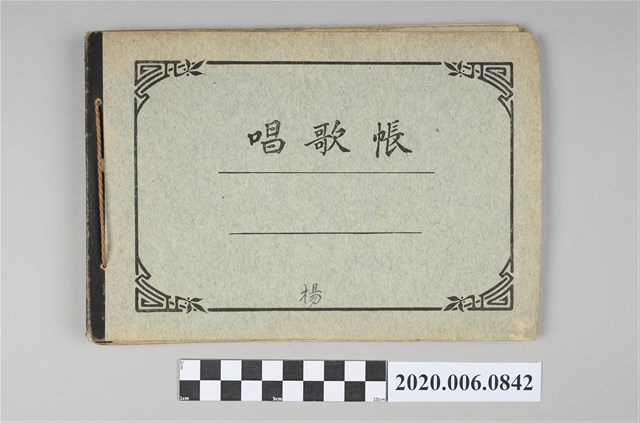
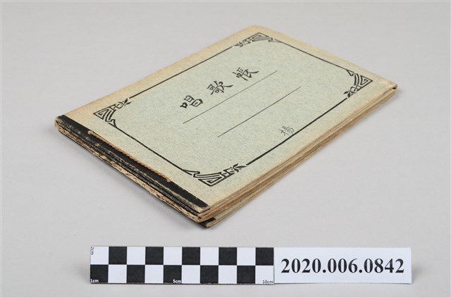
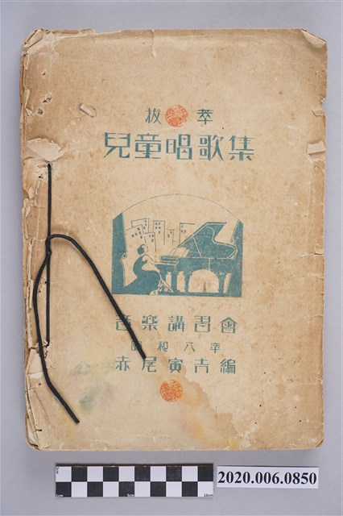

# 延伸館藏與日本國會圖書館（NDL）數位影像調查筆記

本文件記錄在完成《公學校唱歌》第三學年、《新定兒童唱歌》全 8 冊及《楊金土手抄唱歌帖》7 冊（共 16 冊 638 首）數位重建後，針對**國立臺灣歷史博物館（NMTH）同批鄰近館藏區段**、**國家文化記憶庫（TCMB）**、**國立臺灣圖書館（NTL）**以及**日本國立國會圖書館（NDL Digital Collections / 次世代デジタルライブラリー）**所進行的延伸史料與數位影像調查。

---

## 一、臺史博 `2020.006.0840`～`0864` 同批入藏區段完整清查

臺史博館藏號 `2020.006.0841` 至 `2020.006.0856` 均於 **2021 年 1 月 14 日同一批完成編目登錄**。逐號檢視該區段之詮釋資料與影像檔後，確認此批入藏文物為同一脈絡之日治時期音樂教育與手抄歌本史料，更從中發現了**楊金土手抄本疑似佚失第 4～6 冊（`2020.006.0842`）**的重要實體線索：

| 臺史博典藏號 | 館藏名稱 | 年代 | 內容考證與重要發現 | 線上數位化狀態與圖檔路徑 |
| :--- | :--- | :--- | :--- | :--- |
| **[`2020.006.0841`](https://collections.nmth.gov.tw/CollectionContent.aspx?a=132&rno=2020.006.0841)** | **株式會社文運堂發行《唱歌帳》** | 昭和時期 | 大阪市東區博勞町二丁目「株式會社文運堂」（代表者山本留次）印行之直式五線譜作業本（`A NO. 14`，表紙共 18 枚，定價金五錢），封底印有大象踩地球「登録商標」與「授業時間表」。 | 僅有外觀照 4 張（[`20200060841_I001.jpg`](images/20200060841_I001.jpg)～[`I004.jpg`](images/20200060841_I004.jpg)），尚未掃描內頁 `P` 檔 |
| **[`2020.006.0842`](https://collections.nmth.gov.tw/CollectionContent.aspx?a=132&rno=2020.006.0842)** | **楊《唱歌帳》** | 大正～昭和初期 | **重大發現**：橫式灰色封面《唱歌帳》（封底印有大象地球商標 `BK. NO. 5.` 及「甲種九號」授業時間表），封面正下方以毛筆／鉛筆手寫 **「楊」** 字。由側面照（[`20200060842_I003.jpg`](images/20200060842_I003.jpg)）可見**實際上共有 3 本同款橫式《唱歌帳》疊放（總厚度 1.4 公分、重 151.8g）**！對照楊金土在 `2020.006.0843` 第 1 冊扉頁（[`P115.jpg`](../shokacho/vol_01/0_book_info/P115.jpg)）親筆留下的第 `1.`～`6.` 冊總目錄，`0843` 僅含第 `1`、`2`、`3`、`7`、`8`、`10` 冊而獨缺第 `4`、`5`、`6` 冊（共 3 冊），**此編號 `2020.006.0842` 的 3 本「楊《唱歌帳》」極可能就是楊金土原編第 4、5、6 冊實體！** | 僅有外觀照 4 張（[`20200060842_I001.jpg`](images/20200060842_I001.jpg)～[`I004.jpg`](images/20200060842_I004.jpg)），**尚未掃描內頁 `P` 檔**（極具向臺史博申請數位化調閱之價值） |
| **[`2020.006.0843`](https://collections.nmth.gov.tw/CollectionContent.aspx?a=132&rno=2020.006.0843)** | **《唱歌帖》六冊合集** | 1923–1928 | **已全數重建收錄於本計畫**：楊金土手抄《唱歌帖》原編第 `1`、`2`（`II`）、`3`（`I`）、`7`（`VII`・蓬萊唱歌集上）、`8`（`VIII`・蓬萊唱歌集下）、`10`（`X`）冊，共 195 首樂曲。詳見 [考證與研究筆記](../shokacho/research_notes.md)。 | **全書 259 頁高解析掃描**（`20200060843_P001.jpg`～`P259.jpg`） |
| **[`2020.006.0844`](https://collections.nmth.gov.tw/CollectionContent.aspx?a=132&rno=2020.006.0844)** | **《唱歌帖》支那曲** | 1927 年 7 月 | **已全數重建收錄於本計畫**：楊金土手抄《唱歌帖》原編第 `9`（`IX`）冊，收錄〈思春〉、〈柬甫寨人の戲曲〉、〈小紅桃〉、〈安南行進曲〉4 首五線譜。詳見 [第 9 冊總覽](../shokacho/vol_09/index.md)。 | **全書 14 頁高解析掃描**（`20200060844_P001.jpg`～`P014.jpg`） |
| **[`2020.006.0845`](https://collections.nmth.gov.tw/CollectionContent.aspx?a=132&rno=2020.006.0845)** | **《唱歌帖》空白本（2 冊）** | 昭和初期 | 與楊金土第 2、3、7、8、9、10 冊完全同款之深灰色直式五線譜《唱歌帖》筆記本（共 2 冊，內頁空白未抄寫）。 | **有全頁掃描 14 頁**（`https://collections.culture.tw/files/11/JPG/20200060845_P001.jpg`～`P014.jpg`，皆為空白五線譜頁）及外觀照 `I001`–`I003` |
| **[`2020.006.0846`](https://collections.nmth.gov.tw/CollectionContent.aspx?a=132&rno=2020.006.0846)** | **林月琴《寒假溫習》** | 日治時期 | 公學校寒假作業簿（非樂譜）。 | 外觀照 |
| **[`2020.006.0847`](https://collections.nmth.gov.tw/CollectionContent.aspx?a=132&rno=2020.006.0847.0001)～[`0849`](https://collections.nmth.gov.tw/CollectionContent.aspx?a=132&rno=2020.006.0849)** | **日本教育唱歌研究會編《新定兒童唱歌》全 8 冊** | 1932–1934 | **已全數重建收錄於本計畫**：尋常科第 1～6 學年（`0847.0001`～`0006`）、高等科男子用（`0848`）、高等科女子用（`0849`），共 8 冊 424 首。 | **全套 811 頁高解析掃描** |
| **[`2020.006.0850`](https://collections.nmth.gov.tw/CollectionContent.aspx?a=132&rno=2020.006.0850)** | **赤尾寅吉編《拔萃兒童唱歌集》** | 昭和 8 年（1933） | **極重要臺灣音樂教育史料**：封面印有女子彈奏平台鋼琴圖案，題「拔萃 兒童唱歌集／音樂講習會／昭和八年／赤尾寅吉編」（厚達 2.1 公分、重 390.5g）。編者**赤尾寅吉**（1878–？，日本長野縣人，東京音樂學校畢業，與一條慎三郎同鄉兼校友）於 1916 年來臺任臺北第三高女（今中山女高）音樂教諭，並兼任臺灣總督府公學校唱歌科教材調查委員。本書彙集新竹州竹南郡教育會、中壢公學校等臺灣各地音樂舞蹈講習會教材精華。 | 僅有外觀照 3 張（[`20200060850_I001.jpg`](images/20200060850_I001.jpg)～[`I003.jpg`](images/20200060850_I003.jpg)），**尚未掃描內頁 `P` 檔** |
| **[`2020.006.0851`](https://collections.nmth.gov.tw/CollectionContent.aspx?a=132&rno=2020.006.0851)** | **竹南郡矯風會主辦〈音樂舞蹈表演單〉** | 昭和 8 年（1933）8 月 27 日 | 與 `2020.006.0850` 同批入藏之音樂舞蹈晚會節目單。 | 外觀照 `I001`–`I002` |
| **[`2020.006.0853`](https://collections.nmth.gov.tw/CollectionContent.aspx?a=132&rno=2020.006.0853)** | **雲霞江山樓音樂團唱片《小上坆》** | 日治時期 | 大稻埕江山樓藝旦南管／北管蟲膠唱片。 | 唱片盤面照 |
| **[`2020.006.0855`](https://collections.nmth.gov.tw/CollectionContent.aspx?a=132&rno=2020.006.0855)** | **臺灣總督府著《公學校唱歌》第三學年用** | 1934 初版／1942 十二版 | **已全數重建收錄於本計畫**：全冊 15 首曲目。詳見 [公學校唱歌第三學年總覽](../kogakko_shoka/grade_3/index.md)。 | **全書 45 頁高解析掃描**（`20200060855_P001.jpg`～`P045.jpg`） |
| **[`2020.006.0856`](https://collections.nmth.gov.tw/CollectionContent.aspx?a=132&rno=2020.006.0856)** | **學校遊戲研究會編《遊戲與唱歌》4 月號** | 昭和 13 年（1938） | 第 143 號期刊，臺中州大肚公學校舊藏，含幼稚園至高年級遊戲唱歌、新曲推薦與兒童劇。 | 僅有外觀照 3 張（`20200060856_I001.JPG`～`I003.JPG`） |
| **`2020.006.0857`～`0864`** | **戰後初期大酒家歌本與時局歌集（共 8 冊）** | 戰後初期 | 包含琥珀出版社《黑美人大酒家民謠歌集》（`0857`、`0861`）、《美人座大酒家民謠歌集》（`0858`）、《滿翠樓大酒家民謠歌集》（`0859`）、樂美大酒家《中日歌謠精選》（`0860`）、美華閣《中日民謠集》（`0862`）、《皇后大酒家中日民謠集》（`0863`）、林正雄編《最新時局歌與名歌集》（`0864`）。 | 外觀與局部翻拍照 `I001`–`I007` |

### 附圖：`2020.006.0842` 楊《唱歌帳》（3 冊疊放）與 `2020.006.0850` 赤尾寅吉《拔萃兒童唱歌集》

| `2020.006.0842` 楊《唱歌帳》封面（手寫「楊」字） | `2020.006.0842` 側面照（可見 3 冊橫式筆記本疊放） | `2020.006.0850` 赤尾寅吉編《拔萃兒童唱歌集》（1933） |
| :---: | :---: | :---: |
|  |  |  |

---

## 二、臺灣其他已數位化／館藏之總督府官頒唱歌課本

除上述 `2020.006.08xx` 區段外，透過檢索國家文化記憶庫（TCMB）、臺史博與國立臺灣圖書館，另確認以下日治時期臺灣總督府官頒唱歌教科書館藏：

### 1. 臺史博 [`2006.006.0878`](https://collections.nmth.gov.tw/CollectionContent.aspx?a=132&rno=2006.006.0878) 臺灣總督府編纂《唱歌課本》下卷（『うたのほん 下』，1943 年）—— **已有全書 61 頁逐頁掃描！**

- **國家文化記憶庫連結**：[`11000043358`](https://tcmb.culture.tw/zh-tw/detail?indexCode=MOCCOLLECTIONS&id=11000043358)
- **臺史博典藏號**：[`2006.006.0878`](https://collections.nmth.gov.tw/CollectionContent.aspx?a=132&rno=2006.006.0878)
- **歷史背景**：昭和 16 年（1941）臺灣總督府將小學校與公學校統一改制為「國民學校」後，於昭和 17 年（1942）3 月發行國民學校低年級用『ウタノホン 上』、昭和 18 年（1943）3 月發行『うたのほん 下』。此冊即為日治末期最後一代官頒低年級唱歌課本。
- **全頁高解析掃描圖檔 URL 規則（共 61 頁內頁 `P001`–`P061` ＋ 3 張外觀照 `I001`–`I003`）**：
  - 高解析原圖（`JPG`）：
    `https://collections.culture.tw/files/11/JPG/20060060878_P001.jpg` ～ `https://collections.culture.tw/files/11/JPG/20060060878_P061.jpg`
  - 批次下載指令：
    ```bash
    for i in $(seq -w 1 61); do
      curl -skL "https://collections.culture.tw/files/11/JPG/20060060878_P0${i}.jpg" -o "P0${i}.jpg"
    done
    ```

### 2. 臺史博其他《公學校唱歌》相關館藏（目前僅公開外觀／局部照）

| 館藏號 | 國家文化記憶庫 ID | 館藏名稱 | 說明與圖檔狀態 |
| :--- | :--- | :--- | :--- |
| **[`2019.014.0641`](https://collections.nmth.gov.tw/CollectionContent.aspx?a=132&rno=2019.014.0641)** | [`11000172589`](https://tcmb.culture.tw/zh-tw/detail?indexCode=MOCCOLLECTIONS&id=11000172589) | **臺灣唱歌研究會編著《公學校唱歌 伴奏及解說》** | 對應總督府《公學校唱歌》之教師用雙手風琴／鋼琴伴奏譜與教學解說（線上公開 5 張局部照 `I001`–`I005`） |
| **[`2020.014.0007`](https://collections.nmth.gov.tw/CollectionContent.aspx?a=132&rno=2020.014.0007)** | — | **臺灣總督府《公學校唱歌》第三學年用（1935 二版）** | 士林公學校學生「郭燦坤」舊藏（5 張外觀照） |
| **[`2004.007.0365`](https://collections.nmth.gov.tw/CollectionContent.aspx?a=132&rno=2004.007.0365)** | [`11000028571`](https://tcmb.culture.tw/zh-tw/detail?indexCode=MOCCOLLECTIONS&id=11000028571) | **臺灣總督府《公學校唱歌》第四學年用** | 紅黑鳳梨小鳥封面，舊藏者「劉永富」（3 張外觀照） |
| **[`2004.007.0366`](https://collections.nmth.gov.tw/CollectionContent.aspx?a=132&rno=2004.007.0366)** | [`11000028573`](https://tcmb.culture.tw/zh-tw/detail?indexCode=MOCCOLLECTIONS&id=11000028573) | **臺灣總督府《公學校唱歌》第五學年用** | 紅黑鳳梨小鳥封面（3 張外觀照） |
| **[`2004.007.0367`](https://collections.nmth.gov.tw/CollectionContent.aspx?a=132&rno=2004.007.0367)** | — | **臺灣總督府《公學校唱歌》第六學年用** | 紅黑鳳梨小鳥封面，舊藏者「劉永富」（3 張外觀照） |
| **[`2022.027.0010`](https://collections.nmth.gov.tw/CollectionContent.aspx?a=132&rno=2022.027.0010)** | [`11000200036`](https://tcmb.culture.tw/zh-tw/detail?indexCode=MOCCOLLECTIONS&id=11000200036) | **《公學校唱歌》第六學年用（歌詞本）** | 收錄〈明治天皇御製〉、〈瀨戶內海〉、〈胡蝶蘭〉等 20 首歌詞（4 張外觀照） |

### 3. 國立臺灣圖書館（日治時期圖書影像系統）与國立臺灣文學館

- **大正 4 年（1915）臺灣總督府發行、一條慎三郎（宮島慎三郎）主編《公學校唱歌集》（全一冊，共 46 首）**：
  - 典藏於**國立臺灣圖書館**（原臺灣總督府圖書館舊藏，[臺灣學數位圖書館書目 `xItem=16172`](https://wwwacc.ntl.edu.tw/sp.asp?xdurl=MP15AP/BOOK_CP.asp&xItem=16172&ctNode=1427&mp=15)）。
  - 全書收錄六個學年共 46 首曲目（29 首選自日本內地唱歌集、17 首為臺灣新編曲目，多由一條慎三郎作曲），為臺灣史上第一部官頒音樂教科書。
- **國立臺灣文學館藏《詩歌（選本附白話字）》**：
  - 國家文化記憶庫連結：[`26000255952`](https://tcmb.culture.tw/zh-tw/detail?indexCode=MOCCOLLECTIONS&id=26000255952)（臺文館典藏號 `NMTL20080360303`，線上共有 **101 張全頁掃描圖檔**）。
  - 內容前半部為 50 首漢字福音詩歌（四部合唱五線譜＋第一部數字簡譜對照），後半部為其中 44 首之**臺語白話字（Pe̍h-ōe-jī）歌詞與單聲部簡譜**（註：记忆庫標示圖片授權為「僅限公開瀏覽」）。

---

## 三、日本國立國會圖書館（NDL Digital Collections）數位影像調查

### 1. NDL 對臺灣總督府官頒唱歌課本之館藏確認（協同參考資料庫 `1000062244`）

根據日本國立國會圖書館「レファレンス協同データベース」編號 [`1000062244`](https://crd.ndl.go.jp/reference/entry/reference/show?id=1000062244)（*「台湾総督府発行の『公学校唱歌集』『ウタノホン』『初等科音楽』……の所蔵の有無」*）之官方調查紀錄：
- **日本國會圖書館（NDL）並未入藏**臺灣總督府發行的《公學校唱歌集》（1915）、《ウタノホン 上／うたのほん 下》（1942–1943）或《初等科音樂》（1944）。
- 日本國內目前確認典藏 1915 年臺灣總督府《公學校唱歌集》原件的機構為**筑波大學附屬圖書館**。

### 2. 楊金土《唱歌帖》與《蓬萊唱歌集》引用之日本原典歌本（NDL 網際網路公開・公有領域 IIIF 影像）

雖然 NDL 未藏臺灣總督府印行的課本，但楊金土在《唱歌帖》各冊及《蓬萊唱歌集》頁角標註抄錄出處的**明治、大正時期日本原典唱歌集與童謠集**，在 NDL Digital Collections（及 [NDL Lab 次世代デジタルライブラリー](https://lab.ndl.go.jp/dl/)）上**皆已列為「インターネット公開（保護期間満了）」**，不僅完全無版權限制，且提供原版**雙手鋼琴／風琴伴奏五線譜**與標準 **IIIF API**：

| 楊金土手抄本／《蓬萊唱歌集》標註出處 | 日本國會圖書館（NDL）數位典藏書目 | NDL PID 與線上閱覽連結 | 頁數（コマ数） | 與本資料庫之對照價值 |
| :--- | :--- | :--- | :---: | :--- |
| **《大正幼年唱歌》**<br>（見《唱歌帖》第 2 冊多首童謠，如〈オサル〉、〈トンボ〉、〈ヒヨコ〉、〈汽車ハ早イ〉等） | 小松耕輔、梁田貞、葛原しげる 共編<br>**《大正幼年唱歌合本》**（東京：目黒書店，大正 14 年／1925，合訂全 12 集）<br>另有分冊版（1917）與土川五郎《大正幼年唱歌表情遊戯》（1920） | - 合本：[**PID `987580`**](https://dl.ndl.go.jp/pid/987580)（[NDL Lab](https://lab.ndl.go.jp/dl/book/987580)）<br>- 分冊：[**PID `925261`**](https://dl.ndl.go.jp/pid/925261)<br>- 表情遊戯：[**PID `939761`**](https://dl.ndl.go.jp/pid/939761) | **149 頁**<br>（合本） | 內含全 12 集完整**原版雙手鋼琴伴奏五線譜**，可直接與楊金土手抄單旋律簡譜逐首比對 |
| **《共益商社唱歌教科書教師用卷二》**<br>（見《唱歌帖》第 3 冊 [`P036.jpg`](../shokacho/vol_03/p036_ame/P036.jpg)〈雨〉頁角標註） | 共益商社楽器店 編<br>**《唱歌教科書》卷一～卷四**（東京：共益商社楽器店，明治 35–40 年／1902–1907） | - 卷一：[**PID `854862`**](https://dl.ndl.go.jp/pid/854862)<br>- 卷二：[**PID `854863`**](https://dl.ndl.go.jp/pid/854863)（[第 22 頁](https://lab.ndl.go.jp/dl/book/854863?page=22)）<br>- 卷三：[**PID `854864`**](https://dl.ndl.go.jp/pid/854864)<br>- 卷四：[**PID `854865`**](https://dl.ndl.go.jp/pid/854865) | **全 4 冊**<br>（25～32 頁） | 可直接查核楊金土於大正 13 年（1924）抄自共益商社《唱歌教科書》之原譜 |
| **《重音唱歌集》**<br>（見《唱歌帖》第 7 冊《蓬萊唱歌集》[`P259.jpg`](../shokacho/vol_07/p259_tsuwamono/P259.jpg)〈つはもの〉頁角標註） | 小山作之助 編<br>**《重音唱歌集》第 1、2 集**（東京：共益商社，明治 37 年／1904） | - 第 1 集：[**PID `855270`**](https://dl.ndl.go.jp/pid/855270)<br>- 第 2 集：[**PID `855271`**](https://dl.ndl.go.jp/pid/855271) | **共 2 冊**<br>（51 頁、47 頁） | 明治時期二部／多聲部合唱代表曲集，可對照《蓬萊唱歌集》選曲來源 |
| **《幼年唱歌》**<br>（公學校低年級多首童謠之源頭） | 納所弁次郎、田村虎蔵 編<br>**《幼年唱歌》**（東京：十字屋，明治 33 年／1900 起） | - [**PID `11037737`**](https://dl.ndl.go.jp/pid/11037737)<br>- [**PID `11068588`**](https://dl.ndl.go.jp/pid/11068588) | 多冊公開 | 言文一致唱歌運動先驅，多首曲目後收入臺灣《公學校唱歌集》與《新定兒童唱歌》 |
| **《学校家庭最新唱歌全集》**<br>（昭和初期大型唱歌總集） | 唱歌教材調査会 編<br>**《学校家庭最新唱歌全集》**（昭和 3 年／1928） | - [**PID `1171893`**](https://dl.ndl.go.jp/pid/1171893)（[NDL Lab](https://lab.ndl.go.jp/dl/book/1171893)） | **377 頁** | 涵蓋明治至昭和初年常用學校與家庭唱歌 |

### 3. NDL 數位典藏（IIIF API）高解析圖檔批次抓取方式

凡屬 NDL「インターネット公開（保護期間満了）」之書目（已知 `PID`），皆可透過 NDL 的標準 IIIF Presentation API 與 Image API 免登入直接抓取全書高解析度掃描頁：

- **IIIF Manifest JSON**：
  `https://dl.ndl.go.jp/api/iiif/{PID}/manifest.json`
  （例如《大正幼年唱歌合本》：`https://dl.ndl.go.jp/api/iiif/987580/manifest.json`）
- **單頁滿版高解析 JPG 直接網址規則**：
  `https://dl.ndl.go.jp/api/iiif/{PID}/R{7位數頁碼}/full/full/0/default.jpg`
  （例如第 1 頁為 `R0000001`，第 22 頁為 `R0000022`）
- **批次抓取腳本範例（以 PID `854863`《共益商社唱歌教科書 卷二》共 28 頁為例）**：
  ```bash
  PID=854863
  for i in $(seq -f "%07g" 1 28); do
    curl -sSL "https://dl.ndl.go.jp/api/iiif/${PID}/R${i}/full/full/0/default.jpg" -o "P${i}.jpg"
  done
  ```
- **全文與目次檢索 API（NDL Lab 次世代デジタルライブラリー）**：
  `https://lab.ndl.go.jp/dl/api/book/search?keyword={關鍵字}&size=20`
  （回傳 JSON，僅篩選「インターネット公開」且已完成光學字元辨識之公版圖書，不會觸發 `ndlsearch` 的 429 頻率限制）。
