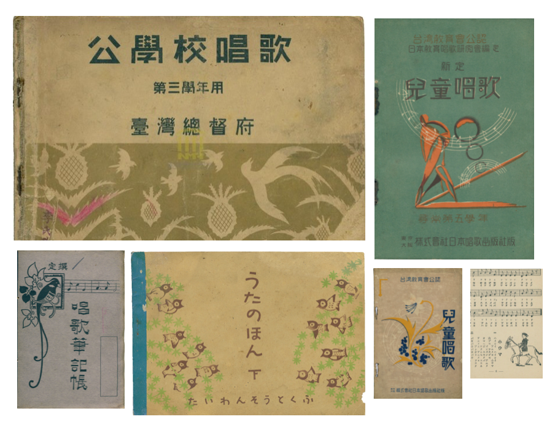
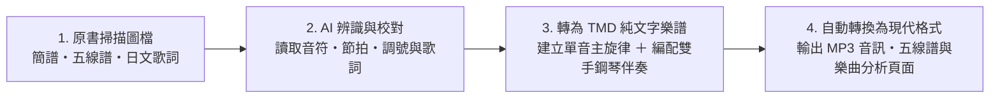

# Re:shoka — 日治時期臺灣公學校、小學校與國民學校唱歌教材數位重建計畫

**Re:shoka** 是一項將日治時期（1910–1940 年代）臺灣校園音樂教材重新數位化與有聲化的計畫。本專案整理了當時學童實際傳唱的《公學校唱歌》、《新定兒童唱歌》、《うたのほん》（唱歌課本）與《楊金土手抄唱歌帖》等教材與抄本，將原本僅存於博物館典藏庫中的靜態掃描圖檔，轉化為**可以在網頁上直接聆聽伴奏、閱讀五線譜、檢索歌詞與瀏覽統計資料**的開放資料庫。

> **專案定位**：Re:shoka 是 **TMD 電腦音樂語言的子計畫**，由個人／社群維護，並非政府機關、博物館或任何官方計畫。資料主要整理自公開典藏與公版史料，供研究、教育與欣賞使用。

## 一、專案目的

1. **讓百年前的歌聲重新被聽見**：本計畫目前已整理 **734 首（次）**歷史曲目，並為曲目編配雙手鋼琴伴奏與合成音訊，讓所有人都能直接試聽。
2. **以純文字格式保存樂譜，方便檢索與再利用**：將歷史樂譜數位化為結構化的純文字樂譜檔，避免受限於特定商業製譜軟體的封閉格式，方便長期保存並轉換為各種現代格式。
3. **從整體數據觀察當時的音樂教材設計與民間傳抄實況**：當這些曲目轉為結構化的數位資料後，就能透過簡單的統計程式，從「調性分布」、「節拍選擇」、「五聲音階與七聲音階的比例變化」、「歌唱音域寬度」以及「跨冊重複與同名曲目對照」等角度，一窺百年前音樂課本由淺入深的編排方式與民間實際傳抄曲目。

## 二、資料來源與各冊導覽

本專案目前已收錄日治時期臺灣與日本唱歌教材、手抄筆記本及《共益商社唱歌教科書》，共計 **21 冊、734 首（次）曲目**：

- 🔍 **[跨冊重複與同名歌曲總索引（共 101 組、246 首對照）](duplicate_songs.md)**
- 📊 **[《新定兒童唱歌》專題統計（主題分布、調性、節拍、五聲音階與歌唱音域）](shintei_jido_shoka/index.md)**
- 📊 **[《共益商社唱歌教科書》專題統計（主題分布、調性、節拍、五聲音階與歌唱音域）](kyoeki_shoka/index.md)**
- 📄 **[臺史博館藏《楊金土手抄唱歌帖》考證與研究筆記（含封面署名、十冊結構重建與出處考證）](shokacho/research_notes.md)**
- 📑 **[《蓬萊唱歌集》存見曲目目次重建（共 45+3 首完整對照表）](shokacho/horai_shokashu.md)**
- 🏛️ **[延伸館藏與日本國會圖書館（NDL）數位影像調查筆記（含 `2020.006.0842` 楊《唱歌帳》3 冊、`2006.006.0878`《唱歌課本》下卷與 NDL 原典歌本 IIIF 清單）](archives/index.md)**

| 教材／抄本叢書                 | 冊別與線上總覽                                                                  | 發行／公認／抄錄資訊與年代                                                              | 臺史博典藏號                    | 收錄曲數 | 書訊與原書卷首／卷末                                                               |
| :----------------------------- | :------------------------------------------------------------------------------ | :-------------------------------------------------------------------------------------- | :------------------------------ | -------: | :--------------------------------------------------------------------------------- |
| **《公學校唱歌》**             | [**第三學年用**](kogakko_shoka/grade_3/index.md)                                | 臺灣總督府編（第 12 版、昭和 17 年／1942 年）                                           | `2020.006.0855`                 |    15 首 | [書訊與掃描頁](kogakko_shoka/grade_3/0_book_info/index.md)                         |
| **《うたのほん》（唱歌課本）** | [**下卷（國民學校初等科第二學年用）**](utanohon/ge_2006.006.0878/index.md)      | 臺灣總督府編（昭和 18 年／1943 年初版）                                                 | `2006.006.0878`                 |    20 首 | [書訊與掃描頁](utanohon/ge_2006.006.0878/0_book_info/index.md)                     |
| **《新定兒童唱歌》**           | [**尋常科 第一學年用**](shintei_jido_shoka/grade_1_2020.006.0847.0001/index.md) | 臺灣教育會公認（昭和 5 年／1930 年）                                                    | `2020.006.0847.0001`            |    59 首 | [書訊與掃描頁](shintei_jido_shoka/grade_1_2020.006.0847.0001/0_book_info/index.md) |
| **《新定兒童唱歌》**           | [**尋常科 第二學年用**](shintei_jido_shoka/grade_2_2020.006.0847.0002/index.md) | 臺灣教育會公認（昭和 5 年／1930 年）                                                    | `2020.006.0847.0002`            |    47 首 | [書訊與掃描頁](shintei_jido_shoka/grade_2_2020.006.0847.0002/0_book_info/index.md) |
| **《新定兒童唱歌》**           | [**尋常科 第三學年用**](shintei_jido_shoka/grade_3_2020.006.0847.0003/index.md) | 臺灣教育會公認（昭和 5 年／1930 年）                                                    | `2020.006.0847.0003`            |    53 首 | [書訊與掃描頁](shintei_jido_shoka/grade_3_2020.006.0847.0003/0_book_info/index.md) |
| **《新定兒童唱歌》**           | [**尋常科 第四學年用**](shintei_jido_shoka/grade_4_2020.006.0847.0004/index.md) | 臺灣教育會公認（昭和 5 年／1930 年）                                                    | `2020.006.0847.0004`            |    50 首 | [書訊與掃描頁](shintei_jido_shoka/grade_4_2020.006.0847.0004/0_book_info/index.md) |
| **《新定兒童唱歌》**           | [**尋常科 第五學年用**](shintei_jido_shoka/grade_5_2020.006.0847.0005/index.md) | 臺灣教育會公認（昭和 5 年／1930 年）                                                    | `2020.006.0847.0005`            |    46 首 | [書訊與掃描頁](shintei_jido_shoka/grade_5_2020.006.0847.0005/0_book_info/index.md) |
| **《新定兒童唱歌》**           | [**尋常科 第六學年用**](shintei_jido_shoka/grade_6_2020.006.0847.0006/index.md) | 臺灣教育會公認（昭和 5 年／1930 年）                                                    | `2020.006.0847.0006`            |    45 首 | [書訊與掃描頁](shintei_jido_shoka/grade_6_2020.006.0847.0006/0_book_info/index.md) |
| **《新定兒童唱歌》**           | [**高等科 男子一二年用**](shintei_jido_shoka/koto_boys_2020.006.0848/index.md)  | 臺灣教育會公認（昭和 5 年／1930 年）                                                    | `2020.006.0848`                 |    62 首 | [書訊與掃描頁](shintei_jido_shoka/koto_boys_2020.006.0848/0_book_info/index.md)    |
| **《新定兒童唱歌》**           | [**高等科 女子一二年用**](shintei_jido_shoka/koto_girls_2020.006.0849/index.md) | 臺灣教育會公認（昭和 5 年／1930 年）                                                    | `2020.006.0849`                 |    62 首 | [書訊與掃描頁](shintei_jido_shoka/koto_girls_2020.006.0849/0_book_info/index.md)   |
| **《楊金土筆記本》**           | [**原編第 1 冊（選定唱歌筆記帳）**](shokacho/vol_01/index.md)                   | 臺灣子供世界社印行／楊金土手抄（大正 12–昭和 2 年／1923–1927 年）                       | `2020.006.0843` (`P113`–`P187`) |    53 首 | [書訊與掃描頁](shokacho/vol_01/0_book_info/index.md)                               |
| **《楊金土筆記本》**           | [**原編第 2 冊（II）**](shokacho/vol_02/index.md)                               | 楊金土手抄（大正 12–昭和 2 年／1923–1927 年，含〈嘆烟花〉）                             | `2020.006.0843` (`P065`–`P112`) |    35 首 | [書訊與掃描頁](shokacho/vol_02/0_book_info/index.md)                               |
| **《楊金土筆記本》**           | [**原編第 3 冊（I）**](shokacho/vol_03/index.md)                                | 楊金土手抄（大正 12–昭和 2 年／1923–1927 年，含奉迎歌夾頁）                             | `2020.006.0843` (`P031`–`P064`) |    22 首 | [書訊與掃描頁](shokacho/vol_03/0_book_info/index.md)                               |
| **《楊金土筆記本》**           | [**原編第 7 冊（VII・蓬萊唱歌集上）**](shokacho/vol_07/index.md)                | 楊金土手抄（大正 12–昭和 2 年／1923–1927 年，含陳英聲〈牛よ牛よ〉、郭水返〈水グルマ〉） | `2020.006.0843` (`P224`–`P259`) |    32 首 | [書訊與掃描頁](shokacho/vol_07/0_book_info/index.md)                               |
| **《楊金土筆記本》**           | [**原編第 8 冊（VIII・蓬萊唱歌集下）**](shokacho/vol_08/index.md)               | 楊金土手抄（大正 12–昭和 2 年／1923–1927 年，《蓬萊唱歌集》後半與《一條歌集》）         | `2020.006.0843` (`P001`–`P030`) |    22 首 | [書訊與掃描頁](shokacho/vol_08/0_book_info/index.md)                               |
| **《楊金土筆記本》**           | [**原編第 9 冊（IX・支那曲）**](shokacho/vol_09/index.md)                       | 楊金土手抄（大正 12–昭和 2 年／1923–1927 年，〈思春〉等四首合調傳統曲牌）               | `2020.006.0844` (`P001`–`P014`) |     4 首 | [書訊與掃描頁](shokacho/vol_09/0_book_info/index.md)                               |
| **《楊金土筆記本》**           | [**原編第 10 冊（X）**](shokacho/vol_10/index.md)                               | 楊金土手抄（大正 12–昭和 2 年／1923–1927 年，《小公學校唱歌教材集》等）                 | `2020.006.0843` (`P188`–`P223`) |    31 首 | [書訊與掃描頁](shokacho/vol_10/0_book_info/index.md)                               |
| **《共益商社唱歌教科書》**     | [**卷一（生徒用）**](kyoeki_shoka/kan_1_854862/index.md)                        | 共益商社樂器店編（明治 35 年／1902 年）                                                 | NDL `854862`                    |    20 首 | [書訊與原書掃描頁](kyoeki_shoka/kan_1_854862/0_book_info/index.md)                 |
| **《共益商社唱歌教科書》**     | [**卷二（教師用）**](kyoeki_shoka/kan_2_854863/index.md)                        | 共益商社樂器店編（明治 35 年／1902 年）                                                 | NDL `854863`                    |    18 首 | [書訊與原書掃描頁](kyoeki_shoka/kan_2_854863/0_book_info/index.md)                 |
| **《共益商社唱歌教科書》**     | [**卷三（教師用）**](kyoeki_shoka/kan_3_854864/index.md)                        | 共益商社樂器店編（明治 35 年／1902 年）                                                 | NDL `854864`                    |    19 首 | [書訊與原書掃描頁](kyoeki_shoka/kan_3_854864/0_book_info/index.md)                 |
| **《共益商社唱歌教科書》**     | [**卷四（教師用）**](kyoeki_shoka/kan_4_854865/index.md)                        | 共益商社樂器店編（明治 35 年／1902 年）                                                 | NDL `854865`                    |    19 首 | [書訊與原書掃描頁](kyoeki_shoka/kan_4_854865/0_book_info/index.md)                 |

> **臺灣在地題材與音樂史料特色**：除了日本文部省的共通曲目外，本資料庫收錄了大量描寫臺灣風土與時代背景的歌曲，例如[〈だいしゃ（台車）〉](kogakko_shoka/grade_3/2_daisha/index.md)、[〈牛車〉](kogakko_shoka/grade_3/4_gyusha/index.md)、[〈すゐれん（睡蓮）〉](kogakko_shoka/grade_3/7_suiren/index.md)、[〈白さぎ（白鷺鷥）〉](kogakko_shoka/grade_3/15_shirasagi/index.md)、[〈かあれん（加令／八哥）〉](utanohon/ge_2006.006.0878/9_kaaren/index.md)、[〈ぺたこ（白頭殼仔／白頭翁）〉](utanohon/ge_2006.006.0878/13_petako/index.md)、[〈くも（榕樹枝頭的蜘蛛）〉](utanohon/ge_2006.006.0878/17_kumo/index.md)、[〈おばあさん（老奶奶／阿嬤學日語）〉](utanohon/ge_2006.006.0878/19_obaasan/index.md)、[〈カーレンサン（加令／八哥）〉](shintei_jido_shoka/grade_1_2020.006.0847.0001/3_03_karensan/index.md)、[〈スヰギウ／水牛〉](shintei_jido_shoka/grade_1_2020.006.0847.0001/3_05_suigyu/index.md)、[〈臺灣行進歌〉](shintei_jido_shoka/grade_3_2020.006.0847.0003/2_07_taiwan_koshinka/index.md)、[〈常夏の島〉](shintei_jido_shoka/grade_3_2020.006.0847.0003/3_07_tokonatsu_no_shima/index.md)、[〈ジャンク（戎克船）〉](shintei_jido_shoka/grade_4_2020.006.0847.0004/1_03_janku/index.md)、[〈これぞ臺灣〉](shintei_jido_shoka/grade_4_2020.006.0847.0004/2_11_korezo_taiwan/index.md)、[〈いかだかづら（九重葛）〉](shintei_jido_shoka/grade_4_2020.006.0847.0004/3_03_ikadakazura/index.md)、[〈神木〉](shintei_jido_shoka/grade_5_2020.006.0847.0005/1_02_shinboku/index.md)、[〈新高山（玉山）〉](shintei_jido_shoka/grade_5_2020.006.0847.0005/2_06_niitakayama/index.md)、[〈つり橋〉](shintei_jido_shoka/grade_5_2020.006.0847.0005/2_09_tsuribashi/index.md)、[〈六氏先生〉](shintei_jido_shoka/grade_5_2020.006.0847.0005/3_03_rokushi_sensei/index.md)、[〈鄭成功〉](shintei_jido_shoka/grade_5_2020.006.0847.0005/4_06_teiseiko/index.md)、[〈鵞鑾鼻（鵝鑾鼻）〉](shintei_jido_shoka/grade_6_2020.006.0847.0006/1_03_garanbi/index.md)、[〈鱶と少年〉](shintei_jido_shoka/grade_6_2020.006.0847.0006/1_06_fuka_to_shonen/index.md)、[〈南洋の歌〉](shintei_jido_shoka/grade_6_2020.006.0847.0006/4_03_nanyo_no_uta/index.md)、[〈臺灣の風景〉](shintei_jido_shoka/grade_6_2020.006.0847.0006/4_07_taiwan_no_fukei/index.md)、[〈富士と新高〉](shintei_jido_shoka/grade_6_2020.006.0847.0006/4_18_fuji_to_niitaka/index.md)、[〈臺灣の歌〉](shintei_jido_shoka/koto_boys_2020.006.0848/1_2_09_taiwan_no_uta/index.md)、[〈殖民の歌〉](shintei_jido_shoka/koto_boys_2020.006.0848/1_2_10_shokumin_no_uta/index.md)、[〈淡水河〉](shintei_jido_shoka/koto_girls_2020.006.0849/2_2_09_tansuigawa/index.md)，以及《楊金土手抄唱歌帖》所保存的標註「陳英声曲」之[〈牛よ牛よ（牛啊牛啊）〉](shokacho/vol_07/p246_ushi_yo_ushi_yo/index.md)、標註「郭水返曲」之[〈水グルマ（水車）〉](shokacho/vol_07/p231_mizuguruma/index.md)、傳統北管／藝旦小曲五線譜採譜[〈嘆烟花〉](shokacho/vol_02/p081_tan_yenhua/index.md)與[〈1. 思春〉](shokacho/vol_09/0844_p006_sichun/index.md)等史料。

---

## 三、內容產生過程

本專案透過三個步驟，將百年前的課本掃描頁轉化為現代可以直接使用的數位樂譜與音訊：

### 1. AI 辨識原書樂譜與歌詞

- **樂譜判讀**：原書低中年級多採用「數字簡譜」，高年級與高等科則採用「五線譜」（包含二部輪唱與合唱譜）。我們先透過多模態 AI 讀取掃描圖檔中的調號、拍號、速度、各小節音高與節奏時值，並人工校對小節數與拍數是否吻合。
- **歌詞轉錄**：同步將原書上的片假名、平假名與漢字歌詞轉為文字（保留當時的歷史假名寫法），並記錄對應的原書頁碼與掃描圖檔，方便讀者直接在網頁上對照原書影像。

### 2. 轉換成 TMD 格式與編配鋼琴伴奏

- **原曲主旋律檔**：將辨識出的單聲部或合唱旋律寫成標準的 TMD 純文字樂譜檔（`.tmd`），並透過工具自動檢查每個小節的拍數是否正確。
- **雙手鋼琴伴奏檔**：原書絕大多數曲目僅印有單行歌唱旋律，沒有伴奏譜。為了讓歌曲聽起來更完整，我們根據每首歌的調性與曲風（例如輕快的童謠、進行曲或抒情合唱曲），為每首曲目另外編寫了包含前奏、右手主旋律與左手和聲伴奏的雙手鋼琴版本（`*_piano.tmd`）。

### 3. 自動輸出為現代格式（MP3、五線譜與網頁）

完成 TMD 樂譜後，由自動化腳本統一將所有樂譜轉換為一般讀者與音樂軟體可直接使用的現代格式：

- **MP3 伴奏音訊**：將雙手鋼琴伴奏譜合成為音訊檔，讓每首歌的頁面都有內建播放器可直接試聽。
- **互動式五線譜**：將樂譜轉為網頁標準的 ABC 記譜格式（`.abc`），並在瀏覽器中透過 `abcjs` 自動繪製成清晰的向量五線譜。
- **單曲音域與調性報告**：自動分析每首歌的長度、最高音與最低音範圍，以及各個音高的出現比例。

## 四、專題統計

- 《新定兒童唱歌》的調性、節拍、五聲音階、歌唱音域與歌詞主題統計，已集中整理於[專題統計頁](shintei_jido_shoka/index.md)。

## 附註

- **關於 TMD 格式**：本計畫使用 [TMD（Timebase Markdown / Textual Music Description）](https://tmdlang.github.io/) 作為底層的樂譜紀錄格式。TMD 是一種概念接近「純文字簡譜＋Markdown」的音樂記述語言，所有音符、節奏與和弦都以純文字檔案（`.tmd`）儲存，不僅容易閱讀與透過 Git 進行版本管理，也能隨時透過工具自動轉出成五線譜、MIDI 或音訊檔。
- **AI 辨識與轉換工具**：本專案之原書掃描影像樂譜辨識、日文歌詞轉錄、TMD 格式轉換以及雙手鋼琴伴奏編曲，係使用 **Google Antigravity / Gemini** 輔助完成。
