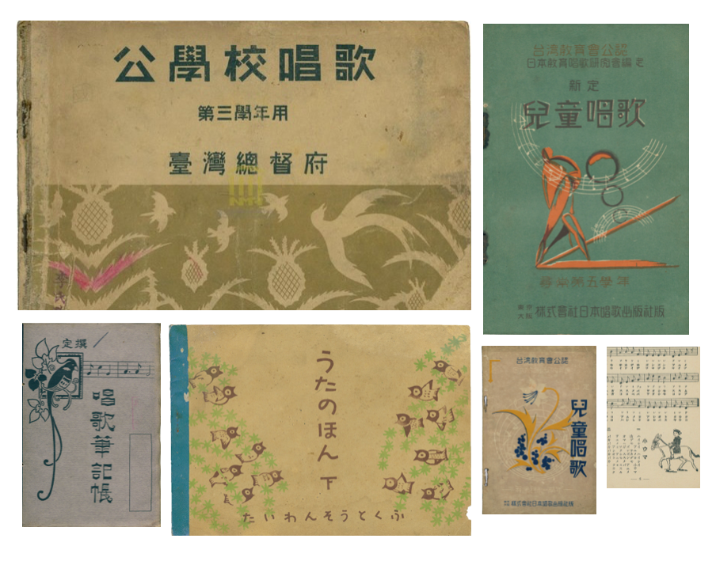

# Re:shō  ka — 日治時期臺灣唱歌教材數位重建計畫

  

    <strong>隨機聽見一段歷史</strong>
    <button type="button" data-lucky-song-button>挑選</button>
  

  
從 1,255 首歷史曲目中隨機探索。

**Re:shōka** 是一項將日治時期（1910–1940 年代）臺灣校園音樂教材重新數位化與有聲化的計畫。本專案整理了當時學童實際傳唱的《尋常小學唱歌》、《公學校唱歌集》、《公學校唱歌》、《公學校高等科唱歌》、《新定兒童唱歌》、《うたのほん》（唱歌課本）與《楊金土手抄唱歌帖》等教材與抄本，將原本僅存於博物館與圖書館典藏庫中的靜態掃描圖檔，轉化為**可以在網頁上直接聆聽伴奏、閱讀五線譜、檢索歌詞與瀏覽統計資料**的開放資料庫。

> **專案定位**：Re:shōka 是 **TMD 電腦音樂語言的民間子計畫**，由個人／社群維護，並非政府機關、博物館或任何官方計畫。資料主要整理自公開典藏與公版史料，供查閱、教育與欣賞使用。

## 一、專案目的

1. **讓百年前的歌聲重新被聽見**：本計畫目前已整理 **1,255 首（次）**歷史曲目，並為曲目編配雙手鋼琴伴奏與合成音訊，讓所有人都能直接試聽。
2. **以純文字格式保存樂譜，方便檢索與再利用**：將歷史樂譜數位化為結構化的純文字樂譜檔，避免受限於特定商業製譜軟體的封閉格式，方便長期保存並轉換為各種現代格式。
3. **從整體數據觀察當時的音樂教材設計與民間傳抄實況**：當這些曲目轉為結構化的數位資料後，就能透過簡單的統計程式，從「調性分布」、「節拍選擇」、「五聲音階與七聲音階的比例變化」、「歌唱音域寬度」以及「跨冊重複與同名曲目對照」等角度，一窺百年前音樂課本由淺入深的編排方式與民間實際傳抄曲目。

## 二、深入閱讀

- 🧭 [資料來源與各冊導覽](sources.md)
- ⚙️ [內容產生過程](workflow.md)
- 🧭 [日治時期臺灣公學校唱歌教材的流動與變化](shoka_genealogy.md)
- 🔍 [全站歌曲去重統計](duplicate_songs.md)
- 🔍 [同一歌名的多個版本](same_title_songs.md)
- 📊 [各套教材專題統計](shintei_jido_shoka/index.md)
