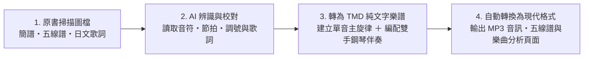

# Re:shoka — 日治時期臺灣公學校、小學校與國民學校唱歌教材數位重建計畫

**Re:shoka** 是一項將日治時期（1910–1940 年代）臺灣校園音樂教材重新數位化與有聲化的計畫。本專案整理了當時學童實際傳唱的《公學校唱歌》、《新定兒童唱歌》、《うたのほん》（唱歌課本）與《楊金土手抄唱歌帖》等教材與抄本，將原本僅存於博物館典藏庫中的靜態掃描圖檔，轉化為**可以在網頁上直接聆聽伴奏、閱讀五線譜、檢索歌詞與瀏覽統計資料**的開放資料庫。

---

## 一、專案目的

1. **讓百年前的課堂歌聲重新被聽見**：日治時期針對臺灣公學校（臺籍學童就讀）、小學校與國民學校編纂的唱歌教材及手抄歌本，過去多半只有紙本或掃描影像留存，一般人若不識譜或沒有樂器，很難想像這些歌曲實際聽起來的樣貌。本計畫目前已整理 **658 首（次）**歷史曲目（扣除跨冊重複收錄後，共計 **595 首不重複曲目**），並為每一首歌編配雙手鋼琴伴奏與合成音訊，讓所有人都能直接試聽。
2. **以純文字格式保存樂譜，方便檢索與再利用**：將歷史樂譜數位化為結構化的純文字樂譜檔，避免受限於特定商業製譜軟體的封閉格式，方便長期保存並轉換為各種現代格式。
3. **從整體數據觀察當時的音樂教材設計與民間傳抄實況**：當這些曲目轉為結構化的數位資料後，就能透過簡單的統計程式，從「調性分布」、「節拍選擇」、「五聲音階與七聲音階的比例變化」、「歌唱音域寬度」以及「跨冊重複與同名曲目對照」等角度，一窺百年前音樂課本由淺入深的編排方式與民間實際傳抄曲目。

---

## 二、資料來源與各冊導覽

本專案目前已收錄國立臺灣歷史博物館（NMTH）數位典藏之四套日治時期學校唱歌教材與手抄筆記本，共計 **17 冊、1,181 頁原書掃描圖檔、658 首（次）曲目**（扣除跨冊與跨叢書重複收錄之 63 首（次）後，實收 **595 首不重複曲目**）：

- 🔍 **[跨冊重複與同名歌曲總索引（共 93 組、213 首對照）](duplicate_songs.md)**
- 📄 **[臺史博館藏《楊金土手抄唱歌帖》考證與研究筆記（含封面署名、十冊結構重建與出處考證）](shokacho/research_notes.md)**
- 📑 **[《蓬萊唱歌集》存見曲目目次重建（共 45+3 首完整對照表）](shokacho/horai_shokashu.md)**
- 🏛️ **[延伸館藏與日本國會圖書館（NDL）數位影像調查筆記（含 `2020.006.0842` 楊《唱歌帳》3 冊、`2006.006.0878`《唱歌課本》下卷與 NDL 原典歌本 IIIF 清單）](archives/index.md)**

| 教材／抄本叢書 | 冊別與線上總覽 | 發行／公認／抄錄資訊與年代 | 臺史博典藏號 | 收錄曲數 | 書訊與原書卷首／卷末 |
| :--- | :--- | :--- | :--- | ---: | :--- |
| **《公學校唱歌》** | [**第三學年用**](kogakko_shoka/grade_3/index.md) | 臺灣總督府編（昭和 9 年／1934 年初版） | `2020.006.0855` | 15 首 | [書訊與掃描頁](kogakko_shoka/grade_3/0_book_info/index.md) |
| **《うたのほん》（唱歌課本）** | [**下卷（國民學校初等科第二學年用）**](utanohon/ge_2006.006.0878/index.md) | 臺灣總督府編（昭和 18 年／1943 年初版） | `2006.006.0878` | 20 首 | [書訊與掃描頁](utanohon/ge_2006.006.0878/0_book_info/index.md) |
| **《新定兒童唱歌》** | [**尋常科 第一學年用**](shintei_jido_shoka/grade_1_2020.006.0847.0001/index.md) | 臺灣教育會公認（昭和 9 年／1934 年） | `2020.006.0847.0001` | 59 首 | [書訊與掃描頁](shintei_jido_shoka/grade_1_2020.006.0847.0001/0_book_info/index.md) |
| **《新定兒童唱歌》** | [**尋常科 第二學年用**](shintei_jido_shoka/grade_2_2020.006.0847.0002/index.md) | 臺灣教育會公認（昭和 9 年／1934 年） | `2020.006.0847.0002` | 47 首 | [書訊與掃描頁](shintei_jido_shoka/grade_2_2020.006.0847.0002/0_book_info/index.md) |
| **《新定兒童唱歌》** | [**尋常科 第三學年用**](shintei_jido_shoka/grade_3_2020.006.0847.0003/index.md) | 臺灣教育會公認（昭和 9 年／1934 年） | `2020.006.0847.0003` | 53 首 | [書訊與掃描頁](shintei_jido_shoka/grade_3_2020.006.0847.0003/0_book_info/index.md) |
| **《新定兒童唱歌》** | [**尋常科 第四學年用**](shintei_jido_shoka/grade_4_2020.006.0847.0004/index.md) | 臺灣教育會公認（昭和 9 年／1934 年） | `2020.006.0847.0004` | 50 首 | [書訊與掃描頁](shintei_jido_shoka/grade_4_2020.006.0847.0004/0_book_info/index.md) |
| **《新定兒童唱歌》** | [**尋常科 第五學年用**](shintei_jido_shoka/grade_5_2020.006.0847.0005/index.md) | 臺灣教育會公認（昭和 9 年／1934 年） | `2020.006.0847.0005` | 46 首 | [書訊與掃描頁](shintei_jido_shoka/grade_5_2020.006.0847.0005/0_book_info/index.md) |
| **《新定兒童唱歌》** | [**尋常科 第六學年用**](shintei_jido_shoka/grade_6_2020.006.0847.0006/index.md) | 臺灣教育會公認（昭和 9 年／1934 年） | `2020.006.0847.0006` | 45 首 | [書訊與掃描頁](shintei_jido_shoka/grade_6_2020.006.0847.0006/0_book_info/index.md) |
| **《新定兒童唱歌》** | [**高等科 男子一二年用**](shintei_jido_shoka/koto_boys_2020.006.0848/index.md) | 臺灣教育會公認（昭和 9 年／1934 年） | `2020.006.0848` | 62 首 | [書訊與掃描頁](shintei_jido_shoka/koto_boys_2020.006.0848/0_book_info/index.md) |
| **《新定兒童唱歌》** | [**高等科 女子一二年用**](shintei_jido_shoka/koto_girls_2020.006.0849/index.md) | 臺灣教育會公認（昭和 9 年／1934 年） | `2020.006.0849` | 62 首 | [書訊與掃描頁](shintei_jido_shoka/koto_girls_2020.006.0849/0_book_info/index.md) |
| **《楊金土手抄唱歌帖》** | [**原編第 1 冊（選定唱歌筆記帳）**](shokacho/vol_01/index.md) | 臺灣子供世界社印行／楊金土手抄（1924–1928 年） | `2020.006.0843` (`P113`–`P187`) | 53 首 | [書訊與掃描頁](shokacho/vol_01/0_book_info/index.md) |
| **《楊金土手抄唱歌帖》** | [**原編第 2 冊（II）**](shokacho/vol_02/index.md) | 楊金土手抄（1923–1925 年，含〈嘆烟花〉） | `2020.006.0843` (`P065`–`P112`) | 35 首 | [書訊與掃描頁](shokacho/vol_02/0_book_info/index.md) |
| **《楊金土手抄唱歌帖》** | [**原編第 3 冊（I）**](shokacho/vol_03/index.md) | 楊金土手抄（1923–1928 年，含奉迎歌夾頁） | `2020.006.0843` (`P031`–`P064`) | 22 首 | [書訊與掃描頁](shokacho/vol_03/0_book_info/index.md) |
| **《楊金土手抄唱歌帖》** | [**原編第 7 冊（VII・蓬萊唱歌集上）**](shokacho/vol_07/index.md) | 楊金土手抄（1927 年，含陳英聲〈牛よ牛よ〉、郭水返〈水グルマ〉） | `2020.006.0843` (`P224`–`P259`) | 32 首 | [書訊與掃描頁](shokacho/vol_07/0_book_info/index.md) |
| **《楊金土手抄唱歌帖》** | [**原編第 8 冊（VIII・蓬萊唱歌集下）**](shokacho/vol_08/index.md) | 楊金土手抄（1927 年，《蓬萊唱歌集》後半與《一條歌集》） | `2020.006.0843` (`P001`–`P030`) | 22 首 | [書訊與掃描頁](shokacho/vol_08/0_book_info/index.md) |
| **《楊金土手抄唱歌帖》** | [**原編第 9 冊（IX・支那曲）**](shokacho/vol_09/index.md) | 楊金土手抄（1927 年，〈思春〉等四首合調傳統曲牌） | `2020.006.0844` (`P001`–`P014`) | 4 首 | [書訊與掃描頁](shokacho/vol_09/0_book_info/index.md) |
| **《楊金土手抄唱歌帖》** | [**原編第 10 冊（X）**](shokacho/vol_10/index.md) | 楊金土手抄（1926–1927 年，《小公學校唱歌教材集》等） | `2020.006.0843` (`P188`–`P223`) | 31 首 | [書訊與掃描頁](shokacho/vol_10/0_book_info/index.md) |

> **臺灣在地題材與音樂史料特色**：除了日本文部省的共通曲目外，本資料庫收錄了大量描寫臺灣風土與時代背景的歌曲，例如[〈だいしゃ（台車）〉](kogakko_shoka/grade_3/2_daisha/index.md)、[〈牛車〉](kogakko_shoka/grade_3/4_gyusha/index.md)、[〈すゐれん（睡蓮）〉](kogakko_shoka/grade_3/7_suiren/index.md)、[〈白さぎ（白鷺鷥）〉](kogakko_shoka/grade_3/15_shirasagi/index.md)、[〈かあれん（加令／八哥）〉](utanohon/ge_2006.006.0878/9_kaaren/index.md)、[〈ぺたこ（陀螺／干樂）〉](utanohon/ge_2006.006.0878/11_petako/index.md)、[〈くも（大屯山與淡水河之雲）〉](utanohon/ge_2006.006.0878/13_kumo/index.md)、[〈おばあさん（老奶奶與廟口油香燈火）〉](utanohon/ge_2006.006.0878/17_obaasan/index.md)、[〈カーレンサン（加令／八哥）〉](shintei_jido_shoka/grade_1_2020.006.0847.0001/3_03_karensan/index.md)、[〈スヰギウ／水牛〉](shintei_jido_shoka/grade_1_2020.006.0847.0001/3_05_suigyu/index.md)、[〈臺灣行進歌〉](shintei_jido_shoka/grade_3_2020.006.0847.0003/2_07_taiwan_koshinka/index.md)、[〈常夏の島〉](shintei_jido_shoka/grade_3_2020.006.0847.0003/3_07_tokonatsu_no_shima/index.md)、[〈ジャンク（戎克船）〉](shintei_jido_shoka/grade_4_2020.006.0847.0004/1_03_janku/index.md)、[〈これぞ臺灣〉](shintei_jido_shoka/grade_4_2020.006.0847.0004/2_11_korezo_taiwan/index.md)、[〈いかだかづら（九重葛）〉](shintei_jido_shoka/grade_4_2020.006.0847.0004/3_03_ikadakazura/index.md)、[〈神木〉](shintei_jido_shoka/grade_5_2020.006.0847.0005/1_02_shinboku/index.md)、[〈新高山（玉山）〉](shintei_jido_shoka/grade_5_2020.006.0847.0005/2_06_niitakayama/index.md)、[〈つり橋〉](shintei_jido_shoka/grade_5_2020.006.0847.0005/2_09_tsuribashi/index.md)、[〈六氏先生〉](shintei_jido_shoka/grade_5_2020.006.0847.0005/3_03_rokushi_sensei/index.md)、[〈鄭成功〉](shintei_jido_shoka/grade_5_2020.006.0847.0005/4_06_teiseiko/index.md)、[〈鵞鑾鼻（鵝鑾鼻）〉](shintei_jido_shoka/grade_6_2020.006.0847.0006/1_03_garanbi/index.md)、[〈鱶と少年〉](shintei_jido_shoka/grade_6_2020.006.0847.0006/1_06_fuka_to_shonen/index.md)、[〈南洋の歌〉](shintei_jido_shoka/grade_6_2020.006.0847.0006/4_03_nanyo_no_uta/index.md)、[〈臺灣の風景〉](shintei_jido_shoka/grade_6_2020.006.0847.0006/4_07_taiwan_no_fukei/index.md)、[〈富士と新高〉](shintei_jido_shoka/grade_6_2020.006.0847.0006/4_18_fuji_to_niitaka/index.md)、[〈臺灣の歌〉](shintei_jido_shoka/koto_boys_2020.006.0848/1_2_09_taiwan_no_uta/index.md)、[〈殖民の歌〉](shintei_jido_shoka/koto_boys_2020.006.0848/1_2_10_shokumin_no_uta/index.md)、[〈淡水河〉](shintei_jido_shoka/koto_girls_2020.006.0849/2_2_09_tansuigawa/index.md)，以及《楊金土手抄唱歌帖》所保存的標註「陳英声曲」之[〈牛よ牛よ（牛啊牛啊）〉](shokacho/vol_07/p246_ushi_yo_ushi_yo/index.md)、標註「郭水返曲」之[〈水グルマ（水車）〉](shokacho/vol_07/p231_mizuguruma/index.md)、傳統北管／藝旦小曲五線譜採譜[〈嘆烟花〉](shokacho/vol_02/p081_tan_yenhua/index.md)與[〈1. 思春〉](shokacho/vol_09/0844_p006_sichun/index.md)等史料。

---

## 三、內容產生過程

本專案透過三個步驟，將百年前的課本掃描頁轉化為現代可以直接使用的數位樂譜與音訊：

### 1. AI 辨識原書樂譜與歌詞
- **樂譜判讀**：原書低中年級多採用「數字簡譜」，高年級與高等科則採用「五線譜」（包含二部輪唱與合唱譜）。我們先透過多模態 AI 讀取掃描圖檔中的調號、拍號、速度、各小節音高與節奏時值，並人工校對小節數與拍數是否吻合。
- **歌詞轉錄**：同步將原書上的片假名、平假名與漢字歌詞轉為文字（保留當時的歷史假名寫法），並記錄對應的原書頁碼與掃描圖檔，方便讀者直接在網頁上對照原書影像。

### 2. 轉換成 TMD 格式與編配鋼琴伴奏
- **原曲主旋律檔**：將辨識出的單聲部或合唱旋律寫成標準的 TMD 純文字樂譜檔（`.tmd`），並透過工具自動檢查每個小節的拍數是否正確。
- **雙手鋼琴伴奏檔**：原書絕大多數曲目僅印有單行歌唱旋律，沒有伴奏譜。為了讓歌曲聽起來更完整，我們根據每首歌的調性與曲風（例如輕快的童謠、進行曲或抒情合唱曲），為每首曲目另外編寫了包含前奏、右手主旋律與左手和聲伴奏的雙手鋼琴版本（`*_piano.tmd`）。

### 3. 自動輸出為現代格式（MP3、五線譜與網頁）
完成 TMD 樂譜後，由自動化腳本統一將所有樂譜轉換為一般讀者與音樂軟體可直接使用的現代格式：
- **MP3 伴奏音訊**：將雙手鋼琴伴奏譜合成為音訊檔，讓每首歌的頁面都有內建播放器可直接試聽。
- **互動式五線譜**：將樂譜轉為網頁標準的 ABC 記譜格式（`.abc`），並在瀏覽器中透過 `abcjs` 自動繪製成清晰的向量五線譜。
- **單曲音域與調性報告**：自動分析每首歌的長度、最高音與最低音範圍，以及各個音高的出現比例。

---

## 四、相關統計資料（以《新定兒童唱歌》8 冊扣除重複後 410 首為範圍）

由於《新定兒童唱歌》完整涵蓋了尋常科一至六年級與高等科男女各冊（共 8 冊、424 首／次；其中《高等科男子一二年用》與《高等科女子一二年用》共用 13 首曲目，《尋常科第六學年用》與《高等科女子一二年用》重複收錄〈埴生の宿〉1 首，**扣除跨冊重複之 14 首後，實收 410 首不重複曲目**），以下針對這 **410 首不重複曲目**統計其在**調性**、**節拍**、**五聲音階比例**與**歌唱音域**上的分布與年級變化：

### 1. 調性統計

- **大調與小調比例**：《新定兒童唱歌》410 首不重複曲目以明亮的大調歌曲為主，共 **363 首（88.5%）**；小調歌曲共 **47 首（11.5%）**。各冊之中，以《高等科女子一二年用》的小調比例最高，達 **24.2%（15/62 首）**，收錄了較多抒情與敘事曲風的作品。
- **常用調號分布**：高達 **89.8%（368 首）** 的曲目集中在 2 個升降記號以內的調號。其中 **F 調** 與 **G 調** 合計超過一半（**53.2%，218 首**），主要是因為這兩個調號能讓主旋律自然落在兒童最容易發聲的中音區：

| 調號 | 升降記號數 | 曲數（不重複） | 佔比 | 在各年級的分布特色 |
| :--- | :--- | ---: | ---: | :--- |
| **F 調** | 1 個降記號（1♭） | 115 | **28.0%** | 一、二年級最常使用的調號（一年級佔 52.5%、二年級佔 31.9%） |
| **G 調** | 1 個升記號（1♯） | 103 | **25.1%** | 四年級至高等科最常使用的調號（高等科男子佔 38.7%） |
| **C 調** | 無升降記號 | 75 | **18.3%** | 各年級皆有分布，常用於儀式歌與第三學期曲目 |
| **D 調** | 2 個升記號（2♯） | 49 | **12.0%** | 常見於開闊明亮的自然景致與行進曲目 |
| **降 B 調（Bb）** | 2 個降記號（2♭） | 26 | **6.3%** | 自二年級起逐步出現 |
| **降 E 調（Eb）** | 3 個降記號（3♭） | 23 | **5.6%** | 多見於中高年級與海景、抒情曲目 |
| **A / E / 降 A 調** | 3♯ / 4♯ / 4♭ | 19 | **4.6%** | A 調 14 首（3.4%）、E 調 4 首（1.0%）、降 A 調 1 首（0.2%） |

### 2. 節拍與速度統計

- **整體速度**：410 首不重複曲目平均速度為每分鐘 **98.9 拍（BPM）**，中位數為 **100 BPM**（最慢 54 BPM，最快 168 BPM），貼近兒童步行與自然呼吸的律動。
- **拍號按年級循序引入**：一年級與二年級 **100% 只使用單純的二拍子（2/4 拍）與四拍子（4/4 拍）**；三拍子（3/4 拍）與六八拍（6/8 拍）則是到了**三年級**才開始出現，展現了非常清楚的節奏教學順序：

| 拍號 | 曲數（不重複） | 佔比 | 平均速度 (BPM) | 速度範圍 | 年級與單元分布特色 |
| :--- | ---: | ---: | ---: | :--- | :--- |
| **4/4 拍（四四拍）** | 182 | **44.4%** | 100.6 | 69–168 | 儀式歌 100% 為四四拍；四年級至高等科最主要的拍號（高等科男子佔 64.5%） |
| **2/4 拍（二四拍）** | 157 | **38.3%** | 100.4 | 66–138 | 低年級絕對主力（一年級佔 **74.6%**、二年級佔 **70.2%**） |
| **3/4 拍（三四拍）** | 45 | **11.0%** | 94.6 | 58–126 | 一、二年級完全不用；三年級（5.7%）→ 四年級（10.0%）→ 五年級（26.1%）逐步增加 |
| **6/8 拍（六八拍）** | 21 | **5.1%** | 84.9 | 58–138 | 一、二年級完全不用；三年級起引入，至六年級（11.1%）與高等科女子（12.9%）最多 |
| **其他（2/2、3/8 等）** | 5 | **1.2%** | 87.6 | 54–132 | 少數四年級以上之特殊曲目（如〈富士登山〉、〈秋の湖上〉等） |

### 3. 五聲音階與七聲音階的比例變化

日本明治、大正至昭和初期的學校唱歌，大量採用省略第四音（Fa）與第七音（Ti）、僅由 **Do、Re、Mi、Sol、La** 五個音組成的五聲音階（日文稱為「ヨナ抜き音階」）。統計《新定兒童唱歌》410 首不重複曲目各個音級的時值比例後，可以看到教材隨年級升高，從「五聲音階」逐步過渡到「西洋七聲音階與轉調樂曲」的明顯趨勢：

- **各音級的平均使用比例（不重複 410 首）**：
  - 五聲骨幹音：**Sol（21.3%）**、**Do（21.2%）**、**Mi（20.1%）**、**Re（17.2%）**、**La（12.4%）**——這五個音合計佔了總音符長度的 **92.3%**。
  - 半音傾向音：**Fa 平均僅佔 3.8%**（有 **165 首、40.2%** 完全沒用到 Fa）、**Ti 平均僅佔 3.5%**（有 **181 首、44.1%** 完全沒用到 Ti）。

| 冊別／學年 | 曲數 | 純五聲音階（全曲 ≤5 音） | 準五聲音階（五聲佔比 ≥95%） | **廣義五聲合計** | 六聲音階 | 標準七聲音階 | 含臨時升降／轉調 | Do-Re-Mi-Sol-La 平均佔比 |
| :--- | ---: | ---: | ---: | ---: | ---: | ---: | ---: | ---: |
| **尋常科 第一學年** | 59 | 42 (71.2%) | 12 (20.3%) | **54 (91.5%)** | 1 (1.7%) | 2 (3.4%) | 2 (3.4%) | **98.9%** |
| **尋常科 第二學年** | 47 | 23 (48.9%) | 17 (36.2%) | **40 (85.1%)** | 4 (8.5%) | 3 (6.4%) | 0 (0.0%) | **96.1%** |
| **尋常科 第三學年** | 53 | 18 (34.0%) | 24 (45.3%) | **42 (79.2%)** | 4 (7.5%) | 7 (13.2%) | 0 (0.0%) | **95.2%** |
| **尋常科 第四學年** | 50 | 15 (30.0%) | 19 (38.0%) | **34 (68.0%)** | 4 (8.0%) | 10 (20.0%) | 2 (4.0%) | **92.4%** |
| **尋常科 第五學年** | 46 | 12 (26.1%) | 17 (37.0%) | **29 (63.0%)** | 4 (8.7%) | 10 (21.7%) | 3 (6.5%) | **92.8%** |
| **尋常科 第六學年** | 45 | 7 (15.6%) | 10 (22.2%) | **17 (37.8%)** | 5 (11.1%) | 15 (33.3%) | 8 (17.8%) | **89.8%** |
| **高等科 男子一二年** | 62 | 3 (4.8%) | 7 (11.3%) | **10 (16.1%)** | 2 (3.2%) | 26 (41.9%) | 24 (38.7%) | **86.1%** |
| **高等科 女子一二年** | 62 | 6 (9.7%) | 8 (12.9%) | **14 (22.6%)** | 2 (3.2%) | 23 (37.1%) | 23 (37.1%) | **86.7%** |
| **各冊總計（含重複）** | 424 | 126 (29.7%) | 114 (26.9%) | **240 (56.6%)** | 26 (6.1%) | 96 (22.6%) | 62 (14.6%) | **92.1%** |
| **不重複合計** | **410** | **124 (30.2%)** | **113 (27.6%)** | **237 (57.8%)** | **25 (6.1%)** | **91 (22.2%)** | **57 (13.9%)** | **92.3%** |

### 4. 歌唱音域統計

- **整體音域寬度**：《新定兒童唱歌》410 首不重複曲目平均音域跨度為 **14.0 個半音（約一個八度加一個全音，即大九度）**，中位數同為 **14 個半音**。
- **音域集中範圍**：
  - **一個八度以內（7–12 個半音）**：共 **137 首（33.4%）**，其中剛好跨越**一個純八度（12 個半音）**的歌曲有 **103 首（25.1%）**。
  - **九度至十度（13–16 個半音）**：共 **191 首（46.6%）**，其中跨越**大九度（14 個半音）**的歌曲有 **137 首（33.4%）**，是最常見的音域寬度。
  - 合計有 **80.0%（328 首）** 的歌曲音域控制在十度（16 個半音）以內，符合學童自然歌唱的舒適音區。
- **各年級音域變化**：一年級與二年級平均音域約為 **13.1–13.2 個半音**，四年級至六年級微幅擴大至 **14.1–14.3 個半音**，到了包含二部合唱的高等科則約為 **14.2–14.8 個半音**。

---

## 附註

- **關於 TMD 格式**：本計畫使用 [TMD（Timebase Markdown / Textual Music Description）](https://tmdlang.github.io/) 作為底層的樂譜紀錄格式。TMD 是一種概念接近「純文字簡譜＋Markdown」的音樂記述語言，所有音符、節奏與和弦都以純文字檔案（`.tmd`）儲存，不僅容易閱讀與透過 Git 進行版本管理，也能隨時透過工具自動轉出成五線譜、MIDI 或音訊檔。
- **AI 辨識與轉換工具**：本專案之原書掃描影像樂譜辨識、日文歌詞轉錄、TMD 格式轉換以及雙手鋼琴伴奏編曲，係使用 **Google Antigravity / Gemini** 輔助完成。
