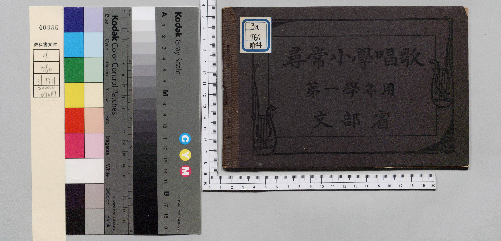
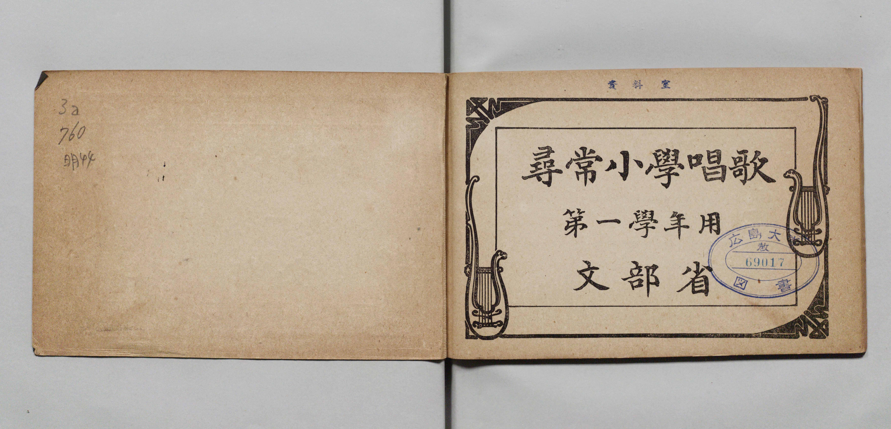
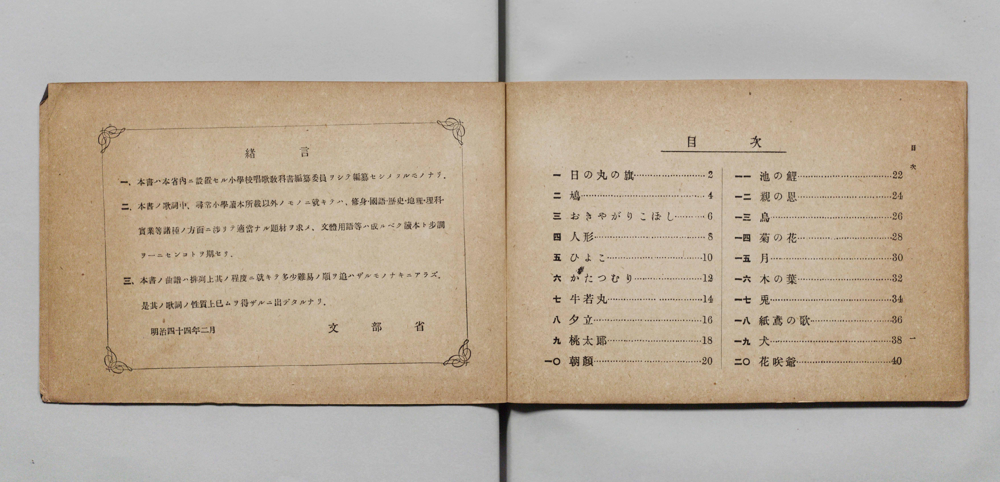
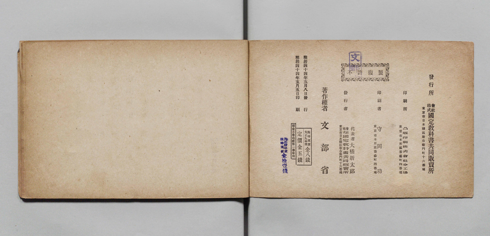

# 書訊與卷首／卷末掃描頁 — jinjo_shogaku_shoka 尋常科 第一學年用（國臺圖 0729 73）

本頁收錄本冊之封面、扉頁、目次（もくろく）、樂典大要、版權頁與封底等原書掃描圖檔（共 5 頁）。

### P001.jpg

本冊封面（右頁），題「公學校唱歌　第一學年用　臺灣總督府」，左上貼有舊藏圖書分類籤「0729 73」，左下貼有國臺圖條碼籤「3 1111 004775662」。

### P002.jpg

封面裏（見返頁）。

### P003.jpg

扉頁，題「公學校唱歌　第一學年用　臺灣總督府」，蓋有「昭和十一年六月二十九日　編修課ヨリ寄贈」藏書章。

### P024.jpg

### P025.jpg

