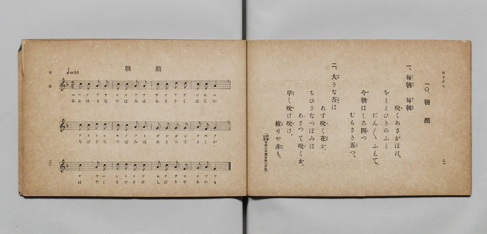

# 朝顏

> Re:Shōka 使用 AI 協助辨識與重建樂譜，可能會有錯誤。歡迎回報。

- **鋼琴伴奏版**：<br><audio controls src="asagao.mp3"></audio>

- 詞：文部省《尋常小學唱歌》（秋季始業尋常小學讀本卷二所載）
- 曲：文部省《尋常小學唱歌》
- 文部省《尋常小學唱歌 第一學年用》（明治四十四年五月，索書號 4103）

## 說明

原書資訊與歌詞全文（對應 P013.jpg，原書 p. 20–21，第一學年第 10 首）：
調性與拍號：ヘ長調 2/4 拍子，♩=84


## 歌詞

```text
一、毎朝（まいあさ）毎朝（まいあさ）
咲（さ）くあさがほは、
をととひきのふと
だん／＼ふえて、
今朝（けさ）はしろ四（よ）つ
むらさき五（いつ）つ。

二、大（おほ）きな蕾（つぼみ）は
あす咲（さ）く花（はな）か。
ちひさなつぼみは
あさつて咲（さ）くか。
早（はや）く咲（さ）け咲（さ）け、
絞（しぼ）りや赤（あか）も。
（秋季始業尋常小學讀本卷二所載）
```

## ABC

<div class="abc-score" data-abc-src="asagao.abc" aria-label="五線譜載入中"></div>

[下載 ABC 原始檔](asagao.abc)

## TMD 檔案連結

- [主旋律 TMD 檔案](asagao.tmd) [[在 TMD Studio 編輯](https://tmdlang.github.io/Tmd-TS/#tmd=s7IKdvYPcrWy4qpTUCpJTLdSSM7PyUlNLsnMz7PKyszLyo8vzshPT8wuBdHZiUpwdWX5OaW5qVbpRYkpqfGG8SaGBsYIyeL80qLkVKvi5Iz8_Jz4ktSKkqT8_Gx0-fiCxPRUqwADQySdBUX5Zal5iXlA3QVFmXklqSlg7QgFqWWZKakg6bLUosy0zNQUJCelFhWD3A01vaQoMa84uSizAOQZhKr8ohKgj4oSCzIqrTIyi0vyizKTE3PisxPzkHxXkpEK9FxBTmIektVAlemZeVa5-XlJpcDQUOLS0lJ4Nmfuy4X9ClpaXIq2ChYmXPa2Cm5cNkb6JnYgbS9Wznu_Z9azae0vm1c8n9P4uKHr6Ybupzt2PN3Q_3TtjqdTNj5b2_O4ofv9no7ny7ufrl38dHn3s6VrkdW8WNfwbM6ap73bn-zqedbZ8GJP5_s9nWAnPZu9iRizIWrxqlJ4vmbNkx0NIP7OLc-nrIC46NmMvmebdj-dPftpbyOI3Lnlya4pz-Z0vN_T83zLomezd7yYOV8BFO1gB3HpaynYUgtwKSgoPO2bD7Jjc_uLFV0vOtqBzgQG5tPWFUCvAB33dEPvs_ZOBVDa0csqSAe6CaJeoUBPwcjgUcNkI0OQO5H9tWaNgqGBwstl04DuBQYcyI4Xq_Y_a1gOMr27F-gboOjj5hkvp24HiisAo1ABKPx07QSgQY9mrrQFRi5ID9DAxw2Nz9b3AWMe6JDHjfseN7Y8bmx63DgVaDAucbCPJgEjDCgB4j9u7IfIPW7sedy4-3HjeqChIEWPmyY9blwBRpseN_Y-blz3uHErkAuWa1zwuGny-z397_fsAYsCDVsG1fdkdxfM4okwK9Y_bpz-uKkXGHkg8SZgzAEFl0BsaXjcBOQAre8FxipYG9CxSyAqHjc0Qby6C5iAGp8uWQ6W7wK6EywPdNSqF1P3gQWXPG4EOmU_xDqIG4G-monm1RddG8FcoINWgUW6QVaAVS8E-xPojlVww5BNAkoARZdhBB3MgGfTV0JNbmqByKEqnYjGhYbW863AfAkUnQ60ESTR1AXU_2Ir0P9AQaC1wPQPFGyCWkJq9gTpoTwTQIGClj4Xl2NxYnpivlVAZmJevkONQU01yAoFGwstOzADW96DZuoXC3sUNEwUgK59vr5BB55hNLFoAFoEMqxGwRQIjYEQnWUGhDAxXYUasGofwxqFx83zgClqCRAvAuKtQDVYRIDk46b1KCJrgOpmA3E_wjQjoHhjFxDvBuJeIF4FUtkINKlxDxDvB-L1YJEmIJ4JxFOBuB8sAjQbqBoYd2DT8IfLrh5ywwU5DEDhYgSFNUCeIZBGDZdNQNwBxZPAfl4LZPUBMdDdQFGQmgYg3gynQSJAuaYVQLoNLVwWAjHQRLCf8YULSB4kswwsAgkh4sJlRyd54aIL9L0pkAUKHVDYgEIDFEKG4BAC0Sjh0rQRyAenCGDcg_jbgSxQyIB83QIOgwVAvBKaataC1QB9BJQDYdRQWQ82CygDTQcg_06E0yCR6ZBQagKmK6A6WCh1A3lNYLNqubh07RQgeUwByFLmAgA)]
- [鋼琴伴奏 TMD 檔案](asagao_piano.tmd) [[在 TMD Studio 編輯](https://tmdlang.github.io/Tmd-TS/#tmd=s7IKdvYPcrWy4qpTUCpJTLdSSM7PyUlNLsnMz7PKyszLyo8vzshPT8wuBdHZiUpwdWX5OaW5qVbpRYkpqfGG8SaGBsYIyeL80qLkVKvi5Iz8_Jz4ktSKkqT8_Gx0-fiCxPRUqwADQySdBUX5Zal5iXlA3QVFmXklqSlg7QgFqWWZKakg6cTk5PzcgsS8zNzUPCT5stSiYpDjoVaUFCXmFScXZRaAfIRQlV9UAvRWUWJBRqVVRmZxSX5RZnJiTnx2Yh6SF0syUoE-LMhJRDYfqDI9M88qNz8vqRQYJEpcWloKz-bMfbmw__2ejpfde55P2PJkz5anS_ufd3a839OpoKXFpWirYGHCZW-r4MZlY6RvYgcy68XKee_3zHo2rf1l84rncxofN3Q93dD9dMeOpxv6n67d8XTKxmdrex43dAPNfL68--naxU-Xdz9buhZZzYt1Dc_mrHnau_3Jrp5nnQ0v9nQCrQO789nsTcSYDVGLV5XC8zVrnuxoAPF3bnk-ZQXERc9m9D3btPvp7NlPextB5M4tT3ZNeTYH6N2e51sWPZu948XM-QqgBAF2EJdjcWJ6Yr5VQGZiXn6Qh0ONQU01lwIQ2Fho2YEZ-loKtugAavOLhT0KGiYKQDc9X9-gowBKK3pZBemaWDRo6YMNq1EwBUJjIERnmQEhTExXoQas2sewRuFx8zyFx01LgHgREG8FqsEiAiQfN61HEVkDVDcbiPsRphkBxRu7gHg3EPcC8SqQykagSY17gHg_EK8HizQB8UwgngrE_WARoNlA1Y8bu8Gm4Q-XXT3khgtyGIDCxQgKa4A8QyCNGi6bgLgDiieB_bwWyOoDYqC7gaIgNQ1AvBlOg0SAck0rgHQbWrgsBGKgiWA_4wsXkDxIZhlYBBJCxIXLjk7ywkUX6HtTIAsUOqCwAYUGKIQMwSEEolHCpWkjkA9OEcC4B_G3A1mgkAH5ugUcBguAeCU01awFqwH6CCgHwqihsh5sFlAGmg5A_p0Ip0Ei0yGh1ARMV0B1sFDqBvKawGbVomYxH-QsZgLNYjUKhvEKpvHaoDhHYZnFa5sgiyFUo8sAqXgFk3htUGIBCkJYGIabYLEGpBHIA7tU104B4thoH8NYBSSeEZinzAUA)]

## 分析

```text
================================================================================
📊 TMD Song Profile: [ 朝顏 ]
================================================================================
⏱  Duration:       0:17 (17.1s), 12 measures total
🎼 Key & Tempo:    首調基準 F, != 84.0 BPM, <2/4>
   - 分析範圍：      由實際發聲的音符與和弦推測調性；播放脈絡另行呈現
🎤 人聲音域:    F4 (MIDI 65) – D5 (MIDI 74) [跨度: 9 個半音 / 0.8 個八度, 難度: easy]
   - 最低音:  F4 in [Asagao #1 @ m.8, 0:10]
   - 最高音: D5 in [Asagao #1 @ m.3, 0:03]
   - 適合: soprano, mezzo-soprano, contralto, tenor, baritone, bass
🏛  結構:      Asagao (17.1s)
⚡ 編曲密度:        Peak 1 軌道同時演奏
🗝  調性診斷：       C 調性不明確（純淨自然大調，未偵測到可信轉調）
   - 風格氣質:    純淨自然大調（陽光明朗、易唱易記，無明顯調外色彩）
   - 轉調歷程:    全曲維持單一推測調性（未偵測到可信轉調）
   - 核心骨幹音:  C, A, G, D, F
   - 調性數值:    C 調性不明確 [相關度: 0.78, 穩定度: Ambiguous, 自然音純度: 100.0%]
   - 候選調性 (K-S): C 大調 (0.78), A 小調 (0.77), F 大調 (0.63)
   - 五度圈歷程:   +0
   - 各段落調性細節:
     • [Asagao #1]: C 調性不明確 (r: 0.78, 自然音純度: 100.0%)

  [ 五度圈游移軌跡 ]
              [C ]*
         F            G  
      Bb               D  
      Eb               A  
         Ab           E  
            Db       B  
               F# 
     (* = active key center)

  [ 十二半音累積音高分佈 ]
     C  : ████████████████████████  37.5%
     C# :                            0.0%
     D  : ████████                  12.5%
     D# :                            0.0%
     E  :                            0.0%
     F  : █████                      8.3%
     F# :                            0.0%
     G  : █████████                 14.6%
     G# :                            0.0%
     A  : █████████████████         27.1%
     A# :                            0.0%
     B  :                            0.0%
--------------------------------------------------------------------------------
Assignment 軌道音域：
  - Piano         : F4 – D5 (9 個半音 / 0.8 個八度, 44 個音符)
================================================================================
```


## 原書掃描頁




