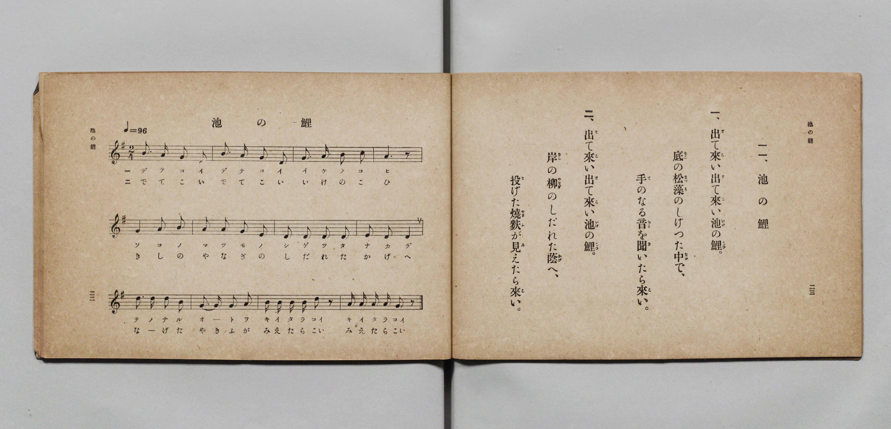

# 池の鯉

> Re:Shōka 使用 AI 協助辨識與重建樂譜，可能會有錯誤。歡迎回報。

- **鋼琴伴奏版**：<br><audio controls src="ike_no_koi.mp3"></audio>

- 詞：文部省《尋常小學唱歌》
- 曲：文部省《尋常小學唱歌》
- 文部省《尋常小學唱歌 第一學年用》（明治四十四年五月，索書號 4103）

## 說明

原書資訊與歌詞全文（對應 P014.jpg，原書 p. 22–23，第一學年第 11 首）：
調性與拍號：ト長調 2/4 拍子，♩=96


## 歌詞

```text
一、出（で）て來（こ）い出（で）て來（こ）い池（いけ）の鯉（こひ）。
底（そこ）の松藻（まつも）のしげつた中（なか）で、
手（て）のなる音（おと）を聞（き）いたら來（こ）い。

二、出（で）て來（こ）い出（で）て來（こ）い池（いけ）の鯉（こひ）。
岸（きし）の柳（やなぎ）のしだれた蔭（かげ）へ、
投（な）げた燒麩（やきふ）が見（み）えたら來（こ）い。
```

## ABC

<div class="abc-score" data-abc-src="ike_no_koi.abc" aria-label="五線譜載入中"></div>

[下載 ABC 原始檔](ike_no_koi.abc)

## TMD 檔案連結

- [主旋律 TMD 檔案](ike_no_koi.tmd) [[在 TMD Studio 編輯](https://tmdlang.github.io/Tmd-TS/#tmd=s7IKdvYPcrWy4qpTUCpJTLdSSM7PyUlNLsnMz7PKyszLyo8vzshPT8wuBdHZiUpwdWX5OaW5qVbpRYkpqfGG8SaGBsYIyeL80qLkVKvi5Iz8_Jz4ktSKkqT8_Gx0-fiCxPRUqwADQxOETEFRfllqXmIeUHdBUWZeSWoKWDtCQWpZZkoqSLostSgzLTM1BclJqUXFIHdDTS8pSswrTi7KLAB5BqEqv6gE6KOixIKMSquMzOKS_KLM5MSc-OzEPCTflWSkAj2XmJeZm5iDrDUzPTPPKjc_L6kUGBxKXFpaCs82LnjcuO7l-k4FLS0uRVsFSzMue1sFdy4bI30TO5DOFyvnvd8z69m09pfNK57PaXzc0PV0Q_fTHTuebuh_unbH0ykbn63tedzQDbbl2exNxKvFq0rh-Zo1T3Y0gPg7tzyfsgKo6_2ejmcz-p5t2v109uynvY0gcueWJ7umPJvT8X5Pz_Mti57N3vFi5nwFUFS-39OpxMWlr6VgSy3ApaCg8LRvPsiOze0vVnS96GgHOhMYOE9bVwC9AnTc0w29z9o7FUDpQS-rIB3oJoh6hQI9BSOjRw2TjYDO6kHx15o1CoaGCi-XTQO6FxhwIDterNr_rGE5yPTuXqBvgKKPmzteTt0OFFcARokCUPjp2glAgx7NXGkLjCyQHqCBjxsan7bvArriceNyoGGPG5c92dcG5k4Gc1vwywJTAZjb8rhxIlgElCIgCh43AuO083FDEzgEdk0Fi86F6Vz3bO6-F9N3gwX3PW5c8ripCSL-uHH648ZJIJHG-U92rAUrWPW4ERiLQNnlQOeCjHvWCYpVoHNgelY9bup-OX8zWLDrceMKkHjTpBeNwCQIFOmFOBZo4uOmTjQfgBwIDotdwBRGn7DYtAPiKqBXoWEBcXkTUCfQq31IAbHgcVMP0NkvpkACohsYNGDZHbCA6IKE6yqwKDDY5j9vn_Ry10qYcUA7toKlel4sgwTZfjAXyMARFkBDKU_0UKCgpc_F5Zmd6pfvnZ9pFZCZmJfvUGNQUw2yRMHG0EzLDszClt2g-fjFwh4FDRMFYA5_vr5BB55HNLFoANoFMqxGwVhBFwiNFAyBpGk8kMAqBGIaATFEygQoAuLBoAFIDdg8H8MahcfN7WDRx81tCo-bNoNYTUvApuCRAdOPmzaCZfsgqoAqQHomIdkEdg3EJiOgXONyiMrGZUA8GcxqgZiHRwZEAxMdmFwHVTUZLLMJwyb8Ib6rh5wQB4UlKDQhYQlyEygsQRgkYwYJcHC4g4MfzIJGA1gSTEDlUcK9aS883GBhCAn1eeBQBfu7eRE8hEE6tkN1bILJN-2H6ukC81aDVUNiDTXke6EhNx0eihATIaG7CkyCbIHIgnRMh-pYAFTVA2bNh8p0g3mgeAbmVbhdBFJ7JzlhbwoJVTANCn9YbBjCUzgo-UMgSA04ZQPFIRCkBj2tt0F8BQxRaJg1g8IMFBKgMIDIdYBJUOoCia8Fp3ZQSD9uXgmKLUjih8Qwfmmk8IebDg03aFiCwx_E7wXirWAWKKxBOoAGNnaAVQLLMlCah2QFqL14pblqubh07RRghZMCkK3MBQA)]
- [鋼琴伴奏 TMD 檔案](ike_no_koi_piano.tmd) [[在 TMD Studio 編輯](https://tmdlang.github.io/Tmd-TS/#tmd=s7IKdvYPcrWy4qpTUCpJTLdSSM7PyUlNLsnMz7PKyszLyo8vzshPT8wuBdHZiUpwdWX5OaW5qVbpRYkpqfGG8SaGBsYIyeL80qLkVKvi5Iz8_Jz4ktSKkqT8_Gx0-fiCxPRUqwADQxOETEFRfllqXmIeUHdBUWZeSWoKWDtCQWpZZkoqSDoxOTk_tyAxLzM3NQ9Jviy1qBjkeKgVJUWJecXJRZkFIB8hVOUXlQC9VZRYkFFplZFZXJJflJmcmBOfnZiH5MWSjFSgD0E2JOYga81Mz8yzys3PSyoFhokSl5aWwrONCx43rnu5vvP9no6X3XueT9jyZM-Wp0v7n3d2vN_TqaClxaVoq2BpxmVvq-DOZWOkb2IHMu7Fynnv98x6Nq39ZfOK53MaHzd0Pd3Q_XTHjqcb-p-u3fF0ysZna3seN3SDrX42exPxavGqUni-Zs2THQ0g_s4tz6esAOoCuvrZjL5nm3Y_nT37aW8jiNy55cmuKc_mAJ3f83zLomezd7yYOV8BFMlA_yhxcXlmp_rle-dnWgVkJublB3k41BjUVHMpAIGNoZmWHZilr6Vgiw6glr9Y2KOgYaIAdNbz9Q06CqAkoJdVkK6JRYOWPtiwGgVjBV0gNFIwBJKm8UACqxCIaQTEECkToAiIB4MGIDVg83wMaxQeN7eDRR83tyk8btoMYjUtAZuCRwZMP27aCJbtg6gCqgDpmYRkE9g1EJuMgHKNyyEqG5cB8WQwqwViHh4ZEP24cSKYXAdVNRksswnDJvwhvquHnBAHhSUoNCFhCXITKCxBGCRjBglwcLiDgx_MgkYDWBJMQOVRwr1pLzzcYGEICfV54FAF-7t5ETyEQTq2Q3Vsgsk37Yfq6QLzVoNVQ2INNeR7oSE3HR6KEBMhobsKTIJsgciCdEyH6lgAVNUDZs2HynSDeaB4fty4A24XgdTeSU7Ym0JCFUyDwh8WG4bwFA5K_hAIUgNO2UBxCASpQU_rbRBfAUMUGmbNoDADhQQoDCByHWASlLpA4mvBqR0U0o-bV4JiC5L4ITGMXxop_OGmQ8MNGpbg8Afxe4F4K5gFCmuQDqCBjR1glY-bOkFpHpIVoPbileaqRS-bfJDLJhNo0QQMTVB61TZGZ5nFa4PKDNP4eGD4QXyBrAIkbhKvbQRlGsVrA5N3DVAIpALIwm84kiFAHtitunYKMOdG-xjGKqDwjcB8ZS4A)]

## 分析

```text
================================================================================
📊 TMD Song Profile: [ 池の鯉 ]
================================================================================
⏱  Duration:       0:15 (15.0s), 12 measures total
🎼 Key & Tempo:    首調基準 G, != 96.0 BPM, <2/4>
   - 分析範圍：      由實際發聲的音符與和弦推測調性；播放脈絡另行呈現
🎤 人聲音域:    D4 (MIDI 62) – D5 (MIDI 74) [跨度: 12 個半音 / 1.0 個八度, 難度: easy]
   - 最低音:  D4 in [IkeNoKoi #1 @ m.1, 0:00]
   - 最高音: D5 in [IkeNoKoi #1 @ m.9, 0:10]
   - 適合: soprano, mezzo-soprano, contralto, tenor, baritone, bass
🏛  結構:      IkeNoKoi (15.0s)
⚡ 編曲密度:        Peak 1 軌道同時演奏
🗝  調性診斷：       D 調性不明確（純淨自然大調，未偵測到可信轉調）
   - 風格氣質:    純淨自然大調（陽光明朗、易唱易記，無明顯調外色彩）
   - 轉調歷程:    全曲維持單一推測調性（未偵測到可信轉調）
   - 核心骨幹音:  D, A, G, B, E
   - 調性數值:    D 調性不明確 [相關度: 0.82, 穩定度: Ambiguous, 自然音純度: 98.9%]
   - 候選調性 (K-S): D 大調 (0.82), G 大調 (0.79), B 小調 (0.64)
   - 五度圈歷程:   +2
   - 各段落調性細節:
     • [IkeNoKoi #1]: D 調性不明確 (r: 0.82, 自然音純度: 98.9%, 調外音: C)

  [ 五度圈游移軌跡 ]
               C  
         F            G  
      Bb              [D ]*
      Eb               A  
         Ab           E  
            Db       B  
               F# 
     (* = active key center)

  [ 十二半音累積音高分佈 ]
     C  : █                          1.1%
     C# :                            0.0%
     D  : ████████████████████████  26.7%
     D# :                            0.0%
     E  : ██████                     6.7%
     F  :                            0.0%
     F# :                            0.0%
     G  : ███████████████████       21.1%
     G# :                            0.0%
     A  : █████████████████████     23.3%
     A# :                            0.0%
     B  : ███████████████████       21.1%
--------------------------------------------------------------------------------
Assignment 軌道音域：
  - Piano         : D4 – D5 (12 個半音 / 1.0 個八度, 45 個音符)
================================================================================
```


## 原書掃描頁




