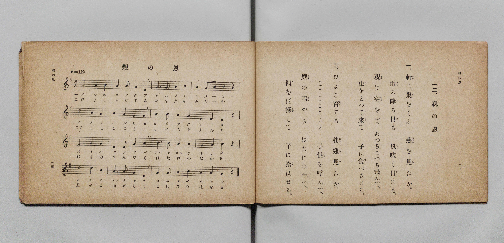

# 親の恩

> Re:Shōka 使用 AI 協助辨識與重建樂譜，可能會有錯誤。歡迎回報。

- **鋼琴伴奏版**：<br><audio controls src="oya_no_on.mp3"></audio>

- 詞：文部省《尋常小學唱歌》
- 曲：文部省《尋常小學唱歌》
- 文部省《尋常小學唱歌 第一學年用》（明治四十四年五月，索書號 4103）

## 說明

原書資訊與歌詞全文（對應 P015.jpg，原書 p. 24–25，第一學年第 12 首）：
調性與拍號：ト長調 4/4 拍子，♩=112


## 歌詞

```text
一、軒（のき）に巣（す）をくふ　燕（つばめ）を見（み）たか。
雨（あめ）の降（ふ）る日（ひ）も　風吹（かぜふ）く日（ひ）にも、
親（おや）は空（そら）をば　あつちこつち飛（と）んで、
虫（むし）をとつて來（き）て　子（こ）に食（た）べさせる。

二、ひよこ育（そだ）てる　牝雞（めんどり）見（み）たか。
こここここここと　子供（こども）を呼（よ）んで、
庭（には）の隅（すみ）やら　はたけの中（なか）で、
餌（ゑ）をば探（さが）して　子（こ）に拾（ひろ）はせる。
```

## ABC

<div class="abc-score" data-abc-src="oya_no_on.abc" aria-label="五線譜載入中"></div>

[下載 ABC 原始檔](oya_no_on.abc)

## TMD 檔案連結

- [主旋律 TMD 檔案](oya_no_on.tmd) [[在 TMD Studio 編輯](https://tmdlang.github.io/Tmd-TS/#tmd=s7IKdvYPcrWy4qpTUCpJTLdSSM7PyUlNLsnMz7PKyszLyo8vzshPT8wuBdHZiUpwdWX5OaW5qVbpRYkpqfGG8SaGBsYIyeL80qLkVKvi5Iz8_Jz4ktSKkqT8_Gx0-fiCxPRUqwADQ1OETEFRfllqXmIeUHdBUWZeSWoKWDtCQWpZZkoqSLostSgzLTM1BclJqUXFIHdDTS8pSswrTi7KLAB5BqEqv6gE6KOixIKMSquMzOKS_KLM5MSc-OzEPCTflWSkAj2XlpibmVOJLpqbX5SYg2xeZnpmHlA0L6kUGEZKXFpaCi-WrXrcuO5Z40oFLS0uRVsFQ0MjLntbBXcuGxN9EzuQ1hcr573fM-vZtPaXzSuez2l83ND1dEP30x07nm7of7p2x9MpG5-t7Xnc0A225tnsTcSrxatK4fmaNU92NID4O7c8n7ICqOv9no5nM_qebdr9dPbsp72NIHLnlie7pjyb0_F-T8_zLYuezd7xYuZ8BVAEv9_TqcTFpa-lYEstwKWgoPC0bz7Ijs3tL1Z0vehoBzoTGDhPW1cAvQJ03NMNvc_aOxVAqUQvqyAd6CaIeoUCPQUjk0cNk41MQe5E9teaNQqGRgovl00DuhcYcCA7Xqza_6xhOcj07l6gb4Cij5s7Xk7dDhRXAEaJAlD46doJQIMezVxpC4otkCagiY8bGl_sngR0BjA6Hzf2Ag183Lj66fbFYJGZIG7TpMeN_Y8btz5uaHjePhUsvuRx44bHTY0Q2RfLQEH8uHE_WO_8x43djxuaQKa_nL0CLNEEVdq47uVMoAVAka1gnd3Ppi8Fc4GRD-Q2AS14uWjF0wk7wYLdjxvnQFU29qOobFwNVtwI9vayVWCJrsdNLWC59c9X7gKLzH3cBAwbiPM3AI0GuQPk8IWPGydDGC8XzwarBLoSqAwouBxm6MzVIIkmoJ7pMCNWgPUse7KvDawHElDLgOaCQxUoMhnitJeLgWEP5AJJIHfn48apjxtnA_0KChNwkO8CpuRGoE8eN4E0vWgCegns2sYFUCNBahued859ORuYgYCuaAS7beXjpi6gApyBDfYVJgJmAJALn-yDeBViUBPEU08n7gFbAMwGqP5_umstWPVqYHBCI25WKyRBQG1uagGGLjhQ14NdMRGo5skOiC5gwQB0I1AXzLiXS3rA9kyER8ezvkVgpcCwAUoBlU7HGpbPuvdBYv1xEyS8gZbBwhJoLuWZEwoUtPS5uPwrE_3y_fOsAjIT8_IdagxqqkF2KNhYaNmBGdgKBWhp82Jhj4KGiQKwHHq-vkEHnpM1sWgA2gQyrEbBUEEXDI2A2BiIa8AsEB8kYxoPFoIoMkRTBOKDeAYgEbBxPoY1Co-b-6BGPm5aCyKbu8E6HjfthIg2bwKy14NZUyEyzS1QmQlAvBCqBiIzH2zOfjC5GkiC3QOxywgo3whSB7GrA0Q2Toboa5wLEW1cAMTLwPIwVzRC1U8GyqwEs7qgesC2NIJtbASphtiFP9B39ZAT6KZQV4NCDxSSNXAWKKRBuEbBBKzCBC5ao2AGchCYAEcLWrA3LYIFBTQIQdEACkJQID9uBgXe4-ZJYBKkEqQDJAYKgD0wVeBoAemBqAMFAkQ1erCDMjXMOjALEfIIHjDXQ9XAxEFiK4HWNIEtA1kCcgY45oDxAZJdTmS47-gkJ9zBgQdJyrBABQclOERBfERkgCIHxIOIwOSwJPemVfBwXwIm-6He2gsVBXoYnJxByRsiswiR4huB3M0QLogDCX1wgDRvBpPtWEIfEm-g4AJno8Z10CCeCRXdDzQUbGJTJ1QGpA6SuIFlJIoekOshyZ3owAe2XChJ9CCaxJIGlgfQS5oFsIBo2g4OLFip0YEI4DZ4MdQGDX1QuEJSN7RgaQaFG0hmK9io3WAxLIVNEyjkINaB80fjBmgYgvIOiN8DxNPBLFCRg5zoV0OLKmAFghQjwFoELIYobGq5uHTtFKBVgAKQqcwFAA)]
- [鋼琴伴奏 TMD 檔案](oya_no_on_piano.tmd) [[在 TMD Studio 編輯](https://tmdlang.github.io/Tmd-TS/#tmd=s7IKdvYPcrWy4qpTUCpJTLdSSM7PyUlNLsnMz7PKyszLyo8vzshPT8wuBdHZiUpwdWX5OaW5qVbpRYkpqfGG8SaGBsYIyeL80qLkVKvi5Iz8_Jz4ktSKkqT8_Gx0-fiCxPRUqwADQ1OETEFRfllqXmIeUHdBUWZeSWoKWDtCQWpZZkoqSDoxOTk_tyAxLzM3NQ9Jviy1qBjkeKgVJUWJecXJRZkFIB8hVOUXlQC9VZRYkFFplZFZXJJflJmcmBOfnZiH5MWSjFSgD9MSczNzKtFFc_OLEnOQzctMz8wDiuYllQIDSolLS0vhxbJVjxvXPWtc-X5Px8vuPc8nbHmyZ8vTpf3POzve7-lU0NLiUrRVMDQ04rK3VXDnsjHRN7EDmfdi5bz3e2Y9m9b-snnF8zmNjxu6nm7ofrpjx9MN_U_X7ng6ZeOztT2PG7rBdj-bvYl4tXhVKTxfs-bJjgYQf-eW51NWAHUBnf1sRt-zTbufzp79tLcRRO7c8mTXlGdzgO7veb5l0bPZO17MnK8Ainqgh5S4uPwrE_3y_fOsAjIT8_KDPBxqDGqquRSAwMZCyw7M0NdSsEUHUKtfLOxR0DBRADrq-foGHQVQstDLKkjXxKJBSx9sWI2CoYIuGBoBsTEQ14BZID5IxjQeLARRZIimCMQH8QxAImDjfAxrFB4390GNfNy0FkQ2d4N1PG7aCRFt3gRkrwezpkJkmlugMhOAeCFUDURmPtic_WByNZAEuwdilxFQvhGkDmJXB4hsnAzR1zgXItq4AIiXgeVhrmiEqp8MlFkJZnVB9YBtaQTb2AhSDbELf6Dv6iEn0E2hrgaFHigka-AsUEiDcI2CCViFCVy0RsEM5CAwAY4WtGBvWgQLCmgQgqIBFISgQH7cDAq8x82TwCRIJUgHSAwUAHtgqsDRAtIDUQcKBIhq9GCfDAlpSBiDWIiQR_AeN66AqoGJg8RWAq1pAlsGsgTkDHDMAeMDJLucyHDf0UlOuIMDD5KUYYEKDkpwiIL4iMgARQ6IBxGByWFJ7k2r4OG-BEz2Q721FyoK9DA4OYOSN0RmESLFNwK5myFcEAcS-uAAad4MJtuxhD4k3kDBBc5GjeugQTwTKrofaCjYxKZOqAxIHSRxP26ciKIH5HpIcic68IHFGCWJHkSTWNLA8gB6SbMAFhBN28GBBSs1OhAB3AYvhtqgoQ8KV0jqhhYszaBwA8lsBRu1GyyGpbBpAoUcxDpw_mjcAA1DUN4B8XuAeDqYBSpykBP9amhR9bipFylGHjfOBoshCptatBrAB7kGMIHWAMBQigeGl7YxkIAyQOk4XsEkXhsYmHAhHKpAGChlAPUaQh2QBpsAFkEzywSoySxe2wTZMBQxhHFwYYRuZMchrIA7DtNWrI4j2afIpgFDVtdOARq40T6GsQrIXCMwV5kLAA)]

## 分析

```text
================================================================================
📊 TMD Song Profile: [ 親の恩 ]
================================================================================
⏱  Duration:       0:34 (34.3s), 16 measures total
🎼 Key & Tempo:    首調基準 G, != 112.0 BPM, <4/4>
   - 分析範圍：      由實際發聲的音符與和弦推測調性；播放脈絡另行呈現
🎤 人聲音域:    D4 (MIDI 62) – D5 (MIDI 74) [跨度: 12 個半音 / 1.0 個八度, 難度: easy]
   - 最低音:  D4 in [OyaNoOn #1 @ m.2, 0:03]
   - 最高音: D5 in [OyaNoOn #1 @ m.5, 0:08]
   - 適合: soprano, mezzo-soprano, contralto, tenor, baritone, bass
🏛  結構:      OyaNoOn (34.3s)
⚡ 編曲密度:        Peak 1 軌道同時演奏
🗝  調性診斷：       G 大調（純淨自然大調，未偵測到可信轉調）
   - 風格氣質:    純淨自然大調（陽光明朗、易唱易記，無明顯調外色彩）
   - 轉調歷程:    全曲維持單一推測調性（未偵測到可信轉調）
   - 核心骨幹音:  A, G, D, B, E
   - 調性數值:    G 大調 [相關度: 0.77, 穩定度: Moderate, 自然音純度: 100.0%]
   - 候選調性 (K-S): G 大調 (0.77), D 大調 (0.70), A 小調 (0.49)
   - 五度圈歷程:   +1
   - 各段落調性細節:
     • [OyaNoOn #1]: G 大調 (r: 0.77, 自然音純度: 100.0%)

  [ 五度圈游移軌跡 ]
               C  
         F           [G ]*
      Bb               D  
      Eb               A  
         Ab           E  
            Db       B  
               F# 
     (* = active key center)

  [ 十二半音累積音高分佈 ]
     C  : ███                        3.3%
     C# :                            0.0%
     D  : ██████████████            16.7%
     D# :                            0.0%
     E  : █████                      6.7%
     F  :                            0.0%
     F# :                            0.0%
     G  : ███████████████████████   27.5%
     G# :                            0.0%
     A  : ████████████████████████  29.2%
     A# :                            0.0%
     B  : ██████████████            16.7%
--------------------------------------------------------------------------------
Assignment 軌道音域：
  - Piano         : D4 – D5 (12 個半音 / 1.0 個八度, 57 個音符)
================================================================================
```


## 原書掃描頁




