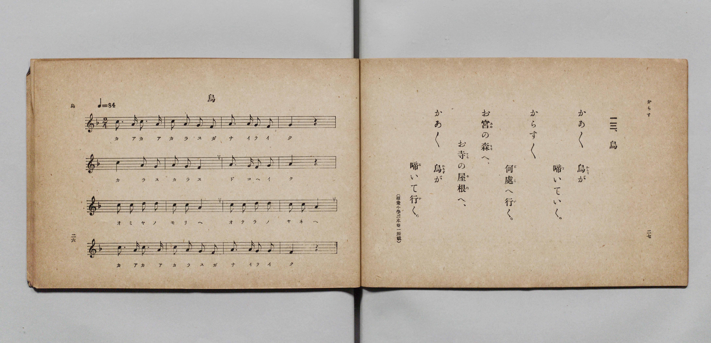

# 烏

> Re:Shōka 使用 AI 協助辨識與重建樂譜，可能會有錯誤。歡迎回報。

- **鋼琴伴奏版**：<br><audio controls src="karasu.mp3"></audio>

- 詞：文部省《尋常小學唱歌》（尋常小學讀本卷一所載）
- 曲：文部省《尋常小學唱歌》
- 文部省《尋常小學唱歌 第一學年用》（明治四十四年五月，索書號 4103）

## 說明

原書資訊與歌詞全文（對應 P016.jpg，原書 p. 26–27，第一學年第 13 首）：
調性與拍號：ヘ長調 2/4 拍子，♩=84


## 歌詞

```text
かあ／＼　烏（からす）が
啼（な）いていく。
からす／＼
何處（どこ）へ行（い）く。
お宮（みや）の森（もり）へ、
お寺（てら）の屋根（やね）へ、
かあ／＼　烏（からす）が
啼（な）いて行（い）く。
（尋常小學讀本卷一所載）
```

## ABC

<div class="abc-score" data-abc-src="karasu.abc" aria-label="五線譜載入中"></div>

[下載 ABC 原始檔](karasu.abc)

## TMD 檔案連結

- [主旋律 TMD 檔案](karasu.tmd) [[在 TMD Studio 編輯](https://tmdlang.github.io/Tmd-TS/#tmd=s7IKdvYPcrWy4qpTUCpJTLdSSM7PyUlNLsnMz7PKyszLyo8vzshPT8wuBdHZiUpwdWX5OaW5qVbpRYkpqfGG8SaGBsYIyeL80qLkVKvi5Iz8_Jz4ktSKkqT8_Gx0-fiCxPRUqwADQzOETEFRfllqXmIeUHdBUWZeSWoKWDtCQWpZZkoqSLostSgzLTM1BclJqUXFIHdDTS8pSswrTi7KLAB5BqEqv6gE6KOixIKMSquMzOKS_KLM5MSc-OzEPCTflWSkAj2XmJeZm5iDrDUzPTPPKjc_L6kUGBxKXFpaCs-b-xW0tLgUbRUsTLjsbRXcuGyM9E3sQHperJz3fs-sZ9PaXzaveD6n8XFD19MN3U937Hi6of_p2h1Pp2x8trbncUP3-z0dyOIv1jU8m7Pmae_2JzsannU2vNjT-X5PJ9gNz2ZvIsY8iFq8qhSer1kDNB7E37nl-ZQVEFc8m9H3bNPup7NnP-1tBJE7tzzZNeXZnI73e3qeb1n0bPaOFzPnK4AiGuwgLn0tBVtqAS4FBYWnffNBdmxuf7Gi60VHO9CZwAB82roC6BVwEPU-a-9UAKUWvayCdKCbIOoVCvQUjMweNUw2Mge5E9lfa9YoGBorvFw2DeheYMCB7Hixav-zhuUg07t7gb4Bij5unvFy6naguAIw2hSAwk_XTgAa9GjmSltghIL0PG7sftzY9H5P__s9ex43NAAjHOgckGBT5-PGmUCzHzf2gN0_dQ9YYhVYqOVx4zIw2f-4oQlmDFQHyCSQ0JO9U1_MnArWtPJx42Swvh0vFvaARVrAXITurqfr1oEl9j9ugsite7YYLNLU9LipC6L5cUMjTPX6XWDVy4CWQlQ_3dj9bMFOsAags9aiaSDXj9idS0yaBqmjPOVAgYKWPheXd2JRYnGpVUBmYl6-Q41BTTXICgUbQzMtOzALW4qFZgWgNxQ0TBSAzn2-vkEHnsw0sWgA2gQyrEbBVEEXCI3hNETEGIiNgNgQiGvAPJAYQgTEAkEDKF0DNs2nRuFx02qwwOOmRShsmMzj5pVgkZ1gcg3YsMfNXVB1S4DsNigLLNO0HmpBPNwi_IGwq4f8QEB4G-JlmHfB9kIDwQgsglCDNxBQvYstCCBGP27uhAbAZiB7BkUBsKOT3AAAYTMoRojAPEmUGkQArAJ7dD6YBHnlcXMf1KuLwDyIPMir0CCA6gDHPiSA4Dog-ntRdeAPBmDJT4_MAEkHsDQyAJmhlotL104BUmQoAFnKXAA)]
- [鋼琴伴奏 TMD 檔案](karasu_piano.tmd) [[在 TMD Studio 編輯](https://tmdlang.github.io/Tmd-TS/#tmd=s7IKdvYPcrWy4qpTUCpJTLdSSM7PyUlNLsnMz7PKyszLyo8vzshPT8wuBdHZiUpwdWX5OaW5qVbpRYkpqfGG8SaGBsYIyeL80qLkVKvi5Iz8_Jz4ktSKkqT8_Gx0-fiCxPRUqwADQzOETEFRfllqXmIeUHdBUWZeSWoKWDtCQWpZZkoqSDoxOTk_tyAxLzM3NQ9Jviy1qBjkeKgVJUWJecXJRZkFIB8hVOUXlQC9VZRYkFFplZFZXJJflJmcmBOfnZiH5MWSjFSgD0E2JOYga81Mz8yzys3PSyoFhokSl5aWwvPm_vd7Ol5273k-YcuTPVueLu1_3tnxfk-ngpYWl6KtgoUJl72tghuXjZG-iR3IoBcr573fM-vZtPaXzSuez2l83ND1dEP30x07nm7of7p2x9MpG5-t7Xnc0A00E1n8xbqGZ3PWPO3d_mRHw7POhhd7OoFWgB32bPYmYsyDqMWrSuH5mjVA40H8nVueT1kBccWzGX3PNu1-Onv2095GELlzy5NdU57NAXqx5_mWRc9m73gxc74CKAmAHcTlnViUWFxqFZCZmJcf5OFQY1BTzaUABDaGZlp2YJa-loItOoBa_WJhj4KGiQLQUc_XN-gogJKHXlZBuiYWDVr6YMNqFEwVdIHQGE5DRIyB2AiIDYG4BswDiSFEQCwQNIDSNWDTfGoUHjetBgs8blqEwobJPG5eCRbZCSbXgA173NwFVbcEyG6DssAyTeuhFsTDLcIfCLt6yA8EhLchXoZ5F2wvNBCMwCIINXgDAdW72IIAYvTj5k5oAGwGsmdQFAA7OskNABA2g2KECMyTRKlBBMAqsEfng0mQVx4390G9ugjMg8iDvAoNAqgOcOxDAgiuA6K_F1UH_mAA5jR6ZAZIOoClkQHIDLWoJYYPcolhAi0wgA6MVzCN1wZ5BxvLND4e6HSIo8HiJvHaRuhqEWIoSs3itU3QlaKL4XcEqsFA_-jaKUC8pABkKXMBAA)]

## 分析

```text
================================================================================
📊 TMD Song Profile: [ 烏 ]
================================================================================
⏱  Duration:       0:22 (22.9s), 16 measures total
🎼 Key & Tempo:    首調基準 F, != 84.0 BPM, <2/4>
   - 分析範圍：      由實際發聲的音符與和弦推測調性；播放脈絡另行呈現
🎤 人聲音域:    F4 (MIDI 65) – D5 (MIDI 74) [跨度: 9 個半音 / 0.8 個八度, 難度: easy]
   - 最低音:  F4 in [Karasu #1 @ m.2, 0:02]
   - 最高音: D5 in [Karasu #1 @ m.9, 0:12]
   - 適合: soprano, mezzo-soprano, contralto, tenor, baritone, bass
🏛  結構:      Karasu (22.9s)
⚡ 編曲密度:        Peak 1 軌道同時演奏
🗝  調性診斷：       A 調性不明確（純淨自然大調，未偵測到可信轉調）
   - 風格氣質:    純淨自然大調（陽光明朗、易唱易記，無明顯調外色彩）
   - 轉調歷程:    全曲維持單一推測調性（未偵測到可信轉調）
   - 核心骨幹音:  C, A, G, F, D
   - 調性數值:    A 調性不明確 [相關度: 0.79, 穩定度: Ambiguous, 自然音純度: 100.0%]
   - 候選調性 (K-S): A 小調 (0.79), C 大調 (0.76), F 大調 (0.69)
   - 五度圈歷程:   +3
   - 各段落調性細節:
     • [Karasu #1]: A 調性不明確 (r: 0.79, 自然音純度: 100.0%)

  [ 五度圈游移軌跡 ]
               C  
         F            G  
      Bb               D  
      Eb              [A ]*
         Ab           E  
            Db       B  
               F# 
     (* = active key center)

  [ 十二半音累積音高分佈 ]
     C  : ████████████████████████  31.0%
     C# :                            0.0%
     D  : █████                      6.9%
     D# :                            0.0%
     E  :                            0.0%
     F  : ███████████               13.8%
     F# :                            0.0%
     G  : ██████████████            18.1%
     G# :                            0.0%
     A  : ███████████████████████   30.2%
     A# :                            0.0%
     B  :                            0.0%
--------------------------------------------------------------------------------
Assignment 軌道音域：
  - Piano         : F4 – D5 (9 個半音 / 0.8 個八度, 51 個音符)
================================================================================
```


## 原書掃描頁




