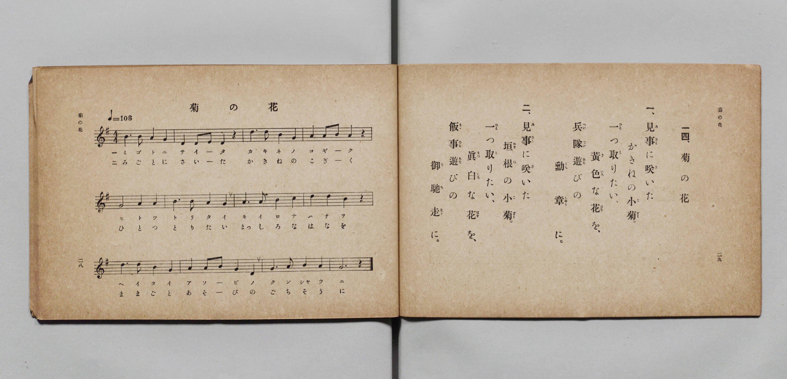

# 菊の花

> Re:Shōka 使用 AI 協助辨識與重建樂譜，可能會有錯誤。歡迎回報。

- **鋼琴伴奏版**：<br><audio controls src="kiku_no_hana.mp3"></audio>

- 詞：文部省《尋常小學唱歌》
- 曲：文部省《尋常小學唱歌》
- 文部省《尋常小學唱歌 第一學年用》（明治四十四年五月，索書號 4103）

## 說明

原書資訊與歌詞全文（對應 P017.jpg，原書 p. 28–29，第一學年第 14 首）：
調性與拍號：ト長調 4/4 拍子，♩=108


## 歌詞

```text
一、見事（みごと）に咲（さ）いた
かきねの小菊（こぎく）。
一つ（ひとつ）取（と）りたい、
黄色（きいろ）な花（はな）を、
兵隊遊（へいたいあそ）びの
勳章（くんしやう）に。

二、見事（みごと）に咲（さ）いた
垣根（かきね）の小菊（こぎく）。
一つ（ひとつ）取（と）りたい、
眞白（まつしろ）な花（はな）を、
飯事遊（まゝごとあそ）びの
御馳走（ごちそう）に。
```

## ABC

<div class="abc-score" data-abc-src="kiku_no_hana.abc" aria-label="五線譜載入中"></div>

[下載 ABC 原始檔](kiku_no_hana.abc)

## TMD 檔案連結

- [主旋律 TMD 檔案](kiku_no_hana.tmd) [[在 TMD Studio 編輯](https://tmdlang.github.io/Tmd-TS/#tmd=s7IKdvYPcrWy4qpTUCpJTLdSSM7PyUlNLsnMz7PKyszLyo8vzshPT8wuBdHZiUpwdWX5OaW5qVbpRYkpqfGG8SaGBsYIyeL80qLkVKvi5Iz8_Jz4ktSKkqT8_Gx0-fiCxPRUqwADQ3OETEFRfllqXmIeUHdBUWZeSWoKWDtCQWpZZkoqSLostSgzLTM1BclJqUXFIHdDTS8pSswrTi7KLAB5BqEqv6gE6KOixIKMSquMzOKS_KLM5MSc-OzEPCTflWSkAj1XkJOYh2Q1UGV6Zp5Vbn5eUikwNJS4tLQUXvR3PW5c96Jro4KWFpeirYKhgQWXva2CO5eNib6JHUjri5Xz3u-Z9Wxa-8vmFc_nND5u6Hq6ofvpjh1PN_Q_Xbvj6ZSNz9b2PG7oBlvzbPYm4tXiVaXwfM2aJzsaQPydW55PWQHU9X5Px7MZfc827X46e_bT3kYQuXPLk11Tns3peL-n5_mWRc9m73gxc74CKCrf7-lU4uLS11KwpRbgUlBQeNo3H2TH5vYXK7pedLQDnQkMnKetK4BeATru6YbeZ-2dCqD0oJdVkA50E0S9QoGegpHFo4bJRpYgdyL7a80aBUMThZfLpgHdCww4kB0vVu1_1rAcZHp3L9A3QNHHzR0vp24HiisAo0QBKPx07QSgQY9mrrQFxRZIE9DExw2NL5Z1P9kFCqbHjfsfN0553LgCaOzjxtVPJwFjBSg4Fcxtedw4H6TncWP348bex41rgfEPDHlgQgArmvy4se9xYz9IaUMTzOzGJWC5TUAjwezOp_1AJwNFwDY0AZPQfJDBDY0gDS93t7zohNgINL7lcVMv2N5VwEQGFlwPZIO1TYJqeNq69eWsrpeNEAfsgDgRTDY9bpwL1rwZ6Eiw0u7Nz1cvAKvrf9wEdOv0x01AdW0Qj4JcDHbyLmAqIzE4ns5b_GzBTrAENFzA0tQNmudz5j2fuRcsvQ-oGux8QqHzcvF6oDdgobPvcdNciGewhc6-hS-XbX6xdQNYKVDRQqAKlNABKqI8K0CBgpY-F5d3ZnapX74HsPCxCshMzMt3qDGoqQZZo2BjoWUHZmDLhdDs_WJhj4KGiQIwjJ-vb9CBZx1NLBqAloEMq1EwVtAFQmMFIyBpCMQ1CqbxQApImMVDmAYQUbA6U7B6iDqQDiOoTrAasIk-hjUKj5vng1U_btoCZHeAWM3dYD2Pm7aCxZeAyf1AEmQDSHw1VMdaoNpesI4-qMxmsPg6MLkepgNilxFQvhFkClCucQoQrwCzQGaBZKaCeS1gEuQiqF2NILeAxHqBeC2YBTIdJDMZzAPZDEyZcLvwh_uuHnLCHRSGIAgJRZDtmDEBYkHCWFfBBB4LIAwSQQ_zSVATYSEO8jdIHMQD8VdBQxwS-qCQBfkdwn_cDA6H5i6oHpDfIbzHzZuwhDlIDBKGkBCHmgjmgUzsgoY4JPRBMsAMuhiqZTpQATiKG1dBJUHRCuEBMyqRwb6jk5xgx52MQTxweofFDSTcIXEDiy0QRA_3GYhQRAvfRWDeXnAoglMWPE2DPAzibwaytz9uBoXM46Zl0MCHJE8IRA_4fdAw3AdO8LAIAMk0gXlzwSQ4y8ATNUgdiL8QLt8GlYFkOmSbarm4dO0UEMWQApCnzAUA)]
- [鋼琴伴奏 TMD 檔案](kiku_no_hana_piano.tmd) [[在 TMD Studio 編輯](https://tmdlang.github.io/Tmd-TS/#tmd=s7IKdvYPcrWy4qpTUCpJTLdSSM7PyUlNLsnMz7PKyszLyo8vzshPT8wuBdHZiUpwdWX5OaW5qVbpRYkpqfGG8SaGBsYIyeL80qLkVKvi5Iz8_Jz4ktSKkqT8_Gx0-fiCxPRUqwADQ3OETEFRfllqXmIeUHdBUWZeSWoKWDtCQWpZZkoqSDoxOTk_tyAxLzM3NQ9Jviy1qBjkeKgVJUWJecXJRZkFIB8hVOUXlQC9VZRYkFFplZFZXJJflJmcmBOfnZiH5MWSjFSgDwtyEpHNB6pMz8yzys3PSyoFBokSl5aWwov-rseN6150bXy_p-Nl957nE7Y82bPl6dL-550d7_d0KmhpcSnaKhgaWHDZ2yq4c9mY6JvYgcx7sXLe-z2znk1rf9m84vmcxscNXU83dD_dsePphv6na3c8nbLx2dqexw3dYLufzd5EvFq8qhSer1nzZEcDiL9zy_MpK4C6gM5-NqPv2abdT2fPftrbCCJ3bnmya8qzOUD39zzfsujZ7B0vZs5XAEUy0ENKXFzemdmlfvkewOCyCshMzMsP8nCoMaip5lIAAhsLLTswQ19LwRYdQG1_sbBHQcNEAeiu5-sbdBRAaUAvqyBdE4sGLX2wYTUKxgq6QGisYAQkDYG4RsE0HkgBCbN4CNMAIgpWZwpWD1EH0mEE1QlWAzbRx7BG4XHzfLDqx01bgOwOEKu5G6zncdNWsPgSMLkfSIJsAImvhupYC1TbC9bRB5XZDBZfBybXw3RA7DICyjeCTAHKNU4B4hVgFsgskMxUMK8FTIJcBLWrEeQWkFgvEK8Fs0Cmg2Qmg3kgmx839sPtwh_uu3rICXdQGIIgJBRBtmPGBIgFCWNdBRN4LIAwSAQ9zCdBTYSFOMjfIHEQD8RfBQ1xSOiDQhbkdwj_cTM4HJq7oHpAfofwHjdvwhLmIDFIGEJCHGoimAcysQsa4pDQB8nse9y4GKplOlABOIobV0ElQdEK4T1uAnmDmGDf0UlOsONOxiAeOL3D4gYS7pC4gcUWCKKH-wxEKKKF7yIwby84FMEpC56mQR4G8TcD2dsfN4NC5nHTMmjgQ5InBKIH_D5oGO4DJ3hYBIBkmsC8uWASnGXgiRqkDsRfCJdvg8pAMh2yTbWYpZAPcilkAi2FgEESrxBtGAsMMhAdHwsVMQGygLQBQgGUApUrQJYpUB7EACrAYg5IFpvJcEmQFIoiiF2oRmHaCBcxAYmA3IhpHdQkYADo2ikgwiDaByiHJmIEFlHmAgA)]

## 分析

```text
================================================================================
📊 TMD Song Profile: [ 菊の花 ]
================================================================================
⏱  Duration:       0:26 (26.7s), 12 measures total
🎼 Key & Tempo:    首調基準 G, != 108.0 BPM, <4/4>
   - 分析範圍：      由實際發聲的音符與和弦推測調性；播放脈絡另行呈現
🎤 人聲音域:    D4 (MIDI 62) – D5 (MIDI 74) [跨度: 12 個半音 / 1.0 個八度, 難度: easy]
   - 最低音:  D4 in [KikuNoHana #1 @ m.2, 0:02]
   - 最高音: D5 in [KikuNoHana #1 @ m.3, 0:04]
   - 適合: soprano, mezzo-soprano, contralto, tenor, baritone, bass
🏛  結構:      KikuNoHana (26.7s)
⚡ 編曲密度:        Peak 1 軌道同時演奏
🗝  調性診斷：       G 大調（純淨自然大調，未偵測到可信轉調）
   - 風格氣質:    純淨自然大調（陽光明朗、易唱易記，無明顯調外色彩）
   - 轉調歷程:    全曲維持單一推測調性（未偵測到可信轉調）
   - 核心骨幹音:  G, A, B, D, C
   - 調性數值:    G 大調 [相關度: 0.78, 穩定度: Moderate, 自然音純度: 100.0%]
   - 候選調性 (K-S): G 大調 (0.78), D 大調 (0.72), B 小調 (0.58)
   - 五度圈歷程:   +1
   - 各段落調性細節:
     • [KikuNoHana #1]: G 大調 (r: 0.78, 自然音純度: 100.0%)

  [ 五度圈游移軌跡 ]
               C  
         F           [G ]*
      Bb               D  
      Eb               A  
         Ab           E  
            Db       B  
               F# 
     (* = active key center)

  [ 十二半音累積音高分佈 ]
     C  : ██                         2.3%
     C# :                            0.0%
     D  : ████████████████████      21.6%
     D# :                            0.0%
     E  : █                          1.1%
     F  :                            0.0%
     F# :                            0.0%
     G  : ████████████████████████  26.1%
     G# :                            0.0%
     A  : ████████████████████████  26.1%
     A# :                            0.0%
     B  : █████████████████████     22.7%
--------------------------------------------------------------------------------
Assignment 軌道音域：
  - Piano         : D4 – D5 (12 個半音 / 1.0 個八度, 44 個音符)
================================================================================
```


## 原書掃描頁




