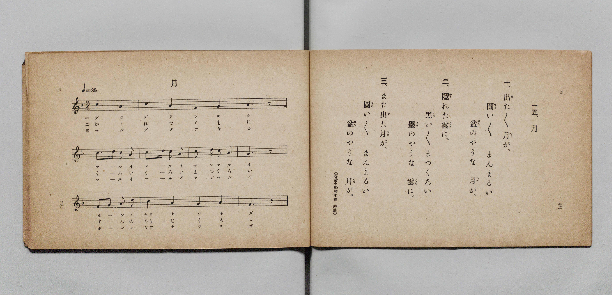

# 月

> Re:Shōka 使用 AI 協助辨識與重建樂譜，可能會有錯誤。歡迎回報。

- **鋼琴伴奏版**：<br><audio controls src="tsuki.mp3"></audio>

- 詞：文部省《尋常小學唱歌》（尋常小學讀本卷二所載）
- 曲：文部省《尋常小學唱歌》
- 文部省《尋常小學唱歌 第一學年用》（明治四十四年五月，索書號 4103）

## 說明

原書資訊與歌詞全文（對應 P018.jpg，原書 p. 30–31，第一學年第 15 首）：
調性與拍號：ヘ長調 2/4 拍子，♩=88


## 歌詞

```text
一、出（で）た／＼月（つき）が、
圓（まる）い／＼　まんまるい
盆（ぼん）のやうな　月（つき）が。

二、隱（かく）れた雲（くも）に、
黑（くろ）い／＼　まつくろい
墨（すみ）のやうな　雲（くも）に。

三、また出（で）た月（つき）が、
圓（まる）い／＼　まんまるい
盆（ぼん）のやうな　月（つき）が。
（尋常小學讀本卷二所載）
```

## ABC

<div class="abc-score" data-abc-src="tsuki.abc" aria-label="五線譜載入中"></div>

[下載 ABC 原始檔](tsuki.abc)

## TMD 檔案連結

- [主旋律 TMD 檔案](tsuki.tmd) [[在 TMD Studio 編輯](https://tmdlang.github.io/Tmd-TS/#tmd=s7IKdvYPcrWy4qpTUCpJTLdSSM7PyUlNLsnMz7PKyszLyo8vzshPT8wuBdHZiUpwdWX5OaW5qVbpRYkpqfGG8SaGBsYIyeL80qLkVKvi5Iz8_Jz4ktSKkqT8_Gx0-fiCxPRUqwADQwuETEFRfllqXmIeUHdBUWZeSWoKWDtCQWpZZkoqSLostSgzLTM1BclJqUXFIHdDTS8pSswrTi7KLAB5BqEqv6gE6KOixIKMSquMzOKS_KLM5MSc-OzEPCTflWSkAj2Xl1hSWpSKrDUzPTPPKjc_L6kUGBxKXFpaCs_mdChoaXEp2ipYWHDZ2yq4cdkY6ZvYgfS8WDnv_Z5Zz6a1v2xe8XxO4-OGrqcbup_u2PF0Q__TtTueTtn4bG3P44bu93s6kMVfrGt4NmfN097tT3b1POtseLGn8_2eTrAbns3eRIx5ELV4VSk8X7PmyY4GEH_nludTVkBc8WxG37NNu5_Onv20txFE7tzyZNcUoP_e7-l5vmXRs9k7XsycrwCKaLCDuPS1FGypBbgUFBSe9s0H2bG5_cWKrhcd7UBnAgPwaesKoFfAQdT7rL1TAZRa9LIK0oFugqhXKNBTMDZ41DDZ2BDkTmR_rVmjYGiq8HLZNKB7gQEHsuPFqv3PGpaDTO_uBfoGKPq4ecbLqduB4grAaFMACj9dOwFo0KOZK22BEQrSAzTwcUPj0_ZdQFc8blwONOxxI1Bn__s9e8CBAxRc8rixFywODP9GsF_mTAZL7HvcBAxZoEQLRMPjhgaw4GSIFFAcpPr57Daw6j1ACbDqdY-bWh43tj1uXAXUgM2SJojLdoHsezlrI1geaBrQis7HTT1A970EpRWgYP_jpiawptVQl73cPREmATEN1WUgW0BSUJc9XbQCrHrm48b9mC7DZgnUZTs6gfaBDZyPFnIDGGZAbcRkNpA6ypM0FCho6XNxhRSXZmdaBWQm5uU71BjUVINsULAxNNOyA7Ow5SRoFn2xsEdBw0QB6Nrn6xt04MlfE4sGoEUgw2oUTBV0wdAYSmMTMYSyjOAiMDkQNACJgE3zMaxReNzcDhV_3LQfrh6XaAtcdC1CtGkNkunxCNONgHKN3TAdjf1IOnrgovMRonAVwBSHJLoau-nGIPfMo4Hb8cfarh7yY80MTIPigjgRWPxhizW4z5tB4fO4aQnUl_jFHzdvhrIh8qAQAKnAFXuIGOkFkY2gMMQnvg8i2rgEqgYiD5KBhT7eWKSBXwjkwU5yYhOUv0BxA4olM7DNmHkQFneYuRJbbM6B-3QzmOyD-nTJ46ZlcKkuuFHkZMSZMB2NoEwBLFKhekDlKlxqFcIwMnIjzXxRy8Wla6cALmgVgAxlLgA)]
- [鋼琴伴奏 TMD 檔案](tsuki_piano.tmd) [[在 TMD Studio 編輯](https://tmdlang.github.io/Tmd-TS/#tmd=s7IKdvYPcrWy4qpTUCpJTLdSSM7PyUlNLsnMz7PKyszLyo8vzshPT8wuBdHZiUpwdWX5OaW5qVbpRYkpqfGG8SaGBsYIyeL80qLkVKvi5Iz8_Jz4ktSKkqT8_Gx0-fiCxPRUqwADQwuETEFRfllqXmIeUHdBUWZeSWoKWDtCQWpZZkoqSDoxOTk_tyAxLzM3NQ9Jviy1qBjkeKgVJUWJecXJRZkFIB8hVOUXlQC9VZRYkFFplZFZXJJflJmcmBOfnZiH5MWSjFSgD_MSS0qLUpG1ZqZn5lnl5ucllQLDRIlLS0vh2ZyO93s6XnbveT5hy5M9W54u7X_eCRTpVNDS4lK0VbCw4LK3VXDjsjHSN7EDGfRi5bz3e2Y9m9b-snnF8zmNjxu6nm7ofrpjx9MN_U_X7ng6ZeOztT2PG7qBZiKLv1jX8GzOmqe925_s6nnW2fBiTyfQCrDDns3eRIx5ELV4VSk8X7PmyY4GEH_nludTVkBc8WxG37NNu5_Onv20txFE7tzyZNcUsKd7nm9Z9Gz2jhcz5yuAkgDYQVwhxaXZmVYBmYl5-UEeDjUGNdVcCkBgY2imZQdm6Wsp2KIDqM0vFvYoaJgoAN30fH2DjgIodehlFaRrYtGgpQ82rEbBVEEXDI2hNDYRQyjLCC4CkwNBA5AI2DQfwxqFx83tUPHHTfvh6nGJtsBF1yJEm9YgmR6PMN0IKNfYDdPR2I-kowcuOh8hClfxuKkJSXQ1dtONQe6ZRwO344-1XT3kx5oZmAbFBXEisPjDFmtwnzeDwudx0xKoL_GLP27eDGVD5EEhAFKBK_YQMdILIhtBYYhPfB9EtHEJVA1EHiQDC328sUgDvxDIg53kxCYof4HiBhRLZmCbMfMgLO4wcyW22JwD9-lmMNkH9emSx03L4FJdcKPIyYgzYToaQZniceM6qJ6Wx41tcKlVCMPIyI0080UtSjnrg1zOmkCLWWD4xiuYxmsbo7NM4rWNICwDqGNxKoWyTOPR1JrFa5tgqEA1F-hCXTsFsCOjfQxjFRAcI2SOMZijzAUA)]

## 分析

```text
================================================================================
📊 TMD Song Profile: [ 月 ]
================================================================================
⏱  Duration:       0:16 (16.4s), 12 measures total
🎼 Key & Tempo:    首調基準 F, != 88.0 BPM, <2/4>
   - 分析範圍：      由實際發聲的音符與和弦推測調性；播放脈絡另行呈現
🎤 人聲音域:    F4 (MIDI 65) – D5 (MIDI 74) [跨度: 9 個半音 / 0.8 個八度, 難度: easy]
   - 最低音:  F4 in [Tsuki #1 @ m.3, 0:02]
   - 最高音: D5 in [Tsuki #1 @ m.5, 0:05]
   - 適合: soprano, mezzo-soprano, contralto, tenor, baritone, bass
🏛  結構:      Tsuki (16.4s)
⚡ 編曲密度:        Peak 1 軌道同時演奏
🗝  調性診斷：       A 小調（純淨自然小調，未偵測到可信轉調）
   - 風格氣質:    純淨自然小調（陰鬱抒情、旋律集中，無明顯調外色彩）
   - 轉調歷程:    全曲維持單一推測調性（未偵測到可信轉調）
   - 核心骨幹音:  A, C, G, F, D
   - 調性數值:    A 小調 [相關度: 0.81, 穩定度: Moderate, 自然音純度: 100.0%]
   - 候選調性 (K-S): A 小調 (0.81), C 大調 (0.72), F 大調 (0.67)
   - 五度圈歷程:   +3
   - 各段落調性細節:
     • [Tsuki #1]: A 小調 (r: 0.81, 自然音純度: 100.0%)

  [ 五度圈游移軌跡 ]
               C  
         F            G  
      Bb               D  
      Eb              [A ]*
         Ab           E  
            Db       B  
               F# 
     (* = active key center)

  [ 十二半音累積音高分佈 ]
     C  : ██████████████████████    30.0%
     C# :                            0.0%
     D  : ████                       5.6%
     D# :                            0.0%
     E  :                            0.0%
     F  : ██████████                13.3%
     F# :                            0.0%
     G  : █████████████             17.8%
     G# :                            0.0%
     A  : ████████████████████████  33.3%
     A# :                            0.0%
     B  :                            0.0%
--------------------------------------------------------------------------------
Assignment 軌道音域：
  - Piano         : F4 – D5 (9 個半音 / 0.8 個八度, 29 個音符)
================================================================================
```


## 原書掃描頁




