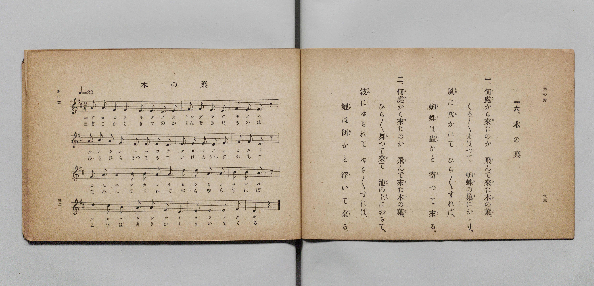

# 木の葉

> Re:Shōka 使用 AI 協助辨識與重建樂譜，可能會有錯誤。歡迎回報。

- **鋼琴伴奏版**：<br><audio controls src="ko_no_ha.mp3"></audio>

- 詞：文部省《尋常小學唱歌》
- 曲：文部省《尋常小學唱歌》
- 文部省《尋常小學唱歌 第一學年用》（明治四十四年五月，索書號 4103）

## 說明

原書資訊與歌詞全文（對應 P019.jpg，原書 p. 32–33，第一學年第 16 首）：
調性與拍號：ニ長調 2/4 拍子，♩=92


## 歌詞

```text
一、何處（どこ）から來（き）たのか　飛（と）んで來（き）た木（き）の葉（は）、
くる／＼まはつて　蜘蛛（くも）の巣（す）にかゝり、
風（かぜ）に吹（ふ）かれて　ひら／＼すれば、
蜘蛛（くも）は蟲（むし）かと　寄（よ）つて來（く）る。

二、何處（どこ）から來（き）たのか　飛（と）んで來（き）た木（き）の葉（は）、
ひら／＼舞（ま）つて來（き）て　池（いけ）の上（うへ）におちて、
波（なみ）にゆられて　ゆら／＼すれば、
鯉（こひ）は餌（ゑさ）かと　浮（う）いて來（く）る。
```

## ABC

<div class="abc-score" data-abc-src="ko_no_ha.abc" aria-label="五線譜載入中"></div>

[下載 ABC 原始檔](ko_no_ha.abc)

## TMD 檔案連結

- [主旋律 TMD 檔案](ko_no_ha.tmd) [[在 TMD Studio 編輯](https://tmdlang.github.io/Tmd-TS/#tmd=s7IKdvYPcrWy4qpTUCpJTLdSSM7PyUlNLsnMz7PKyszLyo8vzshPT8wuBdHZiUpwdWX5OaW5qVbpRYkpqfGG8SaGBsYIyeL80qLkVKvi5Iz8_Jz4ktSKkqT8_Gx0-fiCxPRUqwADQ0uETEFRfllqXmIeUHdBUWZeSWoKWDtCQWpZZkoqSLostSgzLTM1BclJqUXFIHdDTS8pSswrTi7KLAB5BqEqv6gE6KOixIKMSquMzOKS_KLM5MSc-OzEPCTflWSkAj2Xl1hSWpSKrDUzPTPPKjc_L6kUGBxKXFpaCs_mrHjcuO7FxE4FLS0uRVsFSyMue1sFFy4bI30TO5DOFyvnvd8z69m09pfNK57PaXzc0PV0Q_fTHTuebuh_unbH0ykbn63tedzQDbbl2exNxKvFq0rh-Zo1T3Y0gPg7tzyfsgKo6_2ejmcz-p5t2v109uynvY0gcueWJ7umPJvT8X5Pz_Mti57N3vFi5nwFUFS-39OpxMWlr6VgSy3ApaCg8LRvPsiOze0vVnS96GgHOhMYOE9bVwC9AnTc0w29z9o7FUDpQS-rIB3oJoh6hQI9BWOjRw2TjYHO6kHx15o1CoZmCi-XTQO6FxhwIDterNr_rGE5yPTuXqBvgKKPm7tfTt0OFFcARokCUPjp2glAgx7NXGkLjCyQHqCBjxsan-yd-mLmVKBDHjeufNw4GWjk48bux02dT_a1gQV7wSLzgbENEm9oeLl4Nlh8BUi8afLjxuVoKoFJA4kLSiNg7noQt6ERZPHjxv7HTcCI6X-_Z8_jxn1AuceNSx43LgOa_mLOjBezIRYA1TRBjHi6fTFYZCaYuxrsvrmPm7qgxr1cBLGw-3HjHIiKpxN2gkW2wnzTAzH9ceMmoM9gFs8Ei2-AmoLN5vUv5gNTZsfjJqDO6VCzGoGJquHp-hawODAJAQVBbocFAtBoYLAAA6oJEsa7gCl3YMIY4dUXHcC8CJTeh-FaiH5Q0DzbuAAs0vK4cSLE0Cc7usAibY8bd8ACvutx40KwerAdzzYvAqtY9bhxP1RFUxvQVkR4g7nYw_vleoibgb4DhjEosF8u6QEH6sTHjcCwQgT2s63rIA4BCwIdiC2wgSZSnluhQEFLn4vLO98v3yPRKiAzMS_focagphpkhYKNoZmWHZiFrZSAFj8vFvYoaJgoAAum5-sbdOBZWxOLBqBNIMNqFEwVdMHYGIprFIyAJAgbQukasDhIFiYKEYGpMwCJgE3zMaxReNzcCeQ_btoMJleDyOaVYD2Pm9aCxfaDxfrg8iA9HY-bQRpAEu0oCuHaIBqa-4FkPMJCI6B8I8h4YHyCyW6wTpATQDK9YLH5YHIdXB4kswKYvCEWNi5HUYjQBtGwHm4h_tDf1UNu6OsqmMFjABH6iLCG8IzQ4gOEQSJood8Eci8ooFZD2SAWJIznwQPwcXMLmGyDBjBE3SJwID9u2gnmQQMKEoPQeFyFJfA3QewDBjmEjQj8feDwWwLEy-BhugwqB7a_cSI4lCE5HSwAdWpjF5i3EK6FmAjY0UlOBICCEZYFQLAGGBmgCEGI1igYxoHCGkQgxJBVoUcBJMj2wIMRYu7j5qlIQbkGOQKaJ4F54HSMxAaZBYkMiOoJWIIfFCXAUhAeelC7mkAmQ6ICWPghBz2KDIINMmsmkuoNxIU6sFVDTqiDAxMEzaHBiFoOIad7CIbkDZA4CIICHOxRjHQPScewdA4K2gVgT21HCvoOqMwKMA-REyBmgGRgAQkKACR7wAEOKTVAQQRO7eDyAWT_RDAPHMWQQqgRZD5IB9hsaIoHRQKw-oDqgSUOhD21XFy6dgqQKkAByFLmAgA)]
- [鋼琴伴奏 TMD 檔案](ko_no_ha_piano.tmd) [[在 TMD Studio 編輯](https://tmdlang.github.io/Tmd-TS/#tmd=s7IKdvYPcrWy4qpTUCpJTLdSSM7PyUlNLsnMz7PKyszLyo8vzshPT8wuBdHZiUpwdWX5OaW5qVbpRYkpqfGG8SaGBsYIyeL80qLkVKvi5Iz8_Jz4ktSKkqT8_Gx0-fiCxPRUqwADQ0uETEFRfllqXmIeUHdBUWZeSWoKWDtCQWpZZkoqSDoxOTk_tyAxLzM3NQ9Jviy1qBjkeKgVJUWJecXJRZkFIB8hVOUXlQC9VZRYkFFplZFZXJJflJmcmBOfnZiH5MWSjFSgD_MSS0qLUpG1ZqZn5lnl5ucllQLDRIlLS0vh2ZwVjxvXvZjY-X5Px8vuPc8nbHmyZ8vTpf3POzve7-lU0NLiUrRVsDTisrdVcOGyMdI3sQMZ92LlvPd7Zj2b1v6yecXzOY2PG7qebuh-umPH0w39T9fueDpl47O1PY8busFWP5u9iXi1eFUpPF-z5smOBhB_55bnU1YAdQFd_WxG37NNu5_Onv20txFE7tzyZNeUZ3OAzu95vmXRs9k7XsycrwCKZKB_lLi4vPP98j0SrQIyE_PygzwcagxqqrkUgMDG0EzLDszS11KwRQdQq18s7FHQMFEAOur5-gYdBVAC0MsqSNfEokFLH2xYjYKpgi4YG0NxjYIRkARhQyhdAxYHycJEISIwdQYgEbBpPoY1Co-bO4H8x02bweRqENm8EqzncdNasNh-sFgfXB6kp-NxM0gDSKIdRSFcG0RDcz-QjEdYaASUbwQZ_7hxMpjsBusEOQEk0wsWmw8m18HlQTIrHjeBNICElqMoRGiDaFgPtxB_6O_qITf0dRXM4DGACH1EWEN4RmjxAcIgEbTQbwK5FxRQq6FsEAsSxvPgAfi4uQVMtkEDGKJuETiQHzftBPOgAQWJQWg8rsIS-Jsg9gGDHMJGBP4-cPgtAeJl8DBdBpUD2984ERzKjxvbHjfuAAtAndrYBeYthGshJgJ2dJITAaBghGUBEKwBRgYoQhCiNQqGcaCwBhEIMWRV6FEACbI98GCEmPu4eSpSUK5BjoDmSWAeOB0jsUFmQSIDonoCluAHRcnjRnCWAoce1K4mkMmQqHjc1IMc9CgyCDbIrJlIqjcQF-rAEo2cUAcHJgiaQ4MRtRxCTvcQDMkbIHEQBAU42KMY6R6SjmHpHBS0C8Ce2o4U9B1QmRVgHiInQMwAycACEhQASPaAAxxSaoCCCJzaweUDyP6JYB44iiGFUCPIfJAOsNnQFA-KhMeNULc1wRIHwp5a1BrAB7kGMIFWAMBwiFeINowFBVo8jAUSMo1HYWFVDFGDxARKG2CqNUE2F84wQZgKUmCKogDTTKBndO0UIP6J9gEqQuIZgXnKXAA)]

## 分析

```text
================================================================================
📊 TMD Song Profile: [ 木の葉 ]
================================================================================
⏱  Duration:       0:20 (20.9s), 16 measures total
🎼 Key & Tempo:    首調基準 D, != 92.0 BPM, <2/4>
   - 分析範圍：      由實際發聲的音符與和弦推測調性；播放脈絡另行呈現
🎤 人聲音域:    D4 (MIDI 62) – D5 (MIDI 74) [跨度: 12 個半音 / 1.0 個八度, 難度: easy]
   - 最低音:  D4 in [KoNoHa #1 @ m.2, 0:01]
   - 最高音: D5 in [KoNoHa #1 @ m.11, 0:13]
   - 適合: soprano, mezzo-soprano, contralto, tenor, baritone, bass
🏛  結構:      KoNoHa (20.9s)
⚡ 編曲密度:        Peak 1 軌道同時演奏
🗝  調性診斷：       A 大調（純淨自然大調，未偵測到可信轉調）
   - 風格氣質:    純淨自然大調（陽光明朗、易唱易記，無明顯調外色彩）
   - 轉調歷程:    全曲維持單一推測調性（未偵測到可信轉調）
   - 核心骨幹音:  E, A, D, F#, B
   - 調性數值:    A 大調 [相關度: 0.84, 穩定度: Moderate, 自然音純度: 100.0%]
   - 候選調性 (K-S): A 大調 (0.84), D 大調 (0.75), F# 小調 (0.60)
   - 五度圈歷程:   +3
   - 各段落調性細節:
     • [KoNoHa #1]: A 大調 (r: 0.84, 自然音純度: 100.0%)

  [ 五度圈游移軌跡 ]
               C  
         F            G  
      Bb               D  
      Eb              [A ]*
         Ab           E  
            Db       B  
               F# 
     (* = active key center)

  [ 十二半音累積音高分佈 ]
     C  :                            0.0%
     C# : ██                         1.7%
     D  : ███████████████████       20.3%
     D# :                            0.0%
     E  : ████████████████████████  25.4%
     F  :                            0.0%
     F# : ██████████████████        18.6%
     G  :                            0.0%
     G# :                            0.0%
     A  : ███████████████████████   24.6%
     A# :                            0.0%
     B  : █████████                  9.3%
--------------------------------------------------------------------------------
Assignment 軌道音域：
  - Piano         : D4 – D5 (12 個半音 / 1.0 個八度, 57 個音符)
================================================================================
```


## 原書掃描頁




