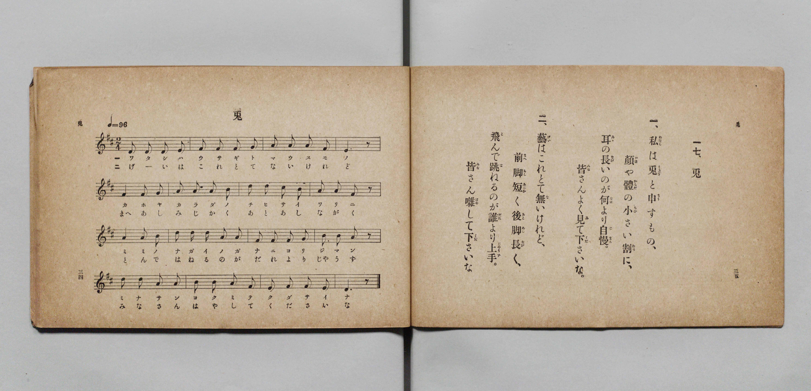

# 兎

> Re:Shōka 使用 AI 協助辨識與重建樂譜，可能會有錯誤。歡迎回報。

- **鋼琴伴奏版**：<br><audio controls src="usagi.mp3"></audio>

- 詞：文部省《尋常小學唱歌》
- 曲：文部省《尋常小學唱歌》
- 文部省《尋常小學唱歌 第一學年用》（明治四十四年五月，索書號 4103）

## 說明

原書資訊與歌詞全文（對應 P020.jpg，原書 p. 34–35，第一學年第 17 首）：
調性與拍號：ニ長調 2/4 拍子，♩=96


## 歌詞

```text
一、私（わたし）は兎（うさぎ）と申（まう）すもの、
顏（かほ）や體（からだ）の小（ちひ）さい割（わり）に、
耳（みゝ）の長（なが）いのが何（なに）より自慢（じまん）。
皆（みな）さんよく見（み）て下（くだ）さいな。

二、藝（げい）はこれとて無（な）いけれど、
前脚（まへあし）短（みじか）く後脚（あとあし）長（なが）く、
飛（と）んで跳（は）ねるのが誰（だれ）より上手（じやうず）。
皆（みな）さん囃（はや）して下（くだ）さいな。
```

## ABC

<div class="abc-score" data-abc-src="usagi.abc" aria-label="五線譜載入中"></div>

[下載 ABC 原始檔](usagi.abc)

## TMD 檔案連結

- [主旋律 TMD 檔案](usagi.tmd) [[在 TMD Studio 編輯](https://tmdlang.github.io/Tmd-TS/#tmd=s7IKdvYPcrWy4qpTUCpJTLdSSM7PyUlNLsnMz7PKyszLyo8vzshPT8wuBdHZiUpwdWX5OaW5qVbpRYkpqfGG8SaGBsYIyeL80qLkVKvi5Iz8_Jz4ktSKkqT8_Gx0-fiCxPRUqwADIwOETEFRfllqXmIeUHdBUWZeSWoKWDtCQWpZZkoqSLostSgzLTM1BclJqUXFIHdDTS8pSswrTi7KLAB5BqEqv6gE6KOixIKMSquMzOKS_KLM5MSc-OzEPCTflWSkAj2XmJeZm5iDrDUzPTPPKjc_L6kUGBxKXFpaCk9b-xS0tLgUbRUszbjsbRVcuGyM9E3sQHperJz3fs-sZ9PaXzaveD6n8XFD19MN3U937Hi6of_p2h1Pp2x8trbncUM32PxnszcRrxavKoXna9Y82dEA4u_c8nzKCqCu93s6ns3oe7Zp99PZs5_2NoLInVue7JrybE7H-z09z7csejZ7x4uZ8xVAkfh-T6cSF5e-loIttQCXgoLC0775IDs2t79Y0fWiox3oTGDgPG1dAfQK0HFPN_Q-a-9UAKUEvayCdKCbIOoVCvQUjE0eNUw2NgW5E9lfa9YoGJorvFw2DeheYMCB7Hixav-zhuUg07t7gb4Bij5u7n45dTtQXAEYJQpA4adrJwANejRzpS0wskB6gAY-bmh8vrwR6IrHTf2PG-c_bpwONPJx43pgxIIEG9seN0593AhkAwVXPJ-yGSy4DygOFpn5uKnpceM6oCEg414u7AdLdz9u3A2Sbmp5uXoKVKQJqHoBWM86YHSBBRc-bgTGOlAEaEHL004gG-yIpi6w4GqooS8aIHbuf9w0F6If6CmwyKrHjT1gkRaQExp7nuydChNfDbYeaFzXi_ZVz1oXgcVngBzeNBkk1dAEMvr5LKAvwEY3roI6pGkySFtj_4tloGQDlAKLL3uyA8IFBhHEEyAng2wCGgQOyF3A5Nn4YjrQhUBVk4CSkFB83Ag0rwcYckAznrcshDgP5uaJYKmVUH8-7ex90TILFrw7HjcCAxYUF8_nr4U5EugBoDOAmvuf7uuBKQYqA5oOVYwRNP2wqFk8GyyxAhwwkx83Ln-xHRKu68Hq1j5uAsYaKBRfrNoAFl8AdB08FJ_s6HrWCQmCGcBoBScLoPV4A_Lp7GaIBUANYMHpBAISaBDl2Q0KFLT0ubhCixPTM60CMhPz8h1qDGqqQTYo2BiaadmBWdhyObT4eLGwR0HDRAGYUp-vb9CBZ01NLBqAFoEMq1EwVNCFYyMgrlEwBpIwbAIWMQWSMAwSrQGrhEEDkAjYNB_DGoXHzeuB_MdN-8HkdhDZ3A_W87hpGVhsK5hcB5bpgMg0zwOLQeR3gmUWQWX6kGyKR9hkBJRrnAQVB0YGmATZDBKfDDanByy2AkyCTAbJrEJSPRGuCiSzEsMe_KG9q4ec0AaFHghiD1szsIhhHCg6QIQ5XAw59NHCu2k1LBSaZ4PJJdDQBok_bgb563FzA5gEhSUoTBvBPFDowWIDqgcSd83gUGruxhLioDwOD_QmMDkdGoDgCG-cASZBWoG5BSoDUQeJCFQ9kOiARBRINTEBv6OTnIAHBR4IYgYzEMFCF1vaBykGYZA8ekqfDw95EAsRvl3gMF0DDleIKIiHJAcO28fN4CABhzYovkABC80JzZuxhD1INdi2JnD6blwODURwnDWuBYp3A2lwvgIHKUhuAVg9OICbQHkNWChCZYAFYjNYaRuYnEVc6ANbIWQVMvAkjQhq5IBFFCqwwIcURaBCCVcxAwlySFCDEzE40EAy4GBtgiRliCqQH0FBDBEDZwa0hA8yB1cxA0nZkLQ6FR4B8KBvghQnoDSNKGhAqRka_BA94EIHluZRbarl4tK1UwAX-wpAhjIXAA)]
- [鋼琴伴奏 TMD 檔案](usagi_piano.tmd) [[在 TMD Studio 編輯](https://tmdlang.github.io/Tmd-TS/#tmd=s7IKdvYPcrWy4qpTUCpJTLdSSM7PyUlNLsnMz7PKyszLyo8vzshPT8wuBdHZiUpwdWX5OaW5qVbpRYkpqfGG8SaGBsYIyeL80qLkVKvi5Iz8_Jz4ktSKkqT8_Gx0-fiCxPRUqwADIwOETEFRfllqXmIeUHdBUWZeSWoKWDtCQWpZZkoqSDoxOTk_tyAxLzM3NQ9Jviy1qBjkeKgVJUWJecXJRZkFIB8hVOUXlQC9VZRYkFFplZFZXJJflJmcmBOfnZiH5MWSjFSgD0E2JOYga81Mz8yzys3PSyoFhokSl5aWwtPWvvd7Ol5273k-YcuTPVueLu1_3tnxfk-ngpYWl6KtgqUZl72tgguXjZG-iR3IoBcr573fM-vZtPaXzSuez2l83ND1dEP30x07nm7of7p2x9MpG5-t7Xnc0A229NnsTcSrxatK4fmaNU92NID4O7c8n7ICqAvo6mcz-p5t2v109uynvY0gcueWJ7umPJsDdH7P8y2Lns3e8WLmfAVQ9AL9o8TFFVqcmJ5pFZCZmJcf5OFQY1BTzaUABDaGZlp2YJa-loItOoDa_GJhj4KGiQLQTc_XN-gogGJeL6sgXROLBi19sGE1CoYKunBsBMQ1CsZAEoZNwCKmQBKGQaI1YJUwaAASAZvmY1ij8Lh5PZD_uGk_mNwOIpv7wXoeNy0Di20Fk-vAMh0QmeZ5YDGI_E6wzCKoTB-STfEIm4yAco2ToOKPG1vAJMhmkPhksDk9YLEVYBJkMkhmFZLqiXBVIJmVGPbgD-1dPeSENij0QBB72JqBRQzjQNEBIszhYsihjxbeTathodA8G0wugYY2SPxxM8hfj5sbwCQoLEFh2gjmgUIPFhtQPZC4awaHUnM3lhDf97hxBzzQm8DkdGgAgiO8cQaYBGl93AiNdqg6SESg6oFEBySiQKqJCfgdneQEPCjwQBAzmIEIFrrY0j5IMQiD5NFT-nx4yINYiPDtAofpGnC4QkRBPCQ5cNg-bgYHCTi0QfEFClhoTmjejCXsQarBtjWB03fjcmggguOscS1QvBtIg_MVOEhBcgvA6sEB3ATKa4-bQPaDZGY8bmoGK20Dk7OIC31gAUZWIQNP0oigRg5YRKECC3xIUQQqlHAVM5AghwQ1OBGDAw0kAw7WJkhShqgC-REUxBAxcGZAS_ggc3AVM5CUDUmrU-ERAA_6JkhxAkrTiIIGlJqhwQ_RAy50YGke1aZalFLfB7nUN4EW-sCgiFeINozFyjCNjweGDsTF2ORNgAwTqAg-dcgagGwMhSBz4BZGm8YjGQn0gq6dAtgX0T5ANQiOEZijzAUA)]

## 分析

```text
================================================================================
📊 TMD Song Profile: [ 兎 ]
================================================================================
⏱  Duration:       0:20 (20.0s), 16 measures total
🎼 Key & Tempo:    首調基準 D, != 96.0 BPM, <2/4>
   - 分析範圍：      由實際發聲的音符與和弦推測調性；播放脈絡另行呈現
🎤 人聲音域:    D4 (MIDI 62) – D5 (MIDI 74) [跨度: 12 個半音 / 1.0 個八度, 難度: easy]
   - 最低音:  D4 in [Usagi #1 @ m.1, 0:00]
   - 最高音: D5 in [Usagi #1 @ m.7, 0:07]
   - 適合: soprano, mezzo-soprano, contralto, tenor, baritone, bass
🏛  結構:      Usagi (20.0s)
⚡ 編曲密度:        Peak 1 軌道同時演奏
🗝  調性診斷：       D 大調（純淨自然大調，未偵測到可信轉調）
   - 風格氣質:    純淨自然大調（陽光明朗、易唱易記，無明顯調外色彩）
   - 轉調歷程:    全曲維持單一推測調性（未偵測到可信轉調）
   - 核心骨幹音:  A, F#, D, B, E
   - 調性數值:    D 大調 [相關度: 0.87, 穩定度: Moderate, 自然音純度: 100.0%]
   - 候選調性 (K-S): D 大調 (0.87), F# 小調 (0.76), A 大調 (0.73)
   - 五度圈歷程:   +2
   - 各段落調性細節:
     • [Usagi #1]: D 大調 (r: 0.87, 自然音純度: 100.0%)

  [ 五度圈游移軌跡 ]
               C  
         F            G  
      Bb              [D ]*
      Eb               A  
         Ab           E  
            Db       B  
               F# 
     (* = active key center)

  [ 十二半音累積音高分佈 ]
     C  :                            0.0%
     C# : █                          1.7%
     D  : █████████████████         20.0%
     D# :                            0.0%
     E  : ████████                  10.0%
     F  :                            0.0%
     F# : ████████████████████      23.3%
     G  : ████                       5.0%
     G# :                            0.0%
     A  : ████████████████████████  28.3%
     A# :                            0.0%
     B  : ██████████                11.7%
--------------------------------------------------------------------------------
Assignment 軌道音域：
  - Piano         : D4 – D5 (12 個半音 / 1.0 個八度, 55 個音符)
================================================================================
```


## 原書掃描頁




