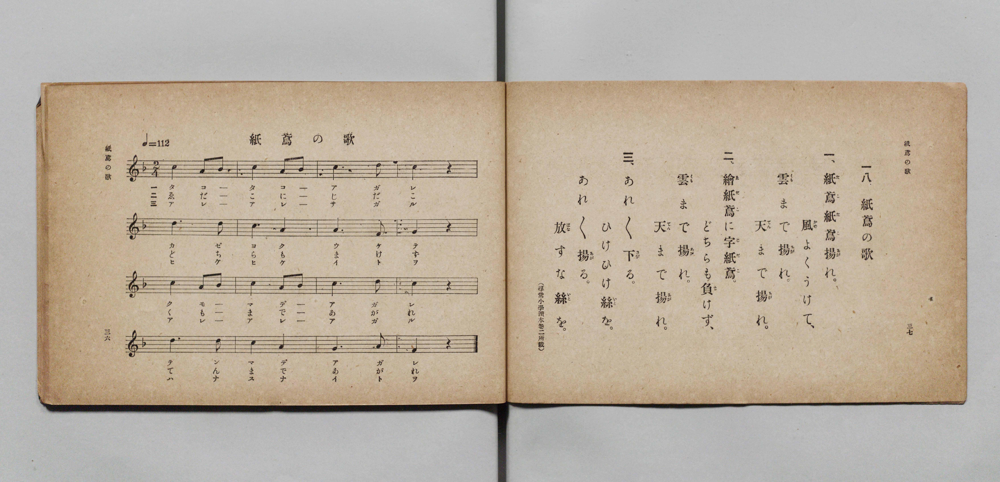

# 紙鳶の歌

> Re:Shōka 使用 AI 協助辨識與重建樂譜，可能會有錯誤。歡迎回報。

- **鋼琴伴奏版**：<br><audio controls src="tako_no_uta.mp3"></audio>

- 詞：文部省《尋常小學唱歌》（尋常小學讀本卷二所載）
- 曲：文部省《尋常小學唱歌》
- 文部省《尋常小學唱歌 第一學年用》（明治四十四年五月，索書號 4103）

## 說明

原書資訊與歌詞全文（對應 P021.jpg，原書 p. 36–37，第一學年第 18 首）：
調性與拍號：ヘ長調 2/4 拍子，♩=112


## 歌詞

```text
一、紙鳶（たこ）紙鳶（たこ）揚（あが）れ。
風（かぜ）よくうけて、
雲（くも）まで揚（あが）れ。
天（てん）まで揚（あが）れ。

二、繪紙鳶（ゑだこ）に字紙鳶（じだこ）。
どちらも負（ま）けず、
雲（くも）まで揚（あが）れ。
天（てん）まで揚（あが）れ。

三、あれ／＼下（さが）る。
ひけひけ絲（いと）を。
あれ／＼揚（あが）る。
放（はな）すな絲（いと）を。
（尋常小學讀本卷二所載）
```

## ABC

<div class="abc-score" data-abc-src="tako_no_uta.abc" aria-label="五線譜載入中"></div>

[下載 ABC 原始檔](tako_no_uta.abc)

## TMD 檔案連結

- [主旋律 TMD 檔案](tako_no_uta.tmd) [[在 TMD Studio 編輯](https://tmdlang.github.io/Tmd-TS/#tmd=s7IKdvYPcrWy4qpTUCpJTLdSSM7PyUlNLsnMz7PKyszLyo8vzshPT8wuBdHZiUpwdWX5OaW5qVbpRYkpqfGG8SaGBsYIyeL80qLkVKvi5Iz8_Jz4ktSKkqT8_Gx0-fiCxPRUqwADI0OETEFRfllqXmIeUHdBUWZeSWoKWDtCQWpZZkoqSLostSgzLTM1BclJqUXFIHdDTS8pSswrTi7KLAB5BqEqv6gE6KOixIKMSquMzOKS_KLM5MSc-OzEPCTflWSkAj1XkJNYiawxMz0zzyo3Py-pFBgYSlxaWgrPt8x8uXnb48Z1z9b2KGhpcSnaKhgaGnHZ2yq4cdkY6ZvYgXS_WDnv_Z5Zz6a1v2xe8XxO4-OGrqcbup_u2PF0Q__TtTueTtkI1Py4ofv9ng5k8RfrGp7NWfO0d_uTXT3POhte7Ol8v6cT7JpnszcRYx5ELV5VCs_XrHmyowHE37nl-ZQVEFc8m9H3bNPup7NnP-1tBJE7tzzZNeXZnI73e3qeb1n0bPaOFzPnK4AiHOwgLn0tBVtqAS4FBYWnffNBdmxuf7Gi60VHO9CZwAB82roC6BVwEPU-a-9UAKUavayCdKCbIOoVCvQUjM0eNUw2Nge5E9lfa9YoGFoovFw2DeheYMCB7Hixav-zhuUg07t7gb4Bij5unvFy6naguAIw2hSAwk_XTgAa9GjmSltQjII0AU183NAIiXKgSx43zn_cOBloJqbIs_5ZYG7T48YeIPdxEzA-mkBGvFy0AizR_bhxDlgCyO5_3Nj2uHHi48ZlQNPBikDxC5ZoagIpatz3uHE5TiOfLlkJllj2uAlkNT7VYE_sAjIbn-9chXB1E9DuBRCHP25c_XTtdCQPzUBIQax73LjycePCx01AM5tebFoAVrQPrBNoyiy6-GAH0C2NIJkmoEz_-z17nuwAJdvHjVNharvhjt0EdheIfL4V4qaWx43AOAAqmgRXhDAJw1aYSc-mAD0JlFj_uHEV2I0zgQycRhKTlUHqKM8wUKCgpc_FFZKYne-XH1qSaBWQmZiX71BjUFMNskXBxkLLDszAllWhZcCLhT0KGiYKQAc_X9-gA89fmlg0AO0CGVajYKqgq2CsYILB0lUwg7IMgLgGrNrHsEbhcdN-IP9x02aQKAZvEVjn46Y1IF7zGiA7HqHbCKRiIki-cQFEfeNkMG81lDcDohsoC5ND0m0MMx9iLiZvK4rdIDMhuvGH2q4eckLNDCWEjMEuAJG6CoZAlhGWUAO5B-S6PWDXrQCz10NdvgwqtxEs14YZao0roSGzEKy-E6y6CRpq-6ByE8G8WZih1jwJxXwQD8SG2L0EItfcAZbbRGSo7eikT1oDhdDjZlA8g1w3D8xrJzatNfZjhBOwUILyQKIgfg_YrB4S0xqq3USmNWA9TK20BkphIHYNML1hhBo4BYFcu5msUIOlxsnkhFozKMxB9nWBVeyEsvGntVouLl07BXjRpwDkKHMBAA)]
- [鋼琴伴奏 TMD 檔案](tako_no_uta_piano.tmd) [[在 TMD Studio 編輯](https://tmdlang.github.io/Tmd-TS/#tmd=s7IKdvYPcrWy4qpTUCpJTLdSSM7PyUlNLsnMz7PKyszLyo8vzshPT8wuBdHZiUpwdWX5OaW5qVbpRYkpqfGG8SaGBsYIyeL80qLkVKvi5Iz8_Jz4ktSKkqT8_Gx0-fiCxPRUqwADI0OETEFRfllqXmIeUHdBUWZeSWoKWDtCQWpZZkoqSDoxOTk_tyAxLzM3NQ9Jviy1qBjkeKgVJUWJecXJRZkFIB8hVOUXlQC9VZRYkFFplZFZXJJflJmcmBOfnZiH5MWSjFSgDwtyEiuRNWamZ-ZZ5ebnJZUCQ0SJS0tL4fmWmS83b3vcuO7Z2p73ezpedu95PmHLkz1bni7tf97Z8X5Pp4KWFpeirYKhoRGXva2CG5eNkb6JHcjIFyvnvd8z69m09pfNK57PaXzc0PV0Q_fTHTuebuh_unbH0ykbgSY-bugGGoos_mJdw7M5a572bn-yq-dZZ8OLPZ1AO8BOfDZ7EzHmQdTiVaXwfM2aJzsaQPydW55PWQFxxbMZfc827X46e_bT3kYQuXPLk11Tns0B-rHn-ZZFz2bveDFzvgIoKYAdxBWSmJ3vlx9akmgVkJmYlx_k4VBjUFPNpQAENhZadmCGvpaCLTqAWv5iYY-ChokC0FnP1zfoKIASil5WQbomFg1a-mDDahRMFXQVjBVMMFi6CmZQlgEQ14BV-xjWKDxu2g_kP27aDBLF4C0C63zctAbEa14DZMcjdBuBVEwEyTcugKhvnAzmrYbyZkB0A2Vhcki6jWHmQ8zF5G1FsRtkJkQ3_lDb1UNOqJmhhJAx2AUgUlfBEMgywhJqIPeAXLcH7LoVYPZ6qMuXQeU2guXaMEOtcSU0ZBaC1XeCVTdBQ20fVG4imDcLM9SaJ6GYD-KB2BC7l0DkmjvAcpuIDLUdnfRJa6AQetwMimeQ6-aBee3EprXGfoxwety4HMoDiYL4PWCzekhMa6h2E5nWgAUAtdIaKIWB2DXA9IYRauAUBHLtZrJCDZYaJ5MTas2gMAfZ1wVWsRPKxp_WajFKPh_kks8EWvIBPRuvYBqvDfY2MsssXhuUlIAsA6hbahRMkIUxNJnGI6ul0FiQYSbx2kYItUAP6dopwP0U7WMYq4AqYIQuYAwWUOYCAA)]

## 分析

```text
================================================================================
📊 TMD Song Profile: [ 紙鳶の歌 ]
================================================================================
⏱  Duration:       0:17 (17.1s), 16 measures total
🎼 Key & Tempo:    首調基準 F, != 112.0 BPM, <2/4>
   - 分析範圍：      由實際發聲的音符與和弦推測調性；播放脈絡另行呈現
🎤 人聲音域:    F4 (MIDI 65) – D5 (MIDI 74) [跨度: 9 個半音 / 0.8 個八度, 難度: easy]
   - 最低音:  F4 in [TakoNoUta #1 @ m.7, 0:07]
   - 最高音: D5 in [TakoNoUta #1 @ m.3, 0:02]
   - 適合: soprano, mezzo-soprano, contralto, tenor, baritone, bass
🏛  結構:      TakoNoUta (17.1s)
⚡ 編曲密度:        Peak 1 軌道同時演奏
🗝  調性診斷：       C 大調（流行色彩大調，未偵測到可信轉調）
   - 風格氣質:    流行大調（略帶和弦色彩音與裝飾副屬和弦）
   - 轉調歷程:    全曲維持單一推測調性（未偵測到可信轉調）
   - 核心骨幹音:  C, A, D, G, A#
   - 調性數值:    C 大調 [相關度: 0.71, 穩定度: Moderate, 自然音純度: 92.9%]
   - 候選調性 (K-S): C 大調 (0.71), A 小調 (0.67), F 大調 (0.61)
   - 五度圈歷程:   +0
   - 各段落調性細節:
     • [TakoNoUta #1]: C 大調 (r: 0.71, 自然音純度: 92.9%, 調外音: A#)

  [ 五度圈游移軌跡 ]
              [C ]*
         F            G  
      Bb               D  
      Eb               A  
         Ab           E  
            Db       B  
               F# 
     (* = active key center)

  [ 十二半音累積音高分佈 ]
     C  : ████████████████████████  39.3%
     C# :                            0.0%
     D  : ███████████               17.9%
     D# :                            0.0%
     E  :                            0.0%
     F  : ███                        5.4%
     F# :                            0.0%
     G  : █████                      8.9%
     G# :                            0.0%
     A  : █████████████             21.4%
     A# : ████                       7.1%
     B  :                            0.0%
--------------------------------------------------------------------------------
Assignment 軌道音域：
  - Piano         : F4 – D5 (9 個半音 / 0.8 個八度, 32 個音符)
================================================================================
```


## 原書掃描頁




