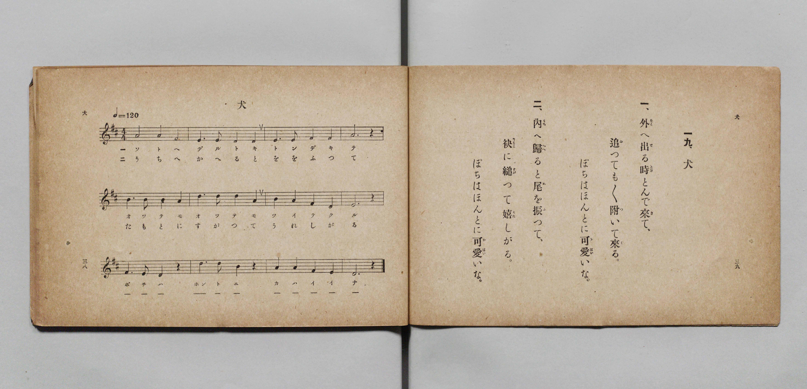

# 犬

> Re:Shōka 使用 AI 協助辨識與重建樂譜，可能會有錯誤。歡迎回報。

- **鋼琴伴奏版**：<br><audio controls src="inu.mp3"></audio>

- 詞：文部省《尋常小學唱歌》
- 曲：文部省《尋常小學唱歌》
- 文部省《尋常小學唱歌 第一學年用》（明治四十四年五月，索書號 4103）

## 說明

原書資訊與歌詞全文（對應 P022.jpg，原書 p. 38–39，第一學年第 19 首）：
調性與拍號：ニ長調 4/4 拍子，♩=120


## 歌詞

```text
一、外（そと）へ出（で）る時（とき）とんで來（き）て、
追（お）つても／＼附（つ）いて來（く）る。
ぽちはほんとに可愛（かはい）いな。

二、內（うち）へ歸（かへ）ると尾（を）を振（ふ）つて、
袂（たもと）に縋（すが）つて嬉（うれ）しがる。
ぽちはほんとに可愛（かはい）いな。
```

## ABC

<div class="abc-score" data-abc-src="inu.abc" aria-label="五線譜載入中"></div>

[下載 ABC 原始檔](inu.abc)

## TMD 檔案連結

- [主旋律 TMD 檔案](inu.tmd) [[在 TMD Studio 編輯](https://tmdlang.github.io/Tmd-TS/#tmd=s7IKdvYPcrWy4qpTUCpJTLdSSM7PyUlNLsnMz7PKyszLyo8vzshPT8wuBdHZiUpwdWX5OaW5qVbpRYkpqfGG8SaGBsYIyeL80qLkVKvi5Iz8_Jz4ktSKkqT8_Gx0-fiCxPRUqwADIyOETEFRfllqXmIeUHdBUWZeSWoKWDtCQWpZZkoqSLostSgzLTM1BclJqUXFIHdDTS8pSswrTi7KLAB5BqEqv6gE6KOixIKMSquMzOKS_KLM5MSc-OzEPCTflWSkAj2XmJeZm5iDrDUzPTPPKjc_L6kUGBxKXFpaCs-71ihoaXEp2ioYGhlw2dsquHDZmOib2IE0vVg57_2eWc-mtb9sXvF8TuPjhq6nG7qf7tjxdEP_07U7nk7Z-Gxtz-OGbrAFz2ZvIl4tXlUKz9esebKjAcTfueX5lBVAXe_3dDyb0fds0-6ns2c_7W0EkTu3PNk15dmcjvd7ep5vWfRs9o4XM-crgGLx_Z5OJS4ufS0FW2oBLgUFhad980F2bG5_saLrRUc70JnAwHnaugLoFaDjnm7ofdbeqQBKCnpZBelAN0HUKxToKRhbPGqYbGwJcieyv9asUTC0VHi5bBrQvcCAA9nxYtX-Zw3LQaZ39wJ9AxR93Nz9cup2oLgCMEoUgMJP104AGvRo5kpbUGyBNAFNfNzQ-HQJ0JyOx41zHzeuABr4uHHH0_ZdYJHlIG5T97OZTWDuiseNvWAFKx43TQbKPtnXBhaHCC4DGgV2yf69YNEusOgSkEQTUH__-z17Xs5sAUstAUu1AKVgRgBlQTY9bmgCGfG4ce_jxoWPG9c_btwNtgpo8-qn_euftcwGq-4GSwHNgpiyCqQN7J9dwGTS-LQV6G6gqjagGRD_PFu7A6YPyABb1Lji6YZ9IMGmSWCRSc961oPVbEU4G-qfRRDfzwd6AxZCq5_vAKWrx40zHzf2wDU8XQOMDbDFTRDB6UBZynwF1EZ5GoQCBS19Li7PvFKrgMzEvHyHGoOaapD5CjYWWnZgBrZ0D81QLxb2KGiYKACz2vP1DTrwxKqJRQPQFpBhNQqmCrpgCKKNgbhGwQjMN1IwBJIgjBAByUPUwHSBoAFIBGyaj2GNwuOmvVDxx80dYHIGWMfj5nao6GqYTNNaqAyIB5LZDFWFkGlDsiceYY8RUK4RJgeMLjC5A6KnsRsqugNoDogNjEKITNMkiAyQBqYgsMwSqJ5lGPbgD-tdPeSEtRnYfDMwDQrBGgXDOLAQkAKzIIIwaVBQI0cA9uBeBQ28FmhwPW5eBPUuThmgCCgYQJ6HyjSth8qsxhPg86HB1wQNUmDGgAbfTGiQ90CDFBKgsEgCZjSw2HSoGojrINFEfJDv6CQnyEFhCEvM4JBDCnJQOEPEQKENC3FQWANV4Q7x5rnQcG0E4n6Y64Hs2aAUDEv5wIIdIdUECiiIYmiwg0mQpi48AQ7JSaD0DSx0EKaBCyao1ApoLMCkIAkepBhYPMFJkAwkNSBbVMvFpWunACxrFICUMhcA)]
- [鋼琴伴奏 TMD 檔案](inu_piano.tmd) [[在 TMD Studio 編輯](https://tmdlang.github.io/Tmd-TS/#tmd=s7IKdvYPcrWy4qpTUCpJTLdSSM7PyUlNLsnMz7PKyszLyo8vzshPT8wuBdHZiUpwdWX5OaW5qVbpRYkpqfGG8SaGBsYIyeL80qLkVKvi5Iz8_Jz4ktSKkqT8_Gx0-fiCxPRUqwADIyOETEFRfllqXmIeUHdBUWZeSWoKWDtCQWpZZkoqSDoxOTk_tyAxLzM3NQ9Jviy1qBjkeKgVJUWJecXJRZkFIB8hVOUXlQC9VZRYkFFplZFZXJJflJmcmBOfnZiH5MWSjFSgD0E2JOYga81Mz8yzys3PSyoFhokSl5aWwvOuNe_3dLzs3vN8wpYne7Y8Xdr_vLPj_Z5OBS0tLkVbBUMjAy57WwUXLhsTfRM7kEkvVs57v2fWs2ntL5tXPJ_T-Lih6-mG7qc7djzd0P907Y6nUzY-W9vzuKEbbOuz2ZuIV4tXlcLzNWue7GgA8XdueT5lBVAX0NnPZvQ927T76ezZT3sbQeTOLU92TXk2B-j-nudbFj2bvePFzPkKoPgFekiJi8szr9QqIDMxLz_Iw6HGoKaaSwEIbCy07MAMfS0FW3QAtfbFwh4FDRMFoIOer2_QUQDFu15WQbomFg1a-mDDahRMFXTBEEQbA3GNghGYb6RgCCRBGCECkoeogekCQQOQCNg0H8MahcdNe6Hij5s7wOQMsI7Hze1Q0dUwmaa1UBkQDySzGaoKIdOGZE88wh4joFwjTO5x40IwuQOip7EbKroDaA6I_bhxBUSmaRJEBkg_btwKllkC1bMMwx78Yb2rh5ywNgObbwamQSFYo2AYBxYCUmAWRBAmDQpq5AjAHtyroIHXAg2ux82LoN7FKQMUAQUDyPNQmab1UJnVeAJ8PjT4mqBB-rgRpBokMxMa5D3QIIUEKCySHjf1gMWmQ9VAXAeJJuKDfEcnOUEOCkNYYgaHHFKQg8IZIgYKbViIg8IaqAp3iDfPhYZrIxD3w1wPZM8GpWBYyn_cDPIgVKoJFFAQxdBgB5MgTV14AhySk0Dp-3EjKIKgpjXuftw0GSq1AhoLMClIggcpftwIjmUwCZKBpAZki2qRihof5KLGBFrUAIMhXsE0XtsYTgODKj5ewSReGxiiRAmBGAZQT9UAhRTM4rVNkBQSI4LDMKACmK1AQbg-IA3iwrTDNaN4BmQK0Pu6dgrAEIj2MYxVgDGNwExlLgA)]

## 分析

```text
================================================================================
📊 TMD Song Profile: [ 犬 ]
================================================================================
⏱  Duration:       0:24 (24.0s), 12 measures total
🎼 Key & Tempo:    首調基準 D, != 120.0 BPM, <4/4>
   - 分析範圍：      由實際發聲的音符與和弦推測調性；播放脈絡另行呈現
🎤 人聲音域:    D4 (MIDI 62) – D5 (MIDI 74) [跨度: 12 個半音 / 1.0 個八度, 難度: easy]
   - 最低音:  D4 in [Inu #1 @ m.2, 0:03]
   - 最高音: D5 in [Inu #1 @ m.6, 0:10]
   - 適合: soprano, mezzo-soprano, contralto, tenor, baritone, bass
🏛  結構:      Inu (24.0s)
⚡ 編曲密度:        Peak 1 軌道同時演奏
🗝  調性診斷：       D 大調（純淨自然大調，未偵測到可信轉調）
   - 風格氣質:    純淨自然大調（陽光明朗、易唱易記，無明顯調外色彩）
   - 轉調歷程:    全曲維持單一推測調性（未偵測到可信轉調）
   - 核心骨幹音:  D, A, E, F#, B
   - 調性數值:    D 大調 [相關度: 0.86, 穩定度: Moderate, 自然音純度: 100.0%]
   - 候選調性 (K-S): D 大調 (0.86), A 大調 (0.79), F# 小調 (0.55)
   - 五度圈歷程:   +2
   - 各段落調性細節:
     • [Inu #1]: D 大調 (r: 0.86, 自然音純度: 100.0%)

  [ 五度圈游移軌跡 ]
               C  
         F            G  
      Bb              [D ]*
      Eb               A  
         Ab           E  
            Db       B  
               F# 
     (* = active key center)

  [ 十二半音累積音高分佈 ]
     C  :                            0.0%
     C# :                            0.0%
     D  : ████████████████████████  27.9%
     D# :                            0.0%
     E  : █████████████████         19.8%
     F  :                            0.0%
     F# : █████████████             15.1%
     G  :                            0.0%
     G# :                            0.0%
     A  : ██████████████████████    25.6%
     A# :                            0.0%
     B  : ██████████                11.6%
--------------------------------------------------------------------------------
Assignment 軌道音域：
  - Piano         : D4 – D5 (12 個半音 / 1.0 個八度, 36 個音符)
================================================================================
```


## 原書掃描頁




