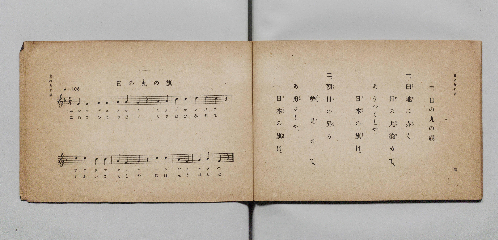

# 日の丸の旗

> Re:Shōka 使用 AI 協助辨識與重建樂譜，可能會有錯誤。歡迎回報。

- **鋼琴伴奏版**：<br><audio controls src="hinomaru_no_hata.mp3"></audio>

- 詞：文部省《尋常小學唱歌》
- 曲：文部省《尋常小學唱歌》
- 文部省《尋常小學唱歌 第一學年用》（明治四十四年五月，索書號 4103）

## 說明

原書資訊與歌詞全文（對應 P004.jpg，原書 p. 2–3，第一學年第 1 首）：
調性與拍號：ヘ長調 2/4 拍子，♩=108


## 歌詞

```text
一、白地（しろぢ）に赤（あか）く
日（ひ）の丸（まる）染（そ）めて、
あゝうつくしや、
日本（にほん）の旗（はた）は。

二、朝日（あさひ）の昇（のぼ）る
勢（いきほひ）見（み）せて、
あゝ勇（いさ）ましや、
日本（にほん）の旗（はた）は。
```

## ABC

<div class="abc-score" data-abc-src="hinomaru_no_hata.abc" aria-label="五線譜載入中"></div>

[下載 ABC 原始檔](hinomaru_no_hata.abc)

## TMD 檔案連結

- [主旋律 TMD 檔案](hinomaru_no_hata.tmd) [[在 TMD Studio 編輯](https://tmdlang.github.io/Tmd-TS/#tmd=s7IKdvYPcrWy4qpTUCpJTLdSSM7PyUlNLsnMz7PKyszLyo8vzshPT8wuBdHZiUpwdWX5OaW5qVbpRYkpqfGG8SaGBsYIyeL80qLkVKvi5Iz8_Jz4ktSKkqT8_Gx0-fiCxPRUqwADAxOETEFRfllqXmIeUHdBUWZeSWoKWDtCQWpZZkoqSLostSgzLTM1BclJqUXFIHdDTS8pSswrTi7KLAB5BqEqv6gE6KOixIKMSquMzOKS_KLM5MSc-OzEPCTflWSkAj2XmVsAtCQxB1lzZnpmnlVufl5SKTBAlLi0tBSeTV_6uHHdkx07gOSz6dMVtLS4FG0VDA0suOxtFdy4bIz0TexABrxYOe_9nlnPprW_bF7xfE7j44aupxu6n-7Y8XRD_9O1O55O2fhsbc_jhm6wZc9mbyJeLV5VCs_XrHmyowHE37nl-ZQVQF3v93Q8m9H3bNPup7NnP-1tBJE7tzzZNeXZnI73e3qeb1n0bPaOFzPnK4Di9P2eTiUuLn0tBVtqAS4FBYWnffNBdmxuf7Gi60VHO9CZwMB52roC6BWg455u6H3W3qkAShh6WQXpQDdB1CsU6CkYPWqYDHRUD4qv1qxRMFR4uWwa0LHAUANZ8GLV_mcNy0FGd_cCvQIUfdw84-XU7UBxBWB8KACFn66dADTn0cyVtqCoAmkCGvi4ofH5zL1P52wAOuNx4_THTb2PGxcBjX3cuPrF1iVgwabHjcAQBIr0g_QAIx8sCowuoBAoFYC5-x43gRQ9mz8ZzJ0Lkm1qfNy4DGgBSBvImKa5jxvbHjcuAZoEtqoFKgc08tmcNWB9qx837n7cBDQDZDYwbYEF1z9uBHoIKLL-cUMTxOG7gImh8dmcuTDXAN04Fe6mZzNAgQpkPG7cA3ZHNzgKuoH-Aoq2PG4E-nE3RPWLZaDE8bhxP1jnbHT3Pu2GmATUMxWsYh8FDgdqoDwxQYGClj4Xl0dmXn5uYlGpX75HYkmiVUBmYl6-Q41BTTXIKgUbEy07MANbWoZmkhcLexQ0LBSA2ef5-gYdeALUxKIBaCHIsBpgwjMEkkZAWKNgDIQgtgGcbQqENQpmQAhiA8XBunwMaxQeN21XeNy8Fij-uLkJiLtBrKZFQLwazFqvEA-WmwTEfWDWPCCGyO0FshaCxdpAqiBmGgH5jUCTGqeCZBo3AfE6MGsdEO8B6-uGmNnYAsS9YNZusEoQaz8QzwazloHNxB9Wu3rICStYOIDCxBgabqCwQhUBhZshWliBwmUR2A_LgL5ugYYQKAxBobAEGlbdQAz2Q_NmeKj1A1Xth7Iww6oJHh6QUNsHxNPBprdAw2o1OJRAIpPhIQq0uXE-lAUys5aLS9dOATX9KQBFlLkA)]
- [鋼琴伴奏 TMD 檔案](hinomaru_no_hata_piano.tmd) [[在 TMD Studio 編輯](https://tmdlang.github.io/Tmd-TS/#tmd=s7IKdvYPcrWy4qpTUCpJTLdSSM7PyUlNLsnMz7PKyszLyo8vzshPT8wuBdHZiUpwdWX5OaW5qVbpRYkpqfGG8SaGBsYIyeL80qLkVKvi5Iz8_Jz4ktSKkqT8_Gx0-fiCxPRUqwADAxOETEFRfllqXmIeUHdBUWZeSWoKWDtCQWpZZkoqSDoxOTk_tyAxLzM3NQ9Jviy1qBjkeKgVJUWJecXJRZkFIB8hVOUXlQC9VZRYkFFplZFZXJJflJmcmBOfnZiH5MWSjFSgDzNzC1KLMhNzkDVnpmfmWeXm5yWVAkNFiUtLS-HZ9KWPG9c92bEDSD6bPv39no6X3XueT9jyZM-Wp0v7n3d2vN_TqaClxaVoq2BoYMFlb6vgxmVjpG9iBzL1xcp57_fMejat_WXziudzGh83dD3d0P10x46nG_qfrt3xdMrGZ2t7Hjd0g13wbPYm4tXiVaXwfM2aJzsaQPydW55PWQHUBXT2sxl9zzbtfjp79tPeRhC5c8uTXVOezQG6v-f5lkXPZu94MXO-Aii2gR5S4uLyyMzLz00sKvXL90gsSbQKyEzMyw_ycKgxqKnmUgACGxMtOzBDX0vBFh1AXfBiYY-ChoUC0G3P1zfoKIAShF5WQbomFg1a-mDDahQMgbBGwQgIaxSMgRDENoCzTYGwRsEMCEFsoDhYl49hjcLjpu0Kj5vXAsUfNzcBcTeI1bQIiFeDWesV4sFyk4C4D8yaB8QQub1A1kKwWBtIFcRMIyC_EWhS41SQTOMmIF4HZq0D4j1gfd0QMxtbgLgXzNoNVgli7Qfi2WDWMrCZ-MNqVw85YQULB1CYGEPDDRRWqCKgcDNECytQuCwC-2EZ0Nct0BAChSEoFJZAw6obiMF-aN4MD7V-oKr9UBZmWDXBwwMSavuAeDrY9BZoWK0GhxJIZDI8RIE2N86HskBm1mJPfj7Ykh_Qb_EKpvHa4NQRH69gEq8NSjqogqBAQYggWCbxCmbx2iYQMVgIoQljaMJnIKoLQCYC_aJrp4DqnWgfw1gFLKJGYFFlLgA)]

## 分析

```text
================================================================================
📊 TMD Song Profile: [ 日の丸の旗 ]
================================================================================
⏱  Duration:       0:17 (17.8s), 16 measures total
🎼 Key & Tempo:    首調基準 F, != 108.0 BPM, <2/4>
   - 分析範圍：      由實際發聲的音符與和弦推測調性；播放脈絡另行呈現
🎤 人聲音域:    F4 (MIDI 65) – D5 (MIDI 74) [跨度: 9 個半音 / 0.8 個八度, 難度: easy]
   - 最低音:  F4 in [HinomaruNoHata #1 @ m.1, 0:00]
   - 最高音: D5 in [HinomaruNoHata #1 @ m.7, 0:06]
   - 適合: soprano, mezzo-soprano, contralto, tenor, baritone, bass
🏛  結構:      HinomaruNoHata (17.8s)
⚡ 編曲密度:        Peak 1 軌道同時演奏
🗝  調性診斷：       F 調性不明確（純淨自然大調，未偵測到可信轉調）
   - 風格氣質:    純淨自然大調（陽光明朗、易唱易記，無明顯調外色彩）
   - 轉調歷程:    全曲維持單一推測調性（未偵測到可信轉調）
   - 核心骨幹音:  C, A, F, G, D
   - 調性數值:    F 調性不明確 [相關度: 0.77, 穩定度: Ambiguous, 自然音純度: 100.0%]
   - 候選調性 (K-S): F 大調 (0.77), C 大調 (0.76), A 小調 (0.73)
   - 五度圈歷程:   -1
   - 各段落調性細節:
     • [HinomaruNoHata #1]: F 調性不明確 (r: 0.77, 自然音純度: 100.0%)

  [ 五度圈游移軌跡 ]
               C  
        [F ]*          G  
      Bb               D  
      Eb               A  
         Ab           E  
            Db       B  
               F# 
     (* = active key center)

  [ 十二半音累積音高分佈 ]
     C  : ████████████████████████  25.0%
     C# :                            0.0%
     D  : ██████████████            14.3%
     D# :                            0.0%
     E  :                            0.0%
     F  : █████████████████         17.9%
     F# :                            0.0%
     G  : █████████████████         17.9%
     G# :                            0.0%
     A  : ████████████████████████  25.0%
     A# :                            0.0%
     B  :                            0.0%
--------------------------------------------------------------------------------
Assignment 軌道音域：
  - Piano         : F4 – D5 (9 個半音 / 0.8 個八度, 28 個音符)
================================================================================
```


## 原書掃描頁




