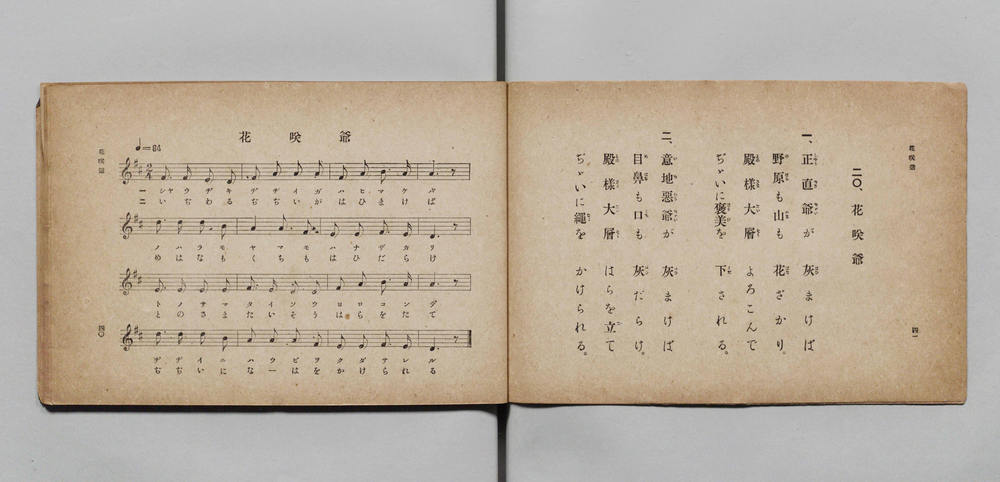

# 花咲爺

> Re:Shōka 使用 AI 協助辨識與重建樂譜，可能會有錯誤。歡迎回報。

- **鋼琴伴奏版**：<br><audio controls src="hanasakajii.mp3"></audio>

- 詞：文部省《尋常小學唱歌》
- 曲：文部省《尋常小學唱歌》
- 文部省《尋常小學唱歌 第一學年用》（明治四十四年五月，索書號 4103）

## 說明

原書資訊與歌詞全文（對應 P023.jpg，原書 p. 40–41，第一學年第 20 首）：
調性與拍號：ニ長調 2/4 拍子，♩=84


## 歌詞

```text
一、正直爺（しやうぢきぢゞい）が　灰（はひ）まけば
野原（のはら）も山（やま）も　花（はな）ざかり。
殿樣（とのさま）大層（たいそう）　よろこんで
ぢゞいに褒美（ほうび）を　下（くだ）される。

二、意地惡爺（いぢわるぢゞい）が　灰（はひ）まけば
目鼻（めはな）も口（くち）も　灰（はひ）だらけ。
殿樣（とのさま）大層（たいそう）　はらを立（た）て
ぢゞいに繩（なは）を　かけられる。
```

## ABC

<div class="abc-score" data-abc-src="hanasakajii.abc" aria-label="五線譜載入中"></div>

[下載 ABC 原始檔](hanasakajii.abc)

## TMD 檔案連結

- [主旋律 TMD 檔案](hanasakajii.tmd) [[在 TMD Studio 編輯](https://tmdlang.github.io/Tmd-TS/#tmd=s7IKdvYPcrWy4qpTUCpJTLdSSM7PyUlNLsnMz7PKyszLyo8vzshPT8wuBdHZiUpwdWX5OaW5qVbpRYkpqfGG8SaGBsYIyeL80qLkVKvi5Iz8_Jz4ktSKkqT8_Gx0-fiCxPRUqwADIySdBUX5Zal5iXlA3QVFmXklqSlg7QgFqWWZKakg6bLUosy0zNQUJCelFhWD3A01vaQoMa84uSizAOQZhKr8ohKgj4oSCzIqrTIyi0vyizKTE3PisxPzkHxXkpEK9Fxafk52Tn5RKrLmzPTMPKvc_LykUmCAKHFpaSm86Nr4dNKm5x27FLS0uBRtFSxMuOxtFVy4bIz0TexAOl-snPd-z6xn09pfNq94PqfxcUPX0w3dT3fseLqh_-naHU-nbHy2tudxQzfYlmezNxGvFq8qhedr1jzZ0QDi79zyfMoKoK73ezqezeh7tmn309mzn_Y2gsidW57smvJsTsf7PT3Ptyx6NnvHi5nzFUCR-X5PpxIXl76Wgi21AJeCgsLTvvkgOza3v1jR9aKjHehMYOA8bV0B9ArQcU839D5r71QApQi9rIJ0oJsg6hUK9BRMDB41TDYxBLkT2V9r1igYGSi8XDYN6F5gwIHseLFq_7OG5SDTu3uBvgGKPm7ufjl1O1BcARglCkDhp2snAA16NHOlLTCyQHqABj5uaHy2dvHz2VuAMQl0y-PG6Y-bWh43tj1uXPS4sRdENs173NgCtOdxIzAKGp43bgArW_-4ERhlQMF9jxsnPm7cADLuZXsf0OVg6XUgFU1At3U-bmp6unEjSBBk7j6ICNAgYPqBGbQKbNC0x43dj5u6Hjc0gcx6tm7_sxWLwSpWgI2bCtH8dMnypxuXgMXnA931uHEu0LEg_Q0Nj5uAdgCdPPlx0-THjctBpsDd_7hx9Yslk57v6wPr3A324GawWyYBdT7ZAUokjxv7HzcuALtl6uOmnsdN3SC3gMNpF9Drjc9a-p_O2fCseSEsqICmAo3vBykkKZyez173cs9ucJA0IgIAGE79EA8DnbEQHk4YBi0AhivILPLDCRw1QJ8_Xw3xNjDKgCYuQw-w5ztXgqVXATXAgwoUSUDLQfphIQTURnk2gQIFLX0uLg9goVScmJ2YlZlpFZCZmJfvUGNQUw2yR8HG0EzLDszClkehmf_Fwh4FDRMFYLHwfH2DDjxjaWLRALQOZFiNgrGCLhAaKxgBSUMghoiYImGEiBlYrSlQBMSDQQOQGrBpPoY1Co-btj9uXgyWeNy0TOFxcxOYtRZsEJQHFVsCJtdAZfrBMpPA5Dyo_o1gmQlIlsUjLDMCyjW2QFQ2LgKqBpvQ1A0xDygCEQeRIFXA5AmVWQ_mbQKT-6D6J4JlNmDYhD_Id_WQE-SGcWALgBSYBQpVRIiCaFB414BjBIQhMWQE0og71Jv7IB4BBuPj5pVgFsjrIBlQMEPkQMGKEIcEeBc40LZBA3w1WGYV7gBvaoQG2HogBqkDZlZosILMg8gtRBFHDu4FUHs6wTITSQzuHZ3kBDcoDEHhBwtPWJo3AocnQoToFN7cAQ3PPqBPtsJDFhQ6-6H-WwLEe8GsZdDQXgFWB8oGj5s2Q_VvBsu04w7tRpAuULitA-KpYBYowYJk5kNlWoB4LpjVhhzewBAGkaDsBJKbD5YBuYWE8AY2GKiavGGYnOQNSkyQkgNabjRD8zkkGYOD-XHzZDAJSmqgyAAHRHMDWB4UTSDeGrCe1XiCHJQ9oCUKtNwAqQbJwLIFLIhBgQsSB7kEkpghwQ6ie8AuAMmg2lPLxaVrp4BU0CsAucpcAA)]
- [鋼琴伴奏 TMD 檔案](hanasakajii_piano.tmd) [[在 TMD Studio 編輯](https://tmdlang.github.io/Tmd-TS/#tmd=s7IKdvYPcrWy4qpTUCpJTLdSSM7PyUlNLsnMz7PKyszLyo8vzshPT8wuBdHZiUpwdWX5OaW5qVbpRYkpqfGG8SaGBsYIyeL80qLkVKvi5Iz8_Jz4ktSKkqT8_Gx0-fiCxPRUqwADIySdBUX5Zal5iXlA3QVFmXklqSlg7QgFqWWZKakg6cTk5PzcgsS8zNzUPCT5stSiYpDjoVaUFCXmFScXZRaAfIRQlV9UAvRWUWJBRqVVRmZxSX5RZnJiTnx2Yh6SF0syUoE-TMvPyc7JL0pF1pyZnplnlZufl1QKDBUlLi0thRddG59O2vS8Y9f7PR0vu_c8n7DlyZ4tT5f2P-_seL-nU0FLi0vRVsHChMveVsGFy8ZI38QOZNyLlfPe75n1bFr7y-YVz-c0Pm7oerqh--mOHU839D9du-PplI3P1vY8bugGW_1s9ibi1eJVpfB8zZonOxpA_J1bnk9ZAdQFdPWzGX3PNu1-Onv2095GELlzy5NdU57NATq_5_mWRc9m73gxc74CKJqB_lHi4vIABlVxYnZiVmamVUBmYl5-kIdDjUFNNZcCENgYmmnZgVn6Wgq26ABq_4uFPQoaJgpAlz1f36CjAEoHelkF6ZpYNGjpgw2rUTBW0AVCYwUjIGkIxBARUySMEDEDqzUFioB4MGgAUgM2zcewRuFx0_bHzYvBEo-blik8bm4Cs9aCDYLyoGJLwOQaqEw_WGYSmJwH1b8RLDMBybJ4hGVGQLnGFojKxkVA1WATmroh5gFFIOIgEqTqcWMPVGY9mLcJTO6D6p8IltmAYRP-IN_VQ06QG8aBLQBSYBYoVBEhCqJB4V0DjhEQhsSQEUgj7lBv7oN4BBiMj5tXglkgr4NkQMEMkQMFK0IcEuBd4EDbBg3w1WCZVbgDvKkRGmDrgRik7nETKDJBgQcyDyK3EEUcObgXQO3pBMtMJDG4d3SSE9ygMASFHyw8YWneCByeCBGiU3hzBzQ8-4A-2QoPWVDo7If6bwkQ7wWzlkFDewVYHSgbPG7aDNW_GSzTjju0G0G6QOG2DoinglmgBAuSmQ-VaQHiuWBWG3J4A0MYRIKyE0huPlgG5BYSwhtYZlE1ecMwOckblJggJQe03GiG5nNIMgYH8-PmyWASlNRAkQEOiOYGsDwomkC8NWA9q_EEOSh7QEsUaLkBUg2SgWULWBCDAhckDnIJJDFDgh1E94BdAJJBtacWSznvg1zOm0CLeWBwxCtEG8aiM0xADNP4eGAIQVxdo2ACE4YrBMlHm8ZDxRAqUcUpNhToGV07BST_RPsAVaILGYGFlLkA)]

## 分析

```text
================================================================================
📊 TMD Song Profile: [ 花咲爺 ]
================================================================================
⏱  Duration:       0:22 (22.9s), 16 measures total
🎼 Key & Tempo:    首調基準 D, != 84.0 BPM, <2/4>
   - 分析範圍：      由實際發聲的音符與和弦推測調性；播放脈絡另行呈現
🎤 人聲音域:    D4 (MIDI 62) – D5 (MIDI 74) [跨度: 12 個半音 / 1.0 個八度, 難度: easy]
   - 最低音:  D4 in [Hanasakajii #1 @ m.1, 0:01]
   - 最高音: D5 in [Hanasakajii #1 @ m.5, 0:05]
   - 適合: soprano, mezzo-soprano, contralto, tenor, baritone, bass
🏛  結構:      Hanasakajii (22.9s)
⚡ 編曲密度:        Peak 1 軌道同時演奏
🗝  調性診斷：       D 調性不明確（純淨自然大調，未偵測到可信轉調）
   - 風格氣質:    純淨自然大調（陽光明朗、易唱易記，無明顯調外色彩）
   - 轉調歷程:    全曲維持單一推測調性（未偵測到可信轉調）
   - 核心骨幹音:  A, D, E, F#, B
   - 調性數值:    D 調性不明確 [相關度: 0.83, 穩定度: Ambiguous, 自然音純度: 100.0%]
   - 候選調性 (K-S): D 大調 (0.83), A 大調 (0.83), F# 小調 (0.65)
   - 五度圈歷程:   +2
   - 各段落調性細節:
     • [Hanasakajii #1]: D 調性不明確 (r: 0.83, 自然音純度: 100.0%)

  [ 五度圈游移軌跡 ]
               C  
         F            G  
      Bb              [D ]*
      Eb               A  
         Ab           E  
            Db       B  
               F# 
     (* = active key center)

  [ 十二半音累積音高分佈 ]
     C  :                            0.0%
     C# :                            0.0%
     D  : ███████████████████       23.3%
     D# :                            0.0%
     E  : ███████████████           19.2%
     F  :                            0.0%
     F# : ███████████████           19.2%
     G  :                            0.0%
     G# :                            0.0%
     A  : ████████████████████████  30.0%
     A# :                            0.0%
     B  : ███████                    8.3%
--------------------------------------------------------------------------------
Assignment 軌道音域：
  - Piano         : D4 – D5 (12 個半音 / 1.0 個八度, 51 個音符)
================================================================================
```


## 原書掃描頁




