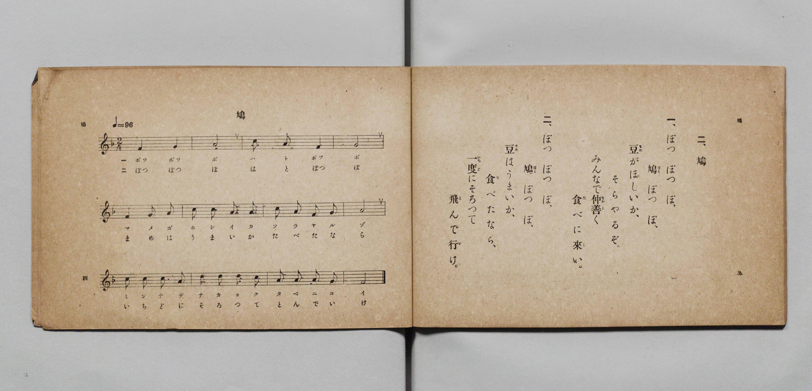

# 鳩

> Re:Shōka 使用 AI 協助辨識與重建樂譜，可能會有錯誤。歡迎回報。

- **鋼琴伴奏版**：<br><audio controls src="hato.mp3"></audio>

- 詞：文部省《尋常小學唱歌》
- 曲：文部省《尋常小學唱歌》
- 文部省《尋常小學唱歌 第一學年用》（明治四十四年五月，索書號 4103）

## 說明

原書資訊與歌詞全文（對應 P005.jpg，原書 p. 4–5，第一學年第 2 首）：
調性與拍號：ヘ長調 2/4 拍子，♩=96


## 歌詞

```text
一、ぽつぽつぽ、
鳩（はと）ぽつぽ、
豆（まめ）がほしいか、
そらやるぞ。
みんなで仲善（なかよ）く
食（た）べに來（こ）い。

二、ぽつぽつぽ、
鳩（はと）ぽつぽ、
豆（まめ）はうまいか、
食（た）べたなら、
一度（いちど）にそろつて
飛（と）んで行（い）け。
```

## ABC

<div class="abc-score" data-abc-src="hato.abc" aria-label="五線譜載入中"></div>

[下載 ABC 原始檔](hato.abc)

## TMD 檔案連結

- [主旋律 TMD 檔案](hato.tmd) [[在 TMD Studio 編輯](https://tmdlang.github.io/Tmd-TS/#tmd=s7IKdvYPcrWy4qpTUCpJTLdSSM7PyUlNLsnMz7PKyszLyo8vzshPT8wuBdHZiUpwdWX5OaW5qVbpRYkpqfGG8SaGBsYIyeL80qLkVKvi5Iz8_Jz4ktSKkqT8_Gx0-fiCxPRUqwADA1OETEFRfllqXmIeUHdBUWZeSWoKWDtCQWpZZkoqSLostSgzLTM1BclJqUXFIHdDTS8pSswrTi7KLAB5BqEqv6gE6KOixIKMSquMzOKS_KLM5MSc-OzEPCTflWSkAj2XmJeZm5iDrDUzPTPPKjc_L6kUGBxKXFpaCi83r1TQ0uJStFWwNOOyt1Vw47Ix0jexA-l5sXLe-z2znk1rf9m84vmcxscNXU83dD_dsePphv6na3c8nbLx2dqexw3dYPOfzd5EvFq8qhSer1nzZEcDiL9zy_MpK4C63u_peDaj79mm3U9nz37a2wgid255smvKszkd7_f0PN-y6NnsHS9mzlcAReL7PZ1KXFz6Wgq21AJcCgoKT_vmg-zY3P5iRdeLjnagM4GB87R1BdArQMc93dD7rL1TAZQS9LIK0oFugqhXKNBTMHnUMNkU5EpkX61Zo2Ck8HLZNKBjgaEGsuDFqv3PGpaDjO7uBXoFKPq4ecbLqduB4grA-FAACj9dOwFozqOZK22BMQXSAzTvcUPj48a9jxuXIMiGRpAcMFqBDnvcuP5x4wqgLejSLza2gaX3PW5qBEv3PG7c_bhx-uPGlseN3VBFjxvnPm7qfNzU8rip-3HjvMcNTRDR_Y-bJj9uXPW4cfmT3ZueTmsBmwTkdj9uAsYH0LB-sAsWA30BlACSQKGdjxtXP9kHsXQyWKQFZB7YG7uAKYNK3gCqawNxkb2B4ZD5INcCPQaRBsXKrmVgFUBNCx83Am0EqlsN9n0v2LplEGNmgxWB3QEKgOUvFvZAtIE1TISGD-UJDgoUtPS5uDwSS_KtAjIT8_IdagxqqkEWKNhYaNmBGdhSOTT7AN2moGGiAMxYz9c36MCTpiYWDUBrQIbVKBgq6AKTpS6QZQwkQbBGwRTIBonXgGXAYmDVPoY1Co-b5z5ubgYKwRlgMbjex839QNyBQxpijBFQDBypIGNgDLAYwpjG9UC8Aoc0OAnhDoldPeSHhDHY_6AQgLBAIWGEHDpIITEPHAwLFR43rQF7czaQtR2IlwDxapBI016g6EogBoo0Q0T2YQkKkBgwMYM9DeK3gcWAaQyIu8Ei84F4J5ReBTank8iw2NFJTliAQgDk9xoFMzA0BYcACILCAhRS6GEBdFnzZiDuAuJ2cGgAWcBQeNwMjMQmsL-a9gN5M4G4G8jeDBYBxSx6aIB8DQzTRmC4NYLDrHEuUGUvkAaGYuMysAjIzMlAejlYPUhkItykWi4uXTsFUB5SANLKXAA)]
- [鋼琴伴奏 TMD 檔案](hato_piano.tmd) [[在 TMD Studio 編輯](https://tmdlang.github.io/Tmd-TS/#tmd=s7IKdvYPcrWy4qpTUCpJTLdSSM7PyUlNLsnMz7PKyszLyo8vzshPT8wuBdHZiUpwdWX5OaW5qVbpRYkpqfGG8SaGBsYIyeL80qLkVKvi5Iz8_Jz4ktSKkqT8_Gx0-fiCxPRUqwADA1OETEFRfllqXmIeUHdBUWZeSWoKWDtCQWpZZkoqSDoxOTk_tyAxLzM3NQ9Jviy1qBjkeKgVJUWJecXJRZkFIB8hVOUXlQC9VZRYkFFplZFZXJJflJmcmBOfnZiH5MWSjFSgD0E2JOYga81Mz8yzys3PSyoFhokSl5aWwsvNK9_v6XjZvef5hC1P9mx5urT_eWfH-z2dClpaXIq2CpZmXPa2Cm5cNkb6JnYgg16snPd-z6xn09pfNq94PqfxcUPX0w3dT3fseLqh_-naHU-nbHy2tudxQzfY0mezNxGvFq8qhedr1jzZ0QDi79zyfMoKoC6gq5_N6Hu2affT2bOf9jaCyJ1bnuya8mwO0Pk9z7csejZ7x4uZ8xVA0Qv0jxIXl0diSb5VQGZiXn6Qh0ONQU01lwIQ2Fho2YEZ-loKtugAau-LhT0KGiYKQBc9X9-gowCKd72sgnRNLBq09MGG1SgYKugqGAFxjYIxkATBGgVTIBskXgOWAYuBVfsY1ig8bp77uLkZKARngMXgeh839wNxBw5piDFGQLHGvY8bl4CMgTHAYghjGtcD8Qoc0lz4Q2JXD_khYQz2PygEICxQSBghhw5SSMwDB8NChcdNa8DenA1kbQfiJUC8GiTStBcouhKIgSLNEJF9WIICJPa4qRHsaRC_DSz2uLEFiLvBIvOBeCeUXgU2p5PIsNjRSU5YgEIA5PcaBTMwNAWHAAiCwgIUUuhhAXRZ82Yg7gLidnBoAFnAUHjcDIzEJrC_mvYDeTOBuBvI3gwWAcUsemiAfA0M00ZguDWCw6xxLlBlL5AGhmLjMrAIyMzJQHo5WD1IZCLcpFrkLOSDnIVMoFkI6IN4BdN4bbBfwCyQTxEs0_h4BROwNIpyVEVAFkQNQgxDtQl21QYQV-raKYAcGu1jGKsAZxuB2cpcAA)]

## 分析

```text
================================================================================
📊 TMD Song Profile: [ 鳩 ]
================================================================================
⏱  Duration:       0:15 (15.0s), 12 measures total
🎼 Key & Tempo:    首調基準 F, != 96.0 BPM, <2/4>
   - 分析範圍：      由實際發聲的音符與和弦推測調性；播放脈絡另行呈現
🎤 人聲音域:    F4 (MIDI 65) – D5 (MIDI 74) [跨度: 9 個半音 / 0.8 個八度, 難度: easy]
   - 最低音:  F4 in [Hato #1 @ m.1, 0:00]
   - 最高音: D5 in [Hato #1 @ m.10, 0:11]
   - 適合: soprano, mezzo-soprano, contralto, tenor, baritone, bass
🏛  結構:      Hato (15.0s)
⚡ 編曲密度:        Peak 1 軌道同時演奏
🗝  調性診斷：       A 調性不明確（純淨自然大調，未偵測到可信轉調）
   - 風格氣質:    純淨自然大調（陽光明朗、易唱易記，無明顯調外色彩）
   - 轉調歷程:    全曲維持單一推測調性（未偵測到可信轉調）
   - 核心骨幹音:  A, F, G, C, D
   - 調性數值:    A 調性不明確 [相關度: 0.74, 穩定度: Ambiguous, 自然音純度: 100.0%]
   - 候選調性 (K-S): A 小調 (0.74), F 大調 (0.72), C 大調 (0.57)
   - 五度圈歷程:   +3
   - 各段落調性細節:
     • [Hato #1]: A 調性不明確 (r: 0.74, 自然音純度: 100.0%)

  [ 五度圈游移軌跡 ]
               C  
         F            G  
      Bb               D  
      Eb              [A ]*
         Ab           E  
            Db       B  
               F# 
     (* = active key center)

  [ 十二半音累積音高分佈 ]
     C  : ███████████               16.7%
     C# :                            0.0%
     D  : ████                       6.2%
     D# :                            0.0%
     E  :                            0.0%
     F  : ████████████████          22.9%
     F# :                            0.0%
     G  : █████████████             18.7%
     G# :                            0.0%
     A  : ████████████████████████  35.4%
     A# :                            0.0%
     B  :                            0.0%
--------------------------------------------------------------------------------
Assignment 軌道音域：
  - Piano         : F4 – D5 (9 個半音 / 0.8 個八度, 32 個音符)
================================================================================
```


## 原書掃描頁




