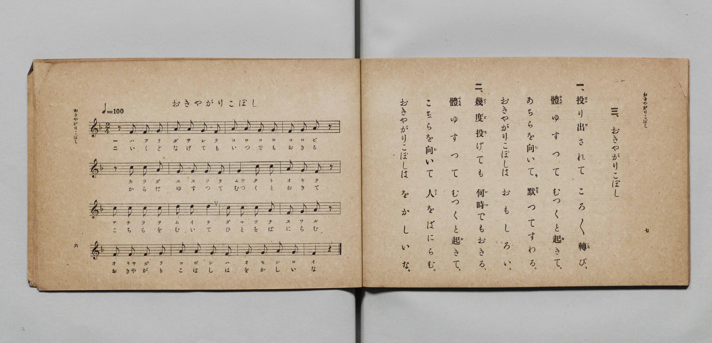

# おきやがりこぼし

> Re:Shōka 使用 AI 協助辨識與重建樂譜，可能會有錯誤。歡迎回報。

- **鋼琴伴奏版**：<br><audio controls src="okiyagarikoboshi.mp3"></audio>

- 詞：文部省《尋常小學唱歌》
- 曲：文部省《尋常小學唱歌》
- 文部省《尋常小學唱歌 第一學年用》（明治四十四年五月，索書號 4103）

## 說明

原書資訊與歌詞全文（對應 P006.jpg，原書 p. 6–7，第一學年第 3 首）：
調性與拍號：ヘ長調 2/4 拍子，♩=100


## 歌詞

```text
一、投（はふ）り出（だ）されて　ころ／＼轉（ころ）び、
體（からだ）ゆすつて　むつくと起（お）きて、
あちらを向（む）いて　默（だま）つてすわる。
おきやがりこぼしは　おもしろい。

二、幾度（いくど）投（な）げても　何時（いつ）でもおきる、
體（からだ）ゆすつて　むつくと起（お）きて、
こちらを向（む）いて　人（ひと）をばにらむ。
おきやがりこぼしは　をかしいな。
```

## ABC

<div class="abc-score" data-abc-src="okiyagarikoboshi.abc" aria-label="五線譜載入中"></div>

[下載 ABC 原始檔](okiyagarikoboshi.abc)

## TMD 檔案連結

- [主旋律 TMD 檔案](okiyagarikoboshi.tmd) [[在 TMD Studio 編輯](https://tmdlang.github.io/Tmd-TS/#tmd=s7IKdvYPcrWy4qpTUCpJTLdSSM7PyUlNLsnMz7PKyszLyo8vzshPT8wuBdHZiUpwdWX5OaW5qVbpRYkpqfGG8SaGBsYIyeL80qLkVKvi5Iz8_Jz4ktSKkqT8_Gx0-fiCxPRUqwADAzOETEFRfllqXmIeUHdBUWZeSWoKWDtCQWpZZkoqSLostSgzLTM1BclJqUXFIHdDTS8pSswrTi7KLAB5BqEqv6gE6KOixIKMSquMzOKS_KLM5MSc-OzEPCTflWSkAj1XkJNYiawxMz0zzyo3Py-pFBgYSlxaWgqPG7seN_Y-bmp53NjzuAnInvy4cc_jxukKWlpcirYKhgYGXPa2Cm5cNkb6JnYgk16snPd-z6xn09pfNq94PqfxcUPX0w3dT3fseLqh_-naHU-nbHy2tudxQzfY1mezNxGvFq8qhedr1jzZ0QDi79zyfMoKoK73ezqezeh7tmn309mzn_Y2gsidW57smvJsTsf7PT3Ptyx6NnvHi5nzFUAR-35PpxIXl76Wgi21AJeCgsLTvvkgOza3v1jR9aKjHehMYOA8bV0B9ArQcU839D5r71QApQ69rIJ0oJsg6hUK9BTMHjVMNge5EtlXa9YoGCu8XDYN6FhgqIEseLFq_7OG5SCju3uBXgGKPm6e8XLqdqC4AjA-FIDCT9dOAJrzaOZKW1BUgTQBDXzc0PisayrQDY8b1z9u3Ao0EBi1T9t3gUUWgLiNUx839TxuXPa4oQEU5U297_f0v9-z58VeoNVANRARoLLNQKNAhr5cPQUs0f24CSgKNqKp7XHjzMeNS6CmNAENArL7HzeueLF1O1hxF9iIXrACsCmPG5seNy4EGdE06emEiSBFTQ1gRcDkBzLl5e4ZEDc-btwHFgebDrSmqf9xU_fjhiaIKdiTLMizIO90PW4CWjMd6AWQuUA94FDZBUxpjU937nu6axnYCqBuoFtXAm2BBdUqsI2TQDYCDWhoeLJ36rOZTTDFS8Cyy8FmQ-wHuoeqYQP0Br6webILEn-bgKaA7QC6dMPjxtVgLcAoJyZsQHq6wVygglVQPZRnBihQ0NLn4vLPzqxMTE8syszOT8ovzsi0CshMzMt3qDGoqQZZpmBjoWUHZmDLjdBs_mJhj4KGiQKwAHi-vkEHnoU0sWgAWgkyrEbBQMEQDGsUjIDZyAjKgkAIyxCopgas2sewRiFe4XFzPxBPBeJVQBWPmxsUHjdtBdJrgLgNJNK0GchaC6eRRJonA_VDzTICm9XYAsRA8xpXgtQ1rgLiSUC8DKinCSwCkl8CxMvhIl1A3AvkdYPNwh8mu3rICxNjMKwBYlMgBLFMFcygLEjYoIVJ02qg71aCQwMUJiD37wTSQNdDwqR5AYTXtB5Id4DDBOjXJlCYtGGESTdQphNILwCrawOyZkJDYRlYBBjiYB4o3FYghwlQnnCY7OgkJ0xA4QCCNdBwAKUOiIgZlGWMEiaPmxYB_dYIDZVNsDBoArob4mNIymmehxxK4DADhdBqlDABZkcgXggJlaZJ8DAApQ2wj4H0JnBYgGSB2RssAowRsPoGwmECrATJCRNIzgGFBCi1wPIOiAUSM1TQBULUMAHH-eNmYCA0gbILOAOBM8ccIL0dnLWgypqBwQcWgWSgJWDDUAMFHOnAMgtI9QCVdIF9DQqpPUA8HYjXg7WCQgSYosAiLdBcBjOslotL104BvexRAIopcwEA)]
- [鋼琴伴奏 TMD 檔案](okiyagarikoboshi_piano.tmd) [[在 TMD Studio 編輯](https://tmdlang.github.io/Tmd-TS/#tmd=s7IKdvYPcrWy4qpTUCpJTLdSSM7PyUlNLsnMz7PKyszLyo8vzshPT8wuBdHZiUpwdWX5OaW5qVbpRYkpqfGG8SaGBsYIyeL80qLkVKvi5Iz8_Jz4ktSKkqT8_Gx0-fiCxPRUqwADAzOETEFRfllqXmIeUHdBUWZeSWoKWDtCQWpZZkoqSDoxOTk_tyAxLzM3NQ9Jviy1qBjkeKgVJUWJecXJRZkFIB8hVOUXlQC9VZRYkFFplZFZXJJflJmcmBOfnZiH5MWSjFSgDwtyEiuRNWamZ-ZZ5ebnJZUCQ0SJS0tL4XFj1-PG3sdNLY8bex43AdmTHzfuedw4_f2ejpfde55P2PJkz5anS_ufd3a839OpoKXFpWirYGhgwGVvq-DGZWOkb2IHMv7Fynnv98x6Nq39ZfOK53MaHzd0Pd3Q_XTHjqcb-p-u3fF0ysZna3seN3SDnfJs9ibi1eJVpfB8zZonOxpA_J1bnk9ZAdQFdPazGX3PNu1-Onv2095GELlzy5NdU57NAbq_5_mWRc9m73gxc74CKMqBHlLi4vLPzqxMTE8syszOT8ovzsi0CshMzMsP8nCoMaip5lIAAhsLLTswQ19LwRYdQN3wYmGPgoaJAtB1z9c36CiA0oVeVkG6JhYNWvpgw2oUDBQMwbBGwUjBGIghLAiEsAyBamrAqn0MaxTiFR439wPxVCBeBVTxuLlB4XHTViC9BojbQCJNm4GstXAaSaR5MlA_1CwjsFmNLUAMNK9xJUhd4yogngTEy4B6msAiIPklQLwcLtIFxL1AXjfYLPxhsquHvDAxBsMaIDYFQhDLVMEMyoKEDVqYNK0G-m4lODRAYQJy_04gDXQ9JEyaF0B4TeuBdAc4TIB-bQKFSRtGmHQDZTqB9AKwujYgayY0FJaBRYAhDuaBwm0FcpgA5QmHyY5OcsIEFA4gWAMNB1DqgIiYQVnGKGHyuGkR0G-N0FDZBAuDJqC7IT6GpJzmecihBA4zUAitRgkTYHkAxAshodI0CR4GoLQB9jGQ3gQOC5Ds48YNYBFgjIDVNxAOE2AOJSdMIDkHFBKg1ALLOyAWSMxQQRcIUcMEHOePm4GB0ATKLuAMBM4cc4D0dnDWgiprBgYfWASSgZaADUMNFHCkAwtNINUDVNIF9jUopPYA8XQgXg_WCgoRYIoCi7RAcxnMsFpcRY8PctFjAi16QDnDNF4bnB3i45GZJvHa4AQBZBrCHImkGiiGwYKYgFCMkDEBs8BBGK9gFq9tgiyLoRrVRKhDgIKggAd6T9dOAd2H0T6GsQpYxY3A4spcAA)]

## 分析

```text
================================================================================
📊 TMD Song Profile: [ おきやがりこぼし ]
================================================================================
⏱  Duration:       0:19 (19.2s), 16 measures total
🎼 Key & Tempo:    首調基準 F, != 100.0 BPM, <2/4>
   - 分析範圍：      由實際發聲的音符與和弦推測調性；播放脈絡另行呈現
🎤 人聲音域:    F4 (MIDI 65) – D5 (MIDI 74) [跨度: 9 個半音 / 0.8 個八度, 難度: easy]
   - 最低音:  F4 in [Okiyagarikoboshi #1 @ m.1, 0:00]
   - 最高音: D5 in [Okiyagarikoboshi #1 @ m.7, 0:07]
   - 適合: soprano, mezzo-soprano, contralto, tenor, baritone, bass
🏛  結構:      Okiyagarikoboshi (19.2s)
⚡ 編曲密度:        Peak 1 軌道同時演奏
🗝  調性診斷：       C 大調（純淨自然大調，未偵測到可信轉調）
   - 風格氣質:    純淨自然大調（陽光明朗、易唱易記，無明顯調外色彩）
   - 轉調歷程:    全曲維持單一推測調性（未偵測到可信轉調）
   - 核心骨幹音:  G, C, F, A, D
   - 調性數值:    C 大調 [相關度: 0.80, 穩定度: Moderate, 自然音純度: 100.0%]
   - 候選調性 (K-S): C 大調 (0.80), F 大調 (0.71), A 小調 (0.57)
   - 五度圈歷程:   +0
   - 各段落調性細節:
     • [Okiyagarikoboshi #1]: C 大調 (r: 0.80, 自然音純度: 100.0%)

  [ 五度圈游移軌跡 ]
              [C ]*
         F            G  
      Bb               D  
      Eb               A  
         Ab           E  
            Db       B  
               F# 
     (* = active key center)

  [ 十二半音累積音高分佈 ]
     C  : ████████████████████      24.1%
     C# :                            0.0%
     D  : ████                       5.2%
     D# :                            0.0%
     E  :                            0.0%
     F  : █████████████████         20.7%
     F# :                            0.0%
     G  : ████████████████████████  29.3%
     G# :                            0.0%
     A  : █████████████████         20.7%
     A# :                            0.0%
     B  :                            0.0%
--------------------------------------------------------------------------------
Assignment 軌道音域：
  - Piano         : F4 – D5 (9 個半音 / 0.8 個八度, 56 個音符)
================================================================================
```


## 原書掃描頁




