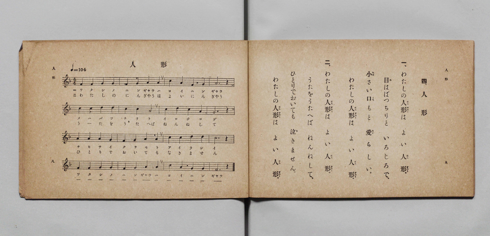

# 人形

> Re:Shōka 使用 AI 協助辨識與重建樂譜，可能會有錯誤。歡迎回報。

- **鋼琴伴奏版**：<br><audio controls src="ningyo.mp3"></audio>

- 詞：文部省《尋常小學唱歌》
- 曲：文部省《尋常小學唱歌》
- 文部省《尋常小學唱歌 第一學年用》（明治四十四年五月，索書號 4103）

## 說明

原書資訊與歌詞全文（對應 P007.jpg，原書 p. 8–9，第一學年第 4 首）：
調性與拍號：ヘ長調 4/4 拍子，♩=104


## 歌詞

```text
一、わたしの人形（にんぎやう）は　よい人形（にんぎやう）。
目（め）はぱつちりと　いろじろで、
小（ちひ）さい口（くち）もと　愛（あい）らしい。
わたしの人形（にんぎやう）は　よい人形（にんぎやう）。

二、わたしの人形（にんぎやう）は　よい人形（にんぎやう）。
うたをうたへば　ねんねして、
ひとりでおいても　泣（な）きません。
わたしの人形（にんぎやう）は　よい人形（にんぎやう）。
```

## ABC

<div class="abc-score" data-abc-src="ningyo.abc" aria-label="五線譜載入中"></div>

[下載 ABC 原始檔](ningyo.abc)

## TMD 檔案連結

- [主旋律 TMD 檔案](ningyo.tmd) [[在 TMD Studio 編輯](https://tmdlang.github.io/Tmd-TS/#tmd=s7IKdvYPcrWy4qpTUCpJTLdSSM7PyUlNLsnMz7PKyszLyo8vzshPT8wuBdHZiUpwdWX5OaW5qVbpRYkpqfGG8SaGBsYIyeL80qLkVKvi5Iz8_Jz4ktSKkqT8_Gx0-fiCxPRUqwADA3OETEFRfllqXmIeUHdBUWZeSWoKWDtCQWpZZkoqSLostSgzLTM1BclJqUXFIHdDTS8pSswrTi7KLAB5BqEqv6gE6KOixIKMSquMzOKS_KLM5MSc-OzEPCTflWSkAj1XkJNYiawxMz0zzyo3Py-pFBgYSlxaWgpPdu16uneRgpYWl6KtgqGBCZe9rYIbl42JvokdSN-LlfPe75n1bFr7y-YVz-c0Pm7oerqh--mOHU839D9du-PplI3P1vY8bugG2_Fs9ibi1eJVpfB8zZonOxpA_J1bnk9ZAdT1fk_Hsxl9zzbtfjp79tPeRhC5c8uTXVOezel4v6fn-ZZFz2bveDFzvgIoGt_v6VTi4tLXUrClFuBSUFB42jcfZMfm9hcrul50tAOdCQycp60rgF4BOu7pht5n7Z0KoLSgl1WQDnQTRL1CgZ6CxaOGyZYgVyL7as0aBROFl8umAR0LDDWQBS9W7X_WsBxkdHcv0CtA0cfNM15O3Q4UVwDGhwJQ-OnaCUBzHs1caQuKKpAmoIGPGxofN_U_bpz_uHH648Z1kBgFOulx4-rHTZMfN_Y9bmp53NgGtOhx4_rHDQ2Pm4BSLfiUNTSBjH4-ex1IuqkRqrNx4-PGJY8bFz5u6nrcCIyTBqApj5t6HzfOAJPLge4Ah9OGfrCpCx83AtMDUOdUoLqn_YvBgkBnLgQJNjVBjHjWMhssDuS2gMWB6oGeaIE6gfr-AofZLmA6pE2YATkgQ5smQRmNOx43bgAH1VqwhrVg-5ZBgwoYQqBgAIXn8seNQBJo2DJQ2AADZjMkwFaBnQAM3n2PG2eDjKBVwAANpTyfQIGClj4Xl19mXnplvlVAZmJevkONQU01yAoFGxMtOzADW_aE5vsXC3sUNExACen5-gYdeJ7SxKIBaBHIsBoFQyA0AkIQy0jBGAhrFEyBJIhXA6R1gdBAoQas2sewRuFx83pgIO4H4u1Adh9QzePmbiDeDBRZ97h58eOmZUBeP1h8BVBsCVweKAJXATI1HmaqEUimHxip84F4OhCvA6ltXA0UnQykocENZK0Hm9EBZLXA5UEqYSpgpuIPp1095ISTKRCaASGEBQoXEMsMzK4BhhVmOC0Eh8Pj5olA3AIOj0YgXgXEHWDdkLBZC6R3gGmQinbMkAH7Cxw2TZPAvgWFBCikQDkEYlAjyBBQUAFpYACCRBBBTCDRdJITGKBkYoyRaBABhBkYIK9PArpyK9jbIM8DkxFYdBE4QEAiQBY4SFaCExckgDCDYxMQgxJWF5BeDvYriAVKEMCE19QEFgEGcmMvEO8D4tlgkyYTFx7A6pGamQgmNhQzUS0Xl66dAqQwUgCylLkA)]
- [鋼琴伴奏 TMD 檔案](ningyo_piano.tmd) [[在 TMD Studio 編輯](https://tmdlang.github.io/Tmd-TS/#tmd=s7IKdvYPcrWy4qpTUCpJTLdSSM7PyUlNLsnMz7PKyszLyo8vzshPT8wuBdHZiUpwdWX5OaW5qVbpRYkpqfGG8SaGBsYIyeL80qLkVKvi5Iz8_Jz4ktSKkqT8_Gx0-fiCxPRUqwADA3OETEFRfllqXmIeUHdBUWZeSWoKWDtCQWpZZkoqSDoxOTk_tyAxLzM3NQ9Jviy1qBjkeKgVJUWJecXJRZkFIB8hVOUXlQC9VZRYkFFplZFZXJJflJmcmBOfnZiH5MWSjFSgDwtyEiuRNWamZ-ZZ5ebnJZUCQ0SJS0tL4cmuXU_3Lnq_p-Nl957nE7Y82bPl6dL-550d7_d0KmhpcSnaKhgamHDZ2yq4cdmY6JvYgQx7sXLe-z2znk1rf9m84vmcxscNXU83dD_dsePphv6na3c8nbLx2dqexw3dYIufzd5EvFq8qhSer1nzZEcDiL9zy_MpK4C6gM5-NqPv2abdT2fPftrbCCJ3bnmya8qzOUD39zzfsujZ7B0vZs5XAEUw0ENKXFx-mXnplflWAZmJeflBHg41BjXVXApAYGOiZQdm6Gsp2KIDqM0vFvYoaJgoAN30fH2DjgIo7vWyCtI1sWjQ0gcbVqNgCIRGQAhiGSkYA2GNgimQBPFqgLQuEBoo1IBV-xjWKDxuXq_wuGk_EG8HsvuAah43dwPxZqDIusfNix83LQPy-sHiK4BiS-DyQBG4CpCp8TBTjUAy_QqPG-cD8XQgXgdS27gaKDoZSPc9bmp53NgGZK0Hm9EBZLXA5UEqYSpgpuIPp1095ISTKRCaASGEBQoXEMsMzK4BhhVmOC0Eh8Pj5olA3AIOj0YgXgXEHWDdkLBZC6R3gGmQinbMkAH7Cxw2TZPAvgWFBCikdjxu3AAxqBFkCCiogDQwAEEiiCAmkGg6yQkMUDIxxkg0iADCDAyQ1ycBXbkV7G2Q54HJCCy6CBwgIBEgCxwkK8GJCxJAmMGxCYhBCasLSC8H-xXEAiUIYMJragKLAAO5sReI9wHxbLBJk4kLD2AGpWYmgokNxUxUi1oW-WAri4B-i1cwjdc2BhLxCibx2mDvQoVgNCFFsIBBCJrEK5jFa5vgNQshAjcVxMA0jCiXYbWRTLNw-xIYpLp2CpBQjfYxjFVA4hmBecpcAA)]

## 分析

```text
================================================================================
📊 TMD Song Profile: [ 人形 ]
================================================================================
⏱  Duration:       0:36 (36.9s), 16 measures total
🎼 Key & Tempo:    首調基準 F, != 104.0 BPM, <4/4>
   - 分析範圍：      由實際發聲的音符與和弦推測調性；播放脈絡另行呈現
🎤 人聲音域:    F4 (MIDI 65) – D5 (MIDI 74) [跨度: 9 個半音 / 0.8 個八度, 難度: easy]
   - 最低音:  F4 in [Ningyo #1 @ m.1, 0:00]
   - 最高音: D5 in [Ningyo #1 @ m.5, 0:10]
   - 適合: soprano, mezzo-soprano, contralto, tenor, baritone, bass
🏛  結構:      Ningyo (36.9s)
⚡ 編曲密度:        Peak 1 軌道同時演奏
🗝  調性診斷：       C 調性不明確（純淨自然大調，未偵測到可信轉調）
   - 風格氣質:    純淨自然大調（陽光明朗、易唱易記，無明顯調外色彩）
   - 轉調歷程:    全曲維持單一推測調性（未偵測到可信轉調）
   - 核心骨幹音:  A, G, C, F, D
   - 調性數值:    C 調性不明確 [相關度: 0.72, 穩定度: Ambiguous, 自然音純度: 100.0%]
   - 候選調性 (K-S): C 大調 (0.72), F 大調 (0.71), A 小調 (0.71)
   - 五度圈歷程:   +0
   - 各段落調性細節:
     • [Ningyo #1]: C 調性不明確 (r: 0.72, 自然音純度: 100.0%)

  [ 五度圈游移軌跡 ]
              [C ]*
         F            G  
      Bb               D  
      Eb               A  
         Ab           E  
            Db       B  
               F# 
     (* = active key center)

  [ 十二半音累積音高分佈 ]
     C  : ██████████████████        21.7%
     C# :                            0.0%
     D  : ███████                    8.3%
     D# :                            0.0%
     E  :                            0.0%
     F  : ████████████████          18.3%
     F# :                            0.0%
     G  : ████████████████████      23.3%
     G# :                            0.0%
     A  : ████████████████████████  28.3%
     A# :                            0.0%
     B  :                            0.0%
--------------------------------------------------------------------------------
Assignment 軌道音域：
  - Piano         : F4 – D5 (9 個半音 / 0.8 個八度, 51 個音符)
================================================================================
```


## 原書掃描頁




