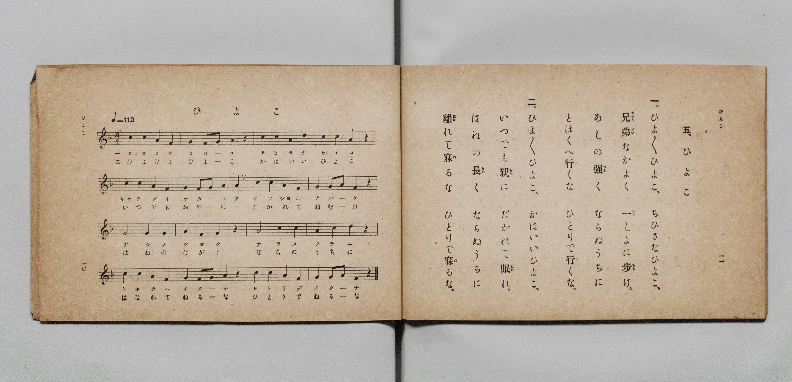

# ヒヨコ（小雞）

> Re:Shōka 使用 AI 協助辨識與重建樂譜，可能會有錯誤。歡迎回報。

- **鋼琴伴奏版**：<br><audio controls src="hiyoko.mp3"></audio>

- 詞：文部省
- 曲：文部省
- 臺灣總督府《公學校唱歌》第一學年用（昭和九年三月第一版、昭和十一年二月第四版，索書號 0729 73）

## 說明


- 出處：臺灣總督府編《公學校唱歌》第一學年用，第五課〈ヒヨコ〉（小雞），原書第 10–11 頁（掃描檔 P014.jpg–P015.jpg）。
- 調性與拍號：ヘ長調（F 大調），4/4 拍，速度 != 112。
- 背景與曲風：與《新定兒童唱歌》第一學年用第一學期第三首〈ヒヨコ〉同曲同詞。描寫小雞吱吱叫、兄弟相親相愛一起走路，並叮嚀小雞在腳還沒長強壯、翅膀還沒長長之前，不要獨自走遠或離開母雞睡覺。


## 歌詞

```text
一　ヒヨ ヒヨ ヒヨコ、
チヒサナ ヒヨコ。
キヤウダイ ナカ ヨク イッシヨ ニ アルケ。
アシ ノ ツヨク ナラヌ ウチ ニ、
トホク ヘ イク ナ、
ヒトリ デ イク ナ。

二　ヒヨ ヒヨ ヒヨコ、
カハイイ ヒヨコ。
イツ デモ オヤ ニ ダカレテ ネムレ。
ハネ ノ ナガク ナラヌ ウチ ニ、
ハナレテ ネル ナ、
ヒトリ デ ネル ナ。
```

## ABC

<div class="abc-score" data-abc-src="hiyoko.abc" aria-label="五線譜載入中"></div>

[下載 ABC 原始檔](hiyoko.abc)

## TMD 檔案連結

- [主旋律 TMD 檔案](hiyoko.tmd) [[在 TMD Studio 編輯](https://tmdlang.github.io/Tmd-TS/#tmd=s7IKdvYPcrWy4qpTUCpJTLdSSM7PyUlNLsnMz7PKyszLyo8vzshPT8wuBdHZiUpwdWX5OaW5qVbpRYkpqfGG8SaGBsYIyeL80qLkVKvi5Iz8_Jz4ktSKkqT8_Gx0-fiCxPRUqwADQxOETEFRfllqXmIeUHdBUWZeSWoKWDtCQWpZZkoqSLo4OTEvviy1KDMtMzUFyV2pRcUgx0OtKClKzCtOLsosAPkIoSq_qAToraLEgoxKq4zM4pL8oszkxJz47MQ8JC-WZKQCfZiYl5mbmIOsNTM9M88qNz8vqRQYJkpcWloKj5snPW5e8bhp8_s9HU839L-cPe_9nk4FLS0uRVsFQ0MjLntbBTcuGxN9EzuQMS9WAqVnPZvW_rJ5xfM5jWCjn83ehCH2on3X88bFz3fsfT538dNdcx43dD1tXfN07Y5nCxY-nbLx2dqexw3dz9esebKjASj4dOeW51NWAO1_NmPt00k9T3bOBYo82dH5bE4HRM3zzo7HDY0Q2ae9jSBdQAW7eiAKns6eDVTwfk_P8y2Lns3e8WLmfAUDcyNLBXNjoE-UuLj0tRRsqQW4FBQUHjdMAHr5-ex1L1atejaj73HDRLBo8-6n7btezJwKDAs03z_fvoK4AOgBieya8mLVpscNHfCIedzQiRw3QGVP--YDPQpUrGBo8KhhsqGhwssFjaDw62t-1t__bNUUBVDK1MsqSAfKApmmICZQ6-OGJqhTX6za_6xh-YuO9mfdvcAAA7r5cfOMl1O3A8WB5rgpPF2yHMwE2QaMewWgMiDrZcP8p7uWKUBSBpJhzT3PZq4HGTZ708tFQH_MArKBPn42bcPTdbOetk56vnopLk_Duc_mzAezO18um4bm-6cTeoAmA0lg6gPaCvTi0_WrIeHxdMJGEOpfDUwfT1tbnu6Z_xyYApatApLPWmYDTX6xdfuLrRtebF8PdP6THcue9q97OqsBqnfOihetm182tTzbNAno9ad7tj9dvB5ozvP9rS_aGuDiQPRkZ_fTTlAAPNnR-2JZ4_PeFS_aVwGNfdm44FnHtJezF72c1v1sfS_QzOdzF75YtgsUNNCUAokqoNeBbn_augKYS4Bh82THWhBj1bwXa4EWTgTHbu-z9k5QtEHjChrHCgV6wLAGxgPYPKB_Hjc0QIIGmnER-Rfockh8NIKEmrY-bu5CloREVtPax81LHjcte9zc8LhpCVC-63HTaiAFVLMeKLvkcXPz46btEHO7gQKLHjevfty0Ea59EVAWKNUHxC0wXUAzmlc-bu4BSgPNbQTphLsFGI-zIYpmgI2HqodJA10HVLEKyGpHkQbbBgwWSBABE9TTqftACJoHeoAMIHo-qwUiAtQAifynDRNB8YMtCYDUzFnxcvZMlDjfNx0S7WgxDFT_tAMcvdN2Pu3bjRBvX_V0-8an09YBkwBQHGgmPGp2ARM3oahpWv24uR_sT1DQo0cNMPBbQCHxuHkRkLcKGFGQSABFFVDjmsfNbUBO7-PmBSAOLPf1A4WgMQKMyzUEYwSoHiiLMAwU-zgiBEmaYIT0rwcGNnKEvJy14tnMppfNe4HB9mTf3KeNfcDgh2SSZ-3bXyxeCM8qQHGCWQ4tj2GNEKA4NEKAbqW8qIcCBS19Li6PzMr87HyrgMzEvHyHGoOaapAVCjYWWnZgBrYaRgFSsr1Y2KOgYaIASq3rG3Tg5bImFg1Ai0CG1SiYKuiCsTEQGwJxjYIRmGUEFjEAiyCrMcMQAasBm-ZjWAOKViAflCJBJIKNJtO0GUjGQ8UbEWqbtoLZXfh0QOwyIssuYAEEEu8Hiy-Bk7jtwh_mu3qoH-YgjE8NiIcW5qCSdjHY4cvAnmhA8RgoMGEeh3hvPTQwwAHQ3AwWAxbEy8HcbqjkIjAPrK1pI2bYQzW3gMl2MAnSAZJZBeZB5EGmgSDIIRBnQRyyBky2QWV6wbwFcBliwn5HJzlhDwpFEATRIFwDD2EQD5LeQSIgCIsDiAiIBUr96GEP8jUIgmorkPv7oH6ChAwiwGGpHRQdYPXNK8FkDzTUIFEHyQugUENP66A0C9EHCS2YPZDoBYcnBfbgDWtgq5ceZQvBdN7cAXb1bLhfQVU9UlKGioF8DgsFSK6G6IOkS1BaxakDLbyhoYs1tULSMVF2YdfBVcvFpWunACnvFYAsZS4A)]
- [鋼琴伴奏 TMD 檔案](hiyoko_piano.tmd) [[在 TMD Studio 編輯](https://tmdlang.github.io/Tmd-TS/#tmd=s7IKdvYPcrWy4tLSUnjcPOlx84rHTZvf7-l4uqH_5ex5j5t3v-ze83zClid7tjxd2v-8s-P9nk4FLS0uRVsFQ0MjLntbBTcuGxN9EzuuOgWlFyvnvd8z69m09pfNK57PaVQCiT2bvQlD7EX7rueNi5_v2Pt87uKnu-Y8buh62rrm6dodzxYsfDpl47O1PY8bup-vWfNkRwNQ8OnOLc-nrAC66NmMtU8n9TzZORco8mRH57M5HRA1QEc9bmiEyD7tbQTpAirY1QNR8HT2bLCre55vWfRs9o4XM-crGJgbWSqYGwN9osTF5ZFZmZ-dbxWQmZiXH-ThUGNQU82lAAQ2Flp2YIa-loItOlCA2PxiYY-ChokCMKier2_QUQgwMDTRyypI18SiQUsfbFiNgqmCLhgbA7EhENcoGIFZRmARA7AIshozDBGwGrBpPoY1oDgD8oHRBiYRbDSZps1AMh4q3ohQ27QVzO7CpwNilxFZdjWtBov3g8WXwEncduEP81091A9zEManBsRDC_OmtY-bF4MdvgzsiQYUj4ECE-ZxiPfWQwMDHADNzWCx7Y-bl4O53VDJRWAeWFvTRsywh2puAZPtYBKkAySzCsyDyINMA0GQQyDOgjhkDZhsg8r0gnkL4DLEhP2OTnLCHhSKIAiiQbgGHsIgHiS9g0RAEBYHEBEQC5T60cMe5GsQBAYh2P19UD9BQgYR4LDUDooOsPrmlWCyBxpqkKiD5AVQqKGndVCaheiDhBbMHkj0gsOTAnvwhjWw0KJH2UIwnTd3gF09G-7Xx80zoL6C5GWIGMjnsFCA5GqIPki6BKVVnDrQwhsaulhTKyQdE2UXdh1ctajFvQ9ycW8CLe5rFAzjFaINY2EUMMTigSzTeLCIAULeBEiZgOQR6oGyRJgBESFgCyxGYaJwBlwnSATJOegGA51HnHOwmYHuGGDA6dopQMIu2geoBIlnBOYpcwEA)]

## 分析

```text
================================================================================
📊 TMD Song Profile: [ ヒヨコ（小雞） ]
================================================================================
⏱  Duration:       0:34 (34.3s), 16 measures total
🎼 Key & Tempo:    首調基準 F, != 112.0 BPM, <4/4>
   - 分析範圍：      由實際發聲的音符與和弦推測調性；播放脈絡另行呈現
🎤 人聲音域:    F4 (MIDI 65) – D5 (MIDI 74) [跨度: 9 個半音 / 0.8 個八度, 難度: easy]
   - 最低音:  F4 in [Hiyoko #1 @ m.1, 0:01]
   - 最高音: D5 in [Hiyoko #1 @ m.3, 0:05]
   - 適合: soprano, mezzo-soprano, contralto, tenor, baritone, bass
🏛  結構:      Hiyoko (34.3s)
⚡ 編曲密度:        Peak 1 軌道同時演奏
🗝  調性診斷：       C 大調（純淨自然大調，未偵測到可信轉調）
   - 風格氣質:    純淨自然大調（陽光明朗、易唱易記，無明顯調外色彩）
   - 轉調歷程:    全曲維持單一推測調性（未偵測到可信轉調）
   - 核心骨幹音:  C, A, G, F, D
   - 調性數值:    C 大調 [相關度: 0.80, 穩定度: Moderate, 自然音純度: 100.0%]
   - 候選調性 (K-S): C 大調 (0.80), F 大調 (0.74), A 小調 (0.72)
   - 五度圈歷程:   +0
   - 各段落調性細節:
     • [Hiyoko #1]: C 大調 (r: 0.80, 自然音純度: 100.0%)

  [ 五度圈游移軌跡 ]
              [C ]*
         F            G  
      Bb               D  
      Eb               A  
         Ab           E  
            Db       B  
               F# 
     (* = active key center)

  [ 十二半音累積音高分佈 ]
     C  : ████████████████████████  29.8%
     C# :                            0.0%
     D  : ███                        3.5%
     D# :                            0.0%
     E  :                            0.0%
     F  : ███████████████           18.4%
     F# :                            0.0%
     G  : ██████████████████        21.9%
     G# :                            0.0%
     A  : █████████████████████     26.3%
     A# :                            0.0%
     B  :                            0.0%
--------------------------------------------------------------------------------
Assignment 軌道音域：
  - Piano         : F4 – D5 (9 個半音 / 0.8 個八度, 60 個音符)
================================================================================
```


## 原書掃描頁




