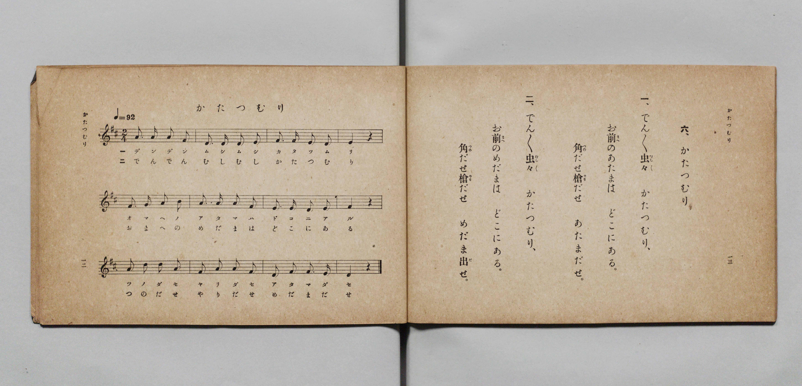

# かたつむり

> Re:Shōka 使用 AI 協助辨識與重建樂譜，可能會有錯誤。歡迎回報。

- **鋼琴伴奏版**：<br><audio controls src="katatsumuri.mp3"></audio>

- 詞：文部省《尋常小學唱歌》
- 曲：文部省《尋常小學唱歌》
- 文部省《尋常小學唱歌 第一學年用》（明治四十四年五月，索書號 4103）

## 說明

原書資訊與歌詞全文（對應 P009.jpg，原書 p. 12–13，第一學年第 6 首）：
調性與拍號：ニ長調 2/4 拍子，♩=92


## 歌詞

```text
一、でん／＼虫（むし）々（むし）　かたつむり、
お前（まへ）のあたまは　どこにある。
角（つの）だせ槍（やり）だせ　あたまだせ。

二、でん／＼虫（むし）々（むし）　かたつむり、
お前（まへ）のめだまは　どこにある。
角（つの）だせ槍（やり）だせ　めだま出（だ）せ。
```

## ABC

<div class="abc-score" data-abc-src="katatsumuri.abc" aria-label="五線譜載入中"></div>

[下載 ABC 原始檔](katatsumuri.abc)

## TMD 檔案連結

- [主旋律 TMD 檔案](katatsumuri.tmd) [[在 TMD Studio 編輯](https://tmdlang.github.io/Tmd-TS/#tmd=s7IKdvYPcrWy4qpTUCpJTLdSSM7PyUlNLsnMz7PKyszLyo8vzshPT8wuBdHZiUpwdWX5OaW5qVbpRYkpqfGG8SaGBsYIyeL80qLkVKvi5Iz8_Jz4ktSKkqT8_Gx0-fiCxPRUqwADA0uETEFRfllqXmIeUHdBUWZeSWoKWDtCQWpZZkoqSLostSgzLTM1BclJqUXFIHdDTS8pSswrTi7KLAB5BqEqv6gE6KOixIKMSquMzOKS_KLM5MSc-OzEPCTflWSkAj2XmJeZm5iDrDUzPTPPKjc_L6kUGBxKXFpaCo8bux83zn_cuORxU8Pjpi4FLS0uRVsFSyMue1sFFy4bI30TO5D-Fyvnvd8z69m09pfNK57PaXzc0PV0Q_fTHTuebuh_unbH0ykbn63tedzQDbbr2exNxKvFq0rh-Zo1T3Y0gPg7tzyfsgKo6_2ejmcz-p5t2v109uynvY0gcueWJ7umPJvT8X5Pz_Mti57N3vFi5nwFUIS-39OpxMWlr6VgSy3ApaCg8LRvPsiOze0vVnS96GgHOhMYOE9bVwC9AnTc0w29z9o7FUCpQi-rIB3oJoh6hQI9BUOjRw2TDYHO6kHx15o1CmYKL5dNAzoXGG4gK16s2v-sYTnI8O5eoGeAoo-bu19O3Q4UVwDGiAJQ-OnaCUBzHs1caQuMK5AeoHmPGxofNy5_3DT5_Z7-93v2vJi5GuggULw2Tgea_bihFZULZKDEPVA7yKDHjV1PO3tBShv3PW7cAVLauO5xYxNYKVBkPVjnyseNkx83rgaJN3U_bmgCO3v5JLC2JUANYG0LHjfOfrYcbFZTC9AGuCDYCLiJEJEmiDd2AdMG7bzRBDQaaB0VvQEz8Wn7LrCuBWBZsH-AZlGe5KBAQUufi8s7sSSxpLg0t7Qo0yogMzEv36HGoKYaZI-CjaGZlh2YhS29QzPSi4U9ChomCsAs9nx9gw48kWpi0QC0DmRYjYKpgi4QmoJpYyCuUTAEixiCaSOwCEgcJAvigURrwCwQNIDSNWDTfAxrFB43t4NFHjdvhrJBLJCex80LIDJN26FsEAss07QaKrMfKNMC1gOSB-lZBbUhHtUmI6Bc43KorslQNogFMa8BItM4HcoGscAyjd1QmflAvASsByQP0tOFYRP-8N7VQ054Q8LSBBzeZmCbMWMAErpGGDGANbybICH0uHkeEM8As_qgPlqEFKrzwDL90FDthMqA4ggUIhC1IBlITGAPb0gIATMDEO8As9ZBbWqEyiwAy4JY66HhvRIqA4ojkNnArAjVA4kJ4sN7Rye56dswDkaAeJDQBLFQ0zyIBQlnI3guwJ7CISkUFMqPm8Gpq2k3NPTAKQqcZtFkwOELiglITEFirAEsA1KBK8TB5oFDGRS2IHI21DywG8BpFl0GFBcwMVBcQHgg00AqUG2q5eLStVNAKncUgFxlLgA)]
- [鋼琴伴奏 TMD 檔案](katatsumuri_piano.tmd) [[在 TMD Studio 編輯](https://tmdlang.github.io/Tmd-TS/#tmd=s7IKdvYPcrWy4qpTUCpJTLdSSM7PyUlNLsnMz7PKyszLyo8vzshPT8wuBdHZiUpwdWX5OaW5qVbpRYkpqfGG8SaGBsYIyeL80qLkVKvi5Iz8_Jz4ktSKkqT8_Gx0-fiCxPRUqwADA0uETEFRfllqXmIeUHdBUWZeSWoKWDtCQWpZZkoqSDoxOTk_tyAxLzM3NQ9Jviy1qBjkeKgVJUWJecXJRZkFIB8hVOUXlQC9VZRYkFFplZFZXJJflJmcmBOfnZiH5MWSjFSgD0E2JOYga81Mz8yzys3PSyoFhokSl5aWwuPG7seN8x83Lnnc1PC4qev9no6X3XueT9jyZM-Wp0v7n3d2vN_TqaClxaVoq2BpxGVvq-DCZWOkb2IHMvTFynnv98x6Nq39ZfOK53MaHzd0Pd3Q_XTHjqcb-p-u3fF0ysZna3seN3SDHfBs9ibi1eJVpfB8zZonOxpA_J1bnk9ZAdQFdPWzGX3PNu1-Onv2095GELlzy5NdU57NATq_5_mWRc9m73gxc74CKKqB_lHi4vJOLEksKS7NLS3KtArITMzLD_JwqDGoqeZSAAIbQzMtOzBLX0vBFh1A7X-xsEdBw0QB6LLn6xt0FEBpQS-rIF0TiwYtfbBhNQqmCrpAaAqmjYG4RsEQLGIIpo3AIiBxkCyIBxKtAbNA0ABK14BN8zGsUXjc3A4Wedy8GcoGsUB6HjcvgMg0bYeyQSywTNNqqMx-oEwLWA9IHqRnFdSGeFSbjIByjcuhuiZD2SAWxLwGiEzjdCgbxALLNHZDZeYD8RKwHpA8SE8Xhk34w3tXDznhDQlLE3B4m4FtxowBSOgaYcQA1vBugoTQ4-Z5QDwDzOqD-mgRUqjOA8v0Q0O1EyoDiiNQiEDUgmQgMYE9vCEh9LhxHxDvALPWQW1qhMosAMuCWOuh4b0SKgOKI5DZjxuboHogMUF8eO_oJDd9G8bBCBAPEpogFmqaB7Eg4WwEzwXYUzgkhYJC-XEzOHU17YaGHjhFgdMsmgw4fEExAYkpSIw1gGVAKnCFONg8cCiDwhZEzoaaB3YDOM2iy4DiAiYGigsID2QaSAWqTbVYih0f5GLHBFrqAAMkXsE0XtsYB8s0Ph4YVBCng8XN4rVNMFSYxGuDwxZNLTZzUZUC3alrp4Dk1Ggfw1gFdCEjsJAyFwA)]

## 分析

```text
================================================================================
📊 TMD Song Profile: [ かたつむり ]
================================================================================
⏱  Duration:       0:15 (15.7s), 12 measures total
🎼 Key & Tempo:    首調基準 D, != 92.0 BPM, <2/4>
   - 分析範圍：      由實際發聲的音符與和弦推測調性；播放脈絡另行呈現
🎤 人聲音域:    D4 (MIDI 62) – D5 (MIDI 74) [跨度: 12 個半音 / 1.0 個八度, 難度: easy]
   - 最低音:  D4 in [Katatsumuri #1 @ m.2, 0:01]
   - 最高音: D5 in [Katatsumuri #1 @ m.9, 0:10]
   - 適合: soprano, mezzo-soprano, contralto, tenor, baritone, bass
🏛  結構:      Katatsumuri (15.7s)
⚡ 編曲密度:        Peak 1 軌道同時演奏
🗝  調性診斷：       D 大調（純淨自然大調，未偵測到可信轉調）
   - 風格氣質:    純淨自然大調（陽光明朗、易唱易記，無明顯調外色彩）
   - 轉調歷程:    全曲維持單一推測調性（未偵測到可信轉調）
   - 核心骨幹音:  F#, A, D, E, B
   - 調性數值:    D 大調 [相關度: 0.81, 穩定度: Moderate, 自然音純度: 100.0%]
   - 候選調性 (K-S): D 大調 (0.81), F# 小調 (0.74), A 大調 (0.72)
   - 五度圈歷程:   +2
   - 各段落調性細節:
     • [Katatsumuri #1]: D 大調 (r: 0.81, 自然音純度: 100.0%)

  [ 五度圈游移軌跡 ]
               C  
         F            G  
      Bb              [D ]*
      Eb               A  
         Ab           E  
            Db       B  
               F# 
     (* = active key center)

  [ 十二半音累積音高分佈 ]
     C  :                            0.0%
     C# :                            0.0%
     D  : ████████████████████      23.8%
     D# :                            0.0%
     E  : ███████████████           17.9%
     F  :                            0.0%
     F# : ████████████████████████  28.6%
     G  : █                          1.2%
     G# :                            0.0%
     A  : ██████████████████████    26.2%
     A# :                            0.0%
     B  : ██                         2.4%
--------------------------------------------------------------------------------
Assignment 軌道音域：
  - Piano         : D4 – D5 (12 個半音 / 1.0 個八度, 39 個音符)
================================================================================
```


## 原書掃描頁




