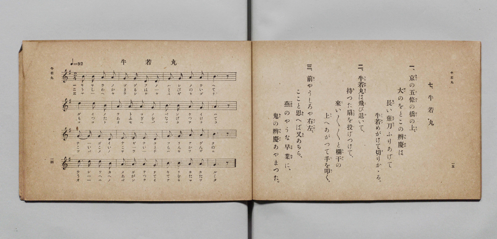

# 牛若丸

> Re:Shōka 使用 AI 協助辨識與重建樂譜，可能會有錯誤。歡迎回報。

- **鋼琴伴奏版**：<br><audio controls src="ushiwakamaru.mp3"></audio>
- **NEUTRINO 歌聲合成版**：<br><audio controls src="ushiwakamaru_neutrino.mp3"></audio>

- 詞：文部省
- 曲：文部省
- 文部省《尋常小學唱歌 第一學年用》（明治四十四年六月，索書號 4103）

## 說明

原書資訊與歌詞全文（對應 P010.jpg，原書 pp. 14–15，第七首）：
- 調性與拍號：ト調二拍子（G 大調五聲音階 2/4 拍），♩= 92
- 版面校勘：左頁五線譜第 2 小節第 1 段歌詞印作「ゴデフノ」（右頁歌詞全文印作「五條（ごでう）の」），
譜內依原譜字面忠實保留「ゴデフノ」。第 1、3 段印片假名，第 2 段印平假名。


## 歌詞

```text
一、
京（きやう）の五條（ごでう）の橋（はし）の上（うへ）、
大（だい）のをとこの辨慶（べんけい）は
長（なが）い薙刀（なぎなた）ふりあげて
牛若（うしわか）めがけて切（き）りかゝる。

二、
牛若丸（うしわかまる）は飛（と）び退（の）いて、
持（も）つた扇（あふぎ）を投（な）げつけて、
來（こ）い〱〱と欄干（らんかん）の
上（うへ）へあがって手（て）を叩（たゝ）く。

三、
前（まへ）やうしろや右左（みぎひだり）、
こゝと思（おも）へば又（また）あちら、
燕（つばめ）のやうな早業（はやわざ）に、
鬼（おに）の辨慶（べんけい）あやまつた。
```

## ABC

<div class="abc-score" data-abc-src="ushiwakamaru.abc" aria-label="五線譜載入中"></div>

[下載 ABC 原始檔](ushiwakamaru.abc)

## TMD 檔案連結

- [主旋律 TMD 檔案](ushiwakamaru.tmd) [[在 TMD Studio 編輯](https://tmdlang.github.io/Tmd-TS/#tmd=s7IKdvYPcrWy4qpTUCpJTLdSSM7PyUlNLsnMz7PKyszLyo8vzshPT8wuBdHZiUpwdWX5OaW5qVbpRYkpqfGG8SaGBsYIyeL80qLkVKvi5Iz8_Jz4ktSKkqT8_Gx0-fiCxPRUqwADQwOETEFRfllqXmIeUHdBUWZeSWoKWDtCQWpZZkoqSLo4OTEvviy1KDMtMzUFyV2pRcUgx0OtKClKzCtOLsosAPkIoSq_qAToraLEgoxKq4zM4pL8oszkxJz47MQ8JC-WZKQCfZiWn5Odk1-Uii4O0VaJbGZmemaeVW5-XlIpMLCUuLS0FJ53zn7RvfTJjh0KWlpcirYKlkZc9rYK7lw2RvomdiCdL1bOe79n1rNp7S-bVzyf0wg27dnsTZhiMN7jhq6nG7qf7tjxdEP_07U7nk7Z-Gxtj8LzNWue7GgA8XdueT5lxeOG7vd7Op7N6Hu2affT2bOf9jaCyJ1bnraufTan4_2enudbFj2bvePFzPkKoIh7v6dTiYtLX0vBllqAS0FB4WnffJAdm9tfrOh60dEOdCbQs09bVwC9AnTc0w29z9o7FUCxr5dVkA50E0S9QkGBnoKhyaOGyYamIIeCPNb8ctk0oBuBgQIy93Hz7her9j9rWA4ytLsX6AmgxOPmDqDgk109QJGnaycALXBXeLpkOVhsyovGTS_nb345q08BGOwKQBVgw3oezVwJjhGImc87O17OXfRswcKn3TOABj7dvuzlgkag5ufbZ71YOwfoDgUjBWCYP1_fAGIbKjxbtxXqpd4NT_bOedzQ87hpy-Pm9sfNUx839z1uAFrS8bR_M9AQZJ_DFQNNfrZoLlDN48YpjxuXP25sAzrqceM6sEaQ60DOUlAAWv20dfmTfXOBoQNir50OdOTT_Querl_2ZP_c51NnYtr7uKEJ7MLHDY3GIFcCrXze2f60sf3pBKDRoBAF-gQi_nTnZog4UA8XyEJgIgJqA7N2rQE7rvdxUwvccbgc_WwlKL09blz_uHE6VOWOLrBI2-PGHSARiKHAGAGLLnjc2AL1btOkx40rHjdOBrJf7FvxrHUbWMHOx01AkYkwZetBml9O3Q6WW_W4sQcs2vJi2synHQ0wwT4wCUwMQKmtj5u6Hjc2PW4Emr4MpBmSEWFOmv64qf9xI9DNnY-bGoHGga1a9rQDlDCBXgaLA_V3P26a-7ipGx44u3qg_oBnazQDHzfuA6qHOPnl4tlg2RVg7uaXDRCHroM4HWgd1KxnPY0giaYmsMQSoA-edULcAXT-VqC3wK6Z9KxrKsSjYGVAbwFVghwNi659wKgASk-GGt-wEYQaVzxb0_J0J7A4AVoANAUYpkA_QdSsg8Q3ajQ17gBbCwyQxUCzn3VConUZxAlP-1eCufOBwQJW3I9INvAY7gSle1A4QAwEJx5w-IASEjA_APMVWMF-cIRtAqWFJqAbYPpBKQEY6ECHN0DSWRcsZIAu2_C0H1h4QUyHxDPQrQtBPoNGSzskjIBBswEYsbAUBnHCqmfTVz5buhaaToGCoBgDFSuPG1dD9b9cswdqZ-NqiGbcSbIJbC7QIaAYA4UDUD_l5SYUKGjpc3GFFmdklidmJ-YmFpVaBWQm5uU71BjUVIPLBRtDMy07MAtbqQ2tDl4s7FHQMIEWWjrwolYTiwagfSDDahSMFXSB0BhYQuiCcQ2wpAOJGCqYxgMpMIEQQ6iC6INAA5AI2DwfwxqFx01rwaKPm5cA2cvArD6wHmC5BZVpB-KpyDLN_RCZpu1QMYhOkMwMJJvAroHYZASUa2yD6GqcDlQPMgGY3CG6GvdBzesGstdDdYPEV0B1bAbidWBWC1QGZB8We4xBbpgHFYe4BuQziH8geiCuBvkaLtM8HyqzDsieBJZpgMqswrAHf7zu6iEnXk2hNoBoUFzVgOMNFHsgGhSfqHEPEYGowRqrYPdD_ATyIyLmNkFDpgMosxlFZiZUBhjWTRvhOhGxjTVOm5pg9jSC7WkEhSQofiDiwCISiCEpBBSuIBlIiAILSbieiVAZPHEKdivEPxBXd0D0NEFNa14Ej-0JUFdDUsHjpv1AvAgs0wiVWYlhD4G82klOnMJyIYiGZkwzEKULosAscrJrcxc8INaASVgkQcQhSRjEBnkcIgPKuiDvr4IFRBMoEYBkIBkSa8Q2ToboAmY4CBuR9SAyMBFIJgVFRSfUBZOhGRvEgugAZV1cmRVkBiTaHjcvBLNgCRLkM4iJkGIJ5CukwgdUYDWDCovHTdugMiBbSYhYYKub_MxqSnRmRS6oscYpSsEE8dFqqI9AIQKJa2imBMcZcrENilWQaoQeEI0rVmExDqyw4SRydu2BZ0pogQ7NlKDsC8nciCyOo1gAZ1dYsQmJEyIKGXDKhMUqKOtCUgZIBpSOUe2p5eLStVNAroGjfQxjFTDEjLCIGYPFlLkA)]
- [鋼琴伴奏 TMD 檔案](ushiwakamaru_piano.tmd) [[在 TMD Studio 編輯](https://tmdlang.github.io/Tmd-TS/#tmd=s7IKdvYPcrWy4qpTUCpJTLdSyC8qychPL0osyKi0ysgsLskvykxOzInPTsxLVIIrKs4vLUpOjS9ITE-1CjAwNFDi0tJSeN45-0X30ic7drzf0_Gye8_zCVue7NnydGn_886O93s6FbS0uBRtFSyNuOxtFdy5bIz0TexA5r1YOe_9nlnPprW_bF7xfE4j2I5nszdhisF4jxu6nm7ofrpjx9MN_U_X7ng6ZeOztT0Kz9esebKjAcTfueX5lBWPG7qBrng2o-_Zpt1PZ89-2tsIInduedq69tkcoHN6nm9Z9Gz2jhcz5yuYGBoYA92nxMUVWpyRWZ6YnZibWFRqFZCZmJcf5OFQY1BTzaUABDaGZlp2YJa-loItOoA64MXCHgUNEwWg056vb9BRAIWNXlZBuiYWDVr6YMNqFIwVdIHQWMEISIJwjYIhWMRQwTQeSIEJhBhCFUQfBBqARMDm-RjWKDxuWgsWfdy8BMheBmb1gfU8btoClWkH4qnIMs39EJmm7VAxiE6QzAwkm8CugdhkBJRrbIPoapwOVA8y4XFjN0RX4z6oed1A9nqobpD4CqiOzUC8DsxqgcqA7MNijzHIDfOg4hDXgHwG8Q9ED8TVIF_DZZrnQ2XWAdmTwDINUJlVGPbgj9ddPeTEqynUBhANiqsacLyBYg9Eg-ITNe4hIhA1WGMV7H6In0B-RMTcJmjIdABlNqPIzITKAMO6aSNcJyK2scZpUxPMnkawPY2gkATFD0T8ceNWIIakEFC4gmQgIfq4cRJcz0SoDJ44BbsV4h-IqzsgepqgpjUvgsf2BKirIangcdN-IF4ElmmEyqzEsIdAXu0kJ05huRBEQzOmGYjSBVFgFjnZtbkLHhBrwCQskiDikCQMYoM8DpEBZV2Q91fBAqIJlAhAMpAMiTViGydDdAEzHISNyHoQGZgIJJOCoqIT6oLJ0IwNYkF0gLIurswKMgMSbY-bF4JZsAQJ8hnEREixBPIVUuEDKrCaQYXF46ZtUBmQrSRELLCcJz-zmhKdWZELaqxxilIwQXy0GuojUIhA4hqaKcFxhlxsg2IVpBqhB0TjilVYjD9u3AEnkbNrDzxTQgt0aKYEZV9I5kZkcRzFAji7wopNSJwQUciAUyYsVkFZF5IyQDKgdIxqTy22CtgHuQI2gda_wHCPB-azeAgj2jAWTcQA6mokaZAckIMmgkWhGVAYbhCxJqKoA_pD104B2SvRPkAdGGJGWMSMwWLKXAA)]

## 分析

```text
================================================================================
📊 TMD Song Profile: [ 牛若丸 ]
================================================================================
⏱  Duration:       1:02 (62.6s), 48 measures total
🎼 Key & Tempo:    首調基準 G, != 92.0 BPM, <2/4>
   - 分析範圍：      由實際發聲的音符與和弦推測調性；播放脈絡另行呈現
🎤 人聲音域:    D4 (MIDI 62) – D5 (MIDI 74) [跨度: 12 個半音 / 1.0 個八度, 難度: easy]
   - 最低音:  D4 in [Ushiwakamaru[L1] #1 @ m.2, 0:01]
   - 最高音: D5 in [Ushiwakamaru[L1] #1 @ m.5, 0:05]
   - 適合: soprano, mezzo-soprano, contralto, tenor, baritone, bass
🏛  結構:      Ushiwakamaru[L1] (20.9s) -> Ushiwakamaru[L2] (20.9s) -> Ushiwakamaru[L3] (20.9s)
⚡ 編曲密度:        Peak 1 軌道同時演奏
🗝  調性診斷：       G 調性不明確（純淨自然大調，未偵測到可信轉調）
   - 風格氣質:    純淨自然大調（陽光明朗、易唱易記，無明顯調外色彩）
   - 轉調歷程:    全曲維持單一推測調性（未偵測到可信轉調）
   - 核心骨幹音:  A, G, B, D, E
   - 調性數值:    G 調性不明確 [相關度: 0.71, 穩定度: Ambiguous, 自然音純度: 100.0%]
   - 候選調性 (K-S): G 大調 (0.71), D 大調 (0.69), B 小調 (0.53)
   - 五度圈歷程:   +1 -> +1 -> +1
   - 各段落調性細節:
     • [Ushiwakamaru[L1] #1]: G 調性不明確 (r: 0.71, 自然音純度: 100.0%)
     • [Ushiwakamaru[L2] #1]: G 調性不明確 (r: 0.71, 自然音純度: 100.0%)
     • [Ushiwakamaru[L3] #1]: G 調性不明確 (r: 0.71, 自然音純度: 100.0%)

  [ 五度圈游移軌跡 ]
               C  
         F           [G ]*
      Bb               D  
      Eb               A  
         Ab           E  
            Db       B  
               F# 
     (* = active key center)

  [ 十二半音累積音高分佈 ]
     C  :                            0.0%
     C# :                            0.0%
     D  : █████████████             16.7%
     D# :                            0.0%
     E  : ████                       5.0%
     F  :                            0.0%
     F# :                            0.0%
     G  : ████████████████████      25.0%
     G# :                            0.0%
     A  : ████████████████████████  30.0%
     A# :                            0.0%
     B  : ███████████████████       23.3%
--------------------------------------------------------------------------------
Assignment 軌道音域：
  - Piano         : D4 – D5 (12 個半音 / 1.0 個八度, 153 個音符)
================================================================================
```


## 原書掃描頁




