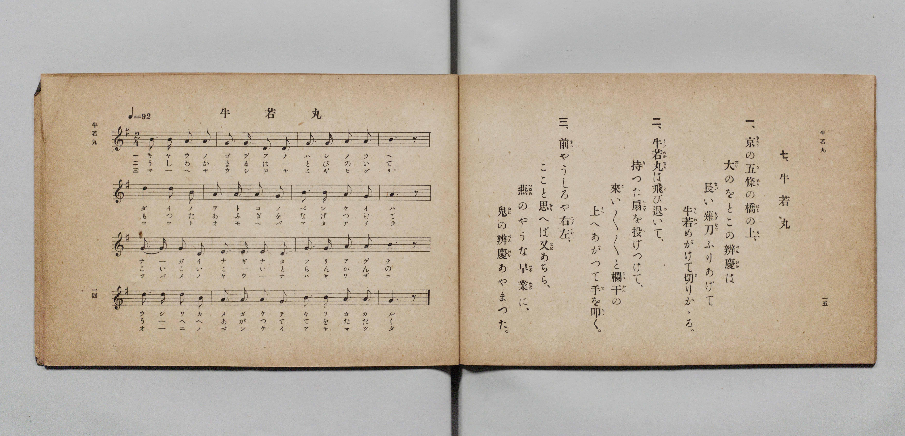

# ウシワカマル（牛若丸）

> Re:Shōka 使用 AI 協助辨識與重建樂譜，可能會有錯誤。歡迎回報。

- **鋼琴伴奏版**：<br><audio controls src="ushiwakamaru.mp3"></audio>

- 詞：文部省
- 曲：文部省
- 臺灣教育會公認《新定兒童唱歌》尋常科第一學年用（2020.006.0847.0001）

## 說明

曲目說明
中文解釋：描寫源義經幼名牛若丸的少年故事與英勇形象。

原書資訊與歌詞全文（對應 P034.jpg，書頁 p. 19，第二學期第 4 首）：
調性與拍號：ト調二拍子（G 大調 2/4 拍），「ゲンキヨク」（♩=92）


## 歌詞

```text
一
キヤウノゴデウノハシノウヘ
ダイノヲトコノベンケイハ
ナガイナギナタフリアゲテ
ウシワカメガケテキリカカル

二
ウシワカマルハトビノイテ
モツタアフギヲナゲツケテ
コイコイコイトランカンノ
ウヘヘアガツテテヲタタク

三
マヘヤウシロヤミギヒダリ
ココトオモヘバマタアチラ
ツバメノヤウナハヤワザニ
オニノベンケイアヤマツタ
```

## ABC

<div class="abc-score" data-abc-src="ushiwakamaru.abc" aria-label="五線譜載入中"></div>

[下載 ABC 原始檔](ushiwakamaru.abc)

## TMD 檔案連結

- [主旋律 TMD 檔案](ushiwakamaru.tmd) [[在 TMD Studio 編輯](https://tmdlang.github.io/Tmd-TS/#tmd=s7IKdvYPcrWy4qpTUCpJTLdSSM7PyUlNLsnMz7PKyszLyo8vzshPT8wuBdHZiUpwdWX5OaW5qVbpRYkpqfGG8SaGBsYIyeL80qLkVKvi5Iz8_Jz4ktSKkqT8_GyEfEFRfllqXmIeUE1BUWZeSWoKWBFCQWpZZkoqSDo1JbMkvygzMQfJ5tSiYpDzIJbElxQl5hUnF2UWgNyMUFWSkQp0Xlp-TnZOflEqunhGZjHQ2EqEMNCO9Mw8q9z8vKRSoE-VuLS0FB43LXvctP1x8_rHTasfN8973Lz6_Z6O552zX3QvfbJjx_s9nQpaWlyKtgqWRlz2tgruXDZG-iZ2IBNfrJz3fs-sZ9PaXzaveD6nEWzLs9mbMMRetO963rj42dSZL5o2PZvT_LR1zYtVvY8bup5N2_B03aynrZOer176dMrGZ2t7Hjd0P93Q_XTHjufLJz5fs-bJjoana3c83bnl-ZQVQDcZGRgZ6BkYmOkZWJiYAxkGhkDHKXHpaykAbX0-e92LVauezejjUlBQeLJjLdAJL5YvftneDXJOf__T9auf7ZrwfN_K59smP9255-mEXrgPn89qebphItCWZ1Nbn-zqftHR_qJ749Pu9qd7F73YuPBxQxOXlj4XyBZbagGQE5_2zX82e8eLze0vVnQBrQR6HhicT1tXAN0N9OrTDb3P2jsVAgyMTfSyCtLf7-kBKn65oFGhQE_B0BLIBYXOrh5g6DybMx_IVjBReLlsGjA4gL4Fmf5i1f5nDctB5nb3vpg5Hyj6uLkDKAjUAxR5unYC0A53hadLlgPFFIDxqQAUBesGRkHP46ZNj5s3P25a-7h5xeOm9Y8bgFIdj2autLU0AqrhggRwA4gCq1kCSkDNfY-btjxuboeym_vBSQooCOTOACttbnjctAQsBzS943HTZjB7JtimjWCpfoi6rsdNa8B8IGMdmNz_uHnq4-ZVj5sWgZ3WBrEaOdUuBOvZCJQDOwmodDVYfDXEtbt6MLWAEjrInUC3NE8GOxVoJcTo5kWPm1tA1gItBNoMcgXQWqBDgCRQHGQNxDyg04G-RyJBhq0EewloNsiHMHubZ4AQyANrQGYA3QlCm8CWANF6aKh2QuwHug2oHhywIAeDA7l5Ptghk0AB2bwKbj_QEmBgrgK7GahnAkgz1OWNQLdAzANaCJRYCA5xSHR1gb0ONBUYGNseN3dDzAMa040eLSCTgOqATgIFCUgd5RkAChRAGSu0OCOzPDE7MTexqNQqIDMxL9-hxqCmGmSRgo2hmZYdmIUt-ylAiogXC3sUNEwUnm7of76-QQeeZzSxaADaBzKsRsFYQRcIjRWMgCQI1ygYAkkQNo2HEQgxhCqIPgg0AImAzfMxrAFlBbAoMLBAEQ5m9YH1ADMGmNcOIlFlmvvBYtvhYhB5kMwMJJvAroHYZAQyD6QGog8Yf2DWaqiueWCTQDyI2SAIEu8Ai0xGsmcJVKYNuz3GMNNAOmaAfYXkOqiLQT6GyMDsmQ9WtQ4sPglMNkBlVmHYgz9ed_WQE6-mYPNN4fFUA443UOyBaFBcQuIQhBEiEDVYYxXsfkh4QUIO5tNN0LDpAGVDeLiCZGaCeWCxpo0oYQ2LESxx2rwIal4LUP1-hD1NMPGp8HAF2QzS0QU2G8QD6YLZRiBOwW4Fqd0MTRUweyDxA3IHJO0BSwyoaeA0BXYTxDXAggUqsxLDHgJ5tZOcOAXFESim4LmzRsEMROmCKCgLKE5idgUHHyQo1oBJWCRBxEGBjWDvB8tMBXseFFDQgAAHPp4AB2dWWICDigVIooDaBJWBiUASEyxYYQkIkpVBbJAMLAFiy6ygJACJNmBJD2bBEiQsg8ILDqC_4IUPJGNDi5FtUB3dGPbgjdins2dTkllBNCimcGVWzIIaR5ziKRhBIQKJa2imBMcZcrG9ChbacD0gGlesQmyCFI4wEim7guyBZEqYPdA0Asq-sMwEIkF6QC7FlV1hxSYkTlALGUjKQCtk4AUGqMCCVAcgd4BkYMUKwp5aLi5dOwXkGlgByFfmAgA)]
- [鋼琴伴奏 TMD 檔案](ushiwakamaru_piano.tmd) [[在 TMD Studio 編輯](https://tmdlang.github.io/Tmd-TS/#tmd=s7IKdvYPcrWy4tLSUnjctOxx0_bHzesfN61-3DzvcfPq93s6XnbveT5hy5M9W54u7X_e2fF-T6eClhaXoq2CpRGXva2CO5eNkb6JHVedgtKLlfPe75n1bFr7y-YVz-c0KoHEns3ehCH2on3X88bFz6bOfNG06dmc5qeta16s6n3c0PVs2oan62Y9bZ30fPXSp1M2Plvb87ih--mG7qc7djxfPvH5mjVPdjQ8Xbvj6c4tz6esALrMyMDIQM_AwEzPwMLEHMgwMAQ6TomLK7Q4I7M8MTsxN7Go1CogMzEvP8jDocagpppLAQhsDM207MAsfS0FW3SgALHmxcIeBQ0Thacb-p-vb9BRCDAwNtHLKkjXxKJBSx9sWI2CsYIuEBorGAFJEK5RMASSIGwaDyMQYghVEH0QaAASAZvnY1gDjI-1YNHHzUtAcQNm9YH1PG7aAua1g0hUmeZ-sNh2uBhEHiQzA8kmsGsgNhmBzAOpgegDxj-YtRqqax7YJBAPYjYIgsQ7wCKTkexZApVpw26PMcw0kI4ZYF8huQ7qYpCPITIwe-aDVa0Di08Ckw1QmVUY9uCP11095MSrKdh8U3g81YDjDRR7IBoUl5A4BGGECEQN1lgFux8SXpCQg_l0EzRsOoBym-HhCpKZCeaBxZo2ooQ1LEawxGnzIqh5LUD1-xH2NMHEp8LDFWQzSEcX2GwQD6QLZhuBOAW7FaR2MzRVwOyBxA_IHZC097h5AtQ0cJoCuwnimsfNjVCZlRj2EMirneTEKSiOQDEFz501CmYgShdEQVlAcRKzKzj4IEGxBkzCIgkiDgpsBHs_WGYq2POggIIGBDjw8QQ4OLPCAhxULEASBdQmqAxMBJKYYMEKS0CQrAxig2RgCRBbZgUlAUi0PW5eCGbBEiQsg8ILDqC_4IUPJGNDi5FtUB3dGPbgjdins2dTkllBNCimcGVWzIIaR5ziKRhBIQKJa2imBMcZcrG9ChbacD0gGlesQmyCFI4wEim7guyBZEqYPdA0Asq-sMwEIkF6QC7FlV1hxSYkTlALGUjKQCtk4AUGqMCCVAcgd4BkYMUKwp5abBWwD3IFbAKtf4HhHq8QbRofC2UZwhhwIQOou5HkTeMx9YDEsCg1ASk1gSslwVQUpUAP6dopIPsp2geoCUPMCIuYMVhMmQsA)]

## 分析

```text
================================================================================
📊 TMD Song Profile: [ ウシワカマル（牛若丸） ]
================================================================================
⏱  Duration:       0:20 (20.9s), 16 measures total
🎼 Key & Tempo:    首調基準 G, != 92.0 BPM, <2/4>
   - 分析範圍：      由實際發聲的音符與和弦推測調性；播放脈絡另行呈現
🎤 人聲音域:    D4 (MIDI 62) – D5 (MIDI 74) [跨度: 12 個半音 / 1.0 個八度, 難度: easy]
   - 最低音:  D4 in [Ushiwakamaru #1 @ m.2, 0:01]
   - 最高音: D5 in [Ushiwakamaru #1 @ m.5, 0:05]
   - 適合: soprano, mezzo-soprano, contralto, tenor, baritone, bass
🏛  結構:      Ushiwakamaru (20.9s)
⚡ 編曲密度:        Peak 1 軌道同時演奏
🗝  調性診斷：       G 大調（純淨自然大調，未偵測到可信轉調）
   - 風格氣質:    純淨自然大調（陽光明朗、易唱易記，無明顯調外色彩）
   - 轉調歷程:    全曲維持單一推測調性（未偵測到可信轉調）
   - 核心骨幹音:  A, G, B, D, E
   - 調性數值:    G 大調 [相關度: 0.69, 穩定度: Moderate, 自然音純度: 100.0%]
   - 候選調性 (K-S): G 大調 (0.69), D 大調 (0.65), B 小調 (0.53)
   - 五度圈歷程:   +1
   - 各段落調性細節:
     • [Ushiwakamaru #1]: G 大調 (r: 0.69, 自然音純度: 100.0%)

  [ 五度圈游移軌跡 ]
               C  
         F           [G ]*
      Bb               D  
      Eb               A  
         Ab           E  
            Db       B  
               F# 
     (* = active key center)

  [ 十二半音累積音高分佈 ]
     C  :                            0.0%
     C# :                            0.0%
     D  : ███████████               14.2%
     D# :                            0.0%
     E  : █████                      5.8%
     F  :                            0.0%
     F# :                            0.0%
     G  : ████████████████████      25.0%
     G# :                            0.0%
     A  : ████████████████████████  30.0%
     A# :                            0.0%
     B  : ████████████████████      25.0%
--------------------------------------------------------------------------------
Assignment 軌道音域：
  - Piano         : D4 – D5 (12 個半音 / 1.0 個八度, 51 個音符)
================================================================================
```


## 原書掃描頁




