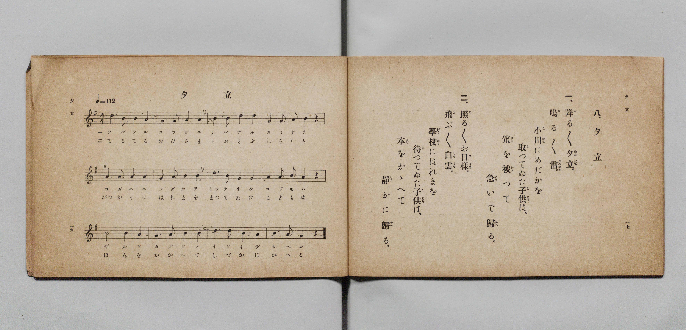

# 夕立

> Re:Shōka 使用 AI 協助辨識與重建樂譜，可能會有錯誤。歡迎回報。

- **鋼琴伴奏版**：<br><audio controls src="yudachi.mp3"></audio>

- 詞：文部省《尋常小學唱歌》
- 曲：文部省《尋常小學唱歌》
- 文部省《尋常小學唱歌 第一學年用》（明治四十四年五月，索書號 4103）

## 說明

原書資訊與歌詞全文（對應 P011.jpg，原書 p. 16–17，第一學年第 8 首）：
調性與拍號：ト長調 4/4 拍子，♩=112


## 歌詞

```text
一、降（ふ）る／＼夕立（ゆふだち）。
鳴（な）る／＼雷（かみなり）。
小川（こがは）にめだかを
取（と）つてゐた子供（こども）は、
笊（ざる）を被（かぶ）つて
急（いそ）いで歸（かへ）る。

二、照（て）る／＼お日樣（ひさま）。
飛（と）ぶ／＼白雲（しらくも）。
學校（がつかう）にはれまを
待（ま）つてゐた子供（こども）は、
本（ほん）をかゝへて
靜（しづ）かに歸（かへ）る。
```

## ABC

<div class="abc-score" data-abc-src="yudachi.abc" aria-label="五線譜載入中"></div>

[下載 ABC 原始檔](yudachi.abc)

## TMD 檔案連結

- [主旋律 TMD 檔案](yudachi.tmd) [[在 TMD Studio 編輯](https://tmdlang.github.io/Tmd-TS/#tmd=s7IKdvYPcrWy4qpTUCpJTLdSSM7PyUlNLsnMz7PKyszLyo8vzshPT8wuBdHZiUpwdWX5OaW5qVbpRYkpqfGG8SaGBsYIyeL80qLkVKvi5Iz8_Jz4ktSKkqT8_Gx0-fiCxPRUqwADQ0OETEFRfllqXmIeUHdBUWZeSWoKWDtCQWpZZkoqSLo4OTEvviy1KDMtMzUFyV2pRcUgx0OtKClKzCtOLsosAPkIoSq_qAToraLEgoxKq4zM4pL8oszkxJz47MQ8JC-WZKQCfViemghkFCHrzUzPzLPKzc9LKgUGihKXlpbC0yVTn6_uVtDS4lK0VTA0NOKyt1Vw57Ix0TexA-l7sXLe-z2znk1rf9m84vmcxscNXU83dD_dsePphv6na3c8nbLx2dqexw3dYDuezd5EvFq8qhSer1nzZEcDiL9zy_MpK4C63u_peDaj79mm3U9nz37a2wgid255smvKszkd7_f0PN-y6NnsHS9mzlcARef7PZ1KXFz6Wgq21AJcCgoKT_vmg-zY3P5iRdeLjnagM4GB87R1BdArQMc93dD7rL1TAZQm9LIK0oFugqhXKNBTMDR71DDZ0BzkTmR_rVmjYKHwctk0oHOB4Qay4sWq_c8aloMM7-4FegYo-ri54-XU7UBxBWCMKACFn66dADTn0cyVtqDIAmkCGvi4ofHlzF6gKx43bgWa9rgJGFz97_fsgUQuSLypDSj1uHHB48aFIAUNTSCdLzdvAetZhazn5eztYMHux437gVKPm7oQGkBxtH0uWHry48aex43rQXKNqx83NYLN7n7cNAmsrh_oKaCiFWDpJY8blz1umvC4cT7Q8U_2zYbpX_m4qQmsYD3Q_SBtz9cA7QLKTQM7BuikSS8WrYY5ZhvcLJDSZw1LwRItjxuB7gFKABnLn63dAVMNZIC8BHI3OIx2AVNe4_PW5WD5Zcj-fdzY9Wz60mcrFoOlNj1unPq4cR9SGC2GuBfiFaAjQHqez9z7EpTYgeLTHzcBxfuhXoEG09odzxYAwxkoDQwjoJOBDmqDhhTQs01AwX2wkNrXClYHtpH4kHo2Zw1YbvfjpsmQkAIH_lygx6EB9HLuHKj7GoEhBdQKdMNq7AEEVE15DoECBS19Lq7I0pTE5IxMq4DMxLx8hxqDmmqQHQo2Flp2YAa2nAnN8i8W9ihomIAS2vP1DTrw7KSJRQPQJpBhNQqmCrpAaAyEugpGQFyjYAgWMQTzICIgOZAakFoQhqgBqQDJGIBEwKb5GNYoPG6eClb9uHk1lA1igfQ8bl4GlZkKxA1gViNUpgtJD4gN19MEoh83zweLP25eBeTFI-wzAqpohJra1A1lg1hgvY1QUxs3ATHYJY37oDIroDLboGwQCyIzHWxCJ5DVD6Sb4PbhD_tdPeSEPSh0QWGMCGlI2EPCFYQR8QMJcZAIRLUxmEYL-6bN0LBYAwyrfnDIQcOieSE0hBvgYboJKtPxuLkFKtkGxBvABuyHBj_IwMfNwOBoXgQ1Ej34QZkUGpqgGGgDs6Cx17ge6p4eaNgD8xpUZh9C2zKg8AQwaz5UcjKYtxIcARBDiImEHZ3kRAIkcUOCG38kmCKpgegyAqtFjwRQUoIlZ6SABgc7iD8NiEEhDgpviAw0JJr2QtmPm9vR9MyAmoYe-rthdjWBwwwevKBoh0XJDmgoIxI4iL8UqgoRWTA9O6BZCGJXLReXrp0CtFSK9jGMVUDmGoG5ylwA)]
- [鋼琴伴奏 TMD 檔案](yudachi_piano.tmd) [[在 TMD Studio 編輯](https://tmdlang.github.io/Tmd-TS/#tmd=s7IKdvYPcrWy4qpTUCpJTLdSSM7PyUlNLsnMz7PKyszLyo8vzshPT8wuBdHZiUpwdWX5OaW5qVbpRYkpqfGG8SaGBsYIyeL80qLkVKvi5Iz8_Jz4ktSKkqT8_Gx0-fiCxPRUqwADQ0OETEFRfllqXmIeUHdBUWZeSWoKWDtCQWpZZkoqSLo4OTEvviy1KDMtMzUFyV2pRcUgx0OtKClKzCtOLsosAPkIoSqxCCienpqbmldiVZCZmJcfn5icnJ9bkJiXCRJDKMwvKgH6vyixIKPSKiOzuCS_KDM5MSc-OzEPKSxKMoAmWZWnJgIZRch6M9Mz86xy8_OSSoGhp8SlpaXwdMnU56u73-_peNm95_mELU_2bHm6tP95Z8f7PZ0KWlpcirYKhoZGXPa2Cu5cNib6JnYgw16snPd-z6xn09pfNq94PqfxcUPX0w3dT3fseLqh_-naHU-nbHy2tudxQzfY4mezNxGvFq8qhedr1jzZ0QDi79zyfMoKoC6gs5_N6Hu2affT2bOf9jaCyJ1bnuya8mwO0P09z7csejZ7x4uZ8xVAiQHoISUursjSlMTkjEyrAFAYB3k41BjUVHMpAIGNhZYdmKGvpWCLDqBWv1jYo6BhogB01PP1DToKoISil1WQrolFg5Y-2LAaBVMFXSA0BkJdBSMgrlEwBIsYgnkQEZAcSA1ILQhD1IBUgGQMQCJg03wMaxQeN08Fq37cvBrKBrFAeh43L4PKTAXiBjCrESrThaQHxIbraQLRj5vng8UfN68C8uIR9hkBVTRCTW3qhrJBLLDeRqipjZuAGOySxn1QmRVQmW1QNogFkZkONqETyOoH0k1w-_CH_a4ecsIeFLqgMEaENCTsIeEKwoj4gYQ4SASi2hhMo4V902ZoWKwBhlU_OOSgYdG8EBrCDfAw3QSV6Xjc3AKVbAPiDWAD9kODH2Tg42ZgcDQvghqJHvw9jxuXQEMTFANtYBY09hrXQ93TAw37x02ToDL7ENqWAYUngFnzoZKTwbyV4AiAGEJMJOzoJCcSIIkbEtz4I8EUSQ1ElxFYLXokgJISLDkjBTQ42EH8aUAMCnFQeENkoCHRtBfKftzcjqZnBtQ09NDfDbOrCRxm8OAFRTssSnZAQxmRwEH8pVBViMiC6dkBzUIQu2rRCiUf5ELJBFooAQMtXsE0XhuYTuMVTOK1jZBETOMxhGA0iogB1GPA4IbpIFYrVARFH8I43E7DahhCDZgFdRkwGHTtFKAhEe1jGKuAzDUCc5W5AA)]

## 分析

```text
================================================================================
📊 TMD Song Profile: [ 夕立 ]
================================================================================
⏱  Duration:       0:51 (51.4s), 24 measures total
🎼 Key & Tempo:    首調基準 G, != 112.0 BPM, <4/4>
   - 分析範圍：      由實際發聲的音符與和弦推測調性；播放脈絡另行呈現
🎤 人聲音域:    G4 (MIDI 67) – D5 (MIDI 74) [跨度: 7 個半音 / 0.6 個八度, 難度: easy]
   - 最低音:  G4 in [Yudachi[L1] #1 @ m.2, 0:02]
   - 最高音: D5 in [Yudachi[L1] #1 @ m.1, 0:00]
   - 適合: soprano, mezzo-soprano, contralto, tenor, baritone, bass
🏛  結構:      Yudachi[L1] (25.7s) -> Yudachi[L2] (25.7s)
⚡ 編曲密度:        Peak 1 軌道同時演奏
🗝  調性診斷：       B 調性不明確（純淨自然大調，未偵測到可信轉調）
   - 風格氣質:    純淨自然大調（陽光明朗、易唱易記，無明顯調外色彩）
   - 轉調歷程:    全曲維持單一推測調性（未偵測到可信轉調）
   - 核心骨幹音:  B, A, G, D
   - 調性數值:    B 調性不明確 [相關度: 0.62, 穩定度: Ambiguous, 自然音純度: 100.0%]
   - 候選調性 (K-S): B 小調 (0.62), G 大調 (0.62), D 大調 (0.61)
   - 五度圈歷程:   +5 -> +5
   - 各段落調性細節:
     • [Yudachi[L1] #1]: B 調性不明確 (r: 0.62, 自然音純度: 100.0%)
     • [Yudachi[L2] #1]: B 調性不明確 (r: 0.62, 自然音純度: 100.0%)

  [ 五度圈游移軌跡 ]
               C  
         F            G  
      Bb               D  
      Eb               A  
         Ab           E  
            Db      [B ]*
               F# 
     (* = active key center)

  [ 十二半音累積音高分佈 ]
     C  :                            0.0%
     C# :                            0.0%
     D  : ███████████               15.6%
     D# :                            0.0%
     E  :                            0.0%
     F  :                            0.0%
     F# :                            0.0%
     G  : ███████████████           21.1%
     G# :                            0.0%
     A  : ██████████████████████    30.0%
     A# :                            0.0%
     B  : ████████████████████████  33.3%
--------------------------------------------------------------------------------
Assignment 軌道音域：
  - Piano         : G4 – D5 (7 個半音 / 0.6 個八度, 92 個音符)
================================================================================
```


## 原書掃描頁




