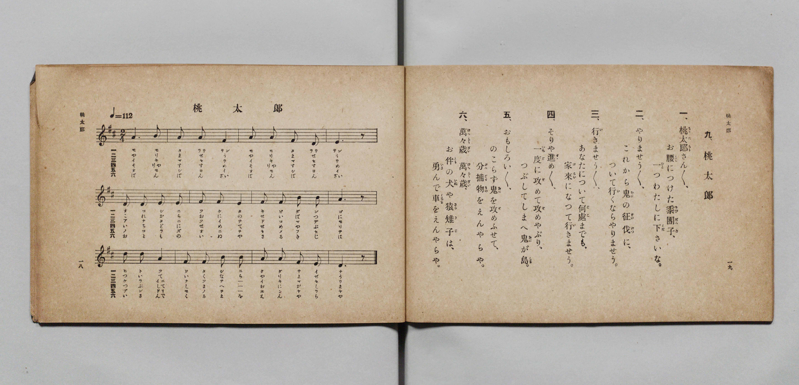

# 桃太郎

> Re:Shōka 使用 AI 協助辨識與重建樂譜，可能會有錯誤。歡迎回報。

- **鋼琴伴奏版**：<br><audio controls src="momotaro.mp3"></audio>

- 詞：文部省《尋常小學唱歌》
- 曲：岡野貞一（文部省《尋常小學唱歌》）
- 文部省《尋常小學唱歌 第一學年用》（明治四十四年五月，索書號 4103）

## 說明

原書資訊與歌詞全文（對應 P012.jpg，原書 p. 18–19，第一學年第 9 首）：
調性與拍號：ニ長調 2/4 拍子，♩=112


## 歌詞

```text
一、桃太郎（ももたらう）さん／＼、
お腰（こし）につけた黍團子（きびだんご）、
一つ（ひとつ）わたしに下（くだ）さいな。

二、やりませう／＼、
これから鬼（おに）の征伐（せいばつ）に、
ついて行（い）くならやりませう。

三、行（い）きませう／＼、
あなたについて何處（どこ）までも、
家來（けらい）になつて行（い）きませう。

四、そりや進（すゝ）め／＼、
一度（いちど）に攻（せ）めて攻（せ）めやぶり、
つぶしてしまへ鬼（おに）が島（しま）。

五、おもしろい／＼、
のこらず鬼（おに）を攻（せ）めふせて、
分捕物（ぶんどりもの）をえんやらや。

六、萬々歲（ばん／＼ざい）萬々歲（ばん／＼ざい）、
お伴（とも）の犬（いぬ）や猿（さる）雉子（きじ）は、
勇（いさ）んで車（くるま）をえんやらや。
```

## ABC

<div class="abc-score" data-abc-src="momotaro.abc" aria-label="五線譜載入中"></div>

[下載 ABC 原始檔](momotaro.abc)

## TMD 檔案連結

- [主旋律 TMD 檔案](momotaro.tmd) [[在 TMD Studio 編輯](https://tmdlang.github.io/Tmd-TS/#tmd=s7IKdvYPcrWy4qpTUCpJTLdSSM7PyUlNLsnMz7PKyszLyo8vzshPT8wuBdHZiUpwdWX5OaW5qVbpRYkpqfGG8SaGBsYIyeL80qLkVKvi5Iz8_Jz4ktSKkqT8_Gx0-fiCxPRUqwADQyOETEFRfllqXmIeUHdBUWZeSWoKWDtCQWpZZkoqSLostSgzLTM1BclJqUXFIHdDTS8pSswrTi7KLAB5BqEqv6gE6KOixIKMSquMzOKS_KLM5MSc-OzEPCTflWSkAj2Xlp-TnZNflIqsOTM9M88qNz8vqRQYIEpcWloKzxY2P12y6mVzn4KWFpeirYKhoRGXva2CC5eNkb6JHUjri5Xz3u-Z9Wxa-8vmFc_nND5u6Hq6ofvpjh1PN_Q_Xbvj6ZSNz9b2PG7oBlvzbPYmoNqnmxa-bO97sWnekx0N7_d0ENT6fk8nRDdehQrP16wBGgji79zyfMoKsMaOZzP6nm3a_XT27Ke9jSBy55Ynu6Y8m9Pxfk_P8y2Lns3e8WLmfAVQ_IIt4dLXUrClFuBSUFB42jcfZMfm9hcrul50tAOdCQyup60rgF4BOu7pht5n7Z0KoESil1WQDnQTRL1CgZ6CocWjhsmGliB3IvtrzRoFS4WXy6YBnQsMSZAVL1btf9awHGR4dy_QM0DRx83dL6duB4orAONIASj8dO0EoDmPZq60BUUfSBPQwMcNjfDIBbrlcVMTCDXOf9zU-bixDWj-48apj5smv9_T_37PHqBikLbHjV0vWjeAVDdOftw4Haxo9ePGJY8bJwJ1vtzd-3TODLBlQAW9jxs3P25cADTiceMUkEqIESCbG5eAVWx63LgCzO583NQPsrlxOtC4JztA8fa4ESiyAOqKxpbHjaseNzRBnL4LmCYaHze1PG7qety473HjbLBzUVw5-XFTz-PGbqBXXq7ZAzYNqHQ12LR1T_c1PtkDcSJQJ9DkDVA3AH0C0w_0EFBi2YuFPWB1LWBpoINWgQIH1Wa4s3aAfIiqAxgE2N0HDOdVYA9DAg9k15O9U1_MnArWvBLoAbB-oObloEiBaHu6btuTfUCTgComgiMJYgnQCKBZQFPQnIuwHOZEYPoHhVzjXJD7m1peNgAzI1D5zMdNc8Fx0IjiSlCa27UMYuDjxoVAZ0GsezZlNyTwIHqA9qKLAAOocRvIDqTg3AaO3GVgEuisHRjx0vN08zawCEgBOLnAonsK2NFAFwNDbfrjJqC_gB5ECc514BgHGjIL3dimSRjO3QoOlGWwQO1oe9Y79Xkn0HNARUBXA1PrSnD4AG1bBzHicSMwdwAtAMY7OPZhwdm6FhTjE9Y8bmh9thYSlhsQOaZxGiQmCCpA5K0ne7aAFa0A2g5JrM-71sBiAMgA2f68Zz9YBJg3QQXjy9mdSBluBljXepjfukGFDFgzMGEBNQP9tvzF7i5o9mrqhoY0Vh8C9VNeBEKBgpY-F5dvfm5-SWJRvlVAZmJevkONQU01yBIFGwstOzADW9kLLdSBKVtBw0QBWNw_X9-gAy8wNbFoAFoFMqxGwVRBFwjNwCxTBWMgG8YyBLKMwLIGCjVg1T6GNQqPmxeBxUA0kNe0H8gCpoRlQObWx82bwfpBcmCMkAUphcrrKsTDzDMCCbdAzGvqAilq3AfEs4G4DWISUBYkAxMHqQDJIJlhDFK1BGrGWrDt84Cs3UC8DGrGErAMTBwkApJBMsMEZO5cmDtAloIEZkJwUyPEGKACqCRMCmQSSBLJJFOQ2CqUENoOZAFtB7sRIgsJG4g4wvVwM8xAlm2AumYy2OoNYBYkL0BdAxOC0CARqCTEJPxpZVcPOWnFEAiNgLAGmDqMwWkDwjKDph-MtALya9NmqF-7wXEDis-N4JQBCQ1QvAC90dwAxJvBIlsw00gjUEVTD5DuBtKdYM-C0sRqUKEGDQ5QmgHFDDA4GpeARVZjSSegdAnUCU6XCPcA00czNL01d0JcDEorze3QtIyZVkA2LQTilWB7oPYD0wKwxES4B8QHp5ZtYH91YaYUYHsRYhvQnKZd8NQB9GXzJmj4ANNxM9Cm5qmwtAt2KXpqAYXGCqCKJnCIwFy4Bpq7QHyQfqC5jb1APAMssp7ItLKjk6y0EgdCoJIENY2AShZQCjLEUrJMAuIOcJxA4mI9JKYQqacJKAJKKU1bwbEGUoMWquDUAoxPsP9hcQFi9wMxKDWCUw-RpQownYJjBpQ-IKkFqAeUYmCphciSBeSebUA8HewmkAiIBbJ7B9SFsNQMSuPToeUgZmqZBs4j4DTavApezgLTEDy1ANMAWAXIxSvBKrCVLaDwAKUHUPGxHGwbMHTAqQPopqZJYBFgPIDkwSEFCzOYSbVcXLp2CrCaSgHIVuYCAA)]
- [鋼琴伴奏 TMD 檔案](momotaro_piano.tmd) [[在 TMD Studio 編輯](https://tmdlang.github.io/Tmd-TS/#tmd=s7IKdvYPcrWy4qpTUCpJTLdSSM7PyUlNLsnMz7PKyszLyo8vzshPT8wuBdHZiUpwdWX5OaW5qVbpRYkpqfGG8SaGBsYIyeL80qLkVKvi5Iz8_Jz4ktSKkqT8_Gx0-fiCxPRUqwADQyOETEFRfllqXmIeUHdBUWZeSWoKWDtCQWpZZkoqSDoxOTk_tyAxLzM3NQ9Jviy1qBjkeKgVJUWJecXJRZkFIB8hVOUXlQC9VZRYkFFplZFZXJJflJmcmBOfnZiH5MWSjFSgD9Pyc7Jz8otSkTVnpmfmWeXm5yWVAkNFiUtLS-HZwuanS1a9bO57v6fjZfee5xO2PNmz5enS_uedHe_3dCpoaXEp2ioYGhpx2dsquHDZGOmb2IHMe7Fy3vs9s55Na3_ZvOL5nMbHDV1PN3Q_3bHj6Yb-p2t3PJ2y8dnanscN3WC7n83eBFT7dNPCl-19LzbNe7KjAWgXQa1A2yG68SpUeL5mDdBAEH_nludTVoA1djyb0fds0-6ns2c_7W0EkTu3PNk15dkcoI96nm9Z9Gz2jhcz5yuAYh5sCZdvfm5-SWJRvlVAZmJefpCHQ41BTTWXAhDYWGjZgRn6Wgq26ABq94uFPQoaJgpAVz1f36CjAEoWelkF6ZpYNGjpgw2rUTBV0AVCMzDLVMEYyIaxDIEsI7CsgUINWLWPYY3C4-ZFYDEQDeQ17QeyVj5uWgZkbn3cvBmsHyQHxghZkFKovK5CPMw8I5BwC8S8pi6QosZ9QDwbiNsgJgFlQTIwcZAKkAySGcYgVUugZqwF2z4PyNoNxMugZiwBy8DEQSIgGSQzTEDmzoW5A2QpSGAmBDc1QowBKoBKwqRAJoEkkUwyBYmtQgmh7UAW0HawGyGykLCBiCNcDzfDDGTZBqhrJoOt3gBmPW6c9rgRFFzIQhAaJAKVhJiEP63s6iEnrRgCoREQ1gBThzE4bUBYZtD0g5FWQH5t2gz1azc4bkDxuRGcMiChAYoXoDeaG4B4M1hkC2YaaQSqaOoB0t1AuhPsWVCaWA3E66DBAUozoJgBBkfjErDIaizpBJQugTrB6RLhHmD6aIamt-ZOiItBaaW5HZqWMdMKyKaFQLwSbA_UfmBaeNwITXMwPji1bAP7qwszpTT3QW0DmtO0C546gL5s3gQNH2A6bgba1DwVlnbBLkVPLaDQWAFU0QQOEZgL10BzF4gP0g80t7EXiGeARdYTmVZ2dJKVVuJACFSSoKYRUMkCSkGGWEqWSUDcAY4TSFysh8QUIvU0AUVAKaVpKzjWQGrQQhWcWoDxCfY_LC5A7H4gBqVGcOohslQBplNwzIDSByS1APWAUgwstRBZsoDcsw2Ip4PdBBIBsUB274C6EJaaQWl8OrQcxEwt08B5BJxGm1fBy1lgGoKnFmAaAKsAuXglWAW2sgUUHqD0ACo-loNtA4YOOHUA3dQ0CSwCjAeQPDikYGEGM6kWvaLyQa6oTKAVFTCO4xVM47WNcbBM4-Ph8Q8WN4nXBqcMZJZZvLYJhIWiFGEYVAHIMIQukFqgI3XtFGDujPYxjFVA4Ruh8Y3R-CZofFM0vhmYr8wFAA)]

## 分析

```text
================================================================================
📊 TMD Song Profile: [ 桃太郎 ]
================================================================================
⏱  Duration:       0:12 (12.9s), 12 measures total
🎼 Key & Tempo:    首調基準 D, != 112.0 BPM, <2/4>
   - 分析範圍：      由實際發聲的音符與和弦推測調性；播放脈絡另行呈現
🎤 人聲音域:    D4 (MIDI 62) – D5 (MIDI 74) [跨度: 12 個半音 / 1.0 個八度, 難度: easy]
   - 最低音:  D4 in [Momotaro #1 @ m.3, 0:02]
   - 最高音: D5 in [Momotaro #1 @ m.9, 0:08]
   - 適合: soprano, mezzo-soprano, contralto, tenor, baritone, bass
🏛  結構:      Momotaro (12.9s)
⚡ 編曲密度:        Peak 1 軌道同時演奏
🗝  調性診斷：       A 大調（純淨自然大調，未偵測到可信轉調）
   - 風格氣質:    純淨自然大調（陽光明朗、易唱易記，無明顯調外色彩）
   - 轉調歷程:    全曲維持單一推測調性（未偵測到可信轉調）
   - 核心骨幹音:  A, F#, D, E, B
   - 調性數值:    A 大調 [相關度: 0.82, 穩定度: Moderate, 自然音純度: 100.0%]
   - 候選調性 (K-S): A 大調 (0.82), D 大調 (0.77), F# 小調 (0.72)
   - 五度圈歷程:   +3
   - 各段落調性細節:
     • [Momotaro #1]: A 大調 (r: 0.82, 自然音純度: 100.0%)

  [ 五度圈游移軌跡 ]
               C  
         F            G  
      Bb               D  
      Eb              [A ]*
         Ab           E  
            Db       B  
               F# 
     (* = active key center)

  [ 十二半音累積音高分佈 ]
     C  :                            0.0%
     C# :                            0.0%
     D  : ██████████████            17.8%
     D# :                            0.0%
     E  : ██████████████            17.8%
     F  :                            0.0%
     F# : █████████████████         22.2%
     G  :                            0.0%
     G# :                            0.0%
     A  : ████████████████████████  31.1%
     A# :                            0.0%
     B  : █████████                 11.1%
--------------------------------------------------------------------------------
Assignment 軌道音域：
  - Piano         : D4 – D5 (12 個半音 / 1.0 個八度, 35 個音符)
================================================================================
```


## 原書掃描頁




