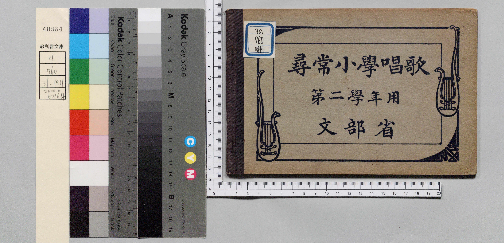
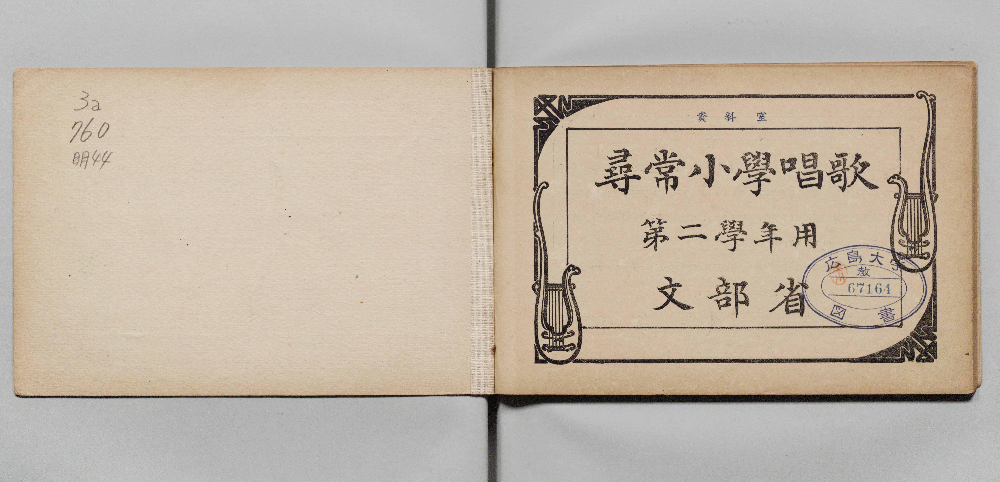
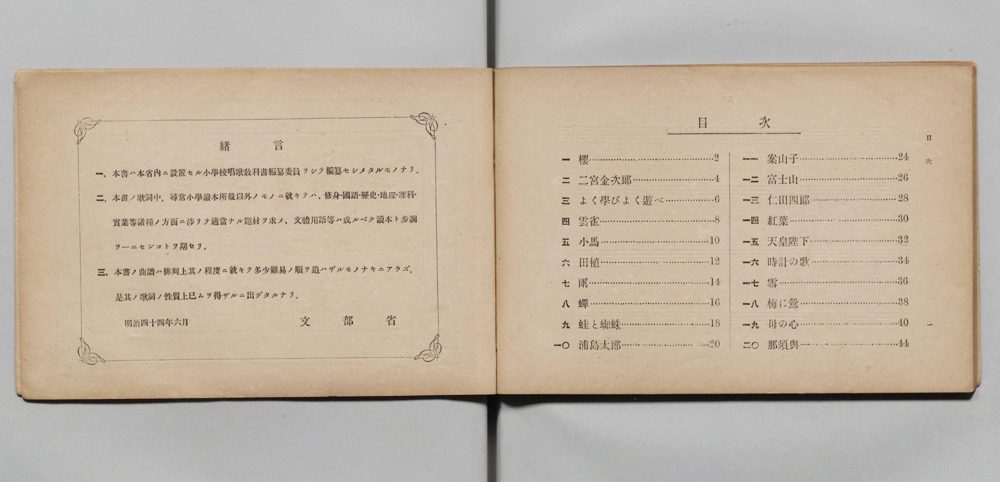
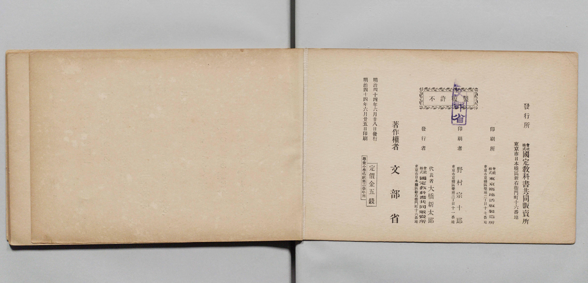
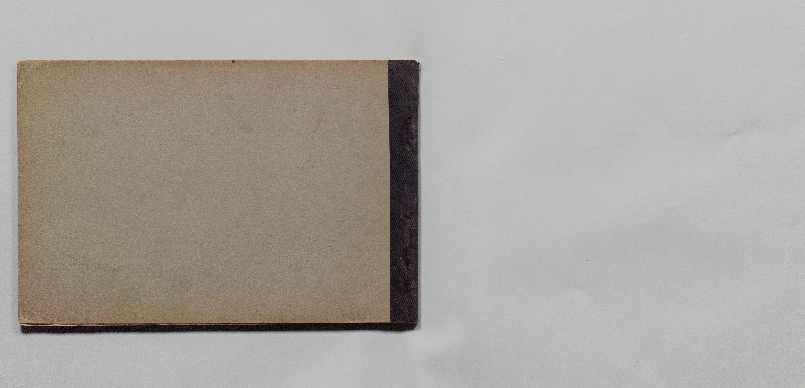

# 書訊與卷首／卷末掃描頁 — jinjo_shogaku_shoka 尋常科 第二學年用（國臺圖 523.37 4322-4）

本頁收錄本冊之封面、扉頁、目次（もくろく）、樂典大要、版權頁與封底等原書掃描圖檔（共 5 頁）。

### P001.jpg

本冊封面（右頁），題「公學校唱歌　第二學年用　臺灣總督府」，右上蓋有「昭和十二年四月十三日　編修課ヨリ寄贈」藏書印，左上貼有舊藏圖書分類籤「523.37 4322-4」。

### P002.jpg

封面裏（見返頁），貼有國臺圖舊藏書標。

### P003.jpg

目次頁（「もくろく」，原書第 1 頁）：列出「一　ミヅグルマ」至「一五　はる が きた」共 15 首曲名與頁碼。

### P026.jpg

### P027.jpg

