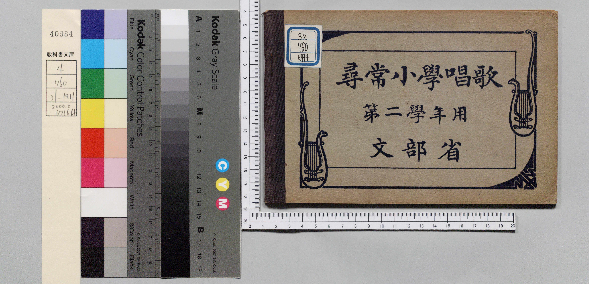
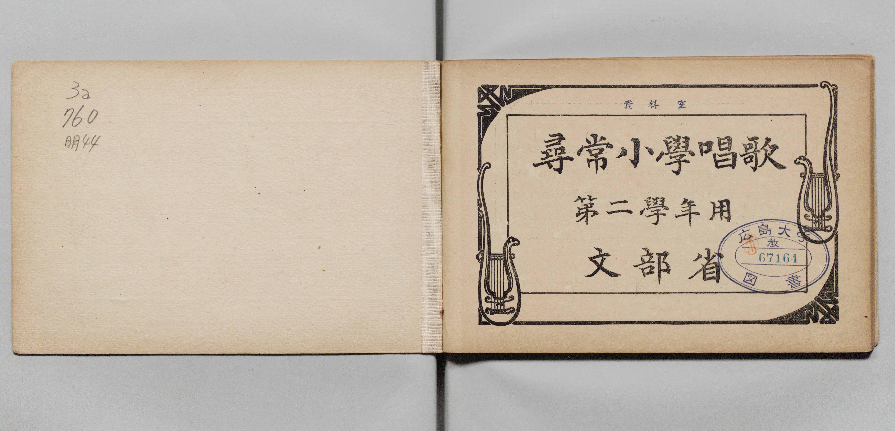
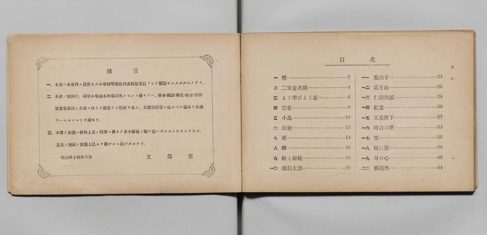
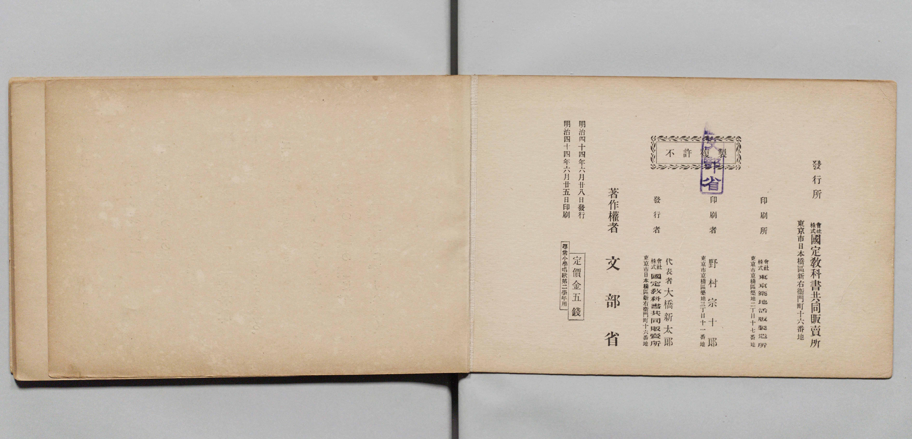

# 書訊與卷首／卷末掃描頁 — 《尋常小學唱歌》 第二學年用（廣島大學圖書館 ID 4102，明治44年／1911）

本頁收錄本冊之封面、扉頁、目次（もくろく）、樂典大要、版權頁與封底等原書掃描圖檔（共 5 頁）。

### P001.jpg

本冊封面（右頁），題「尋常小學唱歌　第二學年用　文部省」。

### P002.jpg

目次頁（「もくろく」）：列出「一　櫻」至「二十　那須與一」共 20 首曲名與頁碼。

### P003.jpg

卷首國歌〈君が代〉歌詞與對頁留白。

### P026.jpg

版權頁：標明「明治四十四年六月一日印刷、明治四十四年六月五日發行」、「著作權所有　著作兼發行者 文部省」。

### P027.jpg

封底外頁。

