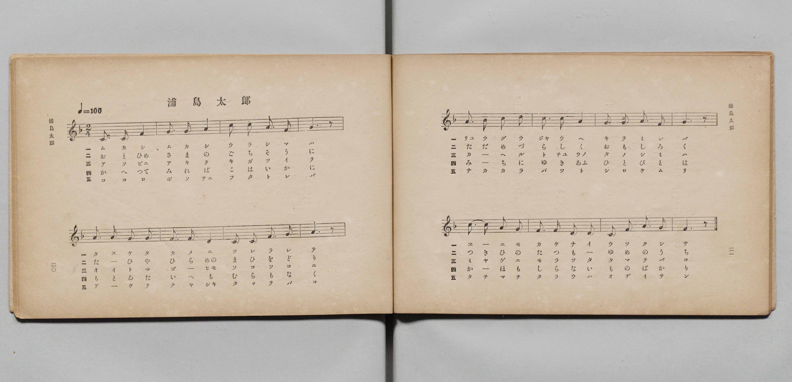
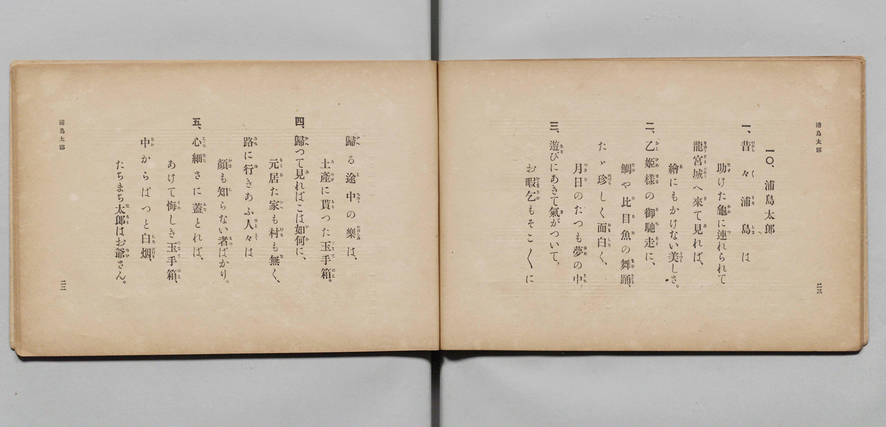

# 浦島太郎

> Re:Shōka 使用 AI 協助辨識與重建樂譜，可能會有錯誤。歡迎回報。

- **鋼琴伴奏版**：<br><audio controls src="urashimataro.mp3"></audio>

- 文部省《尋常小學唱歌 第二學年用》（明治四十四年六月，4102）

## 說明

原書資訊與歌詞全文（對應 P013.jpg–P014.jpg，原書 pp. 20–23，第二學年第 10 首）：
調性與拍號：ヘ長調（F 大調）2/4 拍，♩= 100


## 歌詞

```text
一、
昔々（むかし／＼）浦島（うらしま）は
助（たす）けた龜（かめ）に連（つ）れられて
龍宮城（りゆうぐうじやう）へ來（き）て見（み）れば、
繪（ゑ）にもかけない美（うつく）しさ。

二、
乙姬樣（おとひめさま）の御馳走（ごちそう）に、
鯛（たひ）や比目魚（ひらめ）の舞踊（まひをどり）、
たゞ珍（めづら）しく面白（おもしろ）く、
月日（つきひ）のたつも夢（ゆめ）の中（うち）。

三、
遊（あそ）びにあきて氣（き）がついて、
お暇乞（いとまごひ）もそこ／＼に
歸（かへ）る途中（とちゆう）の樂（たのしみ）は、
土産（みやげ）に貰（もら）つた玉手箱（たまてばこ）。

四、
歸（かへ）つて見（み）ればこは如何（いか）に、
元居（もとゐ）た家（いへ）も村（むら）も無（な）く、
路（みち）に行（ゆ）きあふ人々（ひと／″＼）は
顏（かほ）も知（し）らない者（もの）ばかり。

五、
心細（こゝろぼそ）さに蓋（ふた）とれば、
あけて悔（くや）しき玉手箱（たまてばこ）、
中（なか）からぱつと白烟（しろけむり）、
たちまち太郎（たらう）はお爺（ぢい）さん。
```

## ABC

<div class="abc-score" data-abc-src="urashimataro.abc" aria-label="五線譜載入中"></div>

[下載 ABC 原始檔](urashimataro.abc)

## TMD 檔案連結

- [主旋律 TMD 檔案](urashimataro.tmd) [[在 TMD Studio 編輯](https://tmdlang.github.io/Tmd-TS/#tmd=s7IKdvYPcrWy4qpTUCpJTLdSSM7PyUlNLsnMz7PKyszLyo8vzshPT8wuBdHZiUpwdWX5OaW5qVbpRYkpqfFG8SaGBkYIyeL80qLkVKvi5Iz8_Jz4ktSKkqT8_Gx0-fiCxPRUqwADQ2OETEFRfllqXmIeUHdBUWZeSWoKWDtCQWpZZkoqSLostSgzLTM1BclJqUXFIHdDTS8pSswrTi7KLAB5BqEqv6gE6KOixIKMSquMzOKS_KLM5MSc-OzEPCTflWSkAj2Xlp-TXZKYk4qsOTM9M88qNz8vqRQYIEpcWloKz7Yue7p529Mlq1429yloaXEp2ioYGhhw2dsquHHZGOmb2IF0P5vW_rJ5xfM5jY8bup5u6H66Y8fTDf1P1-54OmXjs7U9Cs_XrHmyqwfE37nl-ZQVjxu63-_peDaj79mm3U9nz37a2wgid2552rr22ZyO93t6QMH9fk-nEheXvpaCLbUAl4KCwtO--c9m73ixuf3Fiq4XHe1Ax71YOe9p6wqgB4BOerqh91l7pwIozvSyCtIfNUwGMk1ATKCjIFoVCgr0FIwMgFJGxkBBFJ-tWQMMGoWXy6YB3f5-zyyQfS9W7X_WsBxkU3fvi5nzgaKPm2e8nLodKA60z03h6ZLlYGYnMCQVgGqARj6auRISxCD9T3Y0PG5oBLGezZjyuKEVqOlxU8Pjxu7HjdPf7-l_v2cPUC8kikBSjW2PmzqBUo8b9wHFHzeuB-l83NDwtGslWHr-48aZYImJQPbLfXPAgt2PmxrBgqtfNiwGiywBcZt6QGYBycZlIFNe7ut9um7d0_l9YCd0PW5qA9nWOAFMznjc1AJkgE3Z8WQfkAE0BegZIHfZi2Wg2H7cCPIl2LgNUB8B3fV85yqwcRMh9j9uagJ7Dei6VY8bW57vA1sGsmDJ40agZyFem_q4oQkSOLt6oEY92Tnz6fI1z1ZAnN_1uHHF48ZNQG-BFEODYt3TfQtfLtv8YusGsJopjxsXPm6cC3P0aoSbXq6fDQurTWAntzxbP-X57HUv184CiwPNBQpCQmzdi455L3Z0gcX3gaUmPW5cCQwekCzURKBBTfOe9wNDA-hRoIuWAvXDvNL_cu6i5zP3Ql0N8v30x02QcOtHuAiYKZ5NXwqJGWCwQt3VuA7sxiVAbU-XLAKbDox9qLue7FgLC7qFYLdAQ2wHzFkvGyGuBlo5F6xlMygQQFyg-cuebYCEJMQpwDgD2guM4GUINwHd-2xW-5Od88DqgHLAEAeGADBYIYEGMvdx42RIGgUaDU7Ca3dAE1wjkAFU1P2yYQrMpUD9CyGJCuKDZyuaYNEA9CgwrMDpp3E9wglP58x_PgXizv3g9DcJEpUvNoGjGOgEaEADHT__eV_ns87u5-s2wgwFOnYZKC2C3AgPH2A5BMtuaG4FGYItKTdOBrrp6bKmJ3unwkICqAY1RT1tbX66EZJ1gcGy4nHTBLCK-U_XQTItUA8kPJqezQXmBHAOhzi9qel5CzD-gGqA-QQpUbzYvh7qb0j0Aj29sAeSBMBcYBwCbdr6ZNcuaJkBTJqNK4CR8ahhM6TMQJQNLxcCowji091QO-dDEhuwhAFygUpBmfEFtPABmrsOrB_od2DJ0YXIjMDyCey4p_ubn2-B5LLJj5vmAhP040ZgEoAkM2B-XP1iMiQYtwLDACwIDBLUcgHsfGApsOxZ0xSw0n5gBMMyTS-huIQUCdB0BXQ7JEKAjgWSG8ExuQKY6Z43Ay0H-RLswIngQEfOtyBXAM0GlhJA4xdCKkCohSCDIAG9HpgPnnfsAosvAoYS1I9Nk0HBAjSF8loLChS09Lm4QosSizMycxNLEovyrQIyE_PyHWoMaqpBFinYGJpp2YFZ2OpMcBW8owGYShQ0TBSAlfPz9Q068IpO4en2ZS8XND7Z0aWJRSvQZpCxNQqm8Qq6QAikDIEUCNcoGIGFjBSMgSQIA1WBlEB5IFUwNRBoAFIDNs_HsEbhcfMCsOjjptVAvB2qBo940zKQaPNKsBxE_HHzPLCOfiRbQA6F2mIElGvsgqhsXAHEm8B6GyHmNU6FyuwD4nUIexqngEUXgsm5UDVtYJnV2O0xBrluEdTVe4HumQx2WzfU3TCZtUCxNiT_rAWLrgGrbYGqWQL2D0wVmj0mIDeATAW5aAcQLwGzQOECktkPNaMHyN6A5B-waxrXg0moPUBT8PjHFOS6zVDTNgPdA3IpLHbmIPzZtBXZn82g8HzcBHLF4-YOiKrmNWCZCRj24E-tu3oIpdZuvKkVkv6MwakPhGvAKRaUIs1A1oMJaJoGExBZI7hOrOkV7DOQD3cC8Ua4X0EykHB83LwQGhqwsAKFNigMYOkWESI4YhicYudDxWHpFWQKSBzEA_E7oWkYkmpBMvuQVE-C6l0Jdhkk9WNPsaug5i2BxhcoN0H8swXq1klADEm9EPG9YPWglAFhQ3gg_8B8jSXFNjVBXQTMgU2glADxIcjdsNQITMtQVRB7GqD-BJEw3avAOnDkdHCKheWzjdDwfdwESvMg14HyCaTUgOQ6mD2QtAryNSxGQGkVkfqJT7E7OnGm2P7NRJSvkHRnAi49zcCuA7FApSmidIWlZuJKV2jsNi-FlZxNoDIBVo6C-MBQb14MZkFLkOYZYB4ohBDhMR8sA0rDsPDBlWIfNy6Ap8ylULtAcQjiT0eKO1ipDIlbkBzEPb34YhicYmHlFdSlzSA-yHWw0qYR7F9kH_WBeZB4BrEhqQAkA89l4NoDvZSF5HWQ6yD1ANSmJmioNPYCMcT1oDIQljtBaRxEQstOIA8kA0qFONJsM7R2Atd1IDsg5QRIZiLUdS1w_0FcAKr5ICUypBQC8RaAdUBinOg0C2zwEkqz-EtZ5BRKoJQFSUCSLaiQhSjDmmybQAEI8RSoSIEUP0hFLDhzQxIPKFMjmgXgohac4eFRDK6esAQ8OMlCiwRwREKiDlaYwhIzsFhEKZQgRQqi4AXRkGYBKIngSLLQZAYqgh43ge2BV5fQ4goY4TDXw6oTUoolzIbBbpSMhZwJV8GLXIg4RBXIL7AGA7RhgKvaABez0GoQnNkgboQ2qOAyQB9BYwWUtWBVzeNmsH3geAPRW8GhgOmjWi4uXTsF5PZutI9hrAKGmBEWMWMsYiZYxEzBYspcAA)]
- [鋼琴伴奏 TMD 檔案](urashimataro_piano.tmd) [[在 TMD Studio 編輯](https://tmdlang.github.io/Tmd-TS/#tmd=s7IKdvYPcrWy4qpTUCpJTLdSSM7PyUlNLsnMz7PKyszLyo8vzshPT8wuBdHZiUpwdWX5OaW5qVbpRYkpqfFG8SaGBkYIyeL80qLkVKvi5Iz8_Jz4ktSKkqT8_Gx0-fiCxPRUqwADQ2OETEFRfllqXmIeUHdBUWZeSWoKWDtCQWpZZkoqSDoxOTk_tyAxLzM3NQ9Jviy1qBjkeKgVJUWJecXJRZkFIB8hVOUXlQC9VZRYkFFplZFZXJJflJmcmBOfnZiH5MWSjFSgD9Pyc7JLEnNSkTVnpmfmWeXm5yWVAkNFiUtLS-HZ1mVPN297umTVy-a-93s6XnbveT5hy5M9W54u7X_e2fF-T6eClhaXoq2CoYEBl72tghuXjZG-iR3IyGfT2l82r3g-p_FxQ9fTDd1Pd-x4uqH_6dodT6dsfLa2R-H5mjVPdvWA-Du3PJ-y4nFDN9D4ZzP6nm3a_XT27Ke9jSBy55anrWufzQHa0wOKCKB1SlxcoUWJxRmZuYkliUX5VgGZiXn5QR4ONQY11VwKQGBjaKZlB2bpaynYogOwtTsaXizsUdAwUQA66Pn6Bh0FUFTpZRWkKzzdvuzlgsYnO7o0sWjV0gcbW6NgGq-gC4RAyhBIgXCNghFYyEjBGEiCMFAVSAmUB1IFUwOBBiA1YPN8DGsUHjcvAIs-bloNxNuhavCINy0DiTavBMtBxB83zwPr6EeyBeRQqC1GQLnGLojKxhVAvAmstxFiXuNUqMw-IF6HsKdxClh0IZicC1XTBpZZjd0eY5DrFkFdvRfonslgt3VD3Q2TWQsUa0Pyz1qw6Bqw2haomiVg_8BUodljAnIDyFSQi3YA8RIwCxQuIJn9UDN6gOwNSP4Bu6ZxPZiE2gM0BY9_TEGu2ww1bTPQPSCXwmJnDsKfTVuR_dkMCs_HTSBXPG7ugKhqXgOWmYBhD_7UuquHUGrtxptaIenPGJz6QLgGnGJBKdIMZD2YgKZpMAGRNYLrxJpewT4D-XAnEG-E-xUkAwnHx80LoaEBCytQaIPCAJZuESGCI4bBKXY-VByWXkGmgMRBPBC_E5qGIakWJLMPSfUkqN6VYJdBUj_2FLsKat4SaHyBchPEP1ugbp0ExJDUCxHfC1YPShkQNoQH8g_M11hSbFMT1EXAHNgESgkQH4LcDUuNwLQMVQWxpwHqTxAJ070KrANHTgenWFg-2wgN38dNoDQPch0on0BKDUiug9kDSasgX8NiBJRWEamf-BS7oxNniu3fTET5Ckl3JuDS0wzsOhALVJoiSldYaiaudIXGbvNSWMnZBCoTYOUoiA8M9ebFYBa0BGmeAeaBQggRHvPBMqA0DAsfXCn2ceMCeMpcCrULFIcg_nSkuIOVypC4BclB3NOLL4bBKRZWXkFd2gzig1wHK20awf5F9lEfmAeJZxAbkgpAMvBcBq490EtZSF4HuQ5SD0BtaoKGSmMvEENcDyoDYbkTlMZBJLTsBPJAMqBUiCPNNkNrJ3BdB7IDUk6AZCZCXdcC9x_EBaCaD1IiQ0ohEG8BWAckxolOs8DGBqE0i7-URU6hBEpZkAQk2YIKWYgyrMm2CRSAEE-BihRI8YNUxIIzNyTxgDI1olkALmrBGR4exeDqCUvAg5MstEgARyQk6mCFKSwxA4tFlEIJUqQgCl4QDWkWgJIIjiQLTWagIuhxE9geeHUJLa6AEQ5zPaw6IaVYwmwY7EbJWMiZcBW8yIWIQ1SB_AJrMEAbBriqDXAxC60GwZkN4kZogwouA_QRNFZAWQtW1TxuBtsHjjcQvRUcCpg-qsXW3PVBbu6aQFu7wJQUD0xf2qCi0DQ-XsE4XhuY2tBFDaCuRxY3iQcmT7gKI4Q-hGKEElzaEGrRDDEDcrGaDPSarp0Csu-ifQxjFTDEjLCIGWMRM8EiZgoWU-YCAA)]

## 分析

```text
================================================================================
📊 TMD Song Profile: [ 浦島太郎 ]
================================================================================
⏱  Duration:       1:36 (96.0s), 80 measures total
🎼 Key & Tempo:    首調基準 F, != 100.0 BPM, <2/4>
   - 分析範圍：      由實際發聲的音符與和弦推測調性；播放脈絡另行呈現
🎤 人聲音域:    C4 (MIDI 60) – D5 (MIDI 74) [跨度: 14 個半音 / 1.2 個八度, 難度: moderate]
   - 最低音:  C4 in [Urashimataro[L1] #1 @ m.1, 0:00]
   - 最高音: D5 in [Urashimataro[L1] #1 @ m.9, 0:10]
   - 適合: soprano, mezzo-soprano, contralto, tenor, baritone, bass
🏛  結構:      Urashimataro[L1] (19.2s) -> Urashimataro[L2] (19.2s) -> Urashimataro[L3] (19.2s) -> Urashimataro[L4] (19.2s) -> Urashimataro[L5] (19.2s)
⚡ 編曲密度:        Peak 1 軌道同時演奏
🗝  調性診斷：       F 大調（純淨自然大調，未偵測到可信轉調）
   - 風格氣質:    純淨自然大調（陽光明朗、易唱易記，無明顯調外色彩）
   - 轉調歷程:    全曲維持單一推測調性（未偵測到可信轉調）
   - 核心骨幹音:  A, G, F, C, D
   - 調性數值:    F 大調 [相關度: 0.75, 穩定度: Moderate, 自然音純度: 100.0%]
   - 候選調性 (K-S): F 大調 (0.75), C 大調 (0.71), A 小調 (0.67)
   - 五度圈歷程:   -1 -> -1 -> -1 -> -1 -> -1
   - 各段落調性細節:
     • [Urashimataro[L1] #1]: F 大調 (r: 0.75, 自然音純度: 100.0%)
     • [Urashimataro[L2] #1]: F 大調 (r: 0.75, 自然音純度: 100.0%)
     • [Urashimataro[L3] #1]: F 大調 (r: 0.75, 自然音純度: 100.0%)
     • [Urashimataro[L4] #1]: F 大調 (r: 0.75, 自然音純度: 100.0%)
     • [Urashimataro[L5] #1]: F 大調 (r: 0.75, 自然音純度: 100.0%)

  [ 五度圈游移軌跡 ]
               C  
        [F ]*          G  
      Bb               D  
      Eb               A  
         Ab           E  
            Db       B  
               F# 
     (* = active key center)

  [ 十二半音累積音高分佈 ]
     C  : ██████████████████        20.0%
     C# :                            0.0%
     D  : ████████                   8.3%
     D# :                            0.0%
     E  :                            0.0%
     F  : ███████████████████       20.8%
     F# :                            0.0%
     G  : █████████████████████     23.3%
     G# :                            0.0%
     A  : ████████████████████████  26.7%
     A# : █                          0.8%
     B  :                            0.0%
--------------------------------------------------------------------------------
Assignment 軌道音域：
  - Piano         : C4 – D5 (14 個半音 / 1.2 個八度, 260 個音符)
================================================================================
```


## 原書掃描頁






