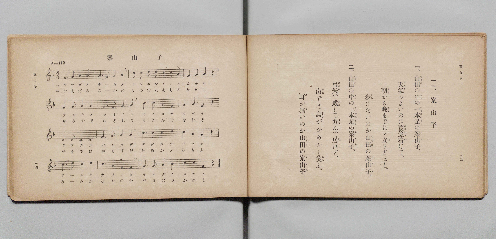

# 案山子

> Re:Shōka 使用 AI 協助辨識與重建樂譜，可能會有錯誤。歡迎回報。

- **鋼琴伴奏版**：<br><audio controls src="kakashi.mp3"></audio>

- 文部省《尋常小學唱歌 第二學年用》（明治四十四年六月，4102）

## 說明

原書資訊與歌詞全文（對應 P015.jpg，原書 pp. 24–25，第二學年第 11 首）：
調性與拍號：ヘ長調（F 大調）4/4 拍，♩= 112


## 歌詞

```text
一、
山田（やまだ）の中（なか）の一本足（いつぽんあし）の案山子（かゝし）、
天氣（てんき）のよいのに蓑笠着（みのかさつ）けて、
朝（あさ）から晚（ばん）までたゞ立（た）ちどほし。
歩（ある）けないのか山田（やまだ）の案山子（かゝし）。

二、
山田（やまだ）の中（なか）の一本足（いつぽんあし）の案山子（かゝし）、
弓矢（ゆみや）で威（おど）して力（りき）んで居（を）れど、
山（やま）では烏（からす）がかあかと笑（わら）ふ。
耳（みゝ）が無（な）いのか山田（やまだ）の案山子（かゝし）。
```

## ABC

<div class="abc-score" data-abc-src="kakashi.abc" aria-label="五線譜載入中"></div>

[下載 ABC 原始檔](kakashi.abc)

## TMD 檔案連結

- [主旋律 TMD 檔案](kakashi.tmd) [[在 TMD Studio 編輯](https://tmdlang.github.io/Tmd-TS/#tmd=s7IKdvYPcrWy4qpTUCpJTLdSSM7PyUlNLsnMz7PKyszLyo8vzshPT8wuBdHZiUpwdWX5OaW5qVbpRYkpqfFG8SaGBkYIyeL80qLkVKvi5Iz8_Jz4ktSKkqT8_Gx0-fiCxPRUqwADQ1OETEFRfllqXmIeUHdBUWZeSWoKWDtCQWpZZkoqSLostSgzLTM1BclJqUXFIHdDTS8pSswrTi7KLAB5BqEqv6gE6KOixIKMSquMzOKS_KLM5MSc-OzEPCTflWSkAj1XVFoElMnJTEtF1p6ZnplnlZufl1QKDBIlLi0thWcLO55u3Ph07QQFLS0uRVsFQ0MjLntbBTcuGxN9EzuQ1mfT2l82r3g-p_FxQ9fTDd1Pd-x4uqH_6dodT6dsfLa2R-H5mjVPdvWA-Du3PJ-y4nFD9_s9Hc9m9D3btPvp7NlPextB5M4tT1vXPpvT8X5PDyi03-_pVOLi0tdSsKUW4FJQUHjaN__Z7B0vNre_WNH1oqMd6LgXK-c9bV0B9ADQSU839D5r71QARZleVkE60CUQ9QoFBXoKRiaPGiYbmQIFUbyzZg0wPBReLpsGdPD7PbNAlrxYtf9Zw3KQ8d29L2bOB4o-bp7xcup2oDjQEjeFp0uWg5mdwOBTAKoBGvlo5kpIuIL0P9nR8LihEezcjRufT9kA1PS4qeVx477HjQuAuh43rnuyYy1IsHHV40ZgUEJEGp7NWfNi22awOFDxkseNex83TX7c2PS4cTpEDTwewWq6HzfNhUpBLHvc0PB0ycpnGxaDpZeBNQPdBtL5uAli6LrHjatfTJ74fM2C53MbwMr2gwW7HzdOBVoJVjwRpBduIhA9mzMXrBTokKlgFUCbO5_NnAUW3AC0BiwI9Nzyx43zHzfNe74alDyAbLD4wseNKx837ga69HFDE8JQkLlrV0LNbYIEAtBmYIBAnNmNK-hwB0ITJPB39QxU4O-Z_Hz-IrB9baCAbWoB61z-dEUjWE8XMCTAItOBIfy0azZYJVAQHEcgy5Y_3dgKFpwEFukBhRxyRADth_sGYvTjxvXPm_thLgKKzASLA3UCYxTodiC54vmaiWBd_UAFYNmt6BHxogHicaCTgTEN0v-8ZSEkiMBcCmIEaA3lGR8KFLT0ubi8E7MTizMyrQIyE_PyHWoMaqpBdijYWGjZgRnYChxw-bWj4cXCHgUNEwVgyfZ8fYMOvJTQxKIBaBPIsBoFQwVdIDRSMAaSIFwDZINEDME0RMQUCM2AEERDREC6YPIGIBGwaT6GNQqPm5eA9T9ungfEDWBWH1jP4-YusAxQpGk1snjTEiC7BYjnAvFmIH8REG9HkgerhpLbgWQ8wkYjkHwLxNTGfUC8AMxaB9HZuApmY2M3ijjQtkagrY17gbonA-kmIJ6OJA9RDSGnw23EH_67emgX_iARSNiD1EPUwHjo4d8GDX9QSK5FCf8V0NAHhTdI7HEzyIcgmflQPX3wcN4KlQGF7eOmjWBZkMnoYQ-1rXE_NB6AeRYahpDYBmZxaBgCywRofMJkesGhj6SnaRLYth6oPuLCfUcnOeFuBjJaF0SZglhgAltswMIeRJvBRUByoDhAC3tgyoWE8FZ4Ggf5AhSOExCxAswZIFY71M_7oTINUPbj5kaonk4wbzbYRELpHhSCwMISGvageAXp6gSyZ4JlQGGKJANO8ZD0DUoVINP6oTpAYqDYJyLsga0icsIeEqag8gQ5TEGhCgp_RAqHxYQJXA0IY0nz0HAHhRYk9YLSK6LEQUrx4FjBW0oRKm2AKR1WpoBjCx6ykLIGUraAyhFI-OIvn7CXM7VcXLp2CtCKINrHMFYBmWsE5ipzAQA)]
- [鋼琴伴奏 TMD 檔案](kakashi_piano.tmd) [[在 TMD Studio 編輯](https://tmdlang.github.io/Tmd-TS/#tmd=s7IKdvYPcrWy4qpTUCpJTLdSSM7PyUlNLsnMz7PKyszLyo8vzshPT8wuBdHZiUpwdWX5OaW5qVbpRYkpqfFG8SaGBkYIyeL80qLkVKvi5Iz8_Jz4ktSKkqT8_Gx0-fiCxPRUqwADQ1OETEFRfllqXmIeUHdBUWZeSWoKWDtCQWpZZkoqSDoxOTk_tyAxLzM3NQ9Jviy1qBjkeKgVJUWJecXJRZkFIB8hVOUXlQC9VZRYkFFplZFZXJJflJmcmBOfnZiH5MWSjFSgD4tKi4AyOZlpqcjaM9Mz86xy8_OSSoHhosSlpaXwbGHH040bn66d8H5Px8vuPc8nbHmyZ8vTpf3POzve7-lU0NLiUrRVMDQ04rK3VXDjsjHRN7EDmfdsWvvL5hXP5zQ-buh6uqH76Y4dTzf0P1274-mUjc_W9ig8X7Pmya4eEH_nludTVjxu6AYa_2xG37NNu5_Onv20txFE7tzytHXtszlAe3pA8QC0TomLyzsxO7E4I9MqIDMxLz_Iw6HGoKaaSwEIbCy07MAMfS0FW3QAtnBHw4uFPQoaJgpApzxf36CjAIojvayCdE0sGrT0wYbVKBgq6AKhkYIxkAThGiAbJGIIpiEipkBoBoQgGiIC0gWTNwCJgE3zMaxReNy8BKz_cfM8IG4As_rAeh43d4FlgCJNq5HFm5YA2S1APBeINwP5i4B4O5I8WDWU3A4k4xE2GoHkWyCmNu4D4gVg1jqIzsZVMBsbu1HEgbY1Am1t3AvUPRlINwHxdCR5iGoIOR1uI_7w39VDu_AHiUDCHqQeogbGQw__Nmj4g0JyLUr4r4CGPii8QWKPm0E-BMnMh-rpg4fzVqgMKGwfN20Ey4JMRg97qG2N-6Hx8LhxOTQMIbH9uHElNAwfNy6DxidMphcc-kh6miaBbeuB6iMu3Hd0khPuZiCjdUGUKYgFJrDFBizsQbQZXAQkB4oDtLAHplxICG-Fp3GQL0DhOAERK8CcAWK1Q_28HyrTAGU_bm6E6ukE82aDTSSU7kEh-LhxPTTsQfEK0tUJZM8Ey4DCFEkGnOIh6RuUKkCm9UN1gMRAsU9E2AOLMXLCHhKmoPIEOUxBoQoKf0QKh8WECVwNCGNJ89BwB4UWJPWC0iuixEFK8eBYwVtKESptgCkdVqaAYwsespCyBlK2gMoRSPjiL5-wlzO1aPWAD3I9YAKtB4CJFZR2tQ3hNDCI4uMVjOK1gYkZIYapCswCKzGAeox8s1BUIYwziQfmLExLsYrA1CJEQIZiOg1THX7HAtUDOVBnAYNU104BGqrRPoaxCshcIzBXmQsA)]

## 分析

```text
================================================================================
📊 TMD Song Profile: [ 案山子 ]
================================================================================
⏱  Duration:       1:08 (68.6s), 32 measures total
🎼 Key & Tempo:    首調基準 F, != 112.0 BPM, <4/4>
   - 分析範圍：      由實際發聲的音符與和弦推測調性；播放脈絡另行呈現
🎤 人聲音域:    C4 (MIDI 60) – D5 (MIDI 74) [跨度: 14 個半音 / 1.2 個八度, 難度: moderate]
   - 最低音:  C4 in [Kakashi[L1] #1 @ m.9, 0:18]
   - 最高音: D5 in [Kakashi[L1] #1 @ m.3, 0:04]
   - 適合: soprano, mezzo-soprano, contralto, tenor, baritone, bass
🏛  結構:      Kakashi[L1] (34.3s) -> Kakashi[L2] (34.3s)
⚡ 編曲密度:        Peak 1 軌道同時演奏
🗝  調性診斷：       F 調性不明確（純淨自然大調，未偵測到可信轉調）
   - 風格氣質:    純淨自然大調（陽光明朗、易唱易記，無明顯調外色彩）
   - 轉調歷程:    全曲維持單一推測調性（未偵測到可信轉調）
   - 核心骨幹音:  C, A, F, G, D
   - 調性數值:    F 調性不明確 [相關度: 0.80, 穩定度: Ambiguous, 自然音純度: 100.0%]
   - 候選調性 (K-S): F 大調 (0.80), C 大調 (0.79), A 小調 (0.72)
   - 五度圈歷程:   -1 -> -1
   - 各段落調性細節:
     • [Kakashi[L1] #1]: F 調性不明確 (r: 0.80, 自然音純度: 100.0%)
     • [Kakashi[L2] #1]: F 調性不明確 (r: 0.80, 自然音純度: 100.0%)

  [ 五度圈游移軌跡 ]
               C  
        [F ]*          G  
      Bb               D  
      Eb               A  
         Ab           E  
            Db       B  
               F# 
     (* = active key center)

  [ 十二半音累積音高分佈 ]
     C  : ████████████████████████  26.7%
     C# :                            0.0%
     D  : ████████                   9.2%
     D# :                            0.0%
     E  :                            0.0%
     F  : █████████████████         19.2%
     F# :                            0.0%
     G  : █████████████████         19.2%
     G# :                            0.0%
     A  : ██████████████████████    24.2%
     A# : ██                         1.7%
     B  :                            0.0%
--------------------------------------------------------------------------------
Assignment 軌道音域：
  - Piano         : C4 – D5 (14 個半音 / 1.2 個八度, 126 個音符)
================================================================================
```


## 原書掃描頁




