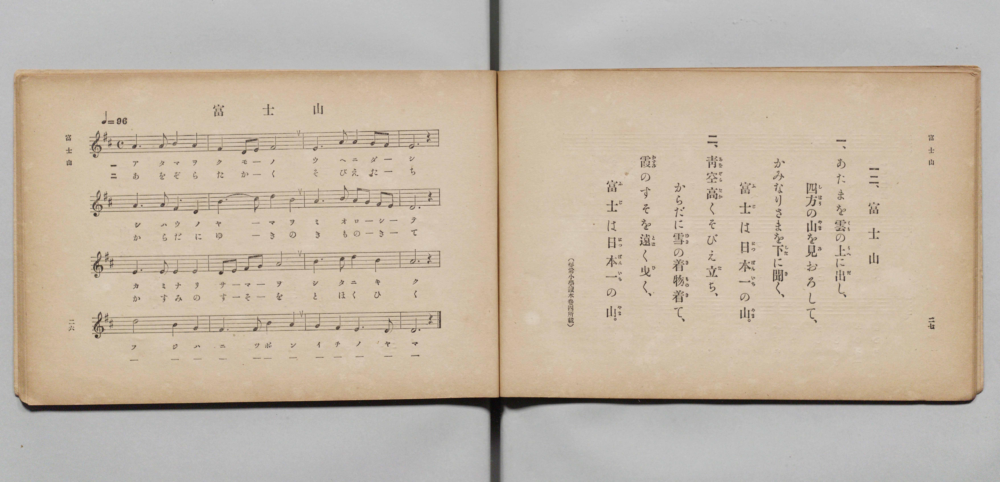

# 富士山

> Re:Shōka 使用 AI 協助辨識與重建樂譜，可能會有錯誤。歡迎回報。

- **鋼琴伴奏版**：<br><audio controls src="fujisan.mp3"></audio>

- 文部省《尋常小學唱歌 第二學年用》（明治四十四年六月，4102）

## 說明

原書資訊與歌詞全文（對應 P016.jpg，原書 pp. 26–27，第二學年第 12 首）：
調性與拍號：ニ長調（D 大調）4/4 拍，♩= 96
出處註記：（尋常小學讀本卷四所載）


## 歌詞

```text
一、
あたまを雲（くも）の上（うへ）に出（だ）し、
四方（しはう）の山（やま）を見（み）おろして、
かみなりさまを下（した）に聞（き）く、
富士（ふじ）は日本一（につぽんいち）の山（やま）。

二、
青空高（あをぞらたか）くそびえ立（た）ち、
からだに雪（ゆき）の着物着（きものき）て、
霞（かすみ）のすそを遠（とほ）く曳（ひ）く、
富士（ふじ）は日本一（につぽんいち）の山（やま）。
```

## ABC

<div class="abc-score" data-abc-src="fujisan.abc" aria-label="五線譜載入中"></div>

[下載 ABC 原始檔](fujisan.abc)

## TMD 檔案連結

- [主旋律 TMD 檔案](fujisan.tmd) [[在 TMD Studio 編輯](https://tmdlang.github.io/Tmd-TS/#tmd=s7IKdvYPcrWy4qpTUCpJTLdSSM7PyUlNLsnMz7PKyszLyo8vzshPT8wuBdHZiUpwdWX5OaW5qVbpRYkpqfFG8SaGBkYIyeL80qLkVKvi5Iz8_Jz4ktSKkqT8_Gx0-fiCxPRUqwADQzOETEFRfllqXmIeUHdBUWZeSWoKWDtCQWpZZkoqSLostSgzLTM1BclJqUXFIHdDTS8pSswrTi7KLAB5BqEqv6gE6KOixIKMSquMzOKS_KLM5MSc-OzEPCTflWSkAj2Xl1hSWpSKLlqQk5iMJAjUn56ZZ5Wbn5dUCgwjJS4tLYWn63ueLl79dONGBS0tLkVbBUszLntbBRcuGxN9EzuQzmfT2l82r3g-p_FxQ9fTDd1Pd-x4uqH_6dodT6dsfLa2R-H5mjVPdvWA-Du3PJ-y4nFD9_s9Hc9m9D3btPvp7NlPextB5M4tT1vXPpvT8X5PDyj03-_pVOLi0tdSsKUW4FJQUHjaN__Z7B0vNre_WNH1oqMd6LgXK-c9bV0B9ADQSU839D5r71QARaFeVkE60CUQ9QoFBXoKRmaPGiYbmQMFUbyzZo2CoZHCy2XTgA5-v2cWyJIXq_Y_a1gOMr6798XM-UDRx83dL6duB4oDLXFReLpkOZjZCQw-BaAaoJGPZq4EByvIie27Xsyc-mLF7hcrZgC1gp2FCNEX6xqezVnztHc7MMiedTa8AFnayQXS92RHw-OGRhDrcWPT48b5jxv3PW6a9HL2JqAJjxv7Hzc1AVU-blz3ZEcXWKTtceMOsMhqoI1gkQVg7nSYKQ0NIDum7QTLTX_cuB6oB2IEMCWABJtagHaARJomvVgGitLHjSBfPW7setzUC9ayDGEWCDV2A1U8blz1uKnrceNUiAOf7IDoBKoGhhTIOS8a54FFgOEC5PajGgF0FDgxglVsfdwIDCKgovXPpi8FBgswCMDiqx83LnncuPdx0-THjUA3LsTu6oYmSLjt6oFa8XLupOcrd71cDTQTaEgT0HGPG-c9bgLqBQYm0JVg1zTOfdy4-XFjx_PVEHdDHL0QyZVAX4L0LAC64-XsVWArgWEN8c2653MbnneuBJIQLwJjBSgIk0UNrpdzIOEADLSZsJAFKgWy54IiFhRdQNkVjxt3Q5z2bPZmsAgwwmkdbkBzKc-PUKCgpc_F5VaalVmcmGcVkJmYl-9QY1BTDbJDwcZCyw7MwFYOgIuVHQ0vFvYoaJgoALPH8_UNOvDMq4lFA9AmkGE1CqYKukBoqmAGJnWBIsZA0lDBCEyDYA2QDVEDkjcBisNEINAApAZsmo9hjcLjpkVg0cdN-xUeN88DsZo3gU153LQezAPJP27ug5v-uGkZREfzDCDuBrMaoDLbkeyJR9hjBJRrbILaMwnIBtvT1AnR1TgfxGsEm9TYj7CncS5ER-NmIO4As0AqQTILMezBH9a7eigJa0gIg2wGhbqugrmCYRyQAnFgisyANCiojYAiIKW4AhsSQI-b-6HBCAlYoEzzEqjMPGgEQAOhGeRlUGCtArLXglkgM0AybXgCGxSYkCAGZmdw0K2GRhFEFzDfAvE6pMDuhepogopDREAykOgmPrB3dJIT2JAkagSmQRgUjqBEbQINYbzBjz2wQV4GBel8IO4Cs1ZBA2ErNKhhqR2WsqHRA84L4PTYBApyWF4gENiNM4F4P5gFCkCQzEwwD5SOQekeEdgroDp2Q1M8sOiDysDSP5GBDaznyAlscABC0i2oiIAVI7pAElGwgMRBopCYMcSfspunQsUfN-0AByvIIyBxaOA0twAxOCCaN0ODFJTiHzc3gklI8QLKBSA9oIjBFdigqIME3gwwCYoYkDg0shuXAPFesDsmQ2VawOKgIgOW4oE1AlhmH4Y9tVxcunYK0DI92scwVgGZawTmKnMBAA)]
- [鋼琴伴奏 TMD 檔案](fujisan_piano.tmd) [[在 TMD Studio 編輯](https://tmdlang.github.io/Tmd-TS/#tmd=s7IKdvYPcrWy4qpTUCpJTLdSSM7PyUlNLsnMz7PKyszLyo8vzshPT8wuBdHZiUpwdWX5OaW5qVbpRYkpqfFG8SaGBkYIyeL80qLkVKvi5Iz8_Jz4ktSKkqT8_Gx0-fiCxPRUqwADQzOETEFRfllqXmIeUHdBUWZeSWoKWDtCQWpZZkoqSDoxOTk_tyAxLzM3NQ9Jviy1qBjkeKgVJUWJecXJRZkFIB8hVOUXlQC9VZRYkFFplZFZXJJflJmcmBOfnZiH5MWSjFSgD_MSS0qLUtFFC3ISk5EEgfrTM_OscvPzkkqBAaXEpaWl8HR9z9PFq59u3Ph-T8fL7j3PJ2x5smfL06X9zzs73u_pVNDS4lK0VbA047K3VXDhsjHRN7EDGfdsWvvL5hXP5zQ-buh6uqH76Y4dTzf0P1274-mUjc_W9ig8X7Pmya4eEH_nludTVjxu6Aaa_mxG37NNu5_Onv20txFE7tzytHXtszlAa3pA8QK0TYmLy600K7M4Mc8qIDMxLz_Iw6HGoKaaSwEIbCy07MAMfS0FW3QAtnBHw4uFPQoaJgpApzxf36CjAIozvayCdE0sGrT0wYbVKJgq6AKhqYIZmNQFihgDSUMFIzANgjVANkQNSN4EKA4TgUADkBqwaT6GNQqPmxaBRR837Vd43DwPxGreBDblcdN6MA8k_7i5D27646ZlEB3NM4C4G8xqgMpsR7InHmGPEVCusQlqzyQgG2xPUydEV-N8EK8RbFJjP8KexrkQHY2bgbgDzAKpBMksxLAHf1jv6qEkrCEhDLIZFOq6CuYKhnFACsSBKTID0qCgNgKKgJTiCmxIAD1u7ocGIyRggTLNS6Ay86ARAA2EZpCXQYG1CsheC2aBzADJtOEJbFBgQoL4ceMCcNCthkYRRNfjxl4gXocU2L1QHU1QcYgISAYS3cQH9o5OcgIbkkSNwDQIg8IRlKhNoCGMN_ixBzbIy6AgnQ_EXWDWKmggbIUGNSy1w1I2NHrAeQGcHptAQQ7LCwQCu3EmEO8Hs0ABCJKZCeaB0jEo3SMCewVUx25oin_cCM1z8PRPZGADCyZyAhscgJB0CyoiYMWILpBEFCwgcZAoJGYM8afs5qlQ8cdNO8DBCvIISBwaOM0tQAwOiObN0CAFpfjHzY1gElK8gHIBSA8oYnAFNijqIIE3A0yCIgYkDo3sxiVAvBfsjslQmRawOKjIgKX4x00tYJl9GPbUohXpPshFugm0SAcGRLxCtGGsggmQMolF8KEUMFXGA1mm8bEIBpIYmDCAegpTL9BQE4TJ2EyCKgVhhDG4FIJYyGaDBTCNR3MUVAG6B81Ays3AZhtBRMAGgM1GcxUwJHXtFKCBGe0DFEXmGoG5ylwA)]

## 分析

```text
================================================================================
📊 TMD Song Profile: [ 富士山 ]
================================================================================
⏱  Duration:       1:20 (80.0s), 32 measures total
🎼 Key & Tempo:    首調基準 D, != 96.0 BPM, <4/4>
   - 分析範圍：      由實際發聲的音符與和弦推測調性；播放脈絡另行呈現
🎤 人聲音域:    D4 (MIDI 62) – D5 (MIDI 74) [跨度: 12 個半音 / 1.0 個八度, 難度: easy]
   - 最低音:  D4 in [Fujisan[L1] #1 @ m.2, 0:03]
   - 最高音: D5 in [Fujisan[L1] #1 @ m.6, 0:13]
   - 適合: soprano, mezzo-soprano, contralto, tenor, baritone, bass
🏛  結構:      Fujisan[L1] (40.0s) -> Fujisan[L2] (40.0s)
⚡ 編曲密度:        Peak 1 軌道同時演奏
🗝  調性診斷：       D 大調（純淨自然大調，未偵測到可信轉調）
   - 風格氣質:    純淨自然大調（陽光明朗、易唱易記，無明顯調外色彩）
   - 轉調歷程:    全曲維持單一推測調性（未偵測到可信轉調）
   - 核心骨幹音:  A, D, E, F#, B
   - 調性數值:    D 大調 [相關度: 0.86, 穩定度: Moderate, 自然音純度: 100.0%]
   - 候選調性 (K-S): D 大調 (0.86), A 大調 (0.81), B 小調 (0.60)
   - 五度圈歷程:   +2 -> +2
   - 各段落調性細節:
     • [Fujisan[L1] #1]: D 大調 (r: 0.86, 自然音純度: 100.0%)
     • [Fujisan[L2] #1]: D 大調 (r: 0.86, 自然音純度: 100.0%)

  [ 五度圈游移軌跡 ]
               C  
         F            G  
      Bb              [D ]*
      Eb               A  
         Ab           E  
            Db       B  
               F# 
     (* = active key center)

  [ 十二半音累積音高分佈 ]
     C  :                            0.0%
     C# : ██                         1.7%
     D  : █████████████████████     20.8%
     D# :                            0.0%
     E  : ███████████████████       19.2%
     F  :                            0.0%
     F# : ██████████████            14.2%
     G  : ██████                     5.8%
     G# :                            0.0%
     A  : ████████████████████████  24.2%
     A# :                            0.0%
     B  : ██████████████            14.2%
--------------------------------------------------------------------------------
Assignment 軌道音域：
  - Piano         : D4 – D5 (12 個半音 / 1.0 個八度, 110 個音符)
================================================================================
```


## 原書掃描頁




