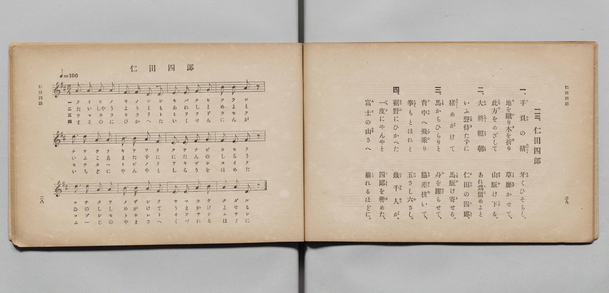

# 仁田四郎

> Re:Shōka 使用 AI 協助辨識與重建樂譜，可能會有錯誤。歡迎回報。

- **鋼琴伴奏版**：<br><audio controls src="nitta_shiro.mp3"></audio>

- 文部省《尋常小學唱歌 第二學年用》（明治四十四年六月，4102）

## 說明

原書資訊與歌詞全文（對應 P017.jpg，原書 pp. 28–29，第二學年第 13 首）：
調性與拍號：ニ長調（D 大調）2/4 拍，♩= 100


## 歌詞

```text
一、
手負（ておひ）の猪（ゐのしゝ）　牙（きば）くひそらし、
地（ち）を蹴（け）り木（き）を折（を）り　草靡（くさなび）かせて、
此方（こなた）をめざして　山驅（やまか）け下（くだ）る。

二、
大將賴朝（たいしやうよりとも）　あれ爲留（しと）めよと
いふ聲待（こゑま）たずに　仁田（にたん）の四郎（しらう）、
猪（ゐのしゝ）めがけて　馬驅（うまか）け寄（よ）せる。

三、
馬（うま）からひらりと　身（み）を躍（をど）らせて、
背中（せなか）へ飛乘（とびの）り　脇差拔（わきざしぬ）いて、
拳（こぶし）もとほれと　五（いつ）さし六（む）さし。

四、
裾野（すその）にひかへた　幾千人（いくせんにん）が、
一度（いちど）にやんやと　四郎（しらう）を譽（ほ）めた、
富士（ふじ）の山（やま）さへ　崩（くづ）れるほどに。
```

## ABC

<div class="abc-score" data-abc-src="nitta_shiro.abc" aria-label="五線譜載入中"></div>

[下載 ABC 原始檔](nitta_shiro.abc)

## TMD 檔案連結

- [主旋律 TMD 檔案](nitta_shiro.tmd) [[在 TMD Studio 編輯](https://tmdlang.github.io/Tmd-TS/#tmd=s7IKdvYPcrWy4qpTUCpJTLdSSM7PyUlNLsnMz7PKyszLyo8vzshPT8wuBdHZiUpwdWX5OaW5qVbpRYkpqfFG8SaGBkYIyeL80qLkVKvi5Iz8_Jz4ktSKkqT8_Gx0-fiCxPRUqwADQ3OETEFRfllqXmIeUHdBUWZeSWoKWDtCQWpZZkoqSLostSgzLTM1BclJqUXFIHdDTS8pSswrTi7KLAB5BqEqv6gE6KOixIKMSquMzOKS_KLM5MSc-OzEPCTflWSkAj0Hka5E1puZnplnlZufl1QKDA8lLi0thSe7G59P2fB09uyXzX0KWlpcirYKhgYGXPa2Ci5cNkb6JnYg3c-mtb9sXvF8TuPjhq6nG7qf7tjxdEP_07U7nk7Z-Gxtj8LzNWue7OoB8XdueT5lxeOG7vd7Op7N6Hu2aTfQ4Ke9jSBy55anrWufzel4v6cHFNrv93QqcXHpaynYUgtwKSgoPO2b_2z2jheb21-s6HrR0Q503IuV8562rgB6AOikpxt6n7V3KoCiTC-rIB3oEoh6hYICPQUji0cNk40sgYIo3lmzRsHQWOHlsmlAB7_fMwtkyYtV-581LAcZ3937YuZ8oOjj5u6XU7cDxYGWuCg8XbIczOwEBp8CUA3QyEczV0LCFaT_yY6Gxw2NINazzu4XmxYANT1uXPa4setx4yagrseN6573rAIJNk0Ash83Tn_cNBck3tDwvHMmWHHv48YNYJX9QC2PG-c-bgKyp0MNfToHKAdUtBCkomnSi51bwNyJYG7XszkrIEZAZJ91zQDbNAkiC7TjRW_ny7lAvUA1QNOnPm5c9bhxM9iy7seNs0EOhbp97ZJn03aC1U0GKwIGBMjEx02NjxungZwDUtrwdOPGlytbwXa0PG7cBzQFbNbEJztAiQRsBzAAgBq7Hzc0QYJnVw_MJ0uWP93Q_mLzlmdzgAEAVDz_cSPQEGB4AMm2x01AM4FhtuJxUxMkeB43Nj1u6nnesen5VEg4Ad0A9C3Q8EaQ4sYVIEPBRmx90bjp6T6ws4Cub5oIdBnYWUALZj1uXA00C5IvwApWg8SbJkOiBpJToKaDgr0NbDfYvdijDRQePUAfQ8Lj5bI10PAA-gApPJ6ubwHrBeYPIHc2cnjsgJkP1AvXCI0RkAs2gUhISACjb9dqsBpQ-gPF_i5gRIPi93HjSrAI2HB4JL5o7nmyYy1YA1AUGIkQ1-x4uXj2k53glAE0tHEz0D-I9NHS_nT7umfdU8DmAqMPmBgh0Q10HFAvMHThSaQbmHAg6WMbUAXYiCawibuB8QRx75NdYINA2paA9QNT3HRgSQE2vQEuAgsMYPDDnL5438t2SETMBGUBiBNBkQXMEcCkugMUa8D0t3Pf097mJ7t2wWwBuhgYukAnrYbFKSy5AfPl013LYOoWQkMMpK4FpAGU6EAuxp4CgEG9di9YcDcs0oHWQ5Lx-p6niyGxsvVxIzBUwelo40Z4poD5cgfI9C1AWyH5YinYoB5QUgAGWONKcMJsAplIeWEJBQpa-lxcfpklJYnBGZlF-VYBmYl5-Q41BjXVIGsUbAzNtOzALGwFNbjc39HwYmGPgoaJArBGeL6-QQdeumpi0QC0DWRYjYKpgi4QmoJpEK5RMAaLGCsYAkkQrlEwAosYgWVMwCJmQBKEQToMQCJg03wMaxQeN7eBVT9uWgVkTwKxgNUZSM_j5g0QGSD_cdN2sBoQCZRpWguVmQBkrwezQDpBMnvBvJVw1fEI24yA8o3zITobW4AYmAiawRyQE0CaO6BO6QKKrQCzmiAyjSAaxO8BaQPrAcmD9DSCxUE6IWJIFhqDdEK917gPiLvBajuhZm6CmtkJthHJzMb9UJlJYAySAXkIZBtILzAbgMllqLaZgHTOhNo2F4jXgVmrUW0DugGYXMEsUFCAZFqgMv0wk5smQ2VAeiE8YF6D24Y_We3qISdZGcaBHQGkEAkLlGBAyQbEAyUlbAkLxAKJgmj0hAWKGVBi2AT0w0YwaxU0FGHJBygDxMgyoMQE8vNWoBg4TpqhYdEECYvdYDFQnKInLFgoAnU2gkOsaSI0FPdBZeYD8SyUOAHRUBloKIPiDCQDTmPQ2EazDZyqQPEEkgNmGkiqAscpSAaUhkD8zbAUAE5bIB_0Q2V6gXgamAWyBaRnDZgH8gH2VAXz20JoSoT7oAkqA3Q9hI1IwyCzoakb7ANISgbJgMMQkm_AaZCYVLWjk_apCiQCkoUUciAMKs7QUlXTZoi_gKnjcRMon0JSECi9LYT6eBusuAKnE5DMEqieefB0BEqPsPT2uLkBTIJk0FJV0wRoyK-DlzvQOAOHHyRfAtsg8JjDWuKA5WHlGyyPg2TQUxUoDYJUAH0ATYGw8g-WqnaDy0DkeIaljSVAPBXFhWBfIYmhp6qtUJ0zoCkVBJHSFNj9EN2wtA1LwUthrgD7Ap6mkNImxK5aLi5dOwVELRntYxirgCZihCFijCFiAhZR5gIA)]
- [鋼琴伴奏 TMD 檔案](nitta_shiro_piano.tmd) [[在 TMD Studio 編輯](https://tmdlang.github.io/Tmd-TS/#tmd=s7IKdvYPcrWy4qpTUCpJTLdSSM7PyUlNLsnMz7PKyszLyo8vzshPT8wuBdHZiUpwdWX5OaW5qVbpRYkpqfFG8SaGBkYIyeL80qLkVKvi5Iz8_Jz4ktSKkqT8_Gx0-fiCxPRUqwADQ3OETEFRfllqXmIeUHdBUWZeSWoKWDtCQWpZZkoqSDoxOTk_tyAxLzM3NQ9Jviy1qBjkeKgVJUWJecXJRZkFIB8hVOUXlQC9VZRYkFFplZFZXJJflJmcmBOfnZiH5MWSjFSgDyHSlch6M9Mz86xy8_OSSoGBosSlpaXwZHfj8ykbns6e_bK57_2ejpfde55P2PJkz5anS_ufd3a839OpoKXFpWirYGhgwGVvq-DCZWOkb2IHMvLZtPaXzSuez2l83ND1dEP30x07nm7of7p2x9MpG5-t7VF4vmbNk109IP7OLc-nrHjc0A00_tmMvmebdgNte9rbCCJ3bnnauvbZHKA9PaB4AFqnxMXll1lSkhickVmUbxWQmZiXH-ThUGNQU82lAAQ2hmZadmCWvpaCLToAW7qj4cXCHgUNEwWgc56vb9BRAMWTXlZBuiYWDVr6YMNqFEwVdIHQFEyDcI2CMVjEWMEQSIJwjYIRWMQILGMCFjEDkiAM0mEAEgGb5mNYo_C4uQ2s-nHTKiB7EojV3AfW87h5A0QGyH_ctB2sBkQCZZrWQmUmANnrwSyQTpDMXjBvJVx1PMI2I6B843yIzsYWIJ7-uKkZzAE5AaS5A-qULqDYCjCrCSLTCKJB_B6QNrAekDxITyNYHKQTIoZkoTFIJ9R7jfuAuBusthNq5iaomZ1gG5HMbNwPlZkExiAZkIdAtoH0Pm6cDSaXodpmAtI5E2rbXCBeB2atRrUN6IbHjTvALFBQgGRaoDL9MJObJkNlQHohvMeNPXDb8CerXT3kJCvDOLAjgBQiYYESDCjZgHigpIQtYYFYIFEQjZ6wQDEDSgybgH7YCGatgoYiLPkAZYAYWQaUmEB-3goUA8dJMzQsmiBhsRssBopT9IQFC0WgzkZwiDVNhIbiPqjMfCCehRInIBoqAw1lUJyBZMBpDBrbaLaBUxUonkBywEwDSVXgOAXJgNIQiL8ZlgLAaQvkg36oTC8QTwOzQLaA9KwB80A-wJ6qYH5bCE2JcB80QWWAroewEWkYZDY0dYN9AEnJIBlwGELyDTgNEpOqdnTSPlWBRECykEIOhEHFGVqqatoM8RcwdTxuAuVTSAoCpbeFUB9vgxVX4HQCklkC1TMPno5A6RGW3h43N4BJkAxaqmqaAA35dfByBxpn4PCD5MvHjaCUBok5rCUOWB5WvsHyOEgGPVWB0iBIBdAH0BQIK_9gqWo3uAxEjmdY2lgCxFNRXAj2FZIYeqraCtU5A5pSQRApTYHdD9ENS9uwFLwU5gqwL-BpCiltQuyqxawkfZArSQtoHQlMKfEK0YaxMAqTbxoPZJnGxyIYNQomQJYJWI0B1F-Y-hBqcJuD0EO8OUZAhhGKKXAm1Byg33XtFBDej_YBakQTAZqAJmKMIQK0FSiizAUA)]

## 分析

```text
================================================================================
📊 TMD Song Profile: [ 仁田四郎 ]
================================================================================
⏱  Duration:       0:57 (57.6s), 48 measures total
🎼 Key & Tempo:    首調基準 D, != 100.0 BPM, <2/4>
   - 分析範圍：      由實際發聲的音符與和弦推測調性；播放脈絡另行呈現
🎤 人聲音域:    D4 (MIDI 62) – D5 (MIDI 74) [跨度: 12 個半音 / 1.0 個八度, 難度: easy]
   - 最低音:  D4 in [NittaShiro[L1] #1 @ m.2, 0:01]
   - 最高音: D5 in [NittaShiro[L1] #1 @ m.5, 0:04]
   - 適合: soprano, mezzo-soprano, contralto, tenor, baritone, bass
🏛  結構:      NittaShiro[L1] (14.4s) -> NittaShiro[L2] (14.4s) -> NittaShiro[L3] (14.4s) -> NittaShiro[L4] (14.4s)
⚡ 編曲密度:        Peak 1 軌道同時演奏
🗝  調性診斷：       A 調性不明確（純淨自然大調，未偵測到可信轉調）
   - 風格氣質:    純淨自然大調（陽光明朗、易唱易記，無明顯調外色彩）
   - 轉調歷程:    全曲維持單一推測調性（未偵測到可信轉調）
   - 核心骨幹音:  A, F#, D, E, B
   - 調性數值:    A 調性不明確 [相關度: 0.81, 穩定度: Ambiguous, 自然音純度: 95.6%]
   - 候選調性 (K-S): A 大調 (0.81), D 大調 (0.79), F# 小調 (0.65)
   - 五度圈歷程:   +3 -> +3 -> +3 -> +3
   - 各段落調性細節:
     • [NittaShiro[L1] #1]: A 調性不明確 (r: 0.81, 自然音純度: 95.6%, 調外音: G)
     • [NittaShiro[L2] #1]: A 調性不明確 (r: 0.81, 自然音純度: 95.6%, 調外音: G)
     • [NittaShiro[L3] #1]: A 調性不明確 (r: 0.81, 自然音純度: 95.6%, 調外音: G)
     • [NittaShiro[L4] #1]: A 調性不明確 (r: 0.81, 自然音純度: 95.6%, 調外音: G)

  [ 五度圈游移軌跡 ]
               C  
         F            G  
      Bb               D  
      Eb              [A ]*
         Ab           E  
            Db       B  
               F# 
     (* = active key center)

  [ 十二半音累積音高分佈 ]
     C  :                            0.0%
     C# :                            0.0%
     D  : ████████████              15.6%
     D# :                            0.0%
     E  : ████████████              15.6%
     F  :                            0.0%
     F# : ██████████████            17.8%
     G  : ███                        4.4%
     G# :                            0.0%
     A  : ████████████████████████  31.1%
     A# :                            0.0%
     B  : ████████████              15.6%
--------------------------------------------------------------------------------
Assignment 軌道音域：
  - Piano         : D4 – D5 (12 個半音 / 1.0 個八度, 180 個音符)
================================================================================
```


## 原書掃描頁




