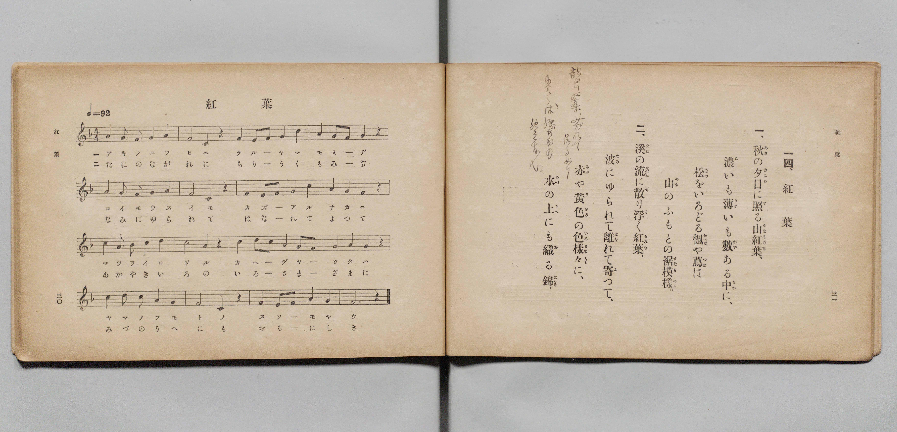

# 紅葉

> Re:Shōka 使用 AI 協助辨識與重建樂譜，可能會有錯誤。歡迎回報。

- **鋼琴伴奏版**：<br><audio controls src="momiji.mp3"></audio>

- 文部省《尋常小學唱歌 第二學年用》（明治四十四年六月，4102）

## 說明

原書資訊與歌詞全文（對應 P018.jpg，原書 pp. 30–31，第二學年第 14 首）：
調性與拍號：ヘ長調（F 大調）4/4 拍，♩= 92


## 歌詞

```text
一、
秋（あき）の夕日（ゆふひ）に照（て）る山紅葉（やまもみぢ）、
濃（こ）いも薄（うす）いも數（かず）ある中（なか）に、
松（まつ）をいろどる楓（かへで）や蔦（つた）は
山（やま）のふもとの裾模樣（すそもやう）。

二、
溪（たに）の流（ながれ）に散（ち）り浮（う）く紅葉（もみぢ）、
波（なみ）にゆられて離（はな）れて寄（よ）つて、
赤（あか）や黃色（きいろ）の色樣々（いろさま／″＼）に、
水（みづ）の上（うへ）にも織（お）る錦（にしき）。
```

## ABC

<div class="abc-score" data-abc-src="momiji.abc" aria-label="五線譜載入中"></div>

[下載 ABC 原始檔](momiji.abc)

## TMD 檔案連結

- [主旋律 TMD 檔案](momiji.tmd) [[在 TMD Studio 編輯](https://tmdlang.github.io/Tmd-TS/#tmd=s7IKdvYPcrWy4qpTUCpJTLdSSM7PyUlNLsnMz7PKyszLyo8vzshPT8wuBdHZiUpwdWX5OaW5qVbpRYkpqfFG8SaGBkYIyeL80qLkVKvi5Iz8_Jz4ktSKkqT8_Gx0-fiCxPRUqwADQwuETEFRfllqXmIeUHdBUWZeSWoKWDtCQWpZZkoqSLostSgzLTM1BclJqUXFIHdDTS8pSswrTi7KLAB5BqEqv6gE6KOixIKMSquMzOKS_KLM5MSc-OzEPCTflWSkAj1XkJOYh2Q1RLA4NbE4P68Y2cDM9Mw8q9z8vKRSYCApcWlpKTzf0vpiYqeClhaXoq2CpRGXva2CG5eNib6JHUjbs2ntL5tXPJ_T-Lih6-mG7qc7djzd0P907Y6nUzY-W9uj8HzNmie7ekD8nVueT1nxuKH7_Z6OZzP6nm3a_XT27Ke9jSBy55anrWufzel4v6cHFPbv93QqcXHpaynYUgtwKSgoPO2b_2z2jheb21-s6HrR0Q503IuV8562rgB6AOikpxt6n7V3KoAiUC-rIB3oEoh6hYICPQVjg0cNk40NgYIo3lmzRsHQROHlsmlAB7_fMwtkyYtV-581LAcZ3937YuZ8oOjj5hkvp24HigMtcVN4umQ5mNkJDD4FoBqgkY9mrgQHK0j7kx0NjxsaQazny0EB9bix6XEjUFHn48Z1T5dMfTZ9KUiwqe1x49bHjZvA4qufty4Hq1wG4jZ1P924ERJhYJUtjxv3PW4CGrL_ceMikAKI6Y8bGp7tbwZrmww2pQWo6MW0FrAI0PSZcMFnU3eABbsfN84CCzYB7XiyYy1YcBVQHOIIhLkgo-fuA0vve9y4BOyoSWCzeh83rgRqfrYUaCXExB2PG4FuBypoeTEF6Hyg4JLHjcBAA5q4HmEcEAE9BfcOJDRAIQDy1wog-8Xifc9WLHy2YjHYiJmPG-eCpECK28BeboKE7a4eqCuf7VoFVjkf6HCIac-2NsI81PO4qQfip2dTIQYuBDux69nWdZDgAcv2IwUy1uDdDORDTARFNyiIgNHWBDSoBxhVL2dDZNcDFYBNBwk-XQ8O_yZgNgCqB4bEMpRQfbEVGJiQFAEO9KaWl7ubX3QCUwFQEBi2oBCG-AYoCAyMxw2tYClIyE8Fh1z_o4bN7_fswRJnICdv2ALWAPQLMJmBDHqyowuWIoCpAOKJpuc7p4AFgVKg9PayBxJzqx83ToemVWCAA82lPNdCgYKWPheXb35uZlamVUBmYl6-Q41BTTXICgUbCy07MANbYQEue3Y0vFjYo6BhogAslZ6vb9CB53BNLBqAFoEMq1EwVdAFQjMwbaxgBBQxBouAeLoKBkBcAxQF8UzAaszAIiCWKVAErgZsmo9hjcLjpkVg3Y-b1io8bu4DsZqXAfFUoK7HzZOgZj9u7gaS8WCzHje3gUVWg8klYHIeVAZk1uPm-WCyCaYDYpcRUL4RJAOUa1wNxOvArFVA3APS29QDswsoC7ercSHYbV1gcbC9jf0QmSaQ-cAkASZB9kLswh_mu3rID3NTcFiCSJgIcpibQOMDJAKShcSCOchRhlgCfTM00JfAAq0JGOhNO8EeAwUpJNDh3gKKgoO7aReYhAQzSAQU6ODAgcgjogkp0FdBg3U_NGiB2R2IO9ECfRlSoK-HRg1ILUgFRBakvgPMA0c6QgeBQN_RSU6gg4IPFHawxIwt0CERAknoxkC1sGjQBetCC3NwIgWFUQsQb4KH_lpwGHbCwxwp8UHDdAaYbAeTIJ-D1LeA9YMTXzMoQaKHOShxgsKoG6gKrLaxF4hbwKb2wsMclAVgYQ4xESQHLBLB5D6ozDQ4Dylr4A9zYNOF0sIFVFhAwhMSD-iFCyyUa8ByMIge5pC0DAp7WOEyFZyuQXKgtASRBcnAwnwnOBz2gsUh6Rwa5sAcgrAHPbxBMQEKn6XwggWYxht3gMMPFGaQ3AYvkoCikFwDyi_QXNE4HSoDix-EPbVcXLp2CpCCPtrHMFYBiWcE5ilzAQA)]
- [鋼琴伴奏 TMD 檔案](momiji_piano.tmd) [[在 TMD Studio 編輯](https://tmdlang.github.io/Tmd-TS/#tmd=s7IKdvYPcrWy4qpTUCpJTLdSSM7PyUlNLsnMz7PKyszLyo8vzshPT8wuBdHZiUpwdWX5OaW5qVbpRYkpqfFG8SaGBkYIyeL80qLkVKvi5Iz8_Jz4ktSKkqT8_Gx0-fiCxPRUqwADQwuETEFRfllqXmIeUHdBUWZeSWoKWDtCQWpZZkoqSDoxOTk_tyAxLzM3NQ9Jviy1qBjkeKgVJUWJecXJRZkFIB8hVOUXlQC9VZRYkFFplZFZXJJflJmcmBOfnZiH5MWSjFSgDwtyEpHNhwgWpyYW5-cVIxuYmZ6ZZ5Wbn5dUCgwpJS4tLYXnW1pfTOx8v6fjZfee5xO2PNmz5enS_uedHe_3dCpoaXEp2ipYGnHZ2yq4cdmY6JvYgcx6Nq39ZfOK53MaHzd0Pd3Q_XTHjqcb-p-u3fF0ysZna3sUnq9Z82RXD4i_c8vzKSseN3QDTX82o-_Zpt1PZ89-2tsIInduedq69tkcoDU9oFgB2qbExeWbn5uZlWkVkJmYlx_k4VBjUFPNpQAENhZadmCGvpaCLToA27ej4cXCHgUNEwWgS56vb9BRAEWYXlZBuiYWDVr6YMNqFEwVdIHQDEwbKxgBRYzBIiCeroIBENcARUE8E7AaM7AIiGUKFIGrAZvmY1ij8LhpEVj346a1Co-b-0Cs5mVAPBWo63HzJKjZj5u7gWQ82KzHzW1gkdVgcgmYnAeVAZn1uHk-mGyC6YDYZQSUbwTJAOUaVwPxOjBrFRD3gPQ29cDsAsrC7WpcCHZbF1gcbG9jP0SmCWT-48b9YBJkL8Qu_GG-q4f8MDcFhyWIhIkgh7kJND5AIiBZSCyYgxxliCXQN0MDfQks0JqAgd60E-wxUJBCAh3uLaAoOLibdoFJSDCDRECBDg4ciDwimpACfRU0WPdDg_ZxUxsQd6IF-jKkQF8PjRqQWpAKiCxIfQeYB450hA4Cgb6jk5xABwUfKOxgiRlboEMiBJLQjYFqYdGgC9aFFubgRAoKoxYg3gQP_bXgMOyEhzlS4oOG6Qww2Q4mQT4HqW8B6wcnvmZQgkQPc1DiBIVRN1AVWG1jLxC3gE3thYc5KAvAwhxiIkjuceNUMLkPKjMNzkPKGvjDHFhcUVq4gAoLSHhC4gG9cIGFcg1YDgbRwxySlkFhDytcpoLTNUgOlJYgsiAZWJjvBIfDXrA4JJ1DwxyYQxD2oIc3KCZA4bMUXrAA03jjDnD4gcIMktvgRRJQFJJrQPkFmisap0NlYPGDsKcWtZz3QS7nTaDlPDAc4hVM47UN4TSKiAEoeOPjFYzitU3jQQIm8dpm8eiCQFVohpnEK5hhNcwIZgSQbwzWDzELqAZY6qCYhbACwcIwD2YRknFAK8CKsLkL4UmYRiCN6kmEa9AtAwWorp0CJEyjfQxjFZB4RmCeMhcA)]

## 分析

```text
================================================================================
📊 TMD Song Profile: [ 紅葉 ]
================================================================================
⏱  Duration:       1:23 (83.5s), 32 measures total
🎼 Key & Tempo:    首調基準 F, != 92.0 BPM, <4/4>
   - 分析範圍：      由實際發聲的音符與和弦推測調性；播放脈絡另行呈現
🎤 人聲音域:    E4 (MIDI 64) – D5 (MIDI 74) [跨度: 10 個半音 / 0.8 個八度, 難度: easy]
   - 最低音:  E4 in [Momiji[L1] #1 @ m.8, 0:18]
   - 最高音: D5 in [Momiji[L1] #1 @ m.1, 0:00]
   - 適合: soprano, mezzo-soprano, contralto, tenor, baritone, bass
🏛  結構:      Momiji[L1] (41.7s) -> Momiji[L2] (41.7s)
⚡ 編曲密度:        Peak 1 軌道同時演奏
🗝  調性診斷：       F 調性不明確（純淨自然大調，未偵測到可信轉調）
   - 風格氣質:    純淨自然大調（陽光明朗、易唱易記，無明顯調外色彩）
   - 轉調歷程:    全曲維持單一推測調性（未偵測到可信轉調）
   - 核心骨幹音:  C, A, G, A#, F
   - 調性數值:    F 調性不明確 [相關度: 0.75, 穩定度: Ambiguous, 自然音純度: 100.0%]
   - 候選調性 (K-S): F 大調 (0.75), C 大調 (0.74), A 小調 (0.70)
   - 五度圈歷程:   -1 -> -1
   - 各段落調性細節:
     • [Momiji[L1] #1]: F 調性不明確 (r: 0.75, 自然音純度: 100.0%)
     • [Momiji[L2] #1]: F 調性不明確 (r: 0.75, 自然音純度: 100.0%)

  [ 五度圈游移軌跡 ]
               C  
        [F ]*          G  
      Bb               D  
      Eb               A  
         Ab           E  
            Db       B  
               F# 
     (* = active key center)

  [ 十二半音累積音高分佈 ]
     C  : ████████████████████████  29.5%
     C# :                            0.0%
     D  : ███████                    8.0%
     D# :                            0.0%
     E  : █                          1.8%
     F  : █████████                 10.7%
     F# :                            0.0%
     G  : ████████████              15.2%
     G# :                            0.0%
     A  : ██████████████████        22.3%
     A# : ██████████                12.5%
     B  :                            0.0%
--------------------------------------------------------------------------------
Assignment 軌道音域：
  - Piano         : E4 – D5 (10 個半音 / 0.8 個八度, 120 個音符)
================================================================================
```


## 原書掃描頁




