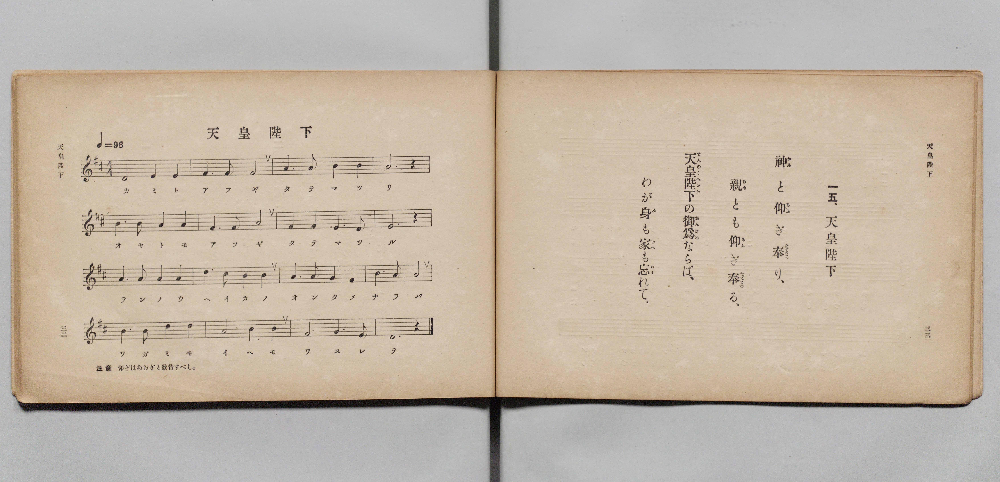

# 天皇陛下

> Re:Shōka 使用 AI 協助辨識與重建樂譜，可能會有錯誤。歡迎回報。

- **鋼琴伴奏版**：<br><audio controls src="tenno_heika.mp3"></audio>

- 文部省《尋常小學唱歌 第二學年用》（明治四十四年六月，4102）

## 說明

原書資訊與歌詞全文（對應 P019.jpg，原書 pp. 32–33，第二學年第 15 首）：
調性與拍號：ニ長調（D 大調）4/4 拍，♩= 96
譜下註記：「注意　仰ぎはあをぎと發音すべし。」


## 歌詞

```text
神（かみ）と仰（あふ）ぎ奉（たてまつ）り、
親（おや）とも仰（あふ）ぎ奉（たてまつ）る、
天皇陛下（てんのうへいか）の御爲（おんため）ならば、
わが身（み）も家（いへ）も忘（わす）れて。
```

## ABC

<div class="abc-score" data-abc-src="tenno_heika.abc" aria-label="五線譜載入中"></div>

[下載 ABC 原始檔](tenno_heika.abc)

## TMD 檔案連結

- [主旋律 TMD 檔案](tenno_heika.tmd) [[在 TMD Studio 編輯](https://tmdlang.github.io/Tmd-TS/#tmd=s7IKdvYPcrWy4qpTUCpJTLdSSM7PyUlNLsnMz7PKyszLyo8vzshPT8wuBdHZiUpwdWX5OaW5qVbpRYkpqfFG8SaGBkYIyeL80qLkVKvi5Iz8_Jz4ktSKkqT8_Gx0-fiCxPRUqwADQ0uETEFRfllqXmIeUHdBUWZeSWoKWDtCQWpZZkoqSLostSgzLTM1BclJqUXFIHdDTS8pSswrTi7KLAB5BqEqv6gE6KOixIKMSquMzOKS_KLM5MSc-OzEPCTflWSkAj2XmVsAtCQxB1lzZnpmnlVufl5SKTBAlLi0tBSeLln5fFb7y5mzn-zoVtDS4lK0VbA047K3VXDhsjHRN7EDaX42rf1l84rncxofN3Q93dD9dMeOpxv6n67d8XTKxmdrexSer1nzZFcPiL9zy_MpKx43dL_f0_FsRt-zTbufzp79tLcRRO7c8rR17bM5He_39IBC-_2eTiUuLn0tBVtqAS4FBYWnffOfzd7xYnP7ixVdLzragY57sXLe09YVQA8AnfR0Q--z9k4FUJTpZRWkA10CUa9QUKCnYGz0qGGysTFQEMU7a9YoGJoqvFw2Dejg93tmgSx5sWr_s4blIOO7e1_MnA8Ufdzc_XLqdqA40BIXYIguBzM7gcGnAFQDNPLRzJXgYAXpXjsHGNIvVux-sWIGSGtDz7PNK5619D9uaHiye8Pjxr7HjesfNzY9bpoEZq94PnPPy_mbHzfOfNy483Hj9McNTY8berlAJj1fOg9o3-PG7seNINuAaoEGgEWaHjduBYv0PV0KdDVQZP7jxmWPG_c9blwCEm_qetzQCDICaOmLZavAKroeN7VATHnc1ES0Qd0Ig4AIOS2BVS973DT5ceO6x41tjxt3PG5sAToWbNy6p_sWPu_YBLMYqGb-46ZGsNSqx01AcgOKuSDU1P-4sefFrtVgPWD_NjU9XbcNzAWauwMqsh8YqB1gxTPBIj0gRzQ0gcyiPIlBgYKWPhdXSGpeXr5HamZ2olVAZmJevkONQU01yBoFGwstOzADW-oGZ5YdDS8W9ihomCgAs9Hz9Q068CSpiUUD0DKQYTUKhgq6YGgExTUKxmC-MZQGiZiCaVMFMyAJwjARCDQAiYBN86lReNy0Gir8uHk-mOwAa3jctAgqOhXIXgc3-nHTfqh4GxDPA7NaIDLNq5AsiQdbgj8AdvWQEwAgD4G8BfISCCMCAOZJiAgIgwJIFxhkNVAW1gCAOPtx8xKo5x83g7xOKAhAAQAiQUEACQRQEMACk9gg2NFJThDA4hcRBIZxYCFzjCg3VTCBhgUs5CDawF6BhwHYLyBfbAbiPhCraRnEr80zIDJNwNABJxWIPHK4AfVAQ2QhVE8XVGYlEE-AW4Y3JICVAyWJAex_MIFI64iggOUMUFCAEgUiF2Emh-b1UA-vgecIWHJYAtUACRS4OFQHSM9OqPwasDgkUJETQy0Xl66dAqLQiPaJVQAKKHMBAA)]
- [鋼琴伴奏 TMD 檔案](tenno_heika_piano.tmd) [[在 TMD Studio 編輯](https://tmdlang.github.io/Tmd-TS/#tmd=s7IKdvYPcrWy4qpTUCpJTLdSSM7PyUlNLsnMz7PKyszLyo8vzshPT8wuBdHZiUpwdWX5OaW5qVbpRYkpqfFG8SaGBkYIyeL80qLkVKvi5Iz8_Jz4ktSKkqT8_Gx0-fiCxPRUqwADQ0uETEFRfllqXmIeUHdBUWZeSWoKWDtCQWpZZkoqSDoxOTk_tyAxLzM3NQ9Jviy1qBjkeKgVJUWJecXJRZkFIB8hVOUXlQC9VZRYkFFplZFZXJJflJmcmBOfnZiH5MWSjFSgDzNzC1KLMhNzkDVnpmfmWeXm5yWVAkNFiUtLS-HpkpXPZ7W_nDn7yY7u93s6XnbveT5hy5M9W54u7X_e2fF-T6eClhaXoq2CpRmXva2CC5eNib6JHcjEZ9PaXzaveD6n8XFD19MN3U937Hi6of_p2h1Pp2x8trZH4fmaNU929YD4O7c8n7LicQPI9Gcz-p5t2v109uynvY0gcueWp61rn80BWtMDigegbUpcXCGpeXn5HqmZ2YlWAZmJeflBHg41BjXVXApAYGOhZQdm6Gsp2KIDsJ07Gl4s7FHQMFEAuub5-gYdBVA06WUVpGti0aClDzasRsFQQRcMjaC4RsEYzDeG0iARUzBtqmAGJEEYJgKBBiARsGk-NQqPm1ZDhR83zweTHWANj5sWQUWnAtnr4EY_btoPFW8D4nlgVgtEpnkVkiXxYEvwB8CuHnICAOQhkLdAXgJhRADAPAkRAWFQAOkCg6wGysIaABBnP25eAvX842aQ1wkFASgAQCQoCCCBAAoCWGASGwQ7OskJAlj8IoLAMA4sZI4R5aYKJtCwgIUcRBvYK_AwAPsF5IvNQNwHYjUtg_i1eQZEpgkYOuCkApFHDjegHmiILITq6YLKrATiCXDL8IYEMI9RkhjA_gcTiLSOCApYzgAFBShRIHIRZnJoXg_18Bp4joAlhyVQDZBAgYtDdYD07ITKrwGLQwIVOTHUYpYZPshlhgm0zAA6MF7BOF7bNF7BND5ewQjMQhKEM5DETOIVzOK1QWkdWZkB1Gs1cHlserGJIVuMYINYCDNxGABShMU5IGHDeG1jkCpM1xDhTBxmYgsekBuBoa1rp4AI8GifWAWggDIXAA)]

## 分析

```text
================================================================================
📊 TMD Song Profile: [ 天皇陛下 ]
================================================================================
⏱  Duration:       0:40 (40.0s), 16 measures total
🎼 Key & Tempo:    首調基準 D, != 96.0 BPM, <4/4>
   - 分析範圍：      由實際發聲的音符與和弦推測調性；播放脈絡另行呈現
🎤 人聲音域:    D4 (MIDI 62) – D5 (MIDI 74) [跨度: 12 個半音 / 1.0 個八度, 難度: easy]
   - 最低音:  D4 in [TennoHeika[L] #1 @ m.1, 0:00]
   - 最高音: D5 in [TennoHeika[L] #1 @ m.10, 0:22]
   - 適合: soprano, mezzo-soprano, contralto, tenor, baritone, bass
🏛  結構:      TennoHeika[L] (40.0s)
⚡ 編曲密度:        Peak 1 軌道同時演奏
🗝  調性診斷：       A 調性不明確（純淨自然大調，未偵測到可信轉調）
   - 風格氣質:    純淨自然大調（陽光明朗、易唱易記，無明顯調外色彩）
   - 轉調歷程:    全曲維持單一推測調性（未偵測到可信轉調）
   - 核心骨幹音:  A, B, F#, D, E
   - 調性數值:    A 調性不明確 [相關度: 0.78, 穩定度: Ambiguous, 自然音純度: 95.9%]
   - 候選調性 (K-S): A 大調 (0.78), D 大調 (0.77), F# 小調 (0.67)
   - 五度圈歷程:   +3
   - 各段落調性細節:
     • [TennoHeika[L] #1]: A 調性不明確 (r: 0.78, 自然音純度: 95.9%, 調外音: G)

  [ 五度圈游移軌跡 ]
               C  
         F            G  
      Bb               D  
      Eb              [A ]*
         Ab           E  
            Db       B  
               F# 
     (* = active key center)

  [ 十二半音累積音高分佈 ]
     C  :                            0.0%
     C# : █                          0.8%
     D  : ███████████               14.8%
     D# :                            0.0%
     E  : █████████                 11.5%
     F  :                            0.0%
     F# : ██████████████            18.0%
     G  : ███                        4.1%
     G# :                            0.0%
     A  : ████████████████████████  32.0%
     A# :                            0.0%
     B  : ██████████████            18.9%
--------------------------------------------------------------------------------
Assignment 軌道音域：
  - Piano         : D4 – D5 (12 個半音 / 1.0 個八度, 49 個音符)
================================================================================
```


## 原書掃描頁




