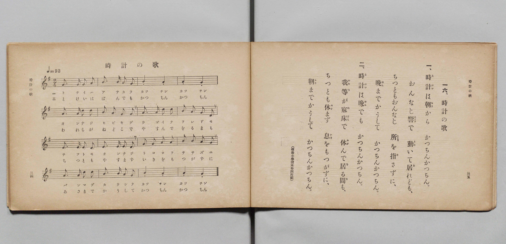

# 時計の歌

> Re:Shōka 使用 AI 協助辨識與重建樂譜，可能會有錯誤。歡迎回報。

- **鋼琴伴奏版**：<br><audio controls src="tokei_no_uta.mp3"></audio>

- 文部省《尋常小學唱歌 第二學年用》（明治四十四年六月，4102）

## 說明

原書資訊與歌詞全文（對應 P020.jpg，原書 pp. 34–35，第二學年第 16 首）：
調性與拍號：ト長調（G 大調）2/4 拍，♩= 92
出處註記：（尋常小學讀本卷四所載）


## 歌詞

```text
一、
時計（とけい）は朝（あさ）から　かつちんかつちん。
おんなじ響（ひゞき）で　動（うご）いて居（を）れども、
ちつともおんなじ　所（ところ）を指（さ）さずに、
晚（ばん）までかうして　かつちんかつちん。

二、
時計（とけい）は晚（ばん）でも　かつちんかつちん。
我等（われら）が寢床（ねどこ）で　休（やす）んで居（を）る間（ま）も、
ちつとも休（やす）まず　息（いき）をもつがずに、
朝（あさ）までかうして　かつちんかつちん。
```

## ABC

<div class="abc-score" data-abc-src="tokei_no_uta.abc" aria-label="五線譜載入中"></div>

[下載 ABC 原始檔](tokei_no_uta.abc)

## TMD 檔案連結

- [主旋律 TMD 檔案](tokei_no_uta.tmd) [[在 TMD Studio 編輯](https://tmdlang.github.io/Tmd-TS/#tmd=s7IKdvYPcrWy4qpTUCpJTLdSSM7PyUlNLsnMz7PKyszLyo8vzshPT8wuBdHZiUpwdWX5OaW5qVbpRYkpqfFG8SaGBkYIyeL80qLkVKvi5Iz8_Jz4ktSKkqT8_Gx0-fiCxPRUqwADIwOETEFRfllqXmIeUHdBUWZeSWoKWDtCQWpZZkoqSLostSgzLTM1BclJqUXFIHdDTS8pSswrTi7KLAB5BqEqv6gE6KOixIKMSquMzOKS_KLM5MSc-OzEPCTflWSkAj2XkpiZUxmfk5mWiqw9Mz0zzyo3Py-pFBgkSlxaWgrPZja9WNHxuHHds7U9ClpaXIq2CpZGXPa2Cu5cNkb6JnYgzc-mtb9sXvF8TuPjhq6nG7qf7tjxdEP_07U7nk7ZCNL1fM2aJ7t6QPydW55PWfG4ofv9no5nM_qebdr9dPbsp72NIHLnlqeta5_N6Xi_pwcU3u_3dCpxcelrKdhSC3ApKCg87Zv_bPaOF5vbX6zoetHRDnTci5XznrauAHoA6KSnG3qftXcqgCJNL6sgHegSiHqFggI9BWOTRw2TjU2BgijeWbNGwdBM4eWyaUAHv98zC2TJi1X7nzUsBxnf3fti5nyg6OPmjpdTtwPFgZa4KzxdshzM7AQGnwJQDdDIRzNXgoMV5MT2XS9mTn2xYveLFTOAWsHOQoToi3UNz-asedq7HRhkzzobXoAs7eQC6Xuyo-FxQyOIBYkxoMbHjSseN0583NgCVPO4cf2zOXPBgk2PG6eCRbofN3U-bmgAMRqXPG5c-LhpMgq7oQlkHFhFF1hu1ePGGS_ng3zxuHHT46Z5jxuBjgcatByo5mk30FCgeNvjxilgwZbHjcuebmwFCTZNAok09TxuXPm4qQnqTJAlIKtWgISQLACaBfQZzPmTHzeB7Wia9KwHFEcwt0993DjrceNqmFlAPTNBYfW4cQPQILCKfSB3gbwDdNF0oFsI-BQchrt6CIUhui3LwR4iIgyfdUx8vhYYW8DQ6AcFRRMo5h439jxdv-jpri6woWtB4dMIM7eh4cmeiWD1wJCcCQ4DoNHLUYO0--U0oHqg3n1gLrawRTcFFDCzQA5qXA_WCRSHhjA4IoC6gPGEFrboKYfEsAWaQnn-hQIFLX0urpD87NRMv_zQkkSrgMzEvHyHGoOaapA1CjaGZlp2YBa2sgNcFO1oeLGwR0HDRAGYpZ6vb9CBZ3hNLBqAtoEMq1EwVNAFQkMwbQTENQrGYBFjMA8kChOByINgDZwF0Q0UAZvmY1ijACwTwCKPmzYC8RIQq7kfrOdx0yKozFYgXg2WWQmVWf24uQVq1OPmxsfNm-E24ZGD2GkEVNO4AiLdOBGIQYqBSRqiu3ED1M7JQPZyMKsJKgOKS5i54ChF2IlbDpyfcMfBrh5y4gASmkYKpkAShCEhDgt_SBzgV2MajxoJTaug4bUZiLvA3t4B8VrzJLA4yEOPm9aC2e3QgF4GDaot8Ihrg-rZBOatAZOdYBIUlUgR0ASKYpDeHiAGq2jsgQYl2I5GUEQDywAwCYoGkB5IrAKzLzh6kGXAbmzqBovtQ0QagcDf0UlO4JuBgk4XRIFZkJDEIQqLDlCwIzILckQgZ4RGaBy0QDMFNNTwxg5YXRMoiT9uhsQOKOxBeraCZSDkLrAMKHyQM8FCaHgugWYIeFJHDmlIeDbOgsYOJLP0glVDQh2WPcApAByLENXAkpNwHACrb-plAEoKoQlIITwPzIKlcpAvQP5cBsTbwTLQVE5xIQQKOVA4TYWHMjQ9N4JiCsRvA-LpYBYor5FfCNVycenaKSBqi2gfw1gFNBEjsIgyFwA)]
- [鋼琴伴奏 TMD 檔案](tokei_no_uta_piano.tmd) [[在 TMD Studio 編輯](https://tmdlang.github.io/Tmd-TS/#tmd=s7IKdvYPcrWy4qpTUCpJTLdSSM7PyUlNLsnMz7PKyszLyo8vzshPT8wuBdHZiUpwdWX5OaW5qVbpRYkpqfFG8SaGBkYIyeL80qLkVKvi5Iz8_Jz4ktSKkqT8_Gx0-fiCxPRUqwADIwOETEFRfllqXmIeUHdBUWZeSWoKWDtCQWpZZkoqSDoxOTk_tyAxLzM3NQ9Jviy1qBjkeKgVJUWJecXJRZkFIB8hVOUXlQC9VZRYkFFplZFZXJJflJmcmBOfnZiH5MWSjFSgD1MSM3Mq43My01KRtWemZ-ZZ5ebnJZUCw0WJS0tL4dnMphcrOh43rnu2tuf9no6X3XueT9jyZM-Wp0v7n3d2vN_TqaClxaVoq2BpxGVvq-DOZWOkb2IHMvHZtPaXzSuez2l83ND1dEP30x07nm7of7p2x9MpG4FGKTxfs-bJrh4Qf-eW51NWPG7oBpr-bEbfs027n86e_bS3EUTu3PK0de2zOUBrekAxAbRNiYsrJD87NdMvP7Qk0SogMzEvP8jDocagpppLAQhsDM207MAsfS0FW3QAtnRHw4uFPQoaJgpA5zxf36CjAIopvayCdE0sGrT0wYbVKBgq6AKhIZg2AuIaBWOwiDGYBxKFiUDkQbAGzoLoBoqATfMxrFF43NwBFnnctBGIl4BYzf1gPY-bFkFltgLxarDMSqjM6sfNLVCjHjc3Pm7eDLcJjxzETiOgmsYVEOnGiUAMUvy4cT1Ed-MGqJ2TgezlYFYTVKb7cSPIeRCNC0Eq4HbiluPCHwe7esiJA0hoGimYAkkQhoQ4LPwhcYBfjWk8aiQ0rYKG12Yg7gJ7ewfEa82TwOIgDz1uWgtmt0MDehk0qLbAI64NqmcTmLcGTHaCSVBUIkVAEyiKQXp7gBisorEHGpRgOxpBEf24EWwrOBpAeiCx-rhxJjh6kGXAbmzqBovtQ0QagcDf0UlO4JuBgk4XRIFZkJDEIQqLDlCwIzILckQgZ4RGaBy0QDMFNNTwxg5YXRMoiT9uhsQOKOxBeraCZSDkLrAMKHyQM8FCaHgugWYIeFJHDmlIeDbOgsYOJLP0glVDQh2WPcApAByLENWPG0FZlkAcAMs26mUASgqhCUghPA_MgqVykC9A_lwGxNvBMtBUTnEhBAo5UDhNhYcyND03gmIKxG8D4ulgFiivkV8I1WJWFj7IlYUJtK4Apth4BeN4bWDyRWeaxoMYIBLIgfgCwjXCVI4mDNYK1WECZJvFx2uDDEHlwO1AGITfFkxHAb2pa6eA8Gm0j2GsApqIEVhEmQsA)]

## 分析

```text
================================================================================
📊 TMD Song Profile: [ 時計の歌 ]
================================================================================
⏱  Duration:       0:41 (41.7s), 32 measures total
🎼 Key & Tempo:    首調基準 G, != 92.0 BPM, <2/4>
   - 分析範圍：      由實際發聲的音符與和弦推測調性；播放脈絡另行呈現
🎤 人聲音域:    D4 (MIDI 62) – D5 (MIDI 74) [跨度: 12 個半音 / 1.0 個八度, 難度: easy]
   - 最低音:  D4 in [TokeiNoUta[L1] #1 @ m.8, 0:10]
   - 最高音: D5 in [TokeiNoUta[L1] #1 @ m.5, 0:05]
   - 適合: soprano, mezzo-soprano, contralto, tenor, baritone, bass
🏛  結構:      TokeiNoUta[L1] (20.9s) -> TokeiNoUta[L2] (20.9s)
⚡ 編曲密度:        Peak 1 軌道同時演奏
🗝  調性診斷：       D 大調（純淨自然大調，未偵測到可信轉調）
   - 風格氣質:    純淨自然大調（陽光明朗、易唱易記，無明顯調外色彩）
   - 轉調歷程:    全曲維持單一推測調性（未偵測到可信轉調）
   - 核心骨幹音:  A, G, B, D, E
   - 調性數值:    D 大調 [相關度: 0.68, 穩定度: Moderate, 自然音純度: 100.0%]
   - 候選調性 (K-S): D 大調 (0.68), G 大調 (0.64), A 大調 (0.55)
   - 五度圈歷程:   +2 -> +2
   - 各段落調性細節:
     • [TokeiNoUta[L1] #1]: D 大調 (r: 0.68, 自然音純度: 100.0%)
     • [TokeiNoUta[L2] #1]: D 大調 (r: 0.68, 自然音純度: 100.0%)

  [ 五度圈游移軌跡 ]
               C  
         F            G  
      Bb              [D ]*
      Eb               A  
         Ab           E  
            Db       B  
               F# 
     (* = active key center)

  [ 十二半音累積音高分佈 ]
     C  :                            0.0%
     C# :                            0.0%
     D  : ██████████                14.1%
     D# :                            0.0%
     E  : ███████                    9.4%
     F  :                            0.0%
     F# :                            0.0%
     G  : ████████████████          23.4%
     G# :                            0.0%
     A  : ████████████████████████  34.4%
     A# :                            0.0%
     B  : █████████████             18.7%
--------------------------------------------------------------------------------
Assignment 軌道音域：
  - Piano         : D4 – D5 (12 個半音 / 1.0 個八度, 112 個音符)
================================================================================
```


## 原書掃描頁




