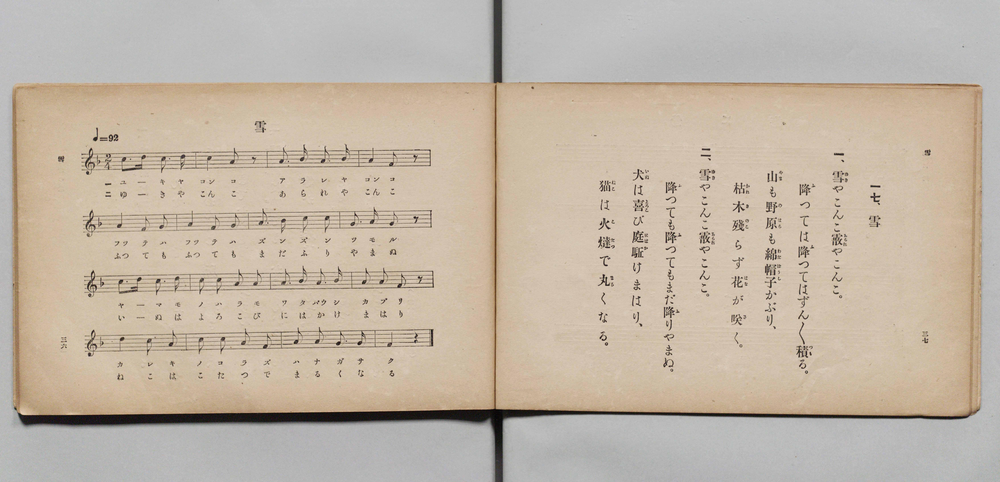

# 雪

> Re:Shōka 使用 AI 協助辨識與重建樂譜，可能會有錯誤。歡迎回報。

- **鋼琴伴奏版**：<br><audio controls src="yuki.mp3"></audio>

- 文部省《尋常小學唱歌 第二學年用》（明治四十四年六月，4102）

## 說明

原書資訊與歌詞全文（對應 P021.jpg，原書 pp. 36–37，第二學年第 17 首）：
調性與拍號：ヘ長調（F 大調）2/4 拍，♩= 92


## 歌詞

```text
一、
雪（ゆき）やこんこ霰（あられ）やこんこ。
降（ふ）つては降（ふ）つてはずん／＼積（つも）る。
山（やま）も野原（のはら）も綿帽子（わたばうし）かぶり、
枯木殘（かれきのこ）らず花（はな）が咲（さ）く。

二、
雪（ゆき）やこんこ霰（あられ）やこんこ。
降（ふ）つても降（ふ）つてもまだ降（ふ）りやまぬ。
犬（いぬ）は喜（よろこ）び庭驅（にはか）けまはり、
猫（ねこ）は火燵（こたつ）で丸（まる）くなる。
```

## ABC

<div class="abc-score" data-abc-src="yuki.abc" aria-label="五線譜載入中"></div>

[下載 ABC 原始檔](yuki.abc)

## TMD 檔案連結

- [主旋律 TMD 檔案](yuki.tmd) [[在 TMD Studio 編輯](https://tmdlang.github.io/Tmd-TS/#tmd=s7IKdvYPcrWy4qpTUCpJTLdSSM7PyUlNLsnMz7PKyszLyo8vzshPT8wuBdHZiUpwdWX5OaW5qVbpRYkpqfFG8SaGBkYIyeL80qLkVKvi5Iz8_Jz4ktSKkqT8_Gx0-fiCxPRUqwADI0OETEFRfllqXmIeUHdBUWZeSWoKWDtCQWpZZkoqSLostSgzLTM1BclJqUXFIHdDTS8pSswrTi7KLAB5BqEqv6gE6KOixIKMSquMzOKS_KLM5MSc-OzEPCTflWSkAj1XnpoIZBShCxenJhbn5xUjG5mZnplnlZufl1QKDCYlLi0thZezVyloaXEp2ipYGnHZ2yq4cdkY6ZvYgfQ8m9b-snnF8zmNjxu6nm7ofrpjx9MN_U_X7ng6ZeOztT0Kz9esebKrB8TfueX5lBWPG7rf7-l4NqPv2abdT2fPftrbCCJ3bnnauvbZnI73e3pAQf9-T6cSF5e-loIttQCXgoLC0775z2bveLG5_cWKrhcd7UDHvVg572nrCqAHgE56uqH3WXunAij-9LIK0oEugahXKCjQUzA2e9Qw2dgcKIjinTVrFAzNFV4umwZ08Ps9s0CWvFi1_1nDcpDx3b0vZs4Hij5unvFy6nagONASN4WnS5aDmZ3A4FMAqgEa-WjmSnCwgrQ_2dHwuKERxAKGOFDD46a2x41ARZ2Pm1oeN05-3DQZSL6cswEk1dj0uAko3oMm-7ihCaT_cUPDy5lAnUB1W0EqGpc8blz2uHE9VsHHjbOAmt_v6X-_Z8_zlRAFSx43NYGN7kaYCERPN24Euwto4T6wdNPL9j5gUIH1rAOZ1QQMC5D48237n-7Y-3TtBLD6_seN8x83bnjcCPTQdLDd3Y8btz1u6oL6F2I6ED2bt_7ZnBXP1s0Am9gN9CAwBMBGAx0INBeoc9aLLrAjQA4HhhJQpOfppE1gkalgbj_IyeDw3NVD0_AE-h6bIDBsHjcuQJECehQcZo8b16CE5_OuNWBFQDkgA2jE-qfT5oBdCkRAf4M93bj56a61L1e2glWuBvsbmI2A4hPBJgLDHCMYn_esBqteCzNi_fPG1c_bgW4BCgL9BYyMJWDx5U927AAL7gNGNTT0Glchop3yzAcFClr6XFyRpdmZVgGZiXn5DjUGNdUgCxRsDM207MAsbFkeXILsaHixsEdBw0QBWLY8X9-gA8-nmlg0AO0BGVajYKygC4SmCmZgUhcqYgjERkBsABYBsUCiIHmQuhowCyYCVgM2zcewRuFx8zKwiboKj5vWgsjmJWAdj5s2g3lgEsyOh4ovAouvBJNrCOuA2GQEkm-D2dTYC1bTAtHXOBnMA5NgNtSmxiaweCeY7CGsA5w7cIf3rh5ywhsUfqBwg4UyNhFQeIPCHyQCYteAxUEhji28p0LCoLkFiEEh8ri5H-Ir3DJNu6Aym6FsSCiD9IBCBMRfBMSrMcO8cSs0xJcAMSimgTkZGoa4ZfZBZRZAVQGzItQdUNuAKoBZm8hw39FJTriDQg6UemEpFxLuMB5yKJvFw5M_JDPAFKEHPCiZQgJrHjTIIEHYBw9qWLKGyayHqG_aD2RPeNwECaXt0LAAhfbj5mlgchWWkIeEFSi0wLmkEWQYSF8H2BRwDoCk40ZoXDaCTISoBJaFYNZEpBiBmACJCyLCHdgGIT-9IwIREsrIJQosvSOrAYmA1IGCHASRgh0cTpBgB4cDuJSBBzu0zAAHOzhlg2RAUQHRAfLr4yaQPpBJkLQICgWQ_5HsAYc3yFxI-EFCFRreUN58MAlKAsDqASlUIREMCW1obmsExSZEDGFPLReXrp0CqKiP9jGMVYCzjcBsZS4A)]
- [鋼琴伴奏 TMD 檔案](yuki_piano.tmd) [[在 TMD Studio 編輯](https://tmdlang.github.io/Tmd-TS/#tmd=s7IKdvYPcrWy4qpTUCpJTLdSSM7PyUlNLsnMz7PKyszLyo8vzshPT8wuBdHZiUpwdWX5OaW5qVbpRYkpqfFG8SaGBkYIyeL80qLkVKvi5Iz8_Jz4ktSKkqT8_Gx0-fiCxPRUqwADI0OETEFRfllqXmIeUHdBUWZeSWoKWDtCQWpZZkoqSDoxOTk_tyAxLzM3NQ9Jviy1qBjkeKgVJUWJecXJRZkFIB8hVOUXlQC9VZRYkFFplZFZXJJflJmcmBOfnZiH5MWSjFSgD8tTE4GMInTh4tTE4vy8YmQjM9Mz86xy8_OSSoFhpcSlpaXwcvaq93s6XnbveT5hy5M9W54u7X_e2fF-T6eClhaXoq2CpRGXva2CG5eNkb6JHcigZ9PaXzaveD6n8XFD19MN3U937Hi6of_p2h1Pp2x8trZH4fmaNU929YD4O7c8n7LicUM30PRnM_qebdr9dPbsp72NIHLnlqeta5_NAVrTA4oUoG1KXFyRpdmZVgGZiXn5QR4ONQY11VwKQGBjaKZlB2bpaynYogOwdTsaXizsUdAwUQA65Pn6Bh0FUHTpZRWka2LRoKUPNqxGwVhBFwhNFczApC5UxBCIjYDYACwCYoFEQfIgdTVgFkwErAZsmo9hjcLj5mVgE3UVHjetBZHNS8A6HjdtBvPAJJgdDxVfBBZfCSbXENYBsckIJN8Gs6mxF6ymBaKvcTKYBybBbKhNjU1g8U4w2UNYBxf-8N7VQ054g8IPFG6wUMYmAgpvUPiDREDsGrA4KMSxhfdUSBg0twAxKEQeN_dDfIVbpmkXVGYzlA0JZZAeUIiA-IuAeDVmmDduhYb4EiAGxfTjJlCo4pfZB5VZAFX1uKkL6g6obUAVjxtBcU9MuO_oJCfcQSEHSr2wlAsJdxgPOZTN4uHJH5IZYIrQAx6UTCGBNQ8aZJAg7IMHNSxZw2TWQ9Q37QeyJzxugoTSdmhYgEL7cfM0MLkKS8hDwgoUWuBc0ggyDKSvA2wKOAdA0nEjNC4bQSZCVD5u7AazJiLFCMQESFwQEe7AAov89I4IREgoI5cosPSOrAYkAlIHCnIQRAp2cDhBgh0cDuBSBh7s0DIDHOzglA2SAUUFRAfIr4-bQPpAJkHSIigUQP5Hsgcc3iBzIeEHCVVoeEN588EkKAk8blyOFKqQCIaENjS3NYJiEyKGsKcWuaT3QS7pTaAFPTCk4hVM47UNYax4UDIGkkbx2qYgNlDQAOriGgWTeGDCBasFsoAyeJQijAUqhRhrBiTBmtDNhAlCNYBUww0HMUD-0LVTAHkl2scwVgHONgKzlbkA)]

## 分析

```text
================================================================================
📊 TMD Song Profile: [ 雪 ]
================================================================================
⏱  Duration:       0:41 (41.7s), 32 measures total
🎼 Key & Tempo:    首調基準 F, != 92.0 BPM, <2/4>
   - 分析範圍：      由實際發聲的音符與和弦推測調性；播放脈絡另行呈現
🎤 人聲音域:    D4 (MIDI 62) – D5 (MIDI 74) [跨度: 12 個半音 / 1.0 個八度, 難度: easy]
   - 最低音:  D4 in [Yuki[L1] #1 @ m.11, 0:13]
   - 最高音: D5 in [Yuki[L1] #1 @ m.1, 0:00]
   - 適合: soprano, mezzo-soprano, contralto, tenor, baritone, bass
🏛  結構:      Yuki[L1] (20.9s) -> Yuki[L2] (20.9s)
⚡ 編曲密度:        Peak 1 軌道同時演奏
🗝  調性診斷：       C 調性不明確（純淨自然大調，未偵測到可信轉調）
   - 風格氣質:    純淨自然大調（陽光明朗、易唱易記，無明顯調外色彩）
   - 轉調歷程:    全曲維持單一推測調性（未偵測到可信轉調）
   - 核心骨幹音:  A, C, G, D, F
   - 調性數值:    C 調性不明確 [相關度: 0.74, 穩定度: Ambiguous, 自然音純度: 100.0%]
   - 候選調性 (K-S): C 大調 (0.74), A 小調 (0.72), F 大調 (0.72)
   - 五度圈歷程:   +0 -> +0
   - 各段落調性細節:
     • [Yuki[L1] #1]: C 調性不明確 (r: 0.74, 自然音純度: 100.0%)
     • [Yuki[L2] #1]: C 調性不明確 (r: 0.74, 自然音純度: 100.0%)

  [ 五度圈游移軌跡 ]
              [C ]*
         F            G  
      Bb               D  
      Eb               A  
         Ab           E  
            Db       B  
               F# 
     (* = active key center)

  [ 十二半音累積音高分佈 ]
     C  : ██████████████████████    24.1%
     C# :                            0.0%
     D  : ██████████████            15.5%
     D# :                            0.0%
     E  :                            0.0%
     F  : ██████████████            15.5%
     F# :                            0.0%
     G  : ██████████████████        19.0%
     G# :                            0.0%
     A  : ████████████████████████  25.9%
     A# :                            0.0%
     B  :                            0.0%
--------------------------------------------------------------------------------
Assignment 軌道音域：
  - Piano         : D4 – D5 (12 個半音 / 1.0 個八度, 112 個音符)
================================================================================
```


## 原書掃描頁




