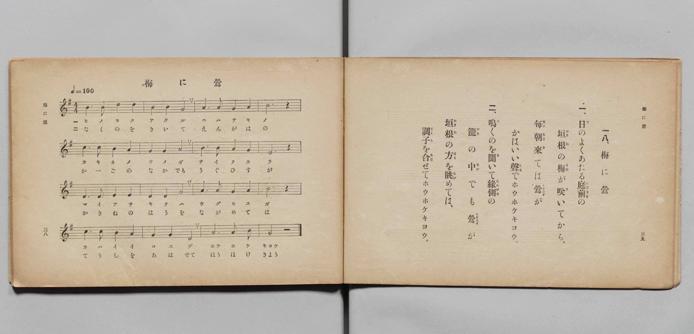

# 梅に鶯

> Re:Shōka 使用 AI 協助辨識與重建樂譜，可能會有錯誤。歡迎回報。

- **鋼琴伴奏版**：<br><audio controls src="ume_ni_uguisu.mp3"></audio>

- 文部省《尋常小學唱歌 第二學年用》（明治四十四年六月，4102）

## 說明

原書資訊與歌詞全文（對應 P022.jpg，原書 pp. 38–39，第二學年第 18 首）：
調性與拍號：ト長調（G 大調）4/4 拍，♩= 100


## 歌詞

```text
一、
日（ひ）のよくあたる庭前（にはさき）の
垣根（かきね）の梅（うめ）が咲（さ）いてから、
每朝來（まいあさき）ては鶯（うぐひす）が
かはいい聲（こゑ）でホウホケキヨウ。

二、
鳴（な）くのを聞（き）いて緣側（えんがは）の
籠（かご）の中（なか）でも鶯（うぐひす）が
垣根（かきね）の方（はう）を眺（なが）めては、
調子（てうし）を合（あは）せてホウホケキヨウ。
```

## ABC

<div class="abc-score" data-abc-src="ume_ni_uguisu.abc" aria-label="五線譜載入中"></div>

[下載 ABC 原始檔](ume_ni_uguisu.abc)

## TMD 檔案連結

- [主旋律 TMD 檔案](ume_ni_uguisu.tmd) [[在 TMD Studio 編輯](https://tmdlang.github.io/Tmd-TS/#tmd=s7IKdvYPcrWy4qpTUCpJTLdSSM7PyUlNLsnMz7PKyszLyo8vzshPT8wuBdHZiUpwdWX5OaW5qVbpRYkpqfFG8SaGBkYIyeL80qLkVKvi5Iz8_Jz4ktSKkqT8_Gx0-fiCxPRUqwADIySdBUX5Zal5iXlA3QVFmXklqSlg7QgFqWWZKakg6bLUosy0zNQUJCelFhWD3A01vaQoMa84uSizAOQZhKr8ohKgj4oSCzIqrTIyi0vyizKTE3PisxPzkHxXkpEK9FxiXmZuYg66aEFOYh6Sg4D60zPzrHLz85JKgWGkxKWlpfBsUevjxtUvt61X0NLiUrRVMDQw4LK3VXDnsjHRN7EDaX02rf1l84rncxofN3Q93dD9dMeOpxv6n67d8XTKxmdrexSer1nzZFcPiL9zy_MpKx43dL_f0_FsRt-zTbufzp79tLcRRO7c8rR17bM5He_39ICC__2eTiUuLn0tBVtqAS4FBYWnffOfzd7xYnP7ixVdLzragY57sXLe09YVQA8AnfR0Q--z9k4FUBzqZRWkA10CUa9QUKCnYGzxqGGysSVQEMU7a9YoGFoovFw2Dejg93tmgSx5sWr_s4blIOO7e1_MnA8Ufdzc8XLqdqA40BJ3hadLloOZncDgUwCqARr5aOZKSLiC9D_Z0fC4oRHEejZ9KVDH48ZNQMWPG9c9bgKy-x83Nj1unP-4qfvprrVPO4G6gYKrHzeuf9w49XEjkAtSCdL8uKHh6bzFzxbsBKvoBso9blwLkQbGKFiw7XFTI1ik5-kkoB1AkalgbsvjxmUgLU2dUIcAzQKiZ-v7n82Z-2RfG1jpPrA6oFvg1gL1rAcmE6jRjROADn_cOBNiAcIUEAI5B-hgoP6WFyDfATVMftw0Eax0-ePm2Y-bloHJjY-b1j5uXgHiNjRBAmdXD9RNLzdvAWtcBdYFDBZg-Ex60TgPLAhxEMgfz7cvftoIUdnxuGky0ClAq1FC6fnGBbAgmgKReLIDGFAgo4GCUDc1NRH2Gc7gngYRBPoYGHSdQGc-n7MLZkEPWKQREnoowQ1EwHTydO0EsFKgNNDm6RD9TycA8wlQEBj6EL_MBinAFW5AEynPPlCgoKXPxRWam-qXGZpemllcahWQmZiX71BjUFMNskfBxkLLDszAlnXBJcGOhhcLexQ0TBSAZcTz9Q068PymiUUD0DaQYTUKxgq6QGiqYAYmdaEiIJYRWAYkYgimjeAyNWDVMGgAEgGb5mNYo_C4eRJY9HFzHxCvALGa1oP1PG5aBObtB8uuhpv-uLkbqqMfKLsVrGYtVKYPyZ54hD1GQLnGVRBdjUBdjevAukA2g2R6weItYHIZwp7GDoiOpslAdg9YFuoysH5Ue_CH9a4ecsIaFHa6wLAD0aCwrAGHMSxUIa4E8UCioDA3AztFwRRE4QjtJkg4gkLscTPY3-AwA8mAfP64eSFYdg0iFKAhvAQs2wZmg8wAhfZKPKENiSNQmE0Bk6AQg8UCRBaSm5GCG2x44wQwuQlMzoTKgAKflODe0UlWcIOMBochKDBBGBLgsECHuBMS9MZwUZgI9sQ9DxF40OQMCk5QsIKSLDRAgQkZEdyQBPi4aQM0azxu2gmVgUUKruCGJWSwyfAAByVZaNiCEzwstGHZoQco3ghmgWyG6SAhtIGNBnJCG1aAgMIQEdYgHjgKIM6ElCQQCCpPECKggAarQUvbkMCEBTmIBMlsBstsBJPtiEAAF9RIVgAFgIo3QuIHUm4jhQOSdeAwB2cYaKqdDg9fkAwoVcNCHlQjIAX7bogOuI2Nu4F4IqQYArcrYLIIG2u5uHTtFJDK-mgfw1gFdCEjsJAyFwA)]
- [鋼琴伴奏 TMD 檔案](ume_ni_uguisu_piano.tmd) [[在 TMD Studio 編輯](https://tmdlang.github.io/Tmd-TS/#tmd=s7IKdvYPcrWy4qpTUCpJTLdSSM7PyUlNLsnMz7PKyszLyo8vzshPT8wuBdHZiUpwdWX5OaW5qVbpRYkpqfFG8SaGBkYIyeL80qLkVKvi5Iz8_Jz4ktSKkqT8_Gx0-fiCxPRUqwADIySdBUX5Zal5iXlA3QVFmXklqSlg7QgFqWWZKakg6cTk5PzcgsS8zNzUPCT5stSiYpDjoVaUFCXmFScXZRaAfIRQlV9UAvRWUWJBRqVVRmZxSX5RZnJiTnx2Yh6SF0syUoE-BNmQmIMuWpCTiGwrUH96Zp5Vbn5eUikwoJS4tLQUni1qfdy4-uW29e_3dLzs3vN8wpYne7Y8Xdr_vLPj_Z5OBS0tLkVbBUMDAy57WwV3LhsTfRM7kHnPprW_bF7xfE7j44aupxu6n-7Y8XRD_9O1O55O2fhsbY_C8zVrnuzqAfF3bnk-ZcXjhm6g8c9m9D3btPvp7NlPextB5M4tT1vXPpsDtKcHFDFA65S4uEJzU_0yQ9NLM4tLrQIyE_PygzwcagxqqrkUgMDGQssOzNDXUrBFB2BLdzS8WNijoGGiAHTO8_UNOgqgiNPLKkjXxKJBSx9sWI2CsYIuEJoqmIFJXagIiGUElgGJGIJpI7hMDVg1DBqARMCm-RjWKDxungQWfdzcB8QrQKym9WA9j5sWgXn7wbKr4aY_bu6G6ugHym4Fq1kLlelDsiceYY8RUK5xFURXI1BX4zqwLpDNIJlesHgLmFyGsKexA6KjaTKQ3QOWhboMrB_VHvxhvauHnLAGhZ0uMOxANCgsa8BhDAtViCtBPJAoKMzNwE5RMAVROEK7CRKOoBB73Az2NzjMQDIgnz9uXgiWXYMIBWgILwHLtoHZIDNAob0ST2hD4ggUZlPAJCjEYLEAkX3cuPxxUxNScIMNb5wAJjeByZlQGVDgkxLcOzrJCm6Q0eAwBAUmCEMCHBboEHdCgt4YLgoTwZ645yECD5qcQcEJClZQkoUGKDAhI4IbkgAfN22AZo3HTTuhMrBIwRXcsIQMNhke4KAkCw1bcIKHhTYsO_QAxRvBLJDNMB0khDawfCIntGEFCCgMEWEN4oGjAOJMSEkCgaDyBCECCmiwGrS0DQlMWJCDSJDMZrDMRjDZjgiE5tmw8IYm1ubZQMUbIfEDLI0QsnAnIYU5OMNAU-10ePiCZECpGhbys1HLlN0QHXAbG3cD8URIMfS4qQMhi7CxFktR74Nc1JtAi3pg6MQrGMdrAxOySTwwGLUNkYVM4-MVjMAsJEE4owauBUgbQP2JXSHCICRBONMMKGsYr22MqhLEQpiK1QT8xuJyPcJQmPuxGonsKmTtIBVIIgZg84ABrmungBTm0T6GsQroQkZgIWUuAA)]

## 分析

```text
================================================================================
📊 TMD Song Profile: [ 梅に鶯 ]
================================================================================
⏱  Duration:       1:16 (76.8s), 32 measures total
🎼 Key & Tempo:    首調基準 G, != 100.0 BPM, <4/4>
   - 分析範圍：      由實際發聲的音符與和弦推測調性；播放脈絡另行呈現
🎤 人聲音域:    D4 (MIDI 62) – E5 (MIDI 76) [跨度: 14 個半音 / 1.2 個八度, 難度: moderate]
   - 最低音:  D4 in [UmeNiUguisu[L1] #1 @ m.8, 0:16]
   - 最高音: E5 in [UmeNiUguisu[L1] #1 @ m.1, 0:01]
   - 適合: soprano, mezzo-soprano, contralto, tenor, baritone, bass
🏛  結構:      UmeNiUguisu[L1] (38.4s) -> UmeNiUguisu[L2] (38.4s)
⚡ 編曲密度:        Peak 1 軌道同時演奏
🗝  調性診斷：       D 調性不明確（純淨自然大調，未偵測到可信轉調）
   - 風格氣質:    純淨自然大調（陽光明朗、易唱易記，無明顯調外色彩）
   - 轉調歷程:    全曲維持單一推測調性（未偵測到可信轉調）
   - 核心骨幹音:  D, B, G, E, A
   - 調性數值:    D 調性不明確 [相關度: 0.80, 穩定度: Ambiguous, 自然音純度: 100.0%]
   - 候選調性 (K-S): D 大調 (0.80), G 大調 (0.78), B 小調 (0.70)
   - 五度圈歷程:   +2 -> +2
   - 各段落調性細節:
     • [UmeNiUguisu[L1] #1]: D 調性不明確 (r: 0.80, 自然音純度: 100.0%)
     • [UmeNiUguisu[L2] #1]: D 調性不明確 (r: 0.80, 自然音純度: 100.0%)

  [ 五度圈游移軌跡 ]
               C  
         F            G  
      Bb              [D ]*
      Eb               A  
         Ab           E  
            Db       B  
               F# 
     (* = active key center)

  [ 十二半音累積音高分佈 ]
     C  :                            0.0%
     C# :                            0.0%
     D  : ████████████████████████  29.7%
     D# :                            0.0%
     E  : █████████████             16.1%
     F  :                            0.0%
     F# :                            0.0%
     G  : ██████████████            17.8%
     G# :                            0.0%
     A  : ████████████              15.3%
     A# :                            0.0%
     B  : █████████████████         21.2%
--------------------------------------------------------------------------------
Assignment 軌道音域：
  - Piano         : D4 – E5 (14 個半音 / 1.2 個八度, 94 個音符)
================================================================================
```


## 原書掃描頁




