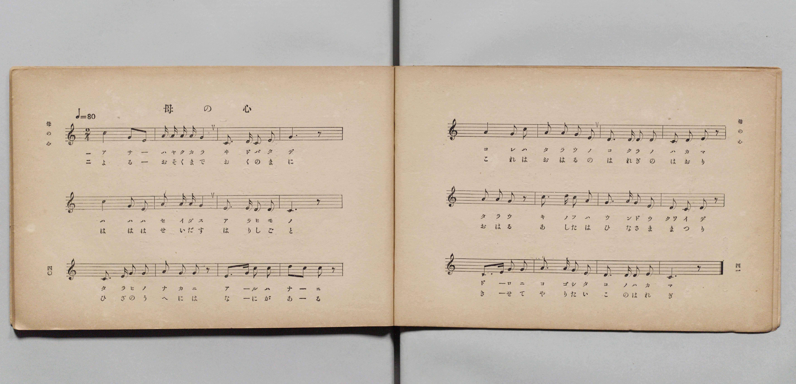
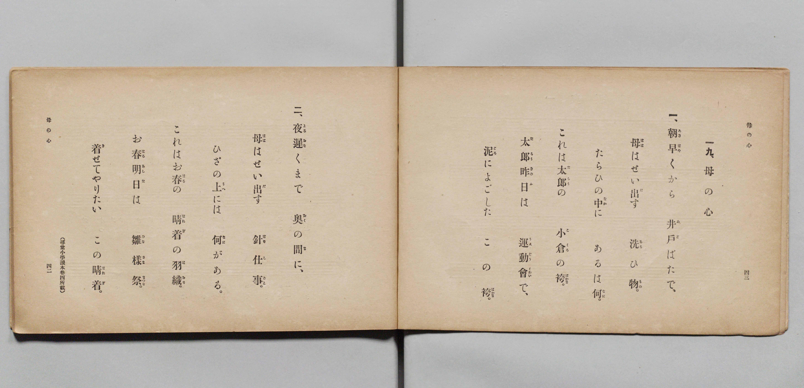

# 母の心

> Re:Shōka 使用 AI 協助辨識與重建樂譜，可能會有錯誤。歡迎回報。

- **鋼琴伴奏版**：<br><audio controls src="haha_no_kokoro.mp3"></audio>

- 文部省《尋常小學唱歌 第二學年用》（明治四十四年六月，4102）

## 說明

原書資訊與歌詞全文（對應 P023.jpg–P024.jpg，原書 pp. 40–43，第二學年第 19 首）：
調性與拍號：ハ長調（C 大調）2/4 拍，♩= 80
出處註記：（尋常小學讀本卷四所載）


## 歌詞

```text
一、
朝早（あさはや）くから　井戶（ゐど）ばたで、
母（はゝ）はせい出（だ）す　洗（あら）ひ物（もの）。
たらひの中（なか）に　あるは何（なに）。
これは太郎（たらう）の　小倉（こくら）の袴（はかま）。
太郎昨日（たらうきのふ）は　運動會（うんどうくわい）で、
泥（どろ）によごした　この袴（はかま）。

二、
夜遲（よるおそ）くまで　奧（おく）の間（ま）に、
母（はゝ）はせい出（だ）す　針仕事（はりしごと）。
ひざの上（うへ）には　何（なに）がある。
これはお春（はる）の　晴着（はれぎ）の羽織（はおり）。
お春明日（はるあした）は　雛樣祭（ひなさままつり）。
着（き）せてやりたい　この晴着（はれぎ）。
```

## ABC

<div class="abc-score" data-abc-src="haha_no_kokoro.abc" aria-label="五線譜載入中"></div>

[下載 ABC 原始檔](haha_no_kokoro.abc)

## TMD 檔案連結

- [主旋律 TMD 檔案](haha_no_kokoro.tmd) [[在 TMD Studio 編輯](https://tmdlang.github.io/Tmd-TS/#tmd=s7IKdvYPcrWy4qpTUCpJTLdSSM7PyUlNLsnMz7PKyszLyo8vzshPT8wuBdHZiUpwdWX5OaW5qVbpRYkpqfFG8SaGBkYIyeL80qLkVKvi5Iz8_Jz4ktSKkqT8_Gx0-fiCxPRUqwADI2OETEFRfllqXmIeUHdBUWZeSWoKWDtCQWpZZkoqSLostSgzLTM1BclJqUXFIHdDTS8pSswrTi7KLAB5BqEqv6gE6KOixIKMSquMzOKS_KLM5MSc-OzEPCTflWSkAj2XlpibmVOJrDUzPTPPKjc_L6kUGBxKXFpaCs_W9z5uXPd0f7OClhaXoq2ChQGXva2CM5eNkb6JHUjns2ntL5tXPJ_T-Lih6-mG7qc7djzd0P907Y6nUzY-W9uj8HzNmie7ekD8nVueT1nxuKH7_Z6OZzP6nm3a_XT27Ke9jSBy55anrWufzel4v6cHFNDv93QqcXHpaynYUgtwKSgoPO2b_2z2jheb21-s6HrR0Q503IuV8562rgB6AOikpxt6n7V3KoBiSy-rIP1Rw2Qg0wTEBDoKolWhoEBPwcQAKGViDBRE8dmaNQqGlgovl00Duv39nlkg-16s2v-sYTnIpu7eFzPnA0UfN_e_nLodKA60z1nh6ZLlYGYnMCQVgGqARj6auRIcwiDXtu96MXPqixW7X6yYAdQKdiEicF-sa3g2Z83T3u3A0HvW2fACZGknF0jfkx0NjxsaQaxnc-Y-m74SqPFxY9PjxqmPG9c_bmoBKnvc2P-4sftxU-fjhoYnu6Y-69gGUtM04XEjUDFQdsPjxvmPG5dDTQEqAiYBsClA_XPBKtY_bpz9uLEF6ESw-AKw4EyQyi3TofY1gRz0uHHT806wC5qALlgHEmloghoKQkB7gK5o3ASUe7JjLVjnKqDTwDpXgxUADeoG2vdk71SY7GokUxonP27qAUo_XbLqZXMfWAXExDawEeuARoCCqwHoFqDUZJDHoe5a92LRFqifgEHRuA_FaRDjns1Y8Wz6UmRDHzeCssLjxq3QQGhoeNnY_bR76rM5zWBlbY-bgHasBKsE2gQMZUhwIwUlKIw2Qwxd-bgJGKxgnzYBuVMeN04H2QTyNdAUHA4Ex_CuHqiBT5fMedm4CRy-QARU1vW4ERJDQLv3gS1ueLp0OdgcoFQ_xOsvp00Gi4DNBIUz6fH8sn3uk91Tn-wC5WWweqDpQNcD_bACM5KB0TsNHMNd0FBq3AG1GRyG6HHbCIxRcLSjRTLQC89mQIIOaCEkkYBi-NnMLc_nNsDEgSqBCQEk9Xzf3uc7p8DCsAvoRlSngY0DFUTQSAYZCs4poGhAxDAwf61Y_HwpJHUCvQJ0JjArAQMXiJZgGNrQAHMLJG6BwbcMmOvAAQTMVC3w6MXuaohBlBd3UKCgpc_F5ZGYkeiX752fnV-UbxWQmZiX71BjUFMNskjBxtBMyw7MwlbYgsvuHQ0vFvYoaJgoAHPS8_UNOvASUuHp9mUvFzQCo1UTi1agzSBjaxQM4xR0wdAMiE2BuAbMgmAzqIgxWIURmEaogUEDkAjYOB_DGoXHTYug4o-btkJZQNHmfpBI8xKw-HogXg3krYTKbYCob-4E4glgFfuhMu1I9sQj7DEC2dMBt6cbYU9jF0ikcS6Y7AfifUC8HEkOJr4OzNoHlVmNYQ_-YN_VQyjY15IT7LogCSOQHFgBTNAUHPJGYBFD3CEPDmNISEJCG0SCQmo3NJyWAMUawKydUBlIXIFi4nHzJDALJAIyqw93yDeuh9kDZkFIkPhsqGgLEC8As2ZCZSA6gPkMyJ4OlpkClVlBYsjv6CQU8t14Qx4UirrA8AQFOiLgQSwQDQ5RMA_EB0cCNCYQsQIm0BM9KMGiBiQoAEEBCU6QwOQOEgMlVLAnkbNJM0QOGllg9RBxuGqkoN8EDeJp8CTcBg3IHWAe2CxwcEPtaVwFjyyIXA9UvAkmDs4-RAQ9sC2DM-j7NxNR1sAKDVDwIqVvWNgjlzWmaCKgVA-KOfRg3wwPrDXIgQiODkj58rhpGXJ0QHWAyyCIPDyiwHkGGlHzsAT9ZHiAgYIQkeohJQ44J4CDEhIxyKm-B8gG2YIqA9UJzBNEljlTCAU__jIHM51DSyFg0gazQBKIxA-iQUEPyTK4IgA9oGGpey00WvqAeCpK1IBUgfibwQU-TB9IZv3jZnCSBpZTIAWgsh89DtDDGpbIIYkZVLYAK3KU2IFlmFVADHYIvMwH0cBGAilxAOwGEYoD_KUPcuqGBDc0DtDDG1ZEQUTwFfqgMISEKCjMIaUGSBxSsD5u2gLE28EsaKUKywLguEEkepAeULLHVej3wuwBF_PAhhPUtBaoPaCiHRL0IBFEhgEleliUwcoezMqllotL104BuTEU7WMYq4AhZgQWU-YCAA)]
- [鋼琴伴奏 TMD 檔案](haha_no_kokoro_piano.tmd) [[在 TMD Studio 編輯](https://tmdlang.github.io/Tmd-TS/#tmd=s7IKdvYPcrWy4qpTUCpJTLdSSM7PyUlNLsnMz7PKyszLyo8vzshPT8wuBdHZiUpwdWX5OaW5qVbpRYkpqfFG8SaGBkYIyeL80qLkVKvi5Iz8_Jz4ktSKkqT8_Gx0-fiCxPRUqwADI2OETEFRfllqXmIeUHdBUWZeSWoKWDtCQWpZZkoqSDoxOTk_tyAxLzM3NQ9Jviy1qBjkeKgVJUWJecXJRZkFIB8hVOUXlQC9VZRYkFFplZFZXJJflJmcmBOfnZiH5MWSjFSgD9MSczNzKpG1ZqZn5lnl5ucllQLDRIlLS0vh2frex43rnu5vfr-n42X3nucTtjzZs-Xp0v7nnR3v93QqaGlxKdoqWBhw2dsqOHPZGOmb2IGMezat_WXziudzGh83dD3d0P10x46nG_qfrt3xdMrGZ2t7FJ6vWfNkVw-Iv3PL8ykrHjd0A01_NqPv2abdT2fPftrbCCJ3bnnauvbZHKA1PaAoANqmxMXlkZiR6JfvnZ-dX5RvFZCZmJcf5OFQY1BTzaUABDaGZlp2YJa-loItOgBbu6PhxcIeBQ0TBaCDnq9v0FEARZJeVkG6wtPty14uaHyyo0sTi1YtfbCxNQqGcQq6YGgGxKZAXANmQbAZVMQYrMIITCPUwKABSARsnI9hjcLjpkVQ8cdNW6EsoGhzP0ikeQlYfD0QrwbyVkLlNkDUN3cC8QSwiv1QmXYke-IR9hiB7OmA29ONsKexCyTSOBdM9gPxPiBejiQHE18HZu2DyqzGsAd_sO_qIRTsa8kJdl2QhBFIDqwAJmgKDnkjsIgh7pAHhzEkJCGhDSJBIbUbGk5LgGINYNZOqAwkrkAx8bh5EpgFEgGZ1Yc75BvXw-wBsyAkSHw2VLQFiBeAWTOhMhAdj5u6gOzpYJkpUJkVJIb8jk5CId-NN-RBoagLDE9QoCMCHsQC0eAQBfNAfHAkQGMCEStgAj3RgxIsakCCAhAUkOAECUzuIDFQQgV7EjmbNEPkoJEFVg8Rh6tGCvpN0CCeBk_CbdCA3AHmgc0CBzfUnsZV8MiCyPVAxZtg4uDsQ0TQAwsxnEHfv5mIsgZWaICCFyl9w8IeuawxRRMBpXpQzKEH-2Z4YK1BDkRwdEDKl8dNy5CjA6oDXAZB5OERBc4z0IiahyXoJ8MDDBSEiFQPKXHAOQEclJCIQU71PUA2yBZUGahOYJ4gssyZQij48Zc5mOkcWgoBkzaYBZJAJH4QDQp6SJbBFQHoAQ1L3Wuh0dIHxFNRogakCsTfDC7wYfpAMusfN4OTNLCcAikAlf3ocYAe1rBEDknMoLLlceN8lNiBZZhVQAx2CLzMB9GPGyE1EpFxAKzBCcUB_tIHOXVDghsaB-jhDSuiICL4Cn1QGEJCFBTmkFIDJA4pWB83bQHi7WAWtFKFZQFw3CASPUgPKNnjKvR7YfaAi_nHjbBYa4HaAyraIUEPEkFkGFCih0UZrOzBrFxqsbWFfJDbQibQphAwNOIVjOO1TeOBTJN4EA9dyADqcHRxs3htQ4igaTxUF0IpSMgIxQxk3SBZkE1QxTB7kewHMiHKEEZCjUGxGdlAFHeC9cPMQ3YM1JXAENK1U0AOpGgfw1gFDDEjsJgyFwA)]

## 分析

```text
================================================================================
📊 TMD Song Profile: [ 母の心 ]
================================================================================
⏱  Duration:       1:12 (72.0s), 48 measures total
🎼 Key & Tempo:    首調基準 C, != 80.0 BPM, <2/4>
   - 分析範圍：      由實際發聲的音符與和弦推測調性；播放脈絡另行呈現
🎤 人聲音域:    C4 (MIDI 60) – D5 (MIDI 74) [跨度: 14 個半音 / 1.2 個八度, 難度: moderate]
   - 最低音:  C4 in [HahaNoKokoro[L1] #1 @ m.8, 0:10]
   - 最高音: D5 in [HahaNoKokoro[L1] #1 @ m.6, 0:08]
   - 適合: soprano, mezzo-soprano, contralto, tenor, baritone, bass
🏛  結構:      HahaNoKokoro[L1] (36.0s) -> HahaNoKokoro[L2] (36.0s)
⚡ 編曲密度:        Peak 1 軌道同時演奏
🗝  調性診斷：       A 調性不明確（純淨自然大調，未偵測到可信轉調）
   - 風格氣質:    純淨自然大調（陽光明朗、易唱易記，無明顯調外色彩）
   - 轉調歷程:    全曲維持單一推測調性（未偵測到可信轉調）
   - 核心骨幹音:  A, C, G, E, D
   - 調性數值:    A 調性不明確 [相關度: 0.80, 穩定度: Ambiguous, 自然音純度: 100.0%]
   - 候選調性 (K-S): A 小調 (0.80), C 大調 (0.78), G 大調 (0.62)
   - 五度圈歷程:   +3 -> +3
   - 各段落調性細節:
     • [HahaNoKokoro[L1] #1]: A 調性不明確 (r: 0.80, 自然音純度: 100.0%)
     • [HahaNoKokoro[L2] #1]: A 調性不明確 (r: 0.80, 自然音純度: 100.0%)

  [ 五度圈游移軌跡 ]
               C  
         F            G  
      Bb               D  
      Eb              [A ]*
         Ab           E  
            Db       B  
               F# 
     (* = active key center)

  [ 十二半音累積音高分佈 ]
     C  : ██████████████████████    25.6%
     C# :                            0.0%
     D  : ██████████                11.4%
     D# :                            0.0%
     E  : ███████████               13.1%
     F  :                            0.0%
     F# :                            0.0%
     G  : ███████████████████       22.2%
     G# :                            0.0%
     A  : ████████████████████████  27.8%
     A# :                            0.0%
     B  :                            0.0%
--------------------------------------------------------------------------------
Assignment 軌道音域：
  - Piano         : C4 – D5 (14 個半音 / 1.2 個八度, 160 個音符)
================================================================================
```


## 原書掃描頁






