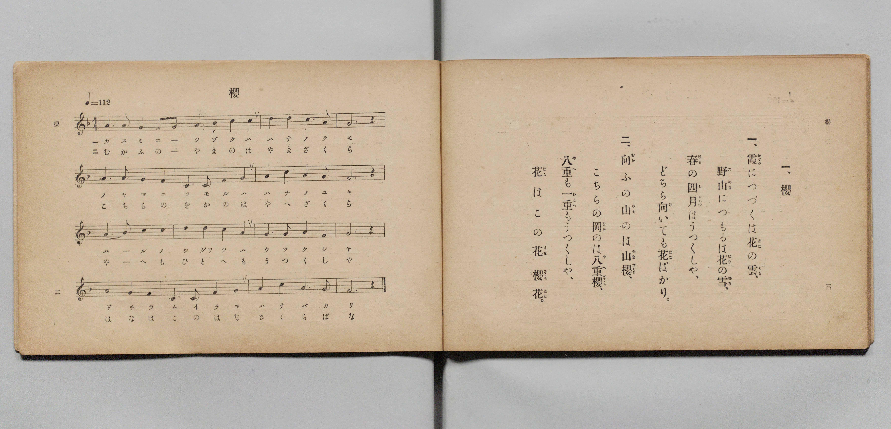

# 櫻

> Re:Shōka 使用 AI 協助辨識與重建樂譜，可能會有錯誤。歡迎回報。

- **鋼琴伴奏版**：<br><audio controls src="sakura.mp3"></audio>

- 文部省《尋常小學唱歌 第二學年用》（明治四十四年六月，4102）

## 說明

原書資訊與歌詞全文（對應 P004.jpg，原書 pp. 2–3，第二學年第 1 首）：
調性與拍號：ヘ長調（F 大調）4/4 拍，♩= 112


## 歌詞

```text
一、
霞（かすみ）につづくは花（はな）の雲（くも）、
野山（のやま）につもるは花（はな）の雪（ゆき）、
春（はる）の四月（しぐわつ）はうつくしや、
どちら向（む）いても花（はな）ばかり。

二、
向（むか）ふの山（やま）のは山櫻（やまざくら）、
こちらの岡（をか）のは八重櫻（やへざくら）、
八重（やへ）も一重（ひとへ）もうつくしや、
花（はな）はこの花（はな）櫻花（さくらばな）。
```

## ABC

<div class="abc-score" data-abc-src="sakura.abc" aria-label="五線譜載入中"></div>

[下載 ABC 原始檔](sakura.abc)

## TMD 檔案連結

- [主旋律 TMD 檔案](sakura.tmd) [[在 TMD Studio 編輯](https://tmdlang.github.io/Tmd-TS/#tmd=s7IKdvYPcrWy4qpTUCpJTLdSSM7PyUlNLsnMz7PKyszLyo8vzshPT8wuBdHZiUpwdWX5OaW5qVbpRYkpqfFG8SaGBkYIyeL80qLkVKvi5Iz8_Jz4ktSKkqT8_Gx0-fiCxPRUqwADAxOETEFRfllqXmIeUHdBUWZeSWoKWDtCQWpZZkoqSLostSgzLTM1BclJqUXFIHdDTS8pSswrTi7KLAB5BqEqv6gE6KOixIKMSquMzOKS_KLM5MSc-OzEPCTflWSkAj1XkJOYh2Q1UGV6Zp5Vbn5eUikwNJS4tLQUnq3eraClxaVoq2BoaMRlb6vgxmVjom9iB9L0bFr7y-YVz-c0Pm7oerqh--mOHU839D9du-PplI3P1vYoPF-z5smuHhB_55bnU1Y8buh-v6fj2Yy-Z5t2P509-2lvI4jcueVp69pnczre7-kBBfH7PZ1KXFz6Wgq21AJcCgoKT_vmP5u948Xm9hcrul50tAMd92LlvKetK4AeADrp6YbeZ-2dCqB40ssqSAe6BKJeoaBAT8HoUcNkY6AQimfWrFEwVHi5bBrQte_3zALZ8GLV_mcNy0Fmd_e-mDkfKPq4ecbLqduB4kAb3BSeLlkOZnYCw04BqAZo4qOZKyGBCtL_ZEfD44ZGEOvlnHlAHY8bux83znzcCNLyuHH148YljxuXPm7sf9y4_kXXRrCC9Y8bV4Fl172cvQks0v-4qQkkAjHocUPDy_a-pxshqtc9bmp53LgPYVxT0-MmoB1YjQMyOh43tT1uBLoTyTggejZjKVR1EzA2QaqBkQiOPqDg9MeNEx43Ad24BCwFNBFoBNDhQJHpIOuRDQKhxpWPGxc-bup8OmEi2MIGsDagM5cBXYfhrg2gMGnqetzQBAmxXT1QA-HagQrAKreCnAXxN8LT64BGAQWB6Rku_rhxGjjQgJGI7MvGyRBngUzZtBCsehLMaLApratftvciGbQDh0ENDRClcHUg6aYmYFxDBRs3PW5cARcnEFwYAQJkAF26Dk0c6C6YyFSIo8BBB9YCDDqgiZTnKShQ0NLn4goGlp1FiVYBmYl5-Q41BjXVICsUbCy07MAMbFkZXDLsaHixsEdBw0QBWGY8X9-gA89_mlg0AC0CGVajYKygC8ZGQGwIJCEiugqmCmZgUhcoAiJhPBALpgYCDUBqwKb5GNYoPG5aDeQ_btoJIpvng8lusCmPm1vA6h83twLl14NZ_VAZEP24uQtM9kFUAVWAZBYh2RSPsMkIZFMDSF0jyHRgEgWT6yDmNUFtatwHFQNGJpIMSBxEToOq6gfLdGLYhD-8d_VQHt4gN5mBLAMxQUIgqRowC4ZBYjVgeRwBDg6wx81LwOQ8jACHBOHjZnC04Avw5mXgYFiLO8AbJ4ODayE4ekDBhQjwSUhRgS3Ad1AhwHd0khPgoJADhSoo8UKSMywpg0QhUQALeUgCB4U3JOSxhzco7CAhBglTUPiB_LMdHC4bHjeDAwAa-NAAb1qGEAOnfRC9HRwVoIjDlcIh6RgegE1NENMaN4HFVmCRaQOLgRMDMJgheqcj5QmigxtYDdEgfYMgeoFCKH2DU1pzI5hcCSYXQAMVkubBXoYXFOipewI0sFeDZVbhDmxwigWW62ASwgald5AMIkVD5KH2NE6FBzMsNQOrBrAMpj21XFy6dgqQwj3axzBWAYlnBOYpcwEA)]
- [鋼琴伴奏 TMD 檔案](sakura_piano.tmd) [[在 TMD Studio 編輯](https://tmdlang.github.io/Tmd-TS/#tmd=s7IKdvYPcrWy4qpTUCpJTLdSSM7PyUlNLsnMz7PKyszLyo8vzshPT8wuBdHZiUpwdWX5OaW5qVbpRYkpqfFG8SaGBkYIyeL80qLkVKvi5Iz8_Jz4ktSKkqT8_Gx0-fiCxPRUqwADAxOETEFRfllqXmIeUHdBUWZeSWoKWDtCQWpZZkoqSDoxOTk_tyAxLzM3NQ9Jviy1qBjkeKgVJUWJecXJRZkFIB8hVOUXlQC9VZRYkFFplZFZXJJflJmcmBOfnZiH5MWSjFSgDwtyEpHNB6pMz8yzys3PSyoFBokSl5aWwrPVu9_v6XjZvef5hC1P9mx5urT_eWfH-z2dClpaXIq2CoaGRlz2tgpuXDYm-iZ2IJOeTWt_2bzi-ZzGxw1dTzd0P92x4-mG_qdrdzydsvHZ2h6F52vWPNnVA-Lv3PJ8yorHDd1A45_N6Hu2affT2bOf9jaCyJ1bnraufTYHaE8PKPCB1ilxcQUDY6oo0SogMzEvP8jDocagpppLAQhsLLTswAx9LQVbdAC2b0fDi4U9ChomCkCXPF_foKMAihe9rIJ0TSwatPTBhtUoGCvogrEREBsCSYiIroKpghmY1AWKgEgYD8SCqYFAA5AasGk-hjUKj5tWA_mPm3aCyOb5YLIbbMrj5haw-sfNrUD59WBWP1QGRD9u7gKTfRBVQBUgmUVINsUjbDIC2dQAUtcIMv1x41YwuQ5iXhPUpsZ9ULHHjSD7YDIgcRA5DaqqHyzTiWET_vDe1UN5eIPcZAayDMQECYGkasAsGAaJ1YDlcQQ4OMAeNy8Bk_MwAhwShI-bwdGCL8Cbl4GDYS3uAG-cDA6uheDoAQUXIsAnIUUFtgDfQYUA39FJToCDQg4UqqDEC0nOsKQMEoVEASzkIQkcFN6QkMce3qCwg4QYJExB4Qfyz3ZwuGx43AwOAGjgQwO8aRlCDJz2QfR2cFSAIg5XCoekY3gANjVBTGvcBBZbgUWmDSwGTgzAYIbonY6UJ4gObmAJRYP0DYLoBQqh9A1Oac2NYHIlmFwADVRImgd7GV5QoKfuCdDAXg2WWYU7sMEp9nEjSAWMDUrvIBlEiobIQ-1pnAoPZlhqfty4ASyDaU8tatnug1y2m0DLdmA4xCuYxmsbAgkwwzweScwkHhiWQBosYhKvDQxYmBRCEZA2gPoKu2lmQLYxWDNIFMgyBYmC2EZgNoJFwFCE3TCHIUQQhmATA7FIcSSScyDeRnY5mhuBwaxrpwAJ6Wgfw1gFJJ4RmKfMBQA)]

## 分析

```text
================================================================================
📊 TMD Song Profile: [ 櫻 ]
================================================================================
⏱  Duration:       1:08 (68.6s), 32 measures total
🎼 Key & Tempo:    首調基準 F, != 112.0 BPM, <4/4>
   - 分析範圍：      由實際發聲的音符與和弦推測調性；播放脈絡另行呈現
🎤 人聲音域:    D4 (MIDI 62) – D5 (MIDI 74) [跨度: 12 個半音 / 1.0 個八度, 難度: easy]
   - 最低音:  D4 in [Sakura[L1] #1 @ m.6, 0:10]
   - 最高音: D5 in [Sakura[L1] #1 @ m.2, 0:03]
   - 適合: soprano, mezzo-soprano, contralto, tenor, baritone, bass
🏛  結構:      Sakura[L1] (34.3s) -> Sakura[L2] (34.3s)
⚡ 編曲密度:        Peak 1 軌道同時演奏
🗝  調性診斷：       F 大調（純淨自然大調，未偵測到可信轉調）
   - 風格氣質:    純淨自然大調（陽光明朗、易唱易記，無明顯調外色彩）
   - 轉調歷程:    全曲維持單一推測調性（未偵測到可信轉調）
   - 核心骨幹音:  A, G, F, C, D
   - 調性數值:    F 大調 [相關度: 0.74, 穩定度: Moderate, 自然音純度: 100.0%]
   - 候選調性 (K-S): F 大調 (0.74), C 大調 (0.69), A 小調 (0.66)
   - 五度圈歷程:   -1 -> -1
   - 各段落調性細節:
     • [Sakura[L1] #1]: F 大調 (r: 0.74, 自然音純度: 100.0%)
     • [Sakura[L2] #1]: F 大調 (r: 0.74, 自然音純度: 100.0%)

  [ 五度圈游移軌跡 ]
               C  
        [F ]*          G  
      Bb               D  
      Eb               A  
         Ab           E  
            Db       B  
               F# 
     (* = active key center)

  [ 十二半音累積音高分佈 ]
     C  : █████████████████         18.3%
     C# :                            0.0%
     D  : ██████████                10.8%
     D# :                            0.0%
     E  :                            0.0%
     F  : ███████████████████       20.8%
     F# :                            0.0%
     G  : █████████████████████     23.3%
     G# :                            0.0%
     A  : ████████████████████████  26.7%
     A# :                            0.0%
     B  :                            0.0%
--------------------------------------------------------------------------------
Assignment 軌道音域：
  - Piano         : D4 – D5 (12 個半音 / 1.0 個八度, 104 個音符)
================================================================================
```


## 原書掃描頁




