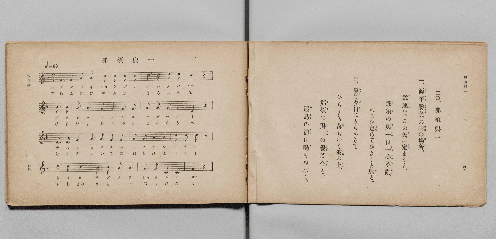

# 那須與一

> Re:Shōka 使用 AI 協助辨識與重建樂譜，可能會有錯誤。歡迎回報。

- **鋼琴伴奏版**：<br><audio controls src="nasu_no_yoichi.mp3"></audio>

- 文部省《尋常小學唱歌 第二學年用》（明治四十四年六月，4102）

## 說明

原書資訊與歌詞全文（對應 P025.jpg，原書 pp. 44–45，第二學年第 20 首）：
調性與拍號：ヘ長調（F 大調）2/4 拍，♩= 88


## 歌詞

```text
一、
源平勝負（げんぺいしようぶ）の晴（はれ）の場所（ばしよ）、
武運（ぶうん）はこの矢（や）に定（さだ）まると、
那須（なす）の與一（よいち）は一心不亂（いつしんふらん）、
ねらひ定（さだ）めてひようと射（い）る。

二、
扇（あふぎ）は夕日（ゆふひ）にきらめきて
ひら／＼落（お）ちゆく波（なみ）の上（うへ）、
那須（なす）の與一（よいち）の譽（ほまれ）は今（いま）も、
屋島（やしま）の浦（うら）に鳴（な）りひゞく。
```

## ABC

<div class="abc-score" data-abc-src="nasu_no_yoichi.abc" aria-label="五線譜載入中"></div>

[下載 ABC 原始檔](nasu_no_yoichi.abc)

## TMD 檔案連結

- [主旋律 TMD 檔案](nasu_no_yoichi.tmd) [[在 TMD Studio 編輯](https://tmdlang.github.io/Tmd-TS/#tmd=s7IKdvYPcrWy4qpTUCpJTLdSSM7PyUlNLsnMz7PKyszLyo8vzshPT8wuBdHZiUpwdWX5OaW5qVbpRYkpqfFG8SaGBkYIyeL80qLkVKvi5Iz8_Jz4ktSKkqT8_Gx0-fiCxPRUqwADI1OETEFRfllqXmIeUHdBUWZeSWoKWDtCQWpZZkoqSLostSgzLTM1BclJqUXFIHdDTS8pSswrTi7KLAB5BqEqv6gE6KOixIKMSquMzOKS_KLM5MSc-OzEPCTflWSkAj0Hka5E1puZnplnlZufl1QKDA8lLi0thZdNi18u6HjR0f5kR4OClhaXoq2ChQWXva2CG5eNkb6JHUjzs2ntL5tXPJ_T-Lih6-mG7qc7djzd0P907Y6nUzY-W9uj8HzNmie7ekD8nVueT1nxuKH7_Z6OZzP6nm3a_XT27Ke9jSBy55anrWufzel4v6cHFNjv93QqcXHpaynYUgtwKSgoPO2b_2z2jheb21-s6AJ6Cei4FyvnPW1dAfQA0ElPN_Q-a-9UAMWYXlZBOtAlEPUKBQV6CiYmjxomm5gCBVG8s2aNgpGBwstl04AOfr9nFsiSF6v2P2tYDjK-u_fFzPlA0cfNM15O3Q4UB1ripvB0yXIwsxMYfApANUAjH81cCQ5WkHZgOD9uaASxnu2a8HTn5qfdc19sWgDU-bhx0uOmyY8bdz1ubHncOP1xE1Ck7XHjNqBJjxvXPZu5Baxm_eOmHojI0wVbnnU2gAU3QNSDxCFGP25oeLZ22ctGUEwAjQAZ1DQZrG3940agHeuez18EkmpqAQuufrpuFljl1MeNQKcARfY9bup-3AiMS5hxQARJKmB1qx43zoS4ApJywGYBxYEOXwixBij4dH_zkx29T3Y1gbUApZaAnQm0fuvjpk6og5AtAKHGtSC5xk3oLmpqfNy4DCgOC5YVTzcA3Q4yFyzb_bihCRK8u3pgwdsJivTHjU0g-xr7IM56umTqs-lLwc4FGgIU3wQJgMeNvWA3AW3pBVoEcxPIPmC897_fs-fFhL1g47rAGhaC9fc_2wwORlB4gGIcGB5PdgAVQJy4A91_pATguhdrIfbtBkcGJM7XP9kNMR2obB_Y303oAfh0Y_fTzcA0A4pbUHBD1AHTz9ZlUHeBPATy8svNkBS1CmxQF9iv84B-AoUk0ETKcyQUKGjpc3H5JRaX-uVH5mcmZ2RaBWQm5uU71BjUVIMsUrAxNNOyA7OwlQfg4mVHw4uFPQoaJgrAguf5-gYdeCbWxKIBaB_IsBoFQwVdIDRUMAaSIFyjYAoWMQXTIFyjYAYWMQPTIAxTo6tgAKVrwKb5GNYoPG7aBBZ53LwZiGeBWE1LwHoeN21_3LwcItm0DCg5DaysDyLZ3A_VtgYq9rh5Aro2XYV4VPuMgNKNTRCNjVuBGKyxcT1UYxuSDMhVwAiFyDT2Qp3RCcSNYBmQCEhmGYZN-EN9Vw85oW4CNtsEKdSNwCJG4PgAYYQIiAZhYKjDHIUl2MGhCQvZzeDwA4UoKBhAPEhIP24GRcXj5m6ozFaoTAMQzwOzoAHU3IEnwKERDAo8SLACWZDA64IG-EJo4ANzClRmFVRmPxCvA7NA8iCZHSQG-I5OcgLcDGI8kIIkePxBjpoZYBgU6sghDvVt005oioWY-rh5BVR8CZANTlzwmACFPojfAkrVYBYobkB6poJ5K-FiIOcihzks_GZCww9qVxMknoCFHTjUQSyQLEjHbqjMPqCqHjALmi2AaiHiIDeCMg_ELryhDmydkBXqkECHFxf4Ej44cYMJWKGEPZ1Dsy4wrB43T0IKCeS0DA6JZmgKa56EWuyAggxeJoETPI6E3gQKKFBQTQcFF0q4g1MvLA_AjECKp6YueJEDjWFwTkC1qJaLS9dOAbnUj_YxjFXAEDMCiylzAQA)]
- [鋼琴伴奏 TMD 檔案](nasu_no_yoichi_piano.tmd) [[在 TMD Studio 編輯](https://tmdlang.github.io/Tmd-TS/#tmd=s7IKdvYPcrWy4qpTUCpJTLdSSM7PyUlNLsnMz7PKyszLyo8vzshPT8wuBdHZiUpwdWX5OaW5qVbpRYkpqfFG8SaGBkYIyeL80qLkVKvi5Iz8_Jz4ktSKkqT8_Gx0-fiCxPRUqwADI1OETEFRfllqXmIeUHdBUWZeSWoKWDtCQWpZZkoqSDoxOTk_tyAxLzM3NQ9Jviy1qBjkeKgVJUWJecXJRZkFIB8hVOUXlQC9VZRYkFFplZFZXJJflJmcmBOfnZiH5MWSjFSgDyHSlch6M9Mz86xy8_OSSoGBosSlpaXwsmnxywUdLzran-xoeL-n42X3nucTtjzZs-Xp0v7nnR3v93QqaGlxKdoqWFhw2dsquHHZGOmb2IFMfDat_WXziudzGh83dD3d0P10x46nG_qfrt3xdMrGZ2t7FJ6vWfNkVw-Iv3PL8ykrHjd0A01_NqPv2abdT2fPftrbCCJ3bnnauvbZHKA1PaBoANqmxMXll1hc6pcfmZ-ZnJFpFZCZmJcf5OFQY1BTzaUABDaGZlp2YJa-loItOgBbu6PhxcIeBQ0TBaCDnq9v0FEARZReVkG6JhYNWvpgw2oUDBV0gdBQwRhIgnCNgilYxBRMg3CNghlYxAxMgzBMja6CAZSuAZvmY1ij8LhpE1jkcfNmIJ4FYjUtAet53LT9cfNyiGTTMqDkNLCyPohkcz9U2xqo2OPmCejadBXiUe0zAko3NkE0Nm4FYrDGxvVQjW1IMiBXPW5cDZFp7IU6oxOIG8EyIBGQzDIMm_CH-q4eckLdBGy2CVKoG4FFjMDxAcIIERANwsBQhzkKS7CDQxMWspvB4QcKUVAwgHiQkH7cDIqKx83dUJmtUJkGIJ4HZkEDqLkDT4BDIxgUeJBgBbIggdcFDfCF0MB_3Ah1Q-MqqMx-IF4HZoHkQTI7SAzwHZ3kBLgZxHggBUnw-IMcNTPAMCjUkUMc6tumndAUCzH1cfMKqPgSIBucuOAxAQp9EL8FlKrBLFDcgPRMBfNWwsVAzkUOc1j4zYSGH9SuJkg8PW4EmggMdRALJAvSsRsqsw-oqgfMgmYLoFqIOMiNoMwDsQtvqANLLbJCHRLo8OICX8IHJ24wASuUsKdzaNYFhtXj5klIIYGclsEh0QxNYc2TUIsdUJDByyRwgseR0JtAAQUKqumg4EIJd3DqheUBmBFI8dTUBS9yoDEMzgmoFtViK_R9kAt9E2iZDwyReAXjeG1g8KAwTeKBKVrbECJoAHU7WBjIB5UXSAwjqB4QG1kpNrVgBlYjkY2GmQhVCPSOrp0Cso-ifQxjFTDEjMBiylwA)]

## 分析

```text
================================================================================
📊 TMD Song Profile: [ 那須與一 ]
================================================================================
⏱  Duration:       0:43 (43.6s), 32 measures total
🎼 Key & Tempo:    首調基準 F, != 88.0 BPM, <2/4>
   - 分析範圍：      由實際發聲的音符與和弦推測調性；播放脈絡另行呈現
🎤 人聲音域:    C4 (MIDI 60) – D5 (MIDI 74) [跨度: 14 個半音 / 1.2 個八度, 難度: moderate]
   - 最低音:  C4 in [NasuNoYoichi[L1] #1 @ m.8, 0:09]
   - 最高音: D5 in [NasuNoYoichi[L1] #1 @ m.3, 0:02]
   - 適合: soprano, mezzo-soprano, contralto, tenor, baritone, bass
🏛  結構:      NasuNoYoichi[L1] (21.8s) -> NasuNoYoichi[L2] (21.8s)
⚡ 編曲密度:        Peak 1 軌道同時演奏
🗝  調性診斷：       C 調性不明確（流行色彩大調，未偵測到可信轉調）
   - 風格氣質:    流行大調（略帶和弦色彩音與裝飾副屬和弦）
   - 轉調歷程:    全曲維持單一推測調性（未偵測到可信轉調）
   - 核心骨幹音:  C, G, F, D, A
   - 調性數值:    C 調性不明確 [相關度: 0.82, 穩定度: Ambiguous, 自然音純度: 93.0%]
   - 候選調性 (K-S): C 大調 (0.82), F 大調 (0.81), D 小調 (0.53)
   - 五度圈歷程:   +0 -> +0
   - 各段落調性細節:
     • [NasuNoYoichi[L1] #1]: C 調性不明確 (r: 0.82, 自然音純度: 93.0%, 調外音: A#)
     • [NasuNoYoichi[L2] #1]: C 調性不明確 (r: 0.82, 自然音純度: 93.0%, 調外音: A#)

  [ 五度圈游移軌跡 ]
              [C ]*
         F            G  
      Bb               D  
      Eb               A  
         Ab           E  
            Db       B  
               F# 
     (* = active key center)

  [ 十二半音累積音高分佈 ]
     C  : ████████████████████████  26.3%
     C# :                            0.0%
     D  : █████████████             14.0%
     D# :                            0.0%
     E  :                            0.0%
     F  : ████████████████          17.5%
     F# :                            0.0%
     G  : ███████████████████       21.1%
     G# :                            0.0%
     A  : █████████████             14.0%
     A# : ██████                     7.0%
     B  :                            0.0%
--------------------------------------------------------------------------------
Assignment 軌道音域：
  - Piano         : C4 – D5 (14 個半音 / 1.2 個八度, 104 個音符)
================================================================================
```


## 原書掃描頁




