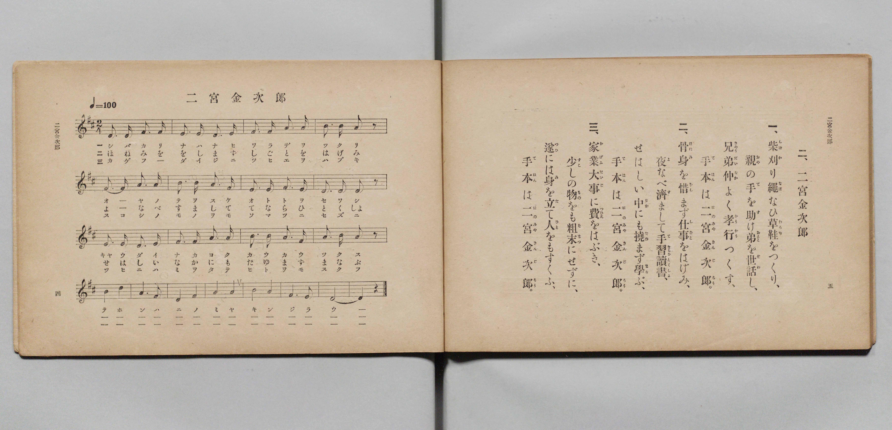

# 二宮金次郎

> Re:Shōka 使用 AI 協助辨識與重建樂譜，可能會有錯誤。歡迎回報。

- **鋼琴伴奏版**：<br><audio controls src="ninomiya_kinjiro.mp3"></audio>

- 文部省《尋常小學唱歌 第二學年用》（明治四十四年六月，4102）

## 說明

原書資訊與歌詞全文（對應 P005.jpg，原書 pp. 4–5，第二學年第 2 首）：
調性與拍號：ニ長調（D 大調）2/4 拍，♩= 100


## 歌詞

```text
一、
柴刈（しばか）り繩（なは）なひ草鞋（わらぢ）をつくり、
親（おや）の手（て）を助（たす）け弟（おとゝ）を世話（せわ）し、
兄弟仲（きやうだいなか）よく孝行（かうかう）つくす、
手本（てほん）は二宮金次郎（にのみやきんじらう）。

二、
骨身（ほねみ）を惜（をし）まず仕事（しごと）をはげみ、
夜（よ）なべ濟（す）まして手習讀書（てならひどくしよ）、
せはしい中（なか）にも撓（たゆ）まず學（まな）ぶ、
手本（てほん）は二宮金次郎（にのみやきんじらう）。

三、
家業大事（かげふだいじ）に費（つひえ）をはぶき、
少（すこ）しの物（もの）をも粗末（そまつ）にせずに、
遂（つひ）には身（み）を立（た）て人（ひと）をもすくふ、
手本（てほん）は二宮金次郎（にのみやきんじらう）。
```

## ABC

<div class="abc-score" data-abc-src="ninomiya_kinjiro.abc" aria-label="五線譜載入中"></div>

[下載 ABC 原始檔](ninomiya_kinjiro.abc)

## TMD 檔案連結

- [主旋律 TMD 檔案](ninomiya_kinjiro.tmd) [[在 TMD Studio 編輯](https://tmdlang.github.io/Tmd-TS/#tmd=s7IKdvYPcrWy4qpTUCpJTLdSSM7PyUlNLsnMz7PKyszLyo8vzshPT8wuBdHZiUpwdWX5OaW5qVbpRYkpqfFG8SaGBkYIyeL80qLkVKvi5Iz8_Jz4ktSKkqT8_Gx0-fiCxPRUqwADA1OETEFRfllqXmIeUHdBUWZeSWoKWDtCQWpZZkoqSLostSgzLTM1BclJqUXFIHdDTS8pSswrTi7KLAB5BqEqv6gE6KOixIKMSquMzOKS_KLM5MSc-OzEPCTflWSkAj0Hka5E1puZnplnlZufl1QKDA8lLi0thSe7ep6uW_eyfeKzNQtfNvcpaGlxKdoqGBoYcNnbKrhw2Rjpm9iBDHg2rf1l84rncxofN3Q93dD9dMeOpxv6n67d8XTKxmdrexSer1kDMgnI37nl-ZQVjxu63-_peDaj79mm3U9nz37a2wgid2552rr22ZyO93t6QAH-fk-nEheXvpaCLbUAl4KCwtO--c9m73ixuf3Fiq4XHe1Ax71YOe9p6wqgB4BOerqh91l7pwIo1vSyCtKBLoGoVygo0FMwedQw2RQohOKZNWsUjBReLpsGdO37PbNANrxYtf9Zw3KQ2d29L2bOB4o-bu5-OXU7UBxog4vC0yXLwcxOYNgpANUATXw0cyUkUEH6n-xoeNzQCGI9m7_laQcwODoeN05_3LjhcSMw1DofN3U937kSLLjqceN6kAiIselFb-fLeaBgfdzU_7gJKLgIrHjS48YljxuBIl1QQx83NLxYtgqsv-txUwtY_7pnnWCdjcsgep52QSyY_7hxJljBxKd7gB4Ba2lc8bhpLkTZkx3TXqzcCBafDbQVrHI61JqnrS1APU92bwJL9wJtetzY9rhxweNGIAPoXohXgFLAVDL3xcIesLJusBoQCTYL7PDGmQiHA535bM4aiEsfN-5-3DQZrG49WioFK1gN9Nbjxv1gi4HWT37cOAMcLGCjG5ogQb2rB2r4y1UrXuxaDda4-3HjWqBGiBefNc8BBykwGKeD7dr3uHHWk91Tn-yCBBgwXqYAgwQW1OsfNwLJ_QgXP10C0Q-MRUg87Xy2HxKSkIAFGgc0YhnQY8_3T3qxrgGY1mDeWwV27qbHjSvBwTAdagjUaGCIg2wDam55smMtLDmAQxXo9aamZ5OAYQOOwiZIYIIcDkyzYEEgG5gCgILbaBi2O2Bufbpu27Ola4HJHhZowAgGhtJWWGqYAXH0i027wbLAWAd6GuxXaJBuA9mCCNINEyEB-LgR4kRgGKx73glOsU1NQDZUZ1PT803Tn82BROpcsKeXQIMHFHizQAxo5Dc2wW2GqVgPSw7QhPB8NcTtwMgDKlj2ZNcuMBfoUljkg-wGugkYVVtpE6pAEykvA6FAQUufi8svMy8_N7My0RtYFWYW5VsFZCbm5TvUGNRUg-xSsDE007IDs7AVwuAyfUcDMOsqaJgoAEv75-sbdOAlpyYWDUArQYbVKBgq6AKhoYIxmDYGihiBWUZQGSOgCEzOFEybAkXMwCwzsIgBENeATfMxrFF43LQdLPe4eQKQvRrKXgXU87i5C8rrR2JPAsush_JWAnETlL0JLNMC4TWtB5uiqxCPsM0IKN-4GyLfuBaI90PVgs0EkhCZ6UC8D8qeBZIBikB4U4B4BbKeRqg7GidBTUOyzRhkJtQ_TZuArpkKZgPlgewGqPgSIN4BdX83svuB_nzcBLUL6rN-KG8aUGYt3C78cbyrh5w4xh9_qLEOUQuKdVjKANHocQyKCYjrl0DpPrCf2uA-fNwEi42dj5s2giMEoulxcwcYIwVFEzQSgckAknzQIrkJohoUMVAzGneCo2smlLcPKVKXgWWWwdUDsy2UDbarcSWUB0yEoHK8HdU6cCzvhLp8M1JqhvhvEZwHcjqEvQjshb1Q3jykOAenAJjnmnaBRYiL5x2d5MQzqTkXEvMQFva8vPZx82Ko85ehJHOk7AzMFI-bYdloPdjLsGwC1IPERsvO4GBGz86zobEDlIfHaAs43mAx3w3EMDObwDLzobw2jIwO4wFTQeM2zIhGzpzgqIEUTiAZqJnICRmYuEEy0GIFnIpRkwAs2YCKKlDhQEREA5va4Ii2IC2iIZEIzJxxUAYsFiEQFOuw_AvhoaqB0UgxDc25IM9AogBSrm1GMhVSYoFEIUEFyQcItZAgQ5QJqBELyZCgyIDkB7CepsnI5oNLX5BaSPSCRNYh1EJLd1AAQ6INNSpp43608IYHHDxQQRCU7RDBDYM1cBYoUyE5F5Kx4JbBnAgShVQdMBlQSQUShQUdpsmgFIZkMjige2H64YELEp2BbDK4RASJwgKNoMngYpHabq7l4tK1U0Br-ET7GMYqYBM2wi5sDBZW5gIA)]
- [鋼琴伴奏 TMD 檔案](ninomiya_kinjiro_piano.tmd) [[在 TMD Studio 編輯](https://tmdlang.github.io/Tmd-TS/#tmd=s7IKdvYPcrWy4qpTUCpJTLdSSM7PyUlNLsnMz7PKyszLyo8vzshPT8wuBdHZiUpwdWX5OaW5qVbpRYkpqfFG8SaGBkYIyeL80qLkVKvi5Iz8_Jz4ktSKkqT8_Gx0-fiCxPRUqwADA1OETEFRfllqXmIeUHdBUWZeSWoKWDtCQWpZZkoqSDoxOTk_tyAxLzM3NQ9Jviy1qBjkeKgVJUWJecXJRZkFIB8hVOUXlQC9VZRYkFFplZFZXJJflJmcmBOfnZiH5MWSjFSgDyHSlch6M9Mz86xy8_OSSoGBosSlpaXwZFfP03XrXrZPfLZm4cvmvvd7Ol5273k-YcuTPVueLu1_3tnxfk-ngpYWl6KtgqGBAZe9rYILl42RvokdyNRn09pfNq94PqfxcUPX0w3dT3fseLqh_-naHU-nbHy2tkfh-Zo1IOOB_J1bnk9Z8bihG2j8sxl9zzbtfjp79tPeRhC5c8vT1rXP5gDt6QFFBdA6JS4uv8y8_NzMykRvYERmFuVbBWQm5uUHeTjUGNRUcykAgY2hmZYdmKWvpWCLDsA272h4sbBHQcNEAeim5-sbdBRA8aWXVZCuiUWDlj7YsBoFQwVdIDRUMAbTxkARIzDLCCpjBBSByZmCaVOgiBmYZQYWMQDiGrBpPoY1Co-btoPlHjdPALJXQ9mrgHoeN3dBef1I7ElgmfVQ3kogboKyN4FlWiC8pvVgU3QV4hG2GQHlG3dD5BvXAvF-qFqwmUASIjMdiPdB2bNAMkARCG8KEK9A1tMIdUfjJKhpSLYZg8yE-qdpE9A1U8FsoDyQ3QAVXwLEO6Du70Z2P9Cfj5ugdkF91g_lTQPKrIXbhT-Od_WQE8f44w811iFqQbEOSxkgGj2OQTEBcf0SKN0H9lMb3IePm2CxsfNx00ZwhEA0PW7uAGOkoGiCRiIwGUCSD1okN0FUgyIGakbjTnB0zYTy9iFF6jKwzDK4-sdNnVA22K7GlVAeMBE2Tn_c1I5qHTiWd0JdvhkpNUP8twjOAzkdwl4E9sJeKG8eUpyDUwDMc027wCLExfOOTnLimdScC4l5CAt7Xl77uHkx1PnLUJI5UnYGZorHzbBstB7sZVg2AepBYqNlZ3Awo2fn2dDYAcrDY7QFHG-wmO8GYpiZTWCZ-VBeG0ZGh_GAqaBxG2ZEI2dOcNRACieQDNRM5IQMTNwgGWixAk7FqEkAlmxARRWocCAiooEVAjiiLUiLaEgkAjNnHJQBi0UIBMU6LP9CeKhqYDRSTENzLsgzkCiAlGubkUyFlFggUUhQQfIBQi0kyBBlAmrEQjIkKDIg-QGsp2kysvng0hekFhK9IJF1CLXQ0h0UwJBoQ41K2rgfLbzhAQcPVBAEZTtEcMNgDZwFylRIzoVkLLhlMCeCRCFVB0wGVFKBRGFBh2kyKIUhmQwO6F6YfnjggkRnIJsMLhFBorBAI2gyuFiktptrcbR7fJDbPSbQZg8wgOMVjOO1TeNBCTk-XsEIykYSNokH8SBOxpTQBpIYWg3gyvGZidCKUA8UMovXNkRVjd2N2HSYxmubo-mAOgcYLLp2CmghE-1jGKuATdgIu7AxWFiZCwA)]

## 分析

```text
================================================================================
📊 TMD Song Profile: [ 二宮金次郎 ]
================================================================================
⏱  Duration:       1:12 (72.0s), 60 measures total
🎼 Key & Tempo:    首調基準 D, != 100.0 BPM, <2/4>
   - 分析範圍：      由實際發聲的音符與和弦推測調性；播放脈絡另行呈現
🎤 人聲音域:    D4 (MIDI 62) – D5 (MIDI 74) [跨度: 12 個半音 / 1.0 個八度, 難度: easy]
   - 最低音:  D4 in [NinomiyaKinjiro[L1] #1 @ m.1, 0:00]
   - 最高音: D5 in [NinomiyaKinjiro[L1] #1 @ m.13, 0:15]
   - 適合: soprano, mezzo-soprano, contralto, tenor, baritone, bass
🏛  結構:      NinomiyaKinjiro[L1] (24.0s) -> NinomiyaKinjiro[L2] (24.0s) -> NinomiyaKinjiro[L3] (24.0s)
⚡ 編曲密度:        Peak 1 軌道同時演奏
🗝  調性診斷：       D 大調（純淨自然大調，未偵測到可信轉調）
   - 風格氣質:    純淨自然大調（陽光明朗、易唱易記，無明顯調外色彩）
   - 轉調歷程:    全曲維持單一推測調性（未偵測到可信轉調）
   - 核心骨幹音:  A, D, F#, B, E
   - 調性數值:    D 大調 [相關度: 0.86, 穩定度: High, 自然音純度: 100.0%]
   - 候選調性 (K-S): D 大調 (0.86), A 大調 (0.74), F# 小調 (0.71)
   - 五度圈歷程:   +2 -> +2 -> +2
   - 各段落調性細節:
     • [NinomiyaKinjiro[L1] #1]: D 大調 (r: 0.86, 自然音純度: 100.0%)
     • [NinomiyaKinjiro[L2] #1]: D 大調 (r: 0.86, 自然音純度: 100.0%)
     • [NinomiyaKinjiro[L3] #1]: D 大調 (r: 0.86, 自然音純度: 100.0%)

  [ 五度圈游移軌跡 ]
               C  
         F            G  
      Bb              [D ]*
      Eb               A  
         Ab           E  
            Db       B  
               F# 
     (* = active key center)

  [ 十二半音累積音高分佈 ]
     C  :                            0.0%
     C# :                            0.0%
     D  : ████████████████████      24.0%
     D# :                            0.0%
     E  : █████████                 11.3%
     F  :                            0.0%
     F# : ██████████████████        22.0%
     G  :                            0.0%
     G# :                            0.0%
     A  : ████████████████████████  28.7%
     A# :                            0.0%
     B  : ████████████              14.0%
--------------------------------------------------------------------------------
Assignment 軌道音域：
  - Piano         : D4 – D5 (12 個半音 / 1.0 個八度, 174 個音符)
================================================================================
```


## 原書掃描頁




