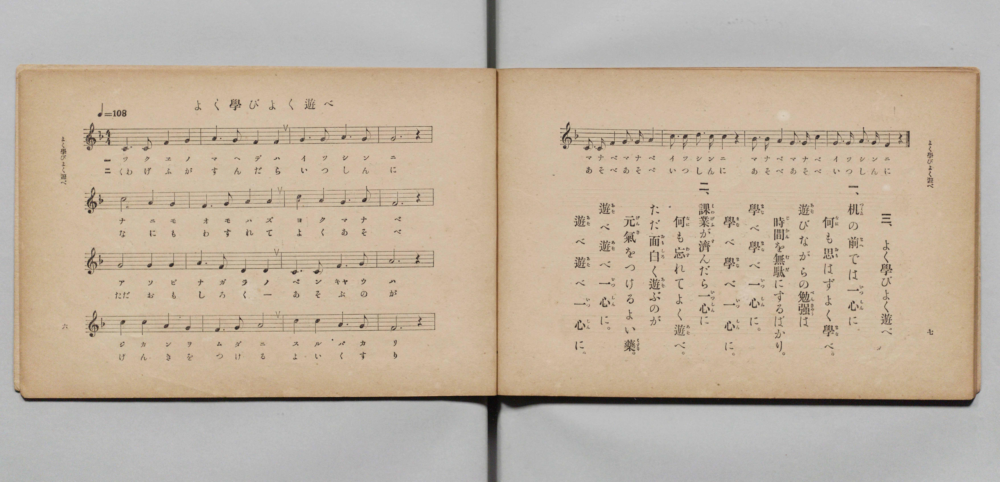

# よく學びよく遊べ

> Re:Shōka 使用 AI 協助辨識與重建樂譜，可能會有錯誤。歡迎回報。

- **鋼琴伴奏版**：<br><audio controls src="yoku_manabi_yoku_asobe.mp3"></audio>

- 文部省《尋常小學唱歌 第二學年用》（明治四十四年六月，4102）

## 說明

原書資訊與歌詞全文（對應 P006.jpg，原書 pp. 6–7，第二學年第 3 首）：
調性與拍號：ヘ長調（F 大調）4/4 拍，♩= 108


## 歌詞

```text
一、
机（つくゑ）の前（まへ）では一心（いつしん）に
何（なに）も思（おも）はずよく學（まな）べ。
遊（あそ）びながらの勉強（べんきやう）は
時間（じかん）を無駄（むだ）にするばかり。
學（まな）べ學（まな）べ一心（いつしん）に。
學（まな）べ學（まな）べ一心（いつしん）に。

二、
課業（くわげふ）が濟（す）んだら一心（いつしん）に
何（なに）も忘（わす）れてよく遊（あそ）べ。
ただ面白（おもしろ）く遊（あそ）ぶのが
元氣（げんき）をつけるよい藥（くすり）。
遊（あそ）べ遊（あそ）べ一心（いつしん）に。
遊（あそ）べ遊（あそ）べ一心（いつしん）に。
```

## ABC

<div class="abc-score" data-abc-src="yoku_manabi_yoku_asobe.abc" aria-label="五線譜載入中"></div>

[下載 ABC 原始檔](yoku_manabi_yoku_asobe.abc)

## TMD 檔案連結

- [主旋律 TMD 檔案](yoku_manabi_yoku_asobe.tmd) [[在 TMD Studio 編輯](https://tmdlang.github.io/Tmd-TS/#tmd=s7IKdvYPcrWy4qpTUCpJTLdSSM7PyUlNLsnMz7PKyszLyo8vzshPT8wuBdHZiUpwdWX5OaW5qVbpRYkpqfFG8SaGBkYIyeL80qLkVKvi5Iz8_Jz4ktSKkqT8_Gx0-fiCxPRUqwADAzOETEFRfllqXmIeUHdBUWZeSWoKWDtCQWpZZkoqSLostSgzLTM1BclJqUXFIHdDTS8pSswrTi7KLAB5BqEqv6gE6KOixIKMSquMzOKS_KLM5MSc-OzEPCTflWSkAj0HdX9OZloqsv7M9Mw8q9z8vKRSYJgocWlpKTxu6njc2P907Y7HjZsh7JeNXY8bdypoaXEp2ioYGlhw2dsquHHZmOib2IFMejat_WXziudzGh83dD3d0P10x46nG0D6n07Z-Gxtj8LzNWue7OoB8XdueT5lxeOG7vd7Op7N6Hu2affT2bOf9jaCyJ1bnraufTan4_2eHlDov9_TqcTFpa-lYEstwKWgoPC0b_6z2TtebG5_saLrRUc70HEvVs572roC6AGgk55u6H3W3qkAikK9rIJ0oEsg6hUKCvQUzB41TDYHCqF4Zs0aBWOFl8umAV37fs8skA0vVu1_1rAcZHZ374uZ84Gij5tnvJy6HSgOtMFN4emS5WBmJzDsFIBqgCY-mrkSEqgg_U92NDxuaASxns3ZBdTxuHEJMPwfN00EanncuO5pJ1AHUHDf48YdYJHljxvXA_U83d8MFm8Bq5_-uGkyWHY1yKDHDQ1P9k4FS68CCoEkmpqeNcwFi3QB2WCl6x83zoJHPMyOVWCpnY8bmkAGAVMBWKLpcSNQM1BiM9jEnsdNYKd1dz7dsx2sYCfQ_seNvY-bgM5pg5gOdcizmU0vpwHdBlQ043FjN9SdTZOetyx8ubwFJN7U8LhxAcTxjxtnPm7qfty4AayyC-oKTOdhiuAJEagpQLdQwSBwjO3qgcbYi1Wbni1dC1YMjLH-x42THjduBSvuebYfmBSA4jPB3gUGzgJgoJETb0_3zwCHEtB0iFk9jxuXwTMpavTA4u1x43yghS_nLno-cy880sG2ARMTUB2mzm3A-AS6GhZQrc3PNiwGq5gEiVlIpIHdPBEURSD7W15MXwr1OyjegCZ24ko3OzFFiIox6hhEeVECBQpa-lxckfnZpb7A0jYpE8RyLM5PAlYCmYl5-Q41BjXVIPsUbCy07MAMbMUZuHTc0fBiYY-ChokCsNx8vr5BB14GKTzdvuzlgkZNLPqAloPMrFEwjVfQBUIgZQikjIC4BlgqgYSMwCIgXAMWB4nAZGAiEGgAUgM2z8ewRuFxcwtY9HHTeiBeAWI194FNedw8DyLTPAOI28GsfohM0xKoTAuQvR3K3gzW041kE8ixUJuMgHKNIN0gm_qB7EkgVuNWiHmNPRCZxplA2clg1gKoTZ1QGaBNjVBbG6eDZUDqUG3CH_C7eigJeKhFoCCFBDsoqGGBDMIQNTB5EAumBnuwd0HFIUH2uHkR1MOroKKLoMH9uGkXNDrAkQOMJpAsLGq6wDIz8QQ6xDxQsK0G62-C2gONDHCQg4IfWLZAZTrAPLDdjSDVIHouOJp2khjkOzopCHJYmgXRyCndUMEMZDeYwJcjsAZ7EyiYIalwLzgAQakIER2Pm9YA2SvBMrBcAAlcUPp-3LT2cfNisDJoWIFjCFfIg0pieOCDzIcHPjAFQ2zrhecKiDgiuIEFM5i1DioDySFEBz2wmUVxajfFkdohjkUEPKKYwZPem3ZAvbwaHJSgAN0EDUNIID1ubkAqPkA6IKntcTNIxwS4bpAOWJrGFuqgggWkcjKQ3QtmgURAMrDiYyJQDNkeUHqHFTGIXAGSgeVRtEC3MTQjVMrvmoIz-Ps3k1bKw_IAWvBDlCiYQWlYAQUKdogKEzBtAtcDMwNqOraKAmYd3BCk8gpR4iDKG-yiuCsIRPwi3EAzk5HSBHK2gpVh2EVBqqEVIjC9IDIqKDWByk80t9PKZK5aLi5dOwUsDY5oH8NYBVxSRmApZS4A)]
- [鋼琴伴奏 TMD 檔案](yoku_manabi_yoku_asobe_piano.tmd) [[在 TMD Studio 編輯](https://tmdlang.github.io/Tmd-TS/#tmd=s7IKdvYPcrWy4qpTUCpJTLdSSM7PyUlNLsnMz7PKyszLyo8vzshPT8wuBdHZiUpwdWX5OaW5qVbpRYkpqfFG8SaGBkYIyeL80qLkVKvi5Iz8_Jz4ktSKkqT8_Gx0-fiCxPRUqwADAzOETEFRfllqXmIeUHdBUWZeSWoKWDtCQWpZZkoqSDoxOTk_tyAxLzM3NQ9Jviy1qBjkeKgVJUWJecXJRZkFIB8hVOUXlQC9VZRYkFFplZFZXJJflJmcmBOfnZiH5MWSjFSgD6GeyMlMS0XWn5memWeVm5-XVAoMGCUuLS2Fx00djxv7n67d8bhxM4T9srHrcePO93s6XnbveT5hy5M9W54u7X_e2fF-T6eClhaXoq2CoYEFl72tghuXjYm-iR3I-GfT2l82r3g-p_FxQ9fTDd1Pd-x4ugFk6NMpG5-t7VF4vmbNk109IP7OLc-nrHjc0A00_tmMvmebdj-dPftpbyOI3LnlaevaZ3OA9vSA4gVonRIXV2R-dqkv0H9JmSCWY3F-EjDsMxPz8oM8HGoMaqq5FIDAxkLLDszQ11KwRQdgy3c0vFjYo6BhogB01vP1DToKoPjTyypIV3i6fdnLBY2aWPRp6YPNrFEwjVfQBUIgZQikjIC4RsEYLGQEFgHhGrA4SAQmAxOBQAOQGrB5PoY1Co-bW8Cij5vWA_EKEKu5D2zK4-Z5EJnmGUDcDmb1Q2SalkBlWoDs7VD2ZrCebiSbQI6F2mQElGsE6QbZ1A9kTwKxGrdCzGvsgcg0zgTKTgazFkBt6oTKAG1qhNraOB0sA1KHahP-gN_VQ0nAQy0CBSkk2EFBDQtkEIaogcmDWDA12IO9CyoOCbLHzYugHl4FFV0EDe7HTbug0QGOHGA0gWRhUdMFlpmJJ9Ah5oGCbTVYfxPUHmhkgIMcFPyPG5dBZTrAPLDdjSDVIHouOJp2khjkOzopCHJYmgXRyCndUMEMZDeYwJcjsAZ7EyiYIalwLzgAQakIER2Pm9YA2SvBMrBcAAlcUPp-3LT2cfNisDJoWIFjCFfIz4ekYkgAgsyHBz4wBUNs64XnCog4IrgfN24Ds9ZBZSA5hOigB5ZiFKd2UxypHeJYRMAjihk86b1pB9TLq8FBCQrQTdAwhATS4-YGpOIDpAOS2h43g3RMgOsG6YClaWyhDipYQConA9m9YBZIBCQDKz4mAsWQ7QGld1gRg8gVIBlYHkULdBtDM0Kl_K4pOIO_fzNppTwsD6AFP0SJghmUhhVQoGCHqDAB0yZwPTAzoKZjqyhg1sENQSqvECUOorzBLoq7gkDEL8INNDMZKU0gZytYGYZdFKQaWiEC0wsio4JSE6j8RHM7rUzmqsXT3vBBbm-YQFMiMPPFA6NW2xBOYxMxjY9XMIrXBiYBBAtd1AAadJSYiKQOYRx-pSbxwCKdVCOp7EKYIG6FcGdiDz-oacDY07VTwBKB0T6GsQq4pIzAUspcAA)]

## 分析

```text
================================================================================
📊 TMD Song Profile: [ よく學びよく遊べ ]
================================================================================
⏱  Duration:       1:28 (88.9s), 40 measures total
🎼 Key & Tempo:    首調基準 F, != 108.0 BPM, <4/4>
   - 分析範圍：      由實際發聲的音符與和弦推測調性；播放脈絡另行呈現
🎤 人聲音域:    C4 (MIDI 60) – D5 (MIDI 74) [跨度: 14 個半音 / 1.2 個八度, 難度: moderate]
   - 最低音:  C4 in [YokuManabiYokuAsobe[L1] #1 @ m.1, 0:00]
   - 最高音: D5 in [YokuManabiYokuAsobe[L1] #1 @ m.18, 0:38]
   - 適合: soprano, mezzo-soprano, contralto, tenor, baritone, bass
🏛  結構:      YokuManabiYokuAsobe[L1] (44.4s) -> YokuManabiYokuAsobe[L2] (44.4s)
⚡ 編曲密度:        Peak 1 軌道同時演奏
🗝  調性診斷：       C 調性不明確（純淨自然大調，未偵測到可信轉調）
   - 風格氣質:    純淨自然大調（陽光明朗、易唱易記，無明顯調外色彩）
   - 轉調歷程:    全曲維持單一推測調性（未偵測到可信轉調）
   - 核心骨幹音:  G, A, F, C, D
   - 調性數值:    C 調性不明確 [相關度: 0.72, 穩定度: Ambiguous, 自然音純度: 98.6%]
   - 候選調性 (K-S): C 大調 (0.72), F 大調 (0.72), A 小調 (0.63)
   - 五度圈歷程:   +0 -> +0
   - 各段落調性細節:
     • [YokuManabiYokuAsobe[L1] #1]: C 調性不明確 (r: 0.72, 自然音純度: 98.6%, 調外音: A#)
     • [YokuManabiYokuAsobe[L2] #1]: C 調性不明確 (r: 0.72, 自然音純度: 98.6%, 調外音: A#)

  [ 五度圈游移軌跡 ]
              [C ]*
         F            G  
      Bb               D  
      Eb               A  
         Ab           E  
            Db       B  
               F# 
     (* = active key center)

  [ 十二半音累積音高分佈 ]
     C  : ██████████████████        20.6%
     C# :                            0.0%
     D  : ███                        3.7%
     D# :                            0.0%
     E  :                            0.0%
     F  : ██████████████████        20.9%
     F# :                            0.0%
     G  : ████████████████████████  27.4%
     G# :                            0.0%
     A  : ███████████████████████   26.0%
     A# : █                          1.4%
     B  :                            0.0%
--------------------------------------------------------------------------------
Assignment 軌道音域：
  - Piano         : C4 – D5 (14 個半音 / 1.2 個八度, 142 個音符)
================================================================================
```


## 原書掃描頁




