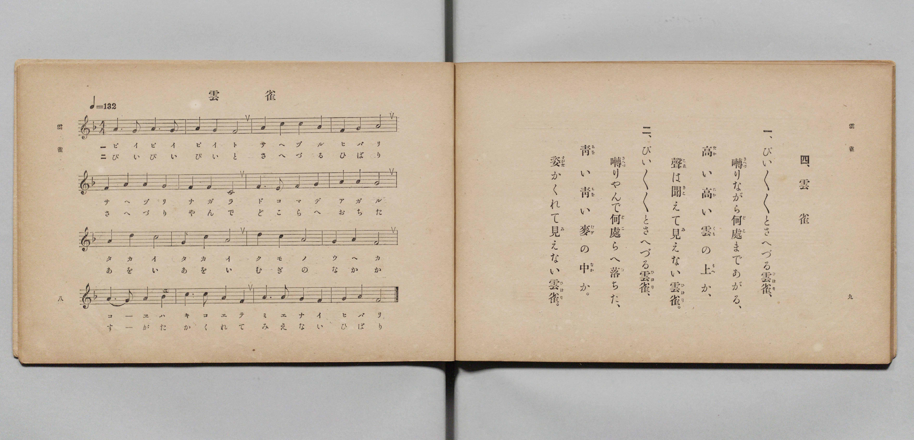

# 雲雀

> Re:Shōka 使用 AI 協助辨識與重建樂譜，可能會有錯誤。歡迎回報。

- **鋼琴伴奏版**：<br><audio controls src="hibari.mp3"></audio>

- 文部省《尋常小學唱歌 第二學年用》（明治四十四年六月，4102）

## 說明

原書資訊與歌詞全文（對應 P007.jpg，原書 pp. 8–9，第二學年第 4 首）：
調性與拍號：ヘ長調（F 大調）4/4 拍，♩= 132
備註：譜下第一節第四行作「コーエハ」，右頁歌詞作「聲（こゑ）は」。


## 歌詞

```text
一、
ぴい／＼／＼とさへづる雲雀（ひばり）、
囀（さへづ）りながら何處（どこ）まであがる、
高（たか）い高（たか）い雲（くも）の上（うへ）か、
聲（こゑ）は聞（きこ）えて見（み）えない雲雀（ひばり）。

二、
ぴい／＼／＼とさへづる雲雀（ひばり）、
囀（さへづ）りやんで何處（どこ）らへ落（お）ちた、
青（あを）い青（あを）い麥（むぎ）の中（なか）か。
姿（すがた）かくれて見（み）えない雲雀（ひばり）。
```

## ABC

<div class="abc-score" data-abc-src="hibari.abc" aria-label="五線譜載入中"></div>

[下載 ABC 原始檔](hibari.abc)

## TMD 檔案連結

- [主旋律 TMD 檔案](hibari.tmd) [[在 TMD Studio 編輯](https://tmdlang.github.io/Tmd-TS/#tmd=s7IKdvYPcrWy4qpTUCpJTLdSSM7PyUlNLsnMz7PKyszLyo8vzshPT8wuBdHZiUpwdWX5OaW5qVbpRYkpqfFG8SaGBkYIyeL80qLkVKvi5Iz8_Jz4ktSKkqT8_Gx0-fiCxPRUqwADA3OETEFRfllqXmIeUHdBUWZeSWoKWDtCQWpZZkoqSLostSgzLTM1BclJqUXFIHdDTS8pSswrTi7KLAB5BqEqv6gE6KOixIKMSquMzOKS_KLM5MSc-OzEPCTflWSkAj2XmJeZm5iDrDUzPTPPKjc_L6kUGBxKXFpaCi9nb3o5u0FBS4tL0VbB0NiIy95WwY3LxkTfxA6k79m09pfNK57PaXzc0PV0Q_fTHTuebuh_unbH0ykbn63tUXi-Zs2TXT0g_s4tz6eseNzQ_X5Px7MZfc827X46e_bT3kYQuXPL09a1z-Z0vN_TAwrm93s6lbi49LUUbKkFuBQUFJ72zX82e8eLze0vVnS96GgHOu7FynlPW1cAPQB00tMNvc_aOxVAcaWXVZAOdAlEvUJBgZ6CxaOGyZZAIRTPrFmjYKLwctk0oGvf75kFsuHFqv3PGpaDzO7ufTFzPlD0cfOMl1O3A8WBNrgpPF2yHMzsBIadAlAN0MRHM1dCAhXkwKaZL1bsBup6sXbOkx3dIMt2NDxf3wBkAAPpxcKeJ3vnPG7oedy0-XHznsdNKx439z9uABnytH_zywWNEA9B1Lxo3AS08XHj5MdNE4H2PW5cD1T5uKGJC2QP0NTHDY0g1uPGLY8bW97v6X-_Zw-EfNy44nHj1MeNOx43Ln3c1A2Je7BRmx43bnjc1AUyDaq5oeEpVA6qASTX1PW4cdXjRqArO5_snfpi5lSwgpVAp4Ddse9x4_LHjU1gBd0Ig4Do5eoZYKXzHzcCkwhQaQsWkdkQb_U_bmoCi6x7sgPoIqBIG9AFYBFUQ4EIMyheNM4Di_TCHAVkL3uxDJQwHzeCogcsAvQEyD5s3ocG464emgZjU8vjpsnA4MISjE1AJ-54MWEvWBBsVuNCUDihhOfcSWDppsdNQAY49DBFdgEt63jc1PC4sQ8WnmvBaoC-h4Q5MDybUMLz6XJQYn7cOBMUh43ARA5WBIoSIJfEYASaS3nehgIFLX0uLo_MpMSiTKuAzMS8fIcag5pqkBUKNhZadmAGtiIFXELtaABmLwUNEwVg2QXMcTrwckATiwagRSDDahSMFXSB0AhOQ0SMgNgQLKILFTGFYhC7BiwHUgPRBRQBm-ZjWKPwuHkKWORx0xIUNkwGxAaSzR1w0x83bQWLzACTrWByNUSmeRKYNwFMrkK1ywgo37gFYn5jCwobJgNig8gVCLsap4JFdoDJpWD3dENlNoHFNoDFuuB24Q_zXT3khDko9EAhBwtpiAgIm8bDnQoJfvN4eFhD4gGmBy3UsYQhKLxAYQjyy-OmNWCxlYiQaO6Exs1mIHseWLYdGh-LkHSAYgI91DHDEGQHSCc4vJsmg2WWI4U6xF5gzgfKguyF6AbJgF3XuBBMzicy1Hd0kpvSzUBhDHcXKBxhaRoiApNHiMBSOTw3IIX5frBvQSEESdWw9IxLfD04RMGh29yHJL4MLAKOO7Au9PBuAsuA8wI4RcNCFYd4UwNYBGQDsDREUg9KEcCCDk4SEdaQSpuiUsUEbDsk1E3hYQlTYwwva_CH9WaoGLDNAA6tfqhf10JFgakYKtMGkWmGpCaQKCwPgOKCmFJlJsyuxh4wCTIJJA4JM2A9ATQLIgOKOZAMKMZB_A54KIPiA3epUsvFpWunACnpo30MYxWQeEZgnjIXAA)]
- [鋼琴伴奏 TMD 檔案](hibari_piano.tmd) [[在 TMD Studio 編輯](https://tmdlang.github.io/Tmd-TS/#tmd=s7IKdvYPcrWy4qpTUCpJTLdSSM7PyUlNLsnMz7PKyszLyo8vzshPT8wuBdHZiUpwdWX5OaW5qVbpRYkpqfFG8SaGBkYIyeL80qLkVKvi5Iz8_Jz4ktSKkqT8_Gx0-fiCxPRUqwADA3OETEFRfllqXmIeUHdBUWZeSWoKWDtCQWpZZkoqSDoxOTk_tyAxLzM3NQ9Jviy1qBjkeKgVJUWJecXJRZkFIB8hVOUXlQC9VZRYkFFplZFZXJJflJmcmBOfnZiH5MWSjFSgD0E2JOYga81Mz8yzys3PSyoFhokSl5aWwsvZm17Obni_p-Nl957nE7Y82bPl6dL-550d7_d0KmhpcSnaKhgaG3HZ2yq4cdmY6JvYgQx7Nq39ZfOK53MaHzd0Pd3Q_XTHjqcb-p-u3fF0ysZna3sUnq9Z82RXD4i_c8vzKSseN3QDjX82o-_Zpt1PZ89-2tsIInduedq69tkcoD09oAgAWqfExeWRmZRYlGkVkJmYlx_k4VBjUFPNpQAENhZadmCGvpaCLToA27ej4cXCHgUNEwWgS56vb9BRAMWNXlZBuiYWDVr6YMNqFIwVdIHQCE5DRIyA2BAsogsVMYViELsGLAdSA9EFFAGb5mNYo_C4eQpY5HHTEhQ2TAbEBpLNHXDTHzdtBYvMAJOtYHI1RKZ5Epg3AUyuQrXLCCjfuAVifmMLChsmA2KDyBUIuxqngkV2gMmlYPd0Q2U2gcU2gMW64HbhD_NdPeSEOSj0QCEHC2mICAibxsOdCgl-83h4WEPiAaYHLdSxhCEovEBhCPLL46Y1YLGViJBo7oTGzWYgex5Yth0aH4uQdIBiAj3UMcMQZAdIJzi8myaDZZYjhTrE3seNk4GyIHshukEyYNc1LgST84kM9R2d5KZ0M1AYw90FCkdYmoaIwOQRIrBUDs8NSGG-H-xbUAhBUjUsPeMSXw8OUXDoNvchiS8Di4DjDqwLPbybwDLgvABO0bBQxSHe1AAWAdnwuHEdknpQinjcCErvEJKIsAaWU5SWKiZg2yGhbgoPS5gaY3hZgz-sN0PFHjeBcvPj5n6oX9dCRYGpGCrTBpFphqQmkCgsD4DigphSZSbMrsYeMAkyCSQOCbPHjf1AsyAyoJgDyYBiHMTvgIcyKD5wlyq1qAW9D3JBbwIt6IFFQDyoQICQUB4K1xgmX6NggqwUoR2iAqQNGxercWBZhAlAg2FKQDJI7oHIQPSBJJGNQ_cAUC0SD6wB1f0I7QaQ4NG1U4CEULSPYawCEs8IzFPmAgA)]

## 分析

```text
================================================================================
📊 TMD Song Profile: [ 雲雀 ]
================================================================================
⏱  Duration:       0:58 (58.2s), 32 measures total
🎼 Key & Tempo:    首調基準 F, != 132.0 BPM, <4/4>
   - 分析範圍：      由實際發聲的音符與和弦推測調性；播放脈絡另行呈現
🎤 人聲音域:    C4 (MIDI 60) – D5 (MIDI 74) [跨度: 14 個半音 / 1.2 個八度, 難度: moderate]
   - 最低音:  C4 in [Hibari[L1] #1 @ m.6, 0:10]
   - 最高音: D5 in [Hibari[L1] #1 @ m.9, 0:15]
   - 適合: soprano, mezzo-soprano, contralto, tenor, baritone, bass
🏛  結構:      Hibari[L1] (29.1s) -> Hibari[L2] (29.1s)
⚡ 編曲密度:        Peak 1 軌道同時演奏
🗝  調性診斷：       A 小調（純淨自然小調，未偵測到可信轉調）
   - 風格氣質:    純淨自然小調（陰鬱抒情、旋律集中，無明顯調外色彩）
   - 轉調歷程:    全曲維持單一推測調性（未偵測到可信轉調）
   - 核心骨幹音:  A, F, G, C, D
   - 調性數值:    A 小調 [相關度: 0.75, 穩定度: Moderate, 自然音純度: 98.4%]
   - 候選調性 (K-S): A 小調 (0.75), F 大調 (0.70), C 大調 (0.52)
   - 五度圈歷程:   +3 -> +3
   - 各段落調性細節:
     • [Hibari[L1] #1]: A 小調 (r: 0.75, 自然音純度: 98.4%, 調外音: A#)
     • [Hibari[L2] #1]: A 小調 (r: 0.75, 自然音純度: 98.4%, 調外音: A#)

  [ 五度圈游移軌跡 ]
               C  
         F            G  
      Bb               D  
      Eb              [A ]*
         Ab           E  
            Db       B  
               F# 
     (* = active key center)

  [ 十二半音累積音高分佈 ]
     C  : ██████████                15.6%
     C# :                            0.0%
     D  : ██                         3.1%
     D# :                            0.0%
     E  :                            0.8%
     F  : ██████████████            22.7%
     F# :                            0.0%
     G  : ███████████               18.0%
     G# :                            0.0%
     A  : ████████████████████████  38.3%
     A# : █                          1.6%
     B  :                            0.0%
--------------------------------------------------------------------------------
Assignment 軌道音域：
  - Piano         : C4 – D5 (14 個半音 / 1.2 個八度, 110 個音符)
================================================================================
```


## 原書掃描頁




