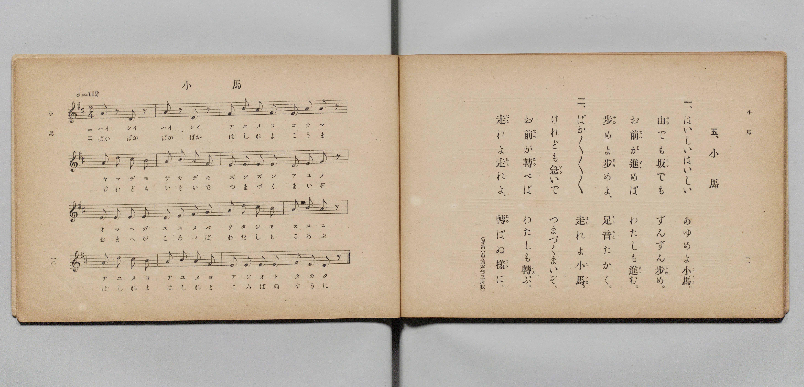

# 小馬

> Re:Shōka 使用 AI 協助辨識與重建樂譜，可能會有錯誤。歡迎回報。

- **鋼琴伴奏版**：<br><audio controls src="kouma.mp3"></audio>

- 文部省《尋常小學唱歌 第二學年用》（明治四十四年六月，4102）

## 說明

原書資訊與歌詞全文（對應 P008.jpg，原書 pp. 10–11，第二學年第 5 首）：
調性與拍號：ニ長調（D 大調）2/4 拍，♩= 112
出處註記：（尋常小學讀本卷三所載）


## 歌詞

```text
一、
はいしいはいしい　あゆめよ小馬（こうま）。
山（やま）でも坂（さか）でも　ずんずん歩（あゆ）め。
お前（まへ）が進（すゝ）めば　わたしも進（すゝ）む。
歩（あゆ）めよ歩（あゆ）めよ、　足音（あしおと）たかく。

二、
ぱか／＼／＼／＼　走（はし）れよ小馬（こうま）。
けれども急（いそ）いで　つまづくまいぞ。
お前（まへ）が轉（ころ）べば　わたしも轉（ころ）ぶ。
走（はし）れよ走（はし）れよ、　轉（ころ）ばぬ樣（やう）に。
```

## ABC

<div class="abc-score" data-abc-src="kouma.abc" aria-label="五線譜載入中"></div>

[下載 ABC 原始檔](kouma.abc)

## TMD 檔案連結

- [主旋律 TMD 檔案](kouma.tmd) [[在 TMD Studio 編輯](https://tmdlang.github.io/Tmd-TS/#tmd=s7IKdvYPcrWy4qpTUCpJTLdSSM7PyUlNLsnMz7PKyszLyo8vzshPT8wuBdHZiUpwdWX5OaW5qVbpRYkpqfFG8SaGBkYIyeL80qLkVKvi5Iz8_Jz4ktSKkqT8_Gx0-fiCxPRUqwADAwuETEFRfllqXmIeUHdBUWZeSWoKWDtCQWpZZkoqSLostSgzLTM1BclJqUXFIHdDTS8pSswrTi7KLAB5BqEqv6gE6KOixIKMSquMzOKS_KLM5MSc-OzEPCTflWSkAj2XmJeZm5iDrDUzPTPPKjc_L6kUGBxKXFpaCk839L9ctkZBS4tL0VbB0NCIy95WwYXLxkjfxA6k79m09pfNK57PaXzc0PV0Q_fTHTuAGp6u3fF0ysZna3sUnq9Z82RXD4i_c8vzKSseN3S_39PxbEbfs027n86e_bS3EUTu3PK0de2zOR3v9_SAgvn9nk4lLi59LQVbagEuBQWFp33zn83e8WJz-4sVXS862oGOe7Fy3tPWFUAPAJ30dEPvs_ZOBVBc6WUVpANdAlGvUFCgp2Bo8KhhsqEhUBDFO2vWKJgqvFw2Deje93tmgex4sWr_s4blINO7e1_MnA8Ufdzc_XLqdqA40A4XhadLloOZncDQUwCqAZr4aOZKSLCCnNi-68XMqS9W7H6xYgZQL9hZiBB9sa7h2Zw1T3u3P9nR-ayz4QXI1k4ukL4nOxoeNzSCWI8b1z9ubHncOB1MIrEbGh43Nj1uanvc1Pi4CWgsKE6B5j9unPy4se1x4z6gUY8bmsCO2LgRJNEE1AkWbVz-uKnp6dwmsOqpjxuBEQgVBBs663ET0AgQ-WztSrAakDUgNUCbICY-bux62gn0K1Bu3-PGHWD9PS8bNoFFZj5umgtV3bgBZGJT_-PG-SBXNzVhqAF6E2wiFquaOrAKAsMFaOiLbZtfzt8MlQUFSNfjxhVgdwBt6n7c2A8yFxySu3rgIbkR7Nf-93v2IJMg07ZuABsFDN7pYIt6CATp48aJIEWNK4F-etawFKwIGLxgP4EYy8EhuQQcPEtBrgExgOLz8AXgi73A-Afb1gSUAorsxAxADDXboCZi9QJWQWgAohu04XHjmmcrFsNSCjjAG1dDTac8w0KBgpY-F5d3fmluolVAZmJevkONQU01yAYFGwstOzADWzEBLnV2NLxY2KOgYQIqwJ6vb9CB521NLBqA9oAMqwFmaAMFQyBGZhkrmAF5xkCWEZAGideAVfsY1ig8bu5_3LREIV7hcdN2CAOHWNMioPgyIF4IxCvAIpuBGCQyD6QCYqIRUByc8EC6YQxcYuuBeDrQjB4g7gCLTAbiNiDeBzYRf_js6iEvfAzjFMyBAQJiIoIFAmuAAWYEFEENoCVgLz5ubgfiRWCPbwXi1Sgiu4AsUHBAaNTgQg2ciRAPN64E0k1gT7cA8VwovRwsArQRGATAvATE_WAREA8kDwlqAgmnk5yAQQ8DE2yBhRIwTaugATMDyF4D9vROCAankQnglASM46b9oIQEDyqYmgVoAdMF9eYOIO6BpYamXiANVN24Aay3H8iaD001kMCDqdlGOGCANTUNUowxkARnM6SAwcwqWEVAgQIORHDiBwcTMFU1rUcLGMxsgjXjgINhAxBDogKUWkBZaTXYtFouLl07BXBJFO1jGKuA4BiBOcpcAA)]
- [鋼琴伴奏 TMD 檔案](kouma_piano.tmd) [[在 TMD Studio 編輯](https://tmdlang.github.io/Tmd-TS/#tmd=s7IKdvYPcrWy4qpTUCpJTLdSSM7PyUlNLsnMz7PKyszLyo8vzshPT8wuBdHZiUpwdWX5OaW5qVbpRYkpqfFG8SaGBkYIyeL80qLkVKvi5Iz8_Jz4ktSKkqT8_Gx0-fiCxPRUqwADAwuETEFRfllqXmIeUHdBUWZeSWoKWDtCQWpZZkoqSDoxOTk_tyAxLzM3NQ9Jviy1qBjkeKgVJUWJecXJRZkFIB8hVOUXlQC9VZRYkFFplZFZXJJflJmcmBOfnZiH5MWSjFSgD0E2JOYga81Mz8yzys3PSyoFhokSl5aWwtMN_S-XrXm_p-Nl957nE7Y82bPl6dL-550d7_d0KmhpcSnaKhgaGnHZ2yq4cNkY6ZvYgQx7Nq39ZfOK53MaHzd0Pd3Q_XTHDqApT9fueDpl47O1PQrP16x5sqsHxN-55fmUFY8buoHGP5vR92zT7qezZz_tbQSRO7c8bV37bA7Qnh5QBACtU-Li8s4vzU20CshMzMsP8nCoMaip5lIAAhsLLTswQ19LwRYdgK3b0fBiYY-ChgnIO8_XN-gogKJGL6sgXROLBi19sGE1CqYKBgqGQIzMMlYwA_KMgSwjIA0SrwGr9jGsUXjc3P-4aYlCvMLjpu0QBg6xpkVA8WVAvBCIV4BFNgMxSGQeSAXERCOgeOPGx43dIN0wBi6x9UA8HWhGDxB3gEUmA3EbEO8Dm4g_fHb1kBc-hnEK5sAAATERwQKBNcAAMwKKoAbQErAXHze3A_EisMe3AvFqFJFdQBYoOCA0anChBs5EiIcbVwLpJrCnW4B4LpReDhYB2ggMgseNS4G4HywC4oHkIUFNIOF0khMw6GFggi2wUAKmaRU0YGYA2WvAnt4JweA0MgGckoBx3LQflJDgQQVTswAtYLqg3twBxD2w1NDUC6SBqhs3gPX2A1nzoakGEngwNdsIBwwwi9IgxRgDSXA2QwoYzKyCVQQUKOBABCd-cDABU1XTerSAwcwmWDMOOBg2ADEkKkCpBZSVVoNNq0UpiHyQCyITaEEEjPh4BeN4bVNQ5sTONI2Ph_sUnxojhDBCOZoEdpvIMB3oNV07BbDvon0MYxUQHCMwR5kLAA)]

## 分析

```text
================================================================================
📊 TMD Song Profile: [ 小馬 ]
================================================================================
⏱  Duration:       0:34 (34.3s), 32 measures total
🎼 Key & Tempo:    首調基準 D, != 112.0 BPM, <2/4>
   - 分析範圍：      由實際發聲的音符與和弦推測調性；播放脈絡另行呈現
🎤 人聲音域:    D4 (MIDI 62) – D5 (MIDI 74) [跨度: 12 個半音 / 1.0 個八度, 難度: easy]
   - 最低音:  D4 in [Kouma[L1] #1 @ m.1, 0:00]
   - 最高音: D5 in [Kouma[L1] #1 @ m.5, 0:04]
   - 適合: soprano, mezzo-soprano, contralto, tenor, baritone, bass
🏛  結構:      Kouma[L1] (17.1s) -> Kouma[L2] (17.1s)
⚡ 編曲密度:        Peak 1 軌道同時演奏
🗝  調性診斷：       A 大調（純淨自然大調，未偵測到可信轉調）
   - 風格氣質:    純淨自然大調（陽光明朗、易唱易記，無明顯調外色彩）
   - 轉調歷程:    全曲維持單一推測調性（未偵測到可信轉調）
   - 核心骨幹音:  E, A, D, F#, B
   - 調性數值:    A 大調 [相關度: 0.90, 穩定度: High, 自然音純度: 98.2%]
   - 候選調性 (K-S): A 大調 (0.90), E 大調 (0.67), D 大調 (0.64)
   - 五度圈歷程:   +3 -> +3
   - 各段落調性細節:
     • [Kouma[L1] #1]: A 大調 (r: 0.90, 自然音純度: 98.2%, 調外音: G)
     • [Kouma[L2] #1]: A 大調 (r: 0.90, 自然音純度: 98.2%, 調外音: G)

  [ 五度圈游移軌跡 ]
               C  
         F            G  
      Bb               D  
      Eb              [A ]*
         Ab           E  
            Db       B  
               F# 
     (* = active key center)

  [ 十二半音累積音高分佈 ]
     C  :                            0.0%
     C# : █████                      5.4%
     D  : ████████████              14.3%
     D# :                            0.0%
     E  : ████████████████████████  28.6%
     F  :                            0.0%
     F# : ███████████               12.5%
     G  : ██                         1.8%
     G# :                            0.0%
     A  : █████████████████████     25.0%
     A# :                            0.0%
     B  : ███████████               12.5%
--------------------------------------------------------------------------------
Assignment 軌道音域：
  - Piano         : D4 – D5 (12 個半音 / 1.0 個八度, 112 個音符)
================================================================================
```


## 原書掃描頁




