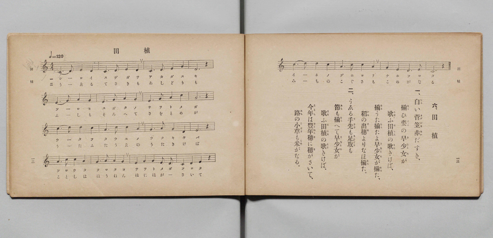

# 田うゑ

> Re:Shōka 使用 AI 協助辨識與重建樂譜，可能會有錯誤。歡迎回報。

- **鋼琴伴奏版**：<br><audio controls src="taue.mp3"></audio>

- 文部省
- 文部省《尋常小學唱歌 第二學年用》（明治四十四年六月，4102）

## 說明

原書資訊與歌詞全文（對應 P045.jpg，書頁 p. 30，第三學期第 3 首）：
調性與拍號：ハ調四拍子（C 大調 4/4 拍），「カルク ハヤメニ（♩＝120）」


## 歌詞

```text
一
しろいすげがさ　あかだすき
そろひすがたの　さをとめが
うたふ田うゑの　うたきけば
そろたそろたよ　さをとめが
そろたいねの　でほよりも

二
うゑるてさきも　あしどりも
ふしもそろへて　さをとめが
うたふ田うゑの　うたきけば
ことしはほうねん　ほにほがさいて
みちのこぐさも　こめがなる
```

## ABC

<div class="abc-score" data-abc-src="taue.abc" aria-label="五線譜載入中"></div>

[下載 ABC 原始檔](taue.abc)

## TMD 檔案連結

- [主旋律 TMD 檔案](taue.tmd) [[在 TMD Studio 編輯](https://tmdlang.github.io/Tmd-TS/#tmd=s7IKdvYPcrWy4qpTUCpJTLdSSM7PyUlNLsnMz7PKyszLyo8vzshPT8wuBdHZiUpwdWX5OaW5qVbpRYkpqfFG8SaGBkYIyeL80qLkVKvi5Iz8_Jz4ktSKkqT8_GyEfEFRfllqXmIeUE1BUWZeSWoKWBFCQWpZZkoqSDo1JbMkvygzMQfJ5tSiYpDzIJbElxQl5hUnF2UWgNyMUFWSkQp0Xnl-EZK1QIPSM_OscvPzkkqB3lHi0tJSeD5lw-PGtsdNExW0tLgUbRUMjQy47G0VnLlsTPRN7EBan01rf9m84vmcRrBBcN7jhq6nG7qf7tjxdEP_07U7nk7Z-Gxtj8LzNWue7OoB8XdueT5lxeOG7vd7Op7N6Hu2affT2bOf9jaCyJ1bnraufTan4_2eHlC4vd_TqcTFpa-lYEstwKWgoPC0b_6z2TtebG5_saLrRUc70HEvVs572roC6AGgk55u6H3W3qkQYGBiqpdVkA50CVDxywWNCgV6CsYGQC7IIzs6gR55Nmc-kK1grPBy2TSgS9_vmQUy_cWq_c8aloPM7e59MXM-UPRxcz9QEOg9oMjTtROAdjgrPF2yHCimAAxJBaAoWHfP44aex02rHzevfty0XgGo6XHzksfNCx83gwLq0cyV7_fMBUYBUOnjhl4ukE1PdjSAqMeN0x839T5ubHncOPNx46THjT2PG6c-bmh43Nj0uLH7ceMCsHgvROlcsNJNYCGguvmPG9eBlU593ATUueJxUyNQHKK0DSy9FZ4MYEoh4kBTgCIbkE0FisIYTR24TIUrBTp3LczI5Y8bd4P0NHU9bmqC-G0X3BVAm5uA3lgGMg5obVMTzG_THzeuhGoBK90KDgmgBMSOHSA9lPttMkgryK71IEeCVKx93DQZrBrIXQ0mwSEO8tEyiJ79jxsXgowEaZ4AdgDE0ZMhbnjcuAroJZBSyhM0FCho6XNxhSSWploFZCbm5TvUGNRUgyxQsLHQsgMzahQMFXSB0AiYYEGkLlQExMIuYgoWAfFg0AAkAjbNx7AGlPCg4sDwBpGNLWAdwMQF5k0Ckz1gcipUpgnM6waTC8AkSC1IBmQCDMYj7DECybXB7ZkIJkH6QeLL4GZD9APDGcUekPuAiQQs0wWRAavAtKcG7GOQn83gPoeFAXYRwziwEIiLK3jmogXPJpTggQTMfDC5DioD9koTJOBWgNmNUBmQalzBsxVmD8TD8EAA2Q-zeweYBAUYOfYAEwbIu8C0EQdCcN_DAwJMgHiQEIEFGSRRQYIWexjBoxYaEiC_gMQhPJAsNNLhYQQWg8pD_AaSB8lswBNGtLcHEhrgoEALDRAbMxGBsDEwhFAzHaE0BHIPQhwkCnVjUwdUBlvcguIVPUWAdKGH0mRoGK2AZ571UFN3Q2XagHgt2BSQWpgMsCAEkxA2KA3BXQIuFCApj7j0hC0EYQUUiAUryLCnJ5BtEJeCXQmPzeVQ0d3QkEItEIAlMpL754LDCJY6cKWo_XCbFqLYBAvDCfC4gOVHkAwkp8HyGchekBtABRqqPbVcXLp2CqASXQFIK3MBAA)]
- [鋼琴伴奏 TMD 檔案](taue_piano.tmd) [[在 TMD Studio 編輯](https://tmdlang.github.io/Tmd-TS/#tmd=s7IKdvYPcrWy4tLSUng-ZcPjxrbHTRPf7-l42b3n-YQtT_Zsebq0_3lnx_s9nQpaWlyKtgqGRgZc9rYKzlw2Jvomdlx1CkrPprW_bF7xfE6jEoj3on3X88bFz6bOfNG06dmc5qeta16s6n3c0PVs2oan62Y9bZ30fPXSp1M2Plvb87ih--mG7qc7djxfPvH5mjVPdvU8Xbvj6c4tz6esADrAyMDIQM_AwEzPwMLEHMgwMAK6QYmLKySxNNUqIDMxLz_Iw6HGoKaaSwEIbCy07MCMGgVDBV0gNFIwBpO6UBEQC7uIKVgExINBA5AI2DQfwxqFx43ToeKPm3pBZGMLWMfjxplg3iQw2QMmp0JlmsC8bjC5AEyC1IJkQCbAYDzCHiOQXBvcnolgEqQfJL4MbjZE_-MmkPkIe0Due9y4EizTBZEBq8C0pwbsY5CfzeA-h4UBdhHDOLAQiIsreOaiBc8mlOCBBMx8MLkOKgP2ShMk4FaA2Y1QGZBqXMGzFWYPxMPwQADZD7N7B5gEBRg59gATBsi7wLQRB0Jw38MDAkyAeJAQgQUZJFFBghZ7GMGjFhoSIL-AxCE8kCw00uFhBBaDykP8BpIHyWzAE0a0twcSGuCgQAsNEBszEYGwMTCEUDMdoTQEcg9CHCQKdWNTB1QGW9yC4hU9RYB0oYfSZGgYrYBnnvVQU3dDZdqAeC3YFJBamMzjxtVgEsIGpSG4S8CFAiTlEZeesIUgrIACsWAFGfb0BLIN4lKwK-GxuRwquhsaUqgFwuPGVUjunwsOI1jqwJWi9sNtWohiEywMJ8DjApYfQTKQnAbLZyB7QW4AFWio9tQiF-g-yAW6CaJAj1eINowFU6bxsVABEAu7CFApMDTjoSJgwgARHxAFJjB1ePgmSHwQxjDEFKYJqhpFE5ABpEDOwGEINk1YXILiR7CvSHYKWB4lqJAcA4wAXTsFUBxE-wCF4GwjMFuZCwA)]

## 分析

```text
================================================================================
📊 TMD Song Profile: [ 田うゑ ]
================================================================================
⏱  Duration:       0:40 (40.0s), 20 measures total
🎼 Key & Tempo:    首調基準 C, != 120.0 BPM, <4/4>
   - 分析範圍：      由實際發聲的音符與和弦推測調性；播放脈絡另行呈現
🎤 人聲音域:    C4 (MIDI 60) – D5 (MIDI 74) [跨度: 14 個半音 / 1.2 個八度, 難度: moderate]
   - 最低音:  C4 in [Taue #1 @ m.1, 0:00]
   - 最高音: D5 in [Taue #1 @ m.9, 0:16]
   - 適合: soprano, mezzo-soprano, contralto, tenor, baritone, bass
🏛  結構:      Taue (40.0s)
⚡ 編曲密度:        Peak 1 軌道同時演奏
🗝  調性診斷：       C 大調（純淨自然大調，未偵測到可信轉調）
   - 風格氣質:    純淨自然大調（陽光明朗、易唱易記，無明顯調外色彩）
   - 轉調歷程:    全曲維持單一推測調性（未偵測到可信轉調）
   - 核心骨幹音:  C, G, D, E, A
   - 調性數值:    C 大調 [相關度: 0.83, 穩定度: Moderate, 自然音純度: 100.0%]
   - 候選調性 (K-S): C 大調 (0.83), G 大調 (0.74), A 小調 (0.66)
   - 五度圈歷程:   +0
   - 各段落調性細節:
     • [Taue #1]: C 大調 (r: 0.83, 自然音純度: 100.0%)

  [ 五度圈游移軌跡 ]
              [C ]*
         F            G  
      Bb               D  
      Eb               A  
         Ab           E  
            Db       B  
               F# 
     (* = active key center)

  [ 十二半音累積音高分佈 ]
     C  : ████████████████████████  24.7%
     C# :                            0.0%
     D  : ███████████████████       19.3%
     D# :                            0.0%
     E  : ██████████████████        18.0%
     F  :                            0.0%
     F# :                            0.0%
     G  : █████████████████████     21.3%
     G# :                            0.0%
     A  : ████████████████          16.7%
     A# :                            0.0%
     B  :                            0.0%
--------------------------------------------------------------------------------
Assignment 軌道音域：
  - Piano         : C4 – D5 (14 個半音 / 1.2 個八度, 68 個音符)
================================================================================
```


## 原書掃描頁




