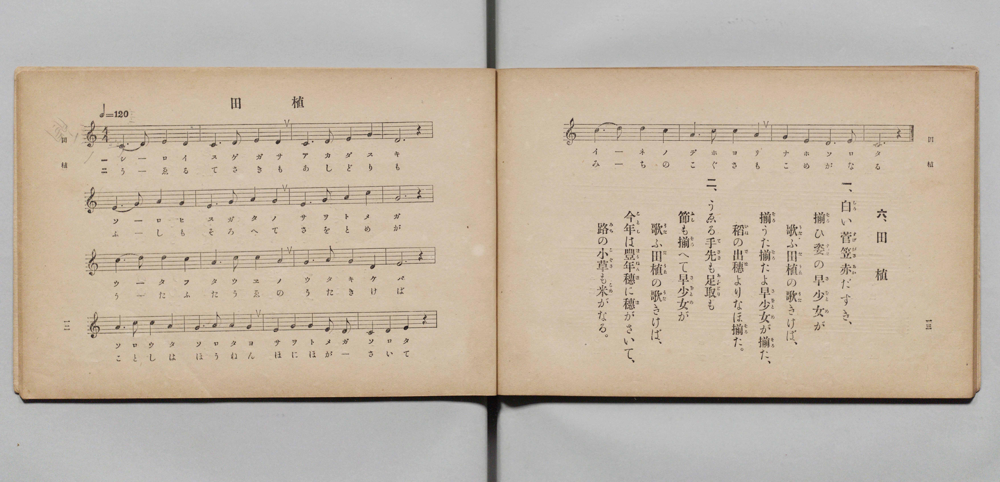

# 田うゑ

> Re:Shōka 使用 AI 協助辨識與重建樂譜，可能會有錯誤。歡迎回報。

- **鋼琴伴奏版**：<br><audio controls src="taue.mp3"></audio>
- **NEUTRINO 歌聲合成版**：<br><audio controls src="taue_neutrino.mp3"></audio>

- 文部省
- 文部省《尋常小學唱歌 第二學年用》（明治四十四年六月，4102）

## 說明

原書資訊與歌詞全文（對應 P045.jpg，書頁 p. 30，第三學期第 3 首）：
調性與拍號：ハ調四拍子（C 大調 4/4 拍），「カルク ハヤメニ（♩＝120）」


## 歌詞

```text
一
しろいすげがさ　あかだすき
そろひすがたの　さをとめが
うたふ田うゑの　うたきけば
そろたそろたよ　さをとめが
そろたいねの　でほよりも

二
うゑるてさきも　あしどりも
ふしもそろへて　さをとめが
うたふ田うゑの　うたきけば
ことしはほうねん　ほにほがさいて
みちのこぐさも　こめがなる
```

## ABC

<div class="abc-score" data-abc-src="taue.abc" aria-label="五線譜載入中"></div>

[下載 ABC 原始檔](taue.abc)

## TMD 檔案連結

- [主旋律 TMD 檔案](taue.tmd) [[在 TMD Studio 編輯](https://tmdlang.github.io/Tmd-TS/#tmd=s7IKdvYPcrWy4qpTUCpJTLdSSM7PyUlNLsnMz7PKyszLyo8vzshPT8wuBdHZiUpwdWX5OaW5qVbpRYkpqfFG8SaGBkYIyeL80qLkVKvi5Iz8_Jz4ktSKkqT8_GyEfEFRfllqXmIeUE1BUWZeSWoKWBFCQWpZZkoqSDo1JbMkvygzMQfJ5tSiYpDzIJbElxQl5hUnF2UWgNyMUFWSkQp0Xnl-EZK1QIPSM_OscvPzkkqB3kGWKAH6siixIKPSKiOzGGRjcmJOfHZiHpKPofYVJKanWgUYGFgqcWlpKTyfsuFxY9vjpokKWlpcirYKhkYGXPa2Cs5cNib6JnYgvc-mtb9sXvF8TiPYJDjvcUPX0w3dT3fseLqh_-naHU-nbHy2tkfh-Zo1T3b1gPg7tzyfsuJxQ_f7PR3PZvQ927T76ezZT3sbQeTOLU9b1z6b0_F-Tw8o2N_v6VTi4tLXUrClFuBSUFB42jf_2ewdLza3v1jR9aKjHei4FyvnPW1dAfQA0ElPN_Q-a-9UCDAwMdXLKkgHugSo-OWCRoUCPQVjAyAX5JEdnUCPPJszH8hWMFZ4uWwa0KXv98wCmf5i1f5nDctB5nb3vpg5Hyj6uLkfKAj0HlDk6doJQDucFZ4uWQ4UUwCGpAJQFKy753FDz-Om1Y-bVz9uWq8A1PS4ecnj5oWPm0EB9Wjmyvd75gKjAKj0cUMvF8imJzsaQNTjxumPm3ofN7Y8bpz5uHHS48aex41THzc0PG5setzY_bhxAVi8F6J0LljpJrAQUN38x43rwEqnPm4C6lzxuKkRKA5R2gaW3gpPBjClEHGgKUCRDcimAkVhjKYOXKbClQKduxZm5PLHjbtBepq6Hjc1Qfy2C-4KoM1NQG8sAxkHtLapCea36Y8bV0K1gJVuBYcEUAJixw6QHsr9NhmkFWTXepAjQSrWPm6aDFYN5K4Gk-AQB_loGUTP_seNC0FGgjRPADsA4ujJEDc8blwF9BJIKeUJGgoUtPS5uEISS4H5NzMxL9-hxqCmGmSBgo2Flh2YUaNgqKALhEbABAsidaEiIBZ2EVOwCIgHgwYgEbBpPoY1oIQHFQeGN4hsbAHrACYuMG8SmOwBk1OhMk1gXjeYXAAmQWpBMiATYDAeYY8RSK4Nbs9EMAnSDxJfBjcboh8Yzij2gNwHTCRgmS6IDFgFpj01YB-D_GwG9zksDLCLGMaBhUBcXMEzFy14NqEEDyRg5oPJdVAZsFeaIAG3AsxuhMqAVOMKnq0weyAehgcCyH6Y3TvAJCjAyLEHmDBA3gWmjTgQgvseHhBgAsSDhAgsyCCJChK02MMIHrXQkAD5BSQO4YFkoZEODyOwGFQe4jeQPEhmA54wor09kNAABwVaaIDYmIkIhI2BIYSa6QilIZB7EOIgUagbmzqgMtjiFhSv6CkCpAs9lCZDw2gFPPOsh5q6GyrTBsRrwaaA1MJkgAUhmISwQWkI7hJwoQBJecSlJ2whCCugQCxYQYY9PYFsg7gU7Ep4bC6Hiu6GhhRqgQAskZHcPxccRrDUgStF7YfbtBDFJlgYToDHBSw_gmQgOQ2Wz0D2gtwAKtBQ7anl4tK1UwCV6ApAWpkLAA)]
- [鋼琴伴奏 TMD 檔案](taue_piano.tmd) [[在 TMD Studio 編輯](https://tmdlang.github.io/Tmd-TS/#tmd=s7IKdvYPcrWy4qpTUCpJTLdSyC8qychPL0osyKi0ysgsLskvykxOzInPTsxLVIIrKs4vLUpOjS9ITE-1CjAwsFTi0tJSeD5lw-PGtsdNE9_v6XjZvef5hC1P9mx5urT_eWfH-z2dClpaXIq2CoZGBlz2tgrOXDYm-iZ2IAOfTWt_2bzi-ZxGsPEv2nc9b1z8bOrMF02bns1pftq65sWq3scNXc-mbXi6btbT1knPVy99OmXjs7U9jxu6n27ofrpjx_PlE5-vWfNkV8_TtTue7tzyfMoKoAOMDIwM9AwMzPQMLEzMgQwDI6AblLi4QhJLgU7OTMzLD_JwqDGoqeZSAAIbCy07MKNGwVBBFwiNFIzBpC5UBMTCLmIKFgHxYNAAJAI2zcewRuFx43So-OOmXhDZ2ALW8bhxJpg3CUz2gMmpUJkmMK8bTC4AkyC1IBmQCTAYj7DHCCTXBrdnIpgE6QeJL4ObDdH_uAlkPsIekPseN64Ey3RBZMAqMO2pAfsY5GczuM9hYYBdxDAOLATi4gqeuWjBswkleCABMx9MroPKgL3SBAm4FWB2I1QGpBpX8GyF2QPxMDwQQPbD7N4BJkEBRo49wIQB8i4wbcSBENz38IAAEyAeJERgQQZJVJCgxR5G8KiFhgTILyBxCA8kC410eBiBxaDyEL-B5EEyG_CEEe3tgYQGOCjQQgPExkxEIGwMDCHUTEcoDYHcgxAHiULd2NQBlcEWt6B4RU8RIF3ooTQZGkYr4JlnPdTU3VCZNiBeCzYFpBYm87hxNZiEsEFpCO4ScKEASXnEpSdsIQgroEAsWEGGPT2BbIO4FOxKeGwuh4ruhoYUaoHwuHEVkvvngsMIljpwpaj9cJsWotgEC8MJ8LiA5UeQDCSnwfIZyF6QG0AFGqo9tcgFug9ygW6CKNDjFaINY8GUaXwsVADEwi4CVAoMzXioCJgwQMQHRIEJTB0evgkSH4QxDDGFaYKqRtEEZAApkDNwGIJNExaXoPgR7CuSnQKWRwkqJMcAI0DXTgEUB9E-QCE42wjMVuYCAA)]

## 分析

```text
================================================================================
📊 TMD Song Profile: [ 田うゑ ]
================================================================================
⏱  Duration:       0:40 (40.0s), 20 measures total
🎼 Key & Tempo:    首調基準 C, != 120.0 BPM, <4/4>
   - 分析範圍：      由實際發聲的音符與和弦推測調性；播放脈絡另行呈現
🎤 人聲音域:    C4 (MIDI 60) – D5 (MIDI 74) [跨度: 14 個半音 / 1.2 個八度, 難度: moderate]
   - 最低音:  C4 in [Taue #1 @ m.1, 0:00]
   - 最高音: D5 in [Taue #1 @ m.9, 0:16]
   - 適合: soprano, mezzo-soprano, contralto, tenor, baritone, bass
🏛  結構:      Taue (40.0s)
⚡ 編曲密度:        Peak 1 軌道同時演奏
🗝  調性診斷：       C 大調（純淨自然大調，未偵測到可信轉調）
   - 風格氣質:    純淨自然大調（陽光明朗、易唱易記，無明顯調外色彩）
   - 轉調歷程:    全曲維持單一推測調性（未偵測到可信轉調）
   - 核心骨幹音:  C, G, D, E, A
   - 調性數值:    C 大調 [相關度: 0.83, 穩定度: Moderate, 自然音純度: 100.0%]
   - 候選調性 (K-S): C 大調 (0.83), G 大調 (0.74), A 小調 (0.66)
   - 五度圈歷程:   +0
   - 各段落調性細節:
     • [Taue #1]: C 大調 (r: 0.83, 自然音純度: 100.0%)

  [ 五度圈游移軌跡 ]
              [C ]*
         F            G  
      Bb               D  
      Eb               A  
         Ab           E  
            Db       B  
               F# 
     (* = active key center)

  [ 十二半音累積音高分佈 ]
     C  : ████████████████████████  24.7%
     C# :                            0.0%
     D  : ███████████████████       19.3%
     D# :                            0.0%
     E  : ██████████████████        18.0%
     F  :                            0.0%
     F# :                            0.0%
     G  : █████████████████████     21.3%
     G# :                            0.0%
     A  : ████████████████          16.7%
     A# :                            0.0%
     B  :                            0.0%
--------------------------------------------------------------------------------
Assignment 軌道音域：
  - Piano         : C4 – D5 (14 個半音 / 1.2 個八度, 68 個音符)
================================================================================
```


## 原書掃描頁




