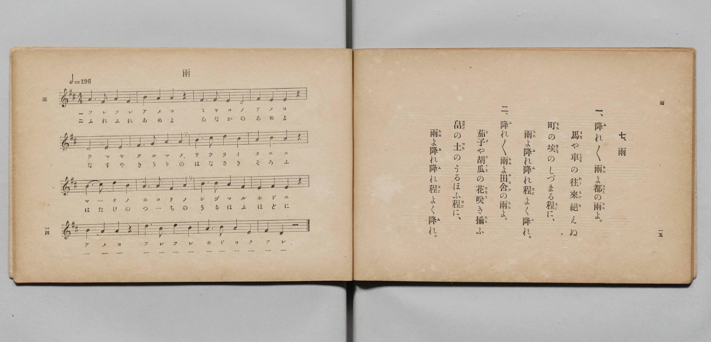

# 雨

> Re:Shōka 使用 AI 協助辨識與重建樂譜，可能會有錯誤。歡迎回報。

- **鋼琴伴奏版**：<br><audio controls src="ame.mp3"></audio>

- 文部省《尋常小學唱歌 第二學年用》（明治四十四年六月，4102）

## 說明

原書資訊與歌詞全文（對應 P010.jpg，原書 pp. 14–15，第二學年第 7 首）：
調性與拍號：ニ長調（D 大調）4/4 拍，♩= 126


## 歌詞

```text
一、
降（ふ）れ／＼雨（あめ）よ都（みやこ）の雨（あめ）よ。
馬（うま）や車（くるま）の往來絕（わうらいた）えぬ
町（まち）の埃（ほこり）のしづまる程（ほど）に、
雨（あめ）よ降（ふ）れ降（ふ）れ程（ほど）よく降（ふ）れ。

二、
降（ふ）れ／＼雨（あめ）よ田舍（ゐなか）の雨（あめ）よ。
茄子（なす）や胡瓜（きうり）の花咲（はなさ）き揃（そろ）ふ
畠（はたけ）の土（つち）のうるほふ程（ほど）に、
雨（あめ）よ降（ふ）れ降（ふ）れ程（ほど）よく降（ふ）れ。
```

## ABC

<div class="abc-score" data-abc-src="ame.abc" aria-label="五線譜載入中"></div>

[下載 ABC 原始檔](ame.abc)

## TMD 檔案連結

- [主旋律 TMD 檔案](ame.tmd) [[在 TMD Studio 編輯](https://tmdlang.github.io/Tmd-TS/#tmd=s7IKdvYPcrWy4qpTUCpJTLdSSM7PyUlNLsnMz7PKyszLyo8vzshPT8wuBdHZiUpwdWX5OaW5qVbpRYkpqfFG8SaGBkYIyeL80qLkVKvi5Iz8_Jz4ktSKkqT8_Gx0-fiCxPRUqwADQwOETEFRfllqXmIeUHdBUWZeSWoKWDtCQWpZZkoqSLostSgzLTM1BclJqUXFIHdDTS8pSswrTi7KLAB5BqEqv6gE6KOixIKMSquMzOKS_KLM5MSc-OzEPCTflWSkAj1XnpoIZBQh681Mz8yzys3PSyoFhocSl5aWwsvZKxS0tLgUbRUMjcy47G0VXLhsTPRN7ECank1rf9m84vmcxscNXU83dD_dsePphv6na3c8nbLx2doehedr1jzZ1QPi79zyfMqKxw3d7_d0PJvR92zT7qezZz_tbQSRO7c8bV37bE7H-z09oEB-v6dTiYtLX0vBllqAS0FB4Wnf_Gezd7zY3P5iRdeLjnag416snPe0dQXQA0AnPd3Q-6y9UwEUU3pZBelAl0DUKxQU6CkYmjxqmGxoChRE8c6aNQrmCi-XTQO69_2eWSA7Xqza_6xhOcj07t4XM-cDRR83d7-cuh0oDrTDReHpkuVgZicw9BSAaoAmPpq5EhKsIP1PdjQ8bmgEsV7OBEp2PG7cClT8uKnn_Z7-93v2AOMBLNj0uKkRLN7xsnkvWGT_46aWx42TQYKN6zCVPW5oAhn6uKHh5bI1YLm2x437wHItL3Z3gUX6Hzd1QwUb1z3d1_BkX9vzrVNBUk39IPVNQHGgHUBPARlA9WugJgLR8ym7wEbse9y4EKp_fjNYZDfQUY-bgBaABB83Tn_cuBSkrKn7-QpQQgArWAmWXQ31OMREkEsxPYsaJmhcdBOBvm7sR1MDCgdwOO8CMkkJ5-dTNrzoAKtsmvC4cdXjRqBdhIL6RU_L07UTwNJADTOhod288PnkOWDBXnCoQsPmRdfGp5M2gcXXg9UDQx4o3vusHxKQcx83Aa0HimxFCvapC2Aa5j9unAgN-TnAGAIKLoHHBdgaYNQCA2brwAU70A7K8zEUKGjpc3E5AkuvgMzEvHyHGoOaapD5CjYWWnZgBrayA1wU7Wh4sbBHQcNEAVhIPV_foAPP8JpYNABtARlWo2CqoAuExmDaGIhrFMyAJIgHwgZgEZA4SNYISBrCRUA8EAarAZvmY1ij8Lh5Klj14-Y1UDaIBdLzuGkRmLcQTK4AkvEQ8eb5UB1LgGo2g1l9-HRA7DICyjduhehs6oGyQSywzsYmMK8RTHYg7GqaANHRuAqIu8Gsdfh0gLMU7jDf1UNOmIPCEARhIQgLYRN4uENiQRdYBhvGASkQBxJVsMhBC_SmZVAjHzfPgwYlxLvroaKr4TLQoG2GygB1Pm5eCWbB9OwH80DB_bgZFJzogb4KZlfjTLDKFmgA9kJF24BiXShBC7ULHOjgJAFWC5KZCzYBxINEIDGBvqOTnEDHEaCg4ASFPnKomyHlBlD8wFI7ekoHBSgkeMGpBh60s6FBuxnIBgUWIj1vh6pvhUfHaiQ9j5s7wSQoXaIHOiwI5wPxRJTABUUbRA6cT-DibVBXdAPZu-EBDJKB8MCR3giyn4hABzZlyA101LIEHPygIMaIB0ioI_IDKJeA9KAndVylCM5yBxYfwNCF6IBkC5geiDqQKehhjqMMwVPqgEIWErYQHcD6AkkPRB3CplouLl07BWBhH-1jGKsAYxqBmcpcAA)]
- [鋼琴伴奏 TMD 檔案](ame_piano.tmd) [[在 TMD Studio 編輯](https://tmdlang.github.io/Tmd-TS/#tmd=s7IKdvYPcrWy4qpTUCpJTLdSSM7PyUlNLsnMz7PKyszLyo8vzshPT8wuBdHZiUpwdWX5OaW5qVbpRYkpqfFG8SaGBkYIyeL80qLkVKvi5Iz8_Jz4ktSKkqT8_Gx0-fiCxPRUqwADQwOETEFRfllqXmIeUHdBUWZeSWoKWDtCQWpZZkoqSDoxOTk_tyAxLzM3NQ9Jviy1qBjkeKgVJUWJecXJRZkFIB8hVOUXlQC9VZRYkFFplZFZXJJflJmcmBOfnZiH5MWSjFSgD8tTE4GMImS9memZeVa5-XlJpcBAUeLS0lJ4OXvF-z0dL7v3PJ-w5cmeLU-X9j_v7Hi_p1NBS4tL0VbB0MiMy95WwYXLxkTfxA5k0rNp7S-bVzyf0_i4oevphu6nO3Y83dD_dO2Op1M2Plvbo_B8zZonu3pA_J1bnk9Z8bihG2j8sxl9zzbtfjp79tPeRhC5c8vT1rXP5gDt6QEFP9A6JS4uR6CTAzIT8_KDPBxqDGqquRSAwMZCyw7M0NdSsEUHYMt2NLxY2KOgYaIAdMbz9Q06CqBo0csqSNfEokFLH2xYjYKpgi4QGoNpYyCuUTADkiAeCBuARUDiIFkjIGkIFwHxQBisBmyaj2GNwuPmqWDVj5vXQNkgFkjP46ZFYN5CMLkCSMZDxJvnQ3UsAarZDGb14dMBscsIKN-4FaKzqQfKBrHAOhubwLxGMNmBsKtpAkRH4yog7gaz1uHTwYU_zHf1kBPmoDAEQVgIwkLYBB7ukFjQVTBXMIwDUiAOJKpgkYMW6E3LoEY-bp4HDUqId9dDRVfDZaBB2wyVAep83LwSzILp2Q_mgYL7cTMoONEDfRXMrsaZYJUt0ADshYq2AcW6UIIWahc40MFJAqwWJDMXbAKIB4lAYgJ9Ryc5gY4jQEHBCQp95FA3Q8oNoPiBpXb0lA4KUEjwglMNPGhnQ4N2M5ANCixEet4OVd8Kj47VSHoeN3eCSVC6RA90WBDOB-KJKIELijaIHDifwMXboK7oBrJ3wwMYJAPhgSO9EWQ_EYEOLKzIDXTUsgQc_KAgxogHSKgj8gMol4D0oCd1XKUIznIHFh_A0IXogGQLmB6IOpAp6GGOowzBU-qAQhYSthAdjxv7kfRA1CFsqkUq632Qy3oTaFkPDK54BdN4KFmjYAJmApEBXMo0HiwADEQgA8oHyqJoh0phMQ1IA0kgAstBjEfoxlCAqhmi3BhmOVgGTTvCtRAOhIRZBnUamAtWBtILDBRdOwVguET7GMYqwJhGYKYyFwA)]

## 分析

```text
================================================================================
📊 TMD Song Profile: [ 雨 ]
================================================================================
⏱  Duration:       1:00 (61.0s), 32 measures total
🎼 Key & Tempo:    首調基準 D, != 126.0 BPM, <4/4>
   - 分析範圍：      由實際發聲的音符與和弦推測調性；播放脈絡另行呈現
🎤 人聲音域:    D4 (MIDI 62) – D5 (MIDI 74) [跨度: 12 個半音 / 1.0 個八度, 難度: easy]
   - 最低音:  D4 in [Ame[L1] #1 @ m.3, 0:05]
   - 最高音: D5 in [Ame[L1] #1 @ m.7, 0:12]
   - 適合: soprano, mezzo-soprano, contralto, tenor, baritone, bass
🏛  結構:      Ame[L1] (30.5s) -> Ame[L2] (30.5s)
⚡ 編曲密度:        Peak 1 軌道同時演奏
🗝  調性診斷：       A 大調（純淨自然大調，未偵測到可信轉調）
   - 風格氣質:    純淨自然大調（陽光明朗、易唱易記，無明顯調外色彩）
   - 轉調歷程:    全曲維持單一推測調性（未偵測到可信轉調）
   - 核心骨幹音:  A, B, F#, D, E
   - 調性數值:    A 大調 [相關度: 0.80, 穩定度: Moderate, 自然音純度: 99.1%]
   - 候選調性 (K-S): A 大調 (0.80), D 大調 (0.73), F# 小調 (0.65)
   - 五度圈歷程:   +3 -> +3
   - 各段落調性細節:
     • [Ame[L1] #1]: A 大調 (r: 0.80, 自然音純度: 99.1%, 調外音: G)
     • [Ame[L2] #1]: A 大調 (r: 0.80, 自然音純度: 99.1%, 調外音: G)

  [ 五度圈游移軌跡 ]
               C  
         F            G  
      Bb               D  
      Eb              [A ]*
         Ab           E  
            Db       B  
               F# 
     (* = active key center)

  [ 十二半音累積音高分佈 ]
     C  :                            0.0%
     C# : █                          1.8%
     D  : ████████████              14.9%
     D# :                            0.0%
     E  : ███████████               14.0%
     F  :                            0.0%
     F# : ██████████████            17.5%
     G  : █                          0.9%
     G# :                            0.0%
     A  : ████████████████████████  29.8%
     A# :                            0.0%
     B  : █████████████████         21.1%
--------------------------------------------------------------------------------
Assignment 軌道音域：
  - Piano         : D4 – D5 (12 個半音 / 1.0 個八度, 112 個音符)
================================================================================
```


## 原書掃描頁




