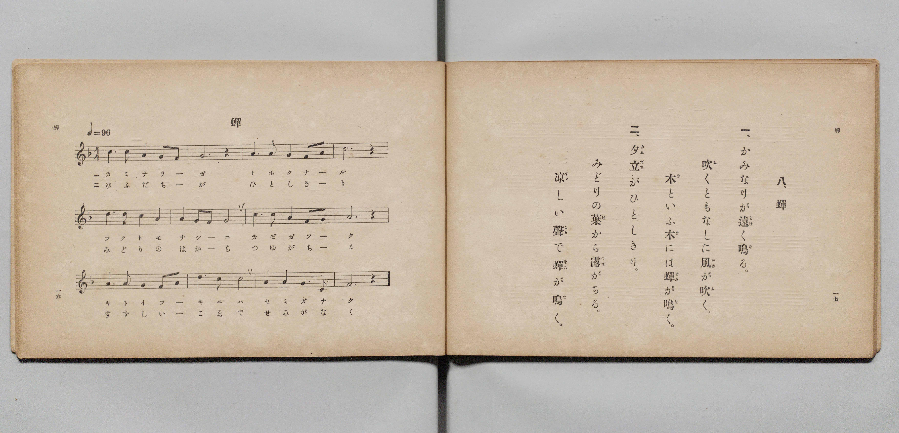

# 蟬

> Re:Shōka 使用 AI 協助辨識與重建樂譜，可能會有錯誤。歡迎回報。

- **鋼琴伴奏版**：<br><audio controls src="semi.mp3"></audio>

- 文部省《尋常小學唱歌 第二學年用》（明治四十四年六月，4102）

## 說明

原書資訊與歌詞全文（對應 P011.jpg，原書 pp. 16–17，第二學年第 8 首）：
調性與拍號：ヘ長調（F 大調）4/4 拍，♩= 96


## 歌詞

```text
一、
かみなりが遠（とほ）く鳴（な）る。
吹（ふ）くともなしに風（かぜ）が吹（ふ）く。
木（き）といふ木（き）には蟬（せみ）が鳴（な）く。

二、
夕立（ゆふだち）がひとしきり。
みどりの葉（は）から露（つゆ）がちる。
涼（すゞ）しい聲（こゑ）で蟬（せみ）が鳴（な）く。
```

## ABC

<div class="abc-score" data-abc-src="semi.abc" aria-label="五線譜載入中"></div>

[下載 ABC 原始檔](semi.abc)

## TMD 檔案連結

- [主旋律 TMD 檔案](semi.tmd) [[在 TMD Studio 編輯](https://tmdlang.github.io/Tmd-TS/#tmd=s7IKdvYPcrWy4qpTUCpJTLdSSM7PyUlNLsnMz7PKyszLyo8vzshPT8wuBdHZiUpwdWX5OaW5qVbpRYkpqfFG8SaGBkYIyeL80qLkVKvi5Iz8_Jz4ktSKkqT8_Gx0-fiCxPRUqwADQ0OETEFRfllqXmIeUHdBUWZeSWoKWDtCQWpZZkoqSLostSgzLTM1BclJqUXFIHdDTS8pSswrTi7KLAB5BqEqv6gE6KOixIKMSquMzOKS_KLM5MSc-OzEPCTflWSkAj2XmJeZm5iDrDUzPTPPKjc_L6kUGBxKXFpaCi_mr1HQ0uJStFWwNOOyt1Vw47Ix0TexA-l5Nq39ZfOK53MaHzd0Pd3Q_XTHjqcb-p-u3fF0ysZna3sUnq9Z82RXD4i_c8vzKSseN3S_39PxbEbfs027n86e_bS3EUTu3PK0de2zOR3v9_SAgvj9nk4lLi59LQVbagEuBQWFp33zn83e8WJz-4sVXS862oGOe7Fy3tPWFUAPAJ30dEPvs_ZOBVA86WUVpANdAlGvUFCgp2Bo9qhhsqE5UBDFO2vWKFgovFw2Deje93tmgex4sWr_s4blINO7e1_MnA8Ufdw84-XU7UBxoB1uCk-XLAczO4GhpwBUAzTx0cyV4FAFaX-yo-FxQyOI9bix-3Hj_seNqx43dT1u7HnZuACo_3HjiseNu4G6Hzf2v9y8BSyyCsRt6n7c0ATW1tDwdMJOsMRWiDqQnqYmkEGN0x83rn65aAVYFmj6HLCCHnT1cIOA6NkciGqgO4FyQMtbgOpQBVc_blwPTB1gkdlAJ0MMRXEdxFCw_3b1QP33dMnU56tBSeFxUxvQzMeNCx43LoTofdy4CWwX0Lm9IN8jHAQKkJXgAFn3YiIwyIEWrAfr6X7c1PlyziawyBKgiTCDFqKEDMhD2_aAFc183DQPrAhoScuLRojOyY-bJoIFlxPlIaChlCdMKFDQ0ufiCk7NzbQKyEzMy3eoMaipBlmgYGOhZQdmYMsN4My1o-HFwh4FDRMFYLZ7vr5BB56ENbFoAFoDMqxGwVhBFwiNFYyApKGCWTxQyBAsBIEGQFwDltQFkiAZI6DiGgVTdDVg43wMaxQeN60Giz5ung_EXWDWKrApj5vWIOmKh4g1d0BVzwbKrwezQHpAMhBzkFRD7DACmdQG0dW4FYgXgFkLIboaezDtaNwEVb0CiKeDWb1QF4HsQrUDfyDv6iEnkM3A5puBQw0U4JAQBYUnJPhBIpAQNQWLgMRhoY41jJunQnwEDDFICD5uXgQNNXCIN20Hi3XDTYfHStMeaDxAzADJgEIdRzg37oeG3EpoWAFzHDRMwXHVCLIBmOcQ9jQugdrTBo0LeMw0wVxDbFjv6CQnrCGpF5yUQZQRPPhN4YkWkupBGBLE2FM9UopeC_ETMKQfN4H8hwg7mEw3EPcjhfZusOh8cEhAUj0oZgiF9kxoaM-Cp9MWaKhOhobqRCB7OVJozwarAsUSLOUDiyawDMw1CHtqubh07RRAhUu0j2GsApxtBGYrcwEA)]
- [鋼琴伴奏 TMD 檔案](semi_piano.tmd) [[在 TMD Studio 編輯](https://tmdlang.github.io/Tmd-TS/#tmd=s7IKdvYPcrWy4qpTUCpJTLdSSM7PyUlNLsnMz7PKyszLyo8vzshPT8wuBdHZiUpwdWX5OaW5qVbpRYkpqfFG8SaGBkYIyeL80qLkVKvi5Iz8_Jz4ktSKkqT8_Gx0-fiCxPRUqwADQ0OETEFRfllqXmIeUHdBUWZeSWoKWDtCQWpZZkoqSDoxOTk_tyAxLzM3NQ9Jviy1qBjkeKgVJUWJecXJRZkFIB8hVOUXlQC9VZRYkFFplZFZXJJflJmcmBOfnZiH5MWSjFSgD0E2JOYga81Mz8yzys3PSyoFhokSl5aWwov5a97v6XjZvef5hC1P9mx5urT_eWfH-z2dClpaXIq2CpZmXPa2Cm5cNib6JnYgg55Na3_ZvOL5nMbHDV1PN3Q_3bHj6Yb-p2t3PJ2y8dnaHoXna9Y82dUD4u_c8nzKiscN3UDTn83oe7Zp99PZs5_2NoLInVuetq59NgdoTQ8o8IG2KXFxBafmZloFZCbm5Qd5ONQY1FRzKQCBjYWWHZihr6Vgiw7Atu1oeLGwR0HDRAHojufrG3QUQLGil1WQrolFg5Y-2LAaBWMFXSA0VjACkoYKZvFAIUOwEAQaAHENWFIXSIJkjICKaxRM0dWAjfMxrFF43LQaLPq4eT4Qd4FZq8CmPG5ag6QrHiLW3AFVPRsovx7MAukByUDMQVINscMIZFIbRFfjViBeAGYthOhq7MG0o3ETVPUKIJ4OZvVCXQSyC9UO_IG8q4ecQDYDm28GDjVQgENCFBSekOAHiUBC1BQsAhKHhTrWMG6eCvERMMQgIfi4eRE01MAh3rQdLNYNNx0eK017oPEAMQMkAwp1HOHcuB8aciuhYfW4cR00TMFx1Qiy4XFTJ8KexiVQe9qgcQGPmSaYa4gN6x2d5IQ1JPWCkzKIMoIHvyk80UJSPQhDghh7qkdK0WshfgKG9OMmkP8QYQeT6QbifqTQ3g0WnQ8OCUiqB8UModCeCQ3tWfB02gIN1cnQUJ0IZC9HCu3ZYFWgWIKl_MeNq8AyMNcg7KlFLlt8kMsWE2jZAgyFeAXTeG1DIBGvYBSvbQoOGagYkDYAJVS4FEwCXQnULJN4YMhCBKHKCGjFUAViIcyDqTADihrHa4NjDdMOwj4ABYSunQIoLKJ9DGMV4GwjMFuZCwA)]

## 分析

```text
================================================================================
📊 TMD Song Profile: [ 蟬 ]
================================================================================
⏱  Duration:       1:00 (60.0s), 24 measures total
🎼 Key & Tempo:    首調基準 F, != 96.0 BPM, <4/4>
   - 分析範圍：      由實際發聲的音符與和弦推測調性；播放脈絡另行呈現
🎤 人聲音域:    D4 (MIDI 62) – D5 (MIDI 74) [跨度: 12 個半音 / 1.0 個八度, 難度: easy]
   - 最低音:  D4 in [Semi[L1] #1 @ m.1, 0:02]
   - 最高音: D5 in [Semi[L1] #1 @ m.5, 0:10]
   - 適合: soprano, mezzo-soprano, contralto, tenor, baritone, bass
🏛  結構:      Semi[L1] (30.0s) -> Semi[L2] (30.0s)
⚡ 編曲密度:        Peak 1 軌道同時演奏
🗝  調性診斷：       F 大調（純淨自然大調，未偵測到可信轉調）
   - 風格氣質:    純淨自然大調（陽光明朗、易唱易記，無明顯調外色彩）
   - 轉調歷程:    全曲維持單一推測調性（未偵測到可信轉調）
   - 核心骨幹音:  F, G, A, C, D
   - 調性數值:    F 大調 [相關度: 0.81, 穩定度: Moderate, 自然音純度: 100.0%]
   - 候選調性 (K-S): F 大調 (0.81), C 大調 (0.73), D 小調 (0.60)
   - 五度圈歷程:   -1 -> -1
   - 各段落調性細節:
     • [Semi[L1] #1]: F 大調 (r: 0.81, 自然音純度: 100.0%)
     • [Semi[L2] #1]: F 大調 (r: 0.81, 自然音純度: 100.0%)

  [ 五度圈游移軌跡 ]
               C  
        [F ]*          G  
      Bb               D  
      Eb               A  
         Ab           E  
            Db       B  
               F# 
     (* = active key center)

  [ 十二半音累積音高分佈 ]
     C  : ███████████████████       19.3%
     C# :                            0.0%
     D  : ████████████              12.5%
     D# :                            0.0%
     E  :                            0.0%
     F  : ████████████████████████  25.0%
     F# :                            0.0%
     G  : ██████████████████████    22.7%
     G# :                            0.0%
     A  : ████████████████████      20.5%
     A# :                            0.0%
     B  :                            0.0%
--------------------------------------------------------------------------------
Assignment 軌道音域：
  - Piano         : D4 – D5 (12 個半音 / 1.0 個八度, 78 個音符)
================================================================================
```


## 原書掃描頁




