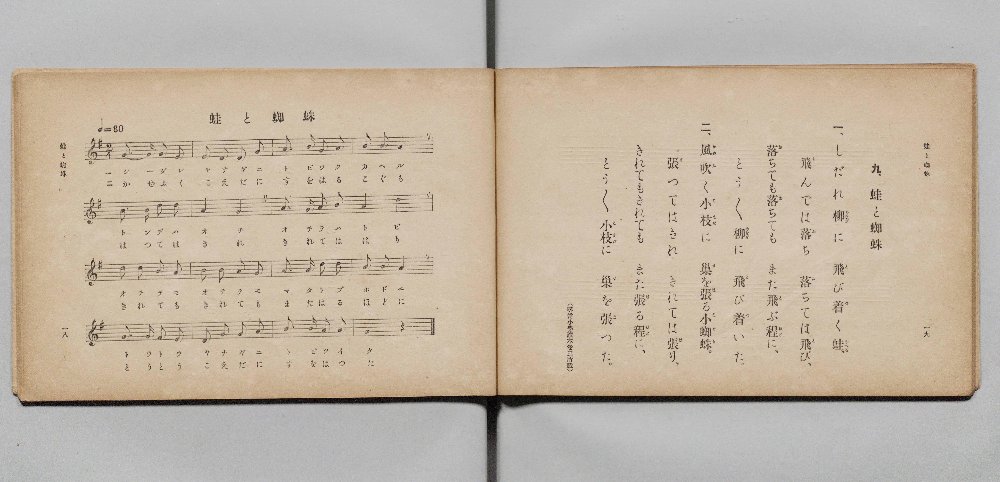

# 蛙と蜘蛛

> Re:Shōka 使用 AI 協助辨識與重建樂譜，可能會有錯誤。歡迎回報。

- **鋼琴伴奏版**：<br><audio controls src="kaeru_to_kumo.mp3"></audio>

- 文部省《尋常小學唱歌 第二學年用》（明治四十四年六月，4102）

## 說明

原書資訊與歌詞全文（對應 P012.jpg，原書 pp. 18–19，第二學年第 9 首）：
調性與拍號：ト長調（G 大調）2/4 拍，♩= 80
出處註記：（尋常小學讀本卷三所載）


## 歌詞

```text
一、
しだれ柳（やなぎ）に　飛（と）び着（つ）く蛙（かへる）、
飛（と）んでは落（お）ち　落（お）ちては飛（と）び、
落（お）ちても落（お）ちても　また飛（と）ぶ程（ほど）に、
とう／＼柳（やなぎ）に　飛（と）び着（つ）いた。

二、
風吹（かぜふ）く小枝（こえだ）に　巢（す）を張（は）る小蜘蛛（こぐも）、
張（は）つてはきれ　きれては張（は）り、
きれてもきれても　また張（は）る程（ほど）に、
とう／＼小枝（こえだ）に　巢（す）を張（は）つた。
```

## ABC

<div class="abc-score" data-abc-src="kaeru_to_kumo.abc" aria-label="五線譜載入中"></div>

[下載 ABC 原始檔](kaeru_to_kumo.abc)

## TMD 檔案連結

- [主旋律 TMD 檔案](kaeru_to_kumo.tmd) [[在 TMD Studio 編輯](https://tmdlang.github.io/Tmd-TS/#tmd=s7IKdvYPcrWy4qpTUCpJTLdSSM7PyUlNLsnMz7PKyszLyo8vzshPT8wuBdHZiUpwdWX5OaW5qVbpRYkpqfFG8SaGBkYIyeL80qLkVKvi5Iz8_Jz4ktSKkqT8_Gx0-fiCxPRUqwADQySdBUX5Zal5iXlA3QVFmXklqSlg7QgFqWWZKakg6bLUosy0zNQUJCelFhWD3A01vaQoMa84uSizAOQZhKr8ohKgj4oSCzIqrTIyi0vyizKTE3PisxPzkHxXkpEK9FxiXmZuYg6y1sz0zDyr3Py8pFJgcChxaWkpvJg983HjihdzZryYPVtBS4tL0VbBwoDL3lbBncvGSN_EDqT52bT2l80rns9pfNzQ9XRD99MdO55u6H-6dsfTKRufre1ReL5mzZNdPSD-zi3Pp6x43ND9fk_Hsxl9zzbtfjp79tPeRhC5c8vT1rXP5nS839MDCuv3ezqVuLj0tRRsqQW4FBQUnvbNfzZ7x4vN7S9WdL3oaAc67sXKeU9bVwA9AHTS0w29z9o7FUARppdVkA50CUS9QkGBnoKhxaOGyYaWQEEU76xZo2Cp8HLZNKB73--ZBbLjxar9zxqWg0zv7n0xcz5Q9HFzx8up24HiQDvcFZ4uWQ5mdgJDTwGoBmjio5krwaEKcmH7rhczp75YsfvFihlArWBXIQL0xbqGZ3PWPO3d_mRH57POhhcgSzu5QPqe7Gh43NAIYj1unP64ccHjpp5n8zcDtT9uanncuOpxYx9Q5ePG1Y8bGl4ung0Sb1wBFtn8fG4DmLsEzO0HxjeY2_24ccfjJmBMdcLMRdPZNPlx4_LHjetfTNgLFuwC618IVIYu0rgMqAzNVqihWJQ2NWEVBJr7uHHf48b5qAZte74ClJoeN-5-3LgS5kWYe4GKHje2vd_T_37PHrJCA6h4_uOGJkgI7-qBmvxy0YqnE3bCQmnO48atkKADxtGzeXPB4sCwAZIL4LY83b4ILA4MW2DITXq6B6gFyF0P5nYDNUIyGEzvBKCHUUIeRUPjEkiQPm7sBUYz2J9gBlgQ1egueKKAqQCGJDIbFqpoLiI2VMn0MsgH4IAFmkh5zoYCBS19Li7vxNSi0pB879LcfKuAzMS8fIcag5pqkD0KNoZmWnZgFrZiBVxK7Wh4sbBHQcNEAeiv5-sbdOBlgSYWDUDrQIbVKBgq6AKhIZg2iwcSNQqmIApMgAVAMjUKRmB1xmAaIQLDIFgDNtHHsEbhcdN2qNjj5gYwuQas43HzEjCvC0Q2rQOzu6EyHVD1k4G4BSy_HiLTtBosPgNMgthIdhkB5RtBJgDlGucA8VYwqx-is3EymAcyGRi3YBKkHyQzE6KnaRKQDbIHmGpQ9EwAizXBbcMf8rt6yAl5Y2iImoJCGymMIeELthcqYgimQeoRakA60EIdHoabgbgdzIKGRNMqeHw0ws2GiYLEHje3IauHmgSJD8wQB4UYKJSWAPEyMAsaV429MH1NPQh7oKIgMXT1EJNAcqA0QUxY7-gkJ6xhYQwKQ1AIQkIfxkNO4UZI8YGsBj2Fg8IOEpqwsFuEFKpYZZrnQf26HxrCj5unQWVmg3mdYBKSnlFDHBSCkDCFhiA4beKX2QeNpfkYaXw3WHwlmETkKLzhDmzlUFK6gAsScJFSgyhUYIUHIisgRGBZwAAz6GHJvGkZLBiBLNKLF5BaUHTth9oAchV6sK-ABmEblA1ikVy0ALMJRGY-hk21XFy6dgpIxX60j2GsArqQEVhImQsA)]
- [鋼琴伴奏 TMD 檔案](kaeru_to_kumo_piano.tmd) [[在 TMD Studio 編輯](https://tmdlang.github.io/Tmd-TS/#tmd=s7IKdvYPcrWy4qpTUCpJTLdSSM7PyUlNLsnMz7PKyszLyo8vzshPT8wuBdHZiUpwdWX5OaW5qVbpRYkpqfFG8SaGBkYIyeL80qLkVKvi5Iz8_Jz4ktSKkqT8_Gx0-fiCxPRUqwADQySdBUX5Zal5iXlA3QVFmXklqSlg7QgFqWWZKakg6cTk5PzcgsS8zNzUPCT5stSiYpDjoVaUFCXmFScXZRaAfIRQlV9UAvRWUWJBRqVVRmZxSX5RZnJiTnx2Yh6SF0syUoE-BNmQmIOsNTM9M88qNz8vqRQYJkpcWloKL2bPfNy44sWcGS9mz36_p-Nl957nE7Y82bPl6dL-550d7_d0KmhpcSnaKlgYcNnbKrhz2Rjpm9iBTHw2rf1l84rncxofN3Q93dD9dMeOpxv6n67d8XTKxmdrexSer1nzZFcPiL9zy_MpKx43dANNfzaj79mm3U9nz37a2wgid2552rr22RygNT2gWADapsTF5Z2YWlQaku9dmptvFZCZmJcf5OFQY1BTzaUABDaGZlp2YJa-loItOgDbuqPhxcIeBQ0TBaB7nq9v0FEARZNeVkG6JhYNWvpgw2oUDBV0gdAQTJvFA4kaBVMQBSbAAiCZGgUjsDpjMI0QgWEQrAGb6GNYo_C4aTtU7HFzA5hcA9bxuHkJmNcFIpvWgdndUJkOqPrJQNwCll8PkWlaDRafASZBbCS7jIDyjSATgHKNc4B4K5jVD9HZOBnMA5n8uHEBmATpB8nMhOhpmgRkg-x53AR1B1TPBLBYE9w2_CG_q4eckDeGhqgpKLSRwhgSvmB7oSKGYBqkHqEGpAMt1OFhuBmI28EsaEg0rYLHRyPcbJgoSOxxcxuyeqhJkPjADHFQiIFCaQkQLwOzoHHV2AvT19SDsAcqChJDVw8xCSQHShPEhPWOTnLCGhbGoDAEhSAk9GE85BRuhBQfyGrQUzgo7CChCQu7RUihilWmeR7Ur_uhIfy4eRpUZjaY1wkmIekZNcRBIQgJU2gIgtMmfpl90Fiaj5HGd4PFV4JJRI7CG-7AUouS0gVckICLlBpEoQIrPBBZASECywIGmEEPS-ZNy2DBCGSRXryA1IKiaz_UBpCr0IN9BTQI26BsEIvkogWYTSAy8zFsqsVS6vsgl_om0EIfGCDxCsbx2sAgRGGaxscrGGGyMfWAJA3jtY2xaTLApgGHJUBhEBe7BiwuAQmDzAf6VNdOAcmz0T6GsQroQkZgIWUuAA)]

## 分析

```text
================================================================================
📊 TMD Song Profile: [ 蛙と蜘蛛 ]
================================================================================
⏱  Duration:       0:48 (48.0s), 32 measures total
🎼 Key & Tempo:    首調基準 G, != 80.0 BPM, <2/4>
   - 分析範圍：      由實際發聲的音符與和弦推測調性；播放脈絡另行呈現
🎤 人聲音域:    D4 (MIDI 62) – D5 (MIDI 74) [跨度: 12 個半音 / 1.0 個八度, 難度: easy]
   - 最低音:  D4 in [KaeruToKumo[L1] #1 @ m.2, 0:01]
   - 最高音: D5 in [KaeruToKumo[L1] #1 @ m.5, 0:06]
   - 適合: soprano, mezzo-soprano, contralto, tenor, baritone, bass
🏛  結構:      KaeruToKumo[L1] (24.0s) -> KaeruToKumo[L2] (24.0s)
⚡ 編曲密度:        Peak 1 軌道同時演奏
🗝  調性診斷：       D 大調（純淨自然大調，未偵測到可信轉調）
   - 風格氣質:    純淨自然大調（陽光明朗、易唱易記，無明顯調外色彩）
   - 轉調歷程:    全曲維持單一推測調性（未偵測到可信轉調）
   - 核心骨幹音:  A, G, D, B, E
   - 調性數值:    D 大調 [相關度: 0.73, 穩定度: Moderate, 自然音純度: 100.0%]
   - 候選調性 (K-S): D 大調 (0.73), G 大調 (0.61), A 大調 (0.57)
   - 五度圈歷程:   +2 -> +2
   - 各段落調性細節:
     • [KaeruToKumo[L1] #1]: D 大調 (r: 0.73, 自然音純度: 100.0%)
     • [KaeruToKumo[L2] #1]: D 大調 (r: 0.73, 自然音純度: 100.0%)

  [ 五度圈游移軌跡 ]
               C  
         F            G  
      Bb              [D ]*
      Eb               A  
         Ab           E  
            Db       B  
               F# 
     (* = active key center)

  [ 十二半音累積音高分佈 ]
     C  :                            0.0%
     C# :                            0.0%
     D  : ███████████               17.7%
     D# :                            0.0%
     E  : ████                       6.5%
     F  :                            0.0%
     F# :                            0.0%
     G  : ██████████████            21.8%
     G# :                            0.0%
     A  : ████████████████████████  37.1%
     A# :                            0.0%
     B  : ███████████               16.9%
--------------------------------------------------------------------------------
Assignment 軌道音域：
  - Piano         : D4 – D5 (12 個半音 / 1.0 個八度, 110 個音符)
================================================================================
```


## 原書掃描頁




